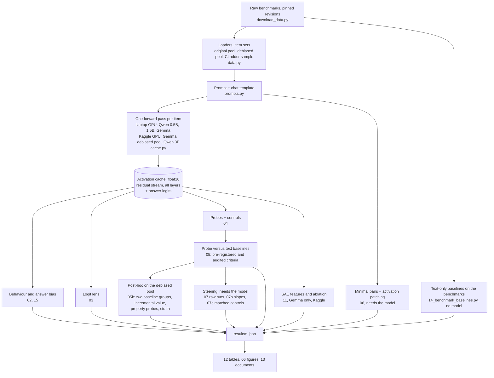
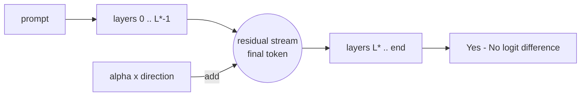
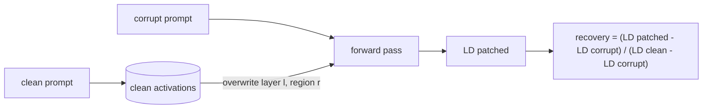
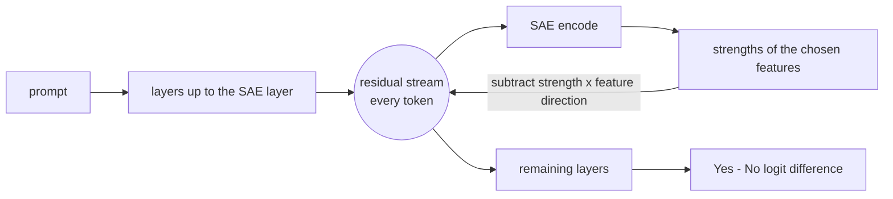

# EXPLAINER

Written for a smart first-year student who has not met these methods before. Read "Start here", then dip into the primer whenever a word is unfamiliar.

Contents: [Start here](#start-here) · [Pipeline](#pipeline) · [Concept primer](#concept-primer) · [Decision log](#decision-log) · [How to read each figure](#how-to-read-each-figure) · [Questions a professor would ask](#questions-a-professor-would-ask)

---

## Start here

<!-- START-HERE: updated as results arrive -->
**The question.** Small language models are bad at formal causal reasoning puzzles such as "given these correlations, must A cause B?". When such a model answers wrongly, is the right answer nevertheless sitting inside it, readable from its internal numbers? If it is, does the model actually use that information?

**What was done.** Four small open chat models (Qwen2.5 0.5B, 1.5B and 3B, and Gemma-2 2B) were run on two benchmarks, Corr2Cause and CLadder, and their internal activations were saved. A simple classifier (a "probe") was then trained to read the correct answer out of those activations. The two smaller Qwen models ran on an 8 GB laptop; Gemma's interventions and everything for the 3B model ran on free Kaggle GPUs with the same code.

**If you want the results first:** `RESULTS.md` is one page with the three claims that stand, the list of what was retracted, and the limitations. What follows here is how we got there.

**The story, in the order it happened.**

1. *The models cannot do the task.* All four answer at or near chance. Two say "No" to almost everything; the others say "Yes" more often and are wrong more often. Checked three ways (accuracy, a bias-free ranking score, and accuracy after re-thresholding), the answers carry at most a faint signal, and that signal disappears on the fair item set of step 6.
2. *First apparent result: the answer is in there.* Probes read the correct answer from the activations with 81 to 87% accuracy on Corr2Cause and 56 to 63% on CLadder, on questions about premises the probe had never seen. The usual sanity checks passed. By the criterion written down before the experiment, one cell (Qwen 1.5B on Corr2Cause, as first run) showed "represents the answer but doesn't say it". I logged that as a positive result.
3. *The first audit.* A fresh reviewer, given the code and the numbers but not my conclusions, found the hole: on Corr2Cause, the *wording of the question alone*, without the premise and without any model, predicts the answer 86% of the time. The benchmark names variables so that causes come earlier in the alphabet, so "D directly causes C" is never true. A probe that merely recognises which question is being asked scores as if it knew the answer.
4. *Retraction.* Against text-only baselines that exploit this (and a similar one for CLadder, where the quoted numbers plus the wording of the question predict 80% and more), the probes lose in every model and both benchmarks. The positive result was withdrawn. The stronger baselines were added after seeing results, and the write-up says so.
5. *Making the benchmark finding solid.* The same baselines were run on the official splits with one reproducible script, the literature was searched twice to separate what is already known from what is not, and a neutral note was written (`report/benchmark_text_baselines.md`). The CLadder part is largely published already; for the Corr2Cause part no earlier report was found.
6. *A fair test.* A new set of Corr2Cause items was built in which neither the question alone nor the premise alone says anything about the answer, in any training or test fold. Only the *combination* can. On it the smallest model's probe at the answer position does no better than simple controls. The other three models' probes score 75 to 77%, and they are remarkably alike. A third audit asked the right question: 75% compared with what? My list of "shallow controls" was at 50% by construction and proved nothing. Against controls that can use the combination but do not connect the premise to the variables in the question, the probes are clearly better (about 76% against 66%). Against a text lookup of "what does the premise say about these two variables" they are level. Against a hand-written parser they are five points behind. They add two to three points to that parser, at most one point to a stack of that parser with n-grams at fixed settings, and nothing demonstrable once that stack is tuned. So each of these models carries about as much as that lookup would give (equal accuracy; that the content is the same is not shown): for example, whether the two variables are directly linked in the premise ("adjacent") can be read from the activations almost perfectly, and not from an untrained copy of the network.
7. *Steering the "correct answer" direction.* My first claim ("pushing along the probe's direction does nothing, pushing along the model's own answer direction flips it") did not survive the second audit: I had shown one sign of the push only, compared with three random directions, and pushed a hundred times harder than anything natural. Redone properly, at the answer position and at the end of the question, the push along the probe's direction moves the answer by an amount within the range of pushes along directions fitted to shuffled labels. That neither shows nor rules out that the model uses the information. A later experiment (step 10) suggests why a natural-size push along a probe's weights does so little: the distance between the classes along it is very short.
8. *Where is the answer formed?* Swapping activations between two prompts that differ in one variable shows the difference travelling from the changed word to the final position at about 60% of the network's depth, in three models. The audit pointed out that this is where a *change in the prompt* arrives, not where a *causal judgement* is made, because the models do not prefer the correct prompt of a pair.
9. *Sparse-autoencoder features (Gemma).* The public dictionaries reconstruct most of each activation but little of what differs between questions. The features most associated with a type of causal graph are not specific to it, and removing them shifts the answer a little more than removing random features in four of five cases, for most graph types as much on other graphs' items. No "causal structure" feature was found, and with dictionaries this poor none can be ruled out.
10. *Is adjacency, a thing the models demonstrably read, actually used?* The answers of every model depend on whether the two queried variables are adjacent, with a sign that differs between question types. So I intervened on the internal encoding of adjacency. This went wrong twice before it went right. An independent review of the code, before it ran at scale, found that my first version could not answer the question (its "removal" left the information readable, among other faults), and it was rewritten. Then I summarised the second version's first results as "erasing adjacency at the end of the question removes about a sixth of the dependence, where control erasures remove nothing", and a fifth audit showed that sentence was wrong too: the control could not have failed, the summary number counted one effect moving the wrong way as a success, and the erasure was only half complete on new items. What the corrected analysis supports for the smallest model: at the answer position, from about 60% of the network's depth, the answer is a linear function of the activation, and the part of it that goes with adjacency for one question type ("X and Y have a common effect") can be moved and removed there, beyond every control; four layers earlier it cannot. That tells us where that part of the answer is. It does not show an "adjacency" variable being read: moving a question of one type by the adjacency difference taken from another type has the effect of the type the vector came from. At the end of the question the same intervention does no more than a random push of the same size.
11. *Two larger models, and one result that beat its controls (14 November).* The same experiments on Qwen 1.5B and 3B came back overnight. The adjacency test repeated: at the answer position the shift moves the answer (in the 3B model beyond every control) and acts alike on every kind of question, which again locates the answer; at the end of the question, nothing. But in the steering experiment two "correct answer" directions out of twelve comparisons on the fair item set moved the answer more than all 20 of their shuffled-label controls. An eighth audit, given only code and numbers, took the stronger one apart: it is real as computed and consistent across every item; it is also one first place among twelve comparisons where about half a first place is expected by chance; it is not first anywhere else; and the direction turns out to be mostly the adjacency contrast again, not validity. Verdict: undecided. More controls of the same kind would not decide it. A different run might, and it is prepared with its test written down in advance. Even that needed a second attempt: a reviewer showed that my first design (fit the direction on the other half of the data and call p ≤ 0.05 a replication) would have "replicated" more often than not with nothing real behind it, because the direction fitted on the other half is nearly the same vector. The amended test asks for more: beyond all of 500 controls that share every balance the real labels have. `RESULTS.md` was left as it was until that is settled.

**The one-sentence version (so far).** What first looked like a hidden correct answer was the probe reading the wording of the question; with that route closed, models from 1.5 to 3 billion parameters turn out to carry about as much as a lookup of what the premise says about the two queried variables, they answer at chance all the same, and in the three Qwen models tested no intervention shows that what a probe reads is what the answer is computed from (two steering comparisons out of twelve stand out, are not repeated elsewhere, and are undecided). The general lesson, learned five times in two days: a number means nothing until it is compared with the right alternative (what the text gives away; what a label-free direction of the same size does; whether the thing you removed is actually gone, on data you did not fit on), and the comparison is only as good as the strongest alternative someone bothered to build.
<!-- /START-HERE -->

---

## Pipeline

Independent audits sit between each tier's results and its write-up (`notes/audit_*_raw.md`).

The expensive step (D) runs once per model. Steps F–I never touch the model again.

---

## Concept primer

In dependency order. Each entry: what it is, a tiny example, where it lives in the code.

### Token, prompt, chat template
A model reads text as a sequence of **tokens** (word pieces, each an integer id). An instruct model was trained on conversations wrapped in special marker tokens; the **chat template** is the recipe that wraps your message in those markers. Skip it and the model sees text unlike anything it was trained to answer. *Example:* for Qwen, the user text `Is 2+2=4?` becomes `<|im_start|>user\nIs 2+2=4?<|im_end|>\n<|im_start|>assistant\n`; the model's answer is whatever it predicts next. *Code:* `prompts.render`, `prompts.encode_with_positions`.

### Logit and answer-token scoring
For the next token the model outputs one number per vocabulary entry, a **logit**; larger means more likely. We score a yes/no question by comparing the logits of "Yes"-like tokens against "No"-like tokens right after the prompt. Because "Yes", " yes" and "YES" are different tokens, we pool the variants (log-sum-exp) and take the **answer logit difference** = pooled Yes minus pooled No; positive means the model says Yes. *Example:* logits Yes=11.2, No=12.0 → difference −0.8 → the model answers No. *Code:* `models.answer_token_ids`, `models.answer_logit_diff`.

### Residual stream
A transformer keeps, for every token position, a running vector (896 numbers in Qwen-0.5B, 2304 in Gemma-2B). Each layer reads this vector and *adds* its contribution back. That running sum is the **residual stream**; it is the model's working memory at that position. *Example:* after layer 10 at the last prompt token, the residual stream is the embedding plus everything layers 0–10 added. *Code:* `cache.ResidCollector` (captures it), cache layout in `cache.py` docstring.

### Activation cache
Running a model is slow; analysing saved numbers is fast. We run each prompt once and save the residual stream at every layer for three positions: the **final** prompt token (where the answer is produced), the **end of the hypothesis/question**, and the **end of the premise**. *Example:* one Gemma item is 27 layers × 3 positions × 2304 numbers × 2 bytes ≈ 373 KB. *Code:* `cache.build_cache`, `cache.load_cache`.

### Logit lens
Normally only the last layer's residual stream is turned into logits. The **logit lens** applies that same final step (normalise, then multiply by the unembedding matrix) to an *earlier* layer, asking "if the model had to answer right now, what would it say?". It shows when the answer takes shape. *Example:* if the Yes−No difference is ≈0 up to layer 15 and then swings to −3, the decision is written into the stream after layer 15. *Code:* `lens.lens_logit_diff`, `scripts/03_logit_lens.py`.

### Linear probe
A **probe** is a small classifier trained to predict some property from an activation vector. A *linear* probe (logistic regression) can only draw a flat boundary, so if it succeeds the property is "linearly decodable": readable by one weighted sum. *Example:* take the layer-12 vectors of 2,400 puzzles, fit logistic regression to predict the correct answer, test on puzzles it has not seen. *Code:* `probes.fit_predict`, `probes.oof_scores`, `scripts/04_probes.py`.

### Held-out evaluation, cross-validation and grouped folds
A probe must be tested on data it was not trained on. In k-fold **cross-validation** the data is cut in k parts; each part is tested by a probe trained on the others. Items here come in families (88 hypotheses share a Corr2Cause premise; many questions share a CLadder story), and family members look alike, so a whole family must sit on one side: **grouped** folds. *Example:* all 8 pooled questions about premise #17 are either all training or all test. *Code:* `data.grouped_folds`.

### Baselines and controls for probes
A high probe score can have boring causes. Controls rule them out one at a time. **Shuffled labels:** train on scrambled labels; should fall to 50%, otherwise the pipeline leaks. **Text baseline (TF-IDF):** word counts of the prompt, same classifier; if it matches the probe, the model did no work. **Type prior:** predict from the question type alone. **Random-init model:** same architecture with untrained weights; whatever a probe reads there is in the input, not learned. *Code:* `probes.shuffled_labels`, `probes.tfidf_oof`, `probes.query_only_oof`, `models.load_model(random_init=True)`.

### Control task and selectivity (Hewitt & Liang, 2019)
A probe with enough capacity can memorise. A **control task** gives each input *type* a fixed random label (here: each hypothesis string, or each graph × query-type pair). Nothing about causality predicts these labels; only memorising type→label does. **Selectivity** = accuracy on the real task minus accuracy on the control task. High selectivity means the probe is reading structure rather than memorising. *Example:* real 80%, control 55% → selectivity 25 points. *Code:* `probes.control_task_labels`.

### Confidence interval and the (cluster) bootstrap
An accuracy from 1,000 items is an estimate; a **95% confidence interval** is a range that would cover the true value in about 95% of repetitions of the study. The **bootstrap** builds it by resampling the items with replacement many times and looking at the spread of the recomputed statistic. Because items sharing a premise or story are not independent, we resample whole premises/stories (**cluster** bootstrap), which gives honestly wider intervals. *Example:* accuracy 0.56 [0.48, 0.63]: we cannot rule out chance (0.50). *Code:* `stats.bootstrap_ci`.

### Accuracy, macro-F1 and AUROC
**Accuracy** is the share answered correctly; with 85% "No" labels, always saying "No" scores 85%, so accuracy alone misleads. **F1** for a class balances precision and recall; **macro-F1** averages F1 over both classes, so ignoring the rare class is punished. **AUROC** asks whether a score ranks positives above negatives (0.5 = no better than chance, 1 = perfect), independent of any threshold. *Code:* `stats.macro_f1`, `stats.auroc`, `stats.baselines`.

### Answer bias versus chance
A model can score 50% for two different reasons: its answers carry no information, or they carry information but lean heavily towards one answer. To tell them apart we report three things. The **Yes-rate** (how often it says Yes). The **AUROC of the answer score**, which only asks whether true-Yes items get higher scores than true-No items and so ignores any constant lean. And the **accuracy at the best threshold**: move the cut-off between Yes and No to wherever helps most, choosing it on one half of the data and scoring on the other. *Example:* a model that says "No" to everything has accuracy equal to the share of No labels, yet if its Yes-score is a bit higher on true-Yes items its AUROC is above 0.5: biased, not empty. *Code:* `scripts/15_answer_bias.py`.

### Partial-input baselines (hypothesis-only, premise-only)
Each benchmark item has parts: a premise and a hypothesis. A **partial-input baseline** is a classifier that is shown only one part. If it beats chance, the label leaks through that part alone, and anything that can read that part (including a probe on a model's activations) can score well without solving the task. The idea comes from natural language inference, where "hypothesis-only" classifiers exposed annotation artefacts (Poliak et al., 2018; Gururangan et al., 2018). *Example:* in Corr2Cause, "D directly causes C." is never valid whatever the premise says, because variables are named in causal order; a classifier that has only memorised each hypothesis string's track record reaches 86% on a balanced pool. *Code:* `probes.hyp_prior_oof`, `scripts/14_benchmark_baselines.py`.

### Target encoding, and how leave-one-out leaks the label
**Target encoding** turns a category (here: the hypothesis string) into a number: the average label of the training items in that category. It must never include the item's own label. A tempting shortcut is **leave-one-out**: average over all *other* items in the category. That leaks. If a category has 4 valid and 4 invalid items, a valid item sees 3/7 = 0.43 and an invalid item sees 4/7 = 0.57, so the feature is *lower exactly when the label is 1*. A flexible model learns "slightly below average means valid", scores brilliantly in training and collapses on new data. The fix is **out-of-fold** encoding: compute each item's feature from other folds only, with whole premises held out together. *Example:* my first parsed-feature baseline used leave-one-out and collapsed on held-out data for exactly this reason; a test now guards against it. The same mechanism later made a hypothesis-only classifier score *below* chance on the first debiased pool. *Code:* `probes._oof_prior`, `tests/test_baselines.py`.

### Debiasing an evaluation set
If a shortcut exists, one fix is to build an item set where the shortcut carries no information. Here: every premise contributes one valid and one invalid hypothesis, every hypothesis string is used equally often as valid and as invalid, and the set is cut into blocks that each satisfy both rules, so that every cross-validation fold does too. Then any classifier looking at the hypothesis alone or the premise alone gets exactly 50%, and only the *combination*, the actual task, can help. *Example:* in the debiased pool "A directly causes D." appears 25 times as valid and 25 times as invalid, five and five in each fold. *Caveat:* balancing only the whole pool is not enough; see the previous entry and decision D21. *Code:* `data.c2c_debiased_pool`, `data.grouped_folds`, `tests/test_data.py`.

### Confound controls versus reference baselines
Baselines for a probe come in two kinds, and it matters which one you are comparing with. A **confound control** asks "could the probe be scoring for a boring reason?": word statistics, the architecture without training (random-init probe), a leak (shuffled labels). A probe has to beat these before its score means anything. A **reference baseline** is a deliberate attempt to do the task, or part of it, from the text: a yardstick for how much the probe's score amounts to. *Example:* on the debiased pool the 1.5B model's probe scores 0.75. Against controls that connect nothing in the premise to the variables in the question (at most 0.66) that is a real signal. Against a text lookup of the statements about those two variables (0.76) it is the same; against a hand-written parser (0.82) it is less.

**Two traps, both of which I fell into.** (1) *A control can be empty.* In the debiased pool, anything that looks at the question alone, at the premise alone, or adds up evidence from each separately, scores exactly 0.50 because the pool was built that way. Listing such controls as "beaten" says nothing. The controls that can score are those that look at *combinations* of question and premise, for instance a separate bag-of-words model of the premise for each question type. (2) *The two kinds are ends of a ladder, not two boxes.* Between "counts words" and "parses the premise" there are intermediate text models (counts of statements mentioning each queried variable; a lookup of statements naming both). Where the probe sits on that ladder is the informative result. *Code:* `scripts/05b_probe_content.py`, table `debiased_ladder`.

### Incremental predictive value
Two predictors can each be good and still carry the *same* information. To ask whether predictor B knows anything A does not, build one model from A alone and one from A and B together, and compare them on held-out data. The difference is B's **incremental value**. Three rules keep it honest. First, B must be produced without ever seeing the labels of the items it is evaluated on; when B is itself a trained probe this needs **nested** cross-validation (a cross-validation inside each training fold). Second, report the difference with a confidence interval computed on the same items for both models (a *paired* comparison). Third, check that the test could detect a gain if there were one: feed it a made-up predictor of known value. *Example:* the probe adds +0.022 (interval +0.005 to +0.038) to a hand-written parser's score, and −0.001 (−0.010 to +0.008) to a stronger text model. *What went wrong on the way:* my first attempt was not nested; my second was nested but added the probe as one column to a tree-based model, which, as the third audit showed with a made-up predictor worth two points, reports "no gain" regardless. The method that works is the simplest: a logistic regression on the two scores, nested. *Code:* `nested`, `stack` in `scripts/05b_probe_content.py`, table `debiased_incremental`.

### Stratified analysis
To check whether an effect is "really" due to some other variable, split the data into groups (**strata**) in which that variable is constant, and measure the effect inside each group. If the effect vanishes inside the groups, the variable explained it; if it survives, it did not. *Example:* inside five groups of items that a text parser scores similarly, the probe still ranks valid above invalid items, but less well (AUROC 0.72 instead of 0.83); inside 25 groups defined by two text models' scores, hardly at all (0.61). So most of what the probe knows, the text models know too. Three cautions. Inside a stratum the labels are usually not 50/50, so use a measure that does not care about the base rate (AUROC). Strata must not be too small. And stratifying by something that barely relates to the outcome proves nothing: my first version stratified by single properties that each predict the label at 0.52 to 0.55, found "no drop", and that was uninformative. The same idea applied to the model's answers (compare only items that share the same question wording) revealed that "at chance overall" hid opposite tendencies for different question types. *Code:* parts D and E of `scripts/05b_probe_content.py`, tables `debiased_strata`, `debiased_answers`.

### Decodable is not the same as used
A probe finding information in a layer shows the information is *present*. It does not show the model *uses* it: the information could be a by-product that no later layer reads. To claim use, you must intervene (change the activation and watch the output) rather than just observe. The next four entries are interventions. *Example:* a thermometer on a car's exhaust lets you decode engine speed, but warming the exhaust does not make the car go faster. *Code:* observational = `04_probes.py`; interventional = `07_steering.py`, `08_patching.py`.

### Steering vector
Pick a direction in activation space (a vector), add a multiple of it to the residual stream at some layer and position during the forward pass, and see how the output changes. We summarise the change by a **slope**: how many units the Yes−No logit difference moves per unit of vector added, measured with both signs (+ and −) so that a constant offset cancels. *Example:* adding +1 unit moves the logit difference from −1.1 to −0.2 and adding −1 unit moves it to −2.0; the slope is (−0.2 − (−2.0)) / 2 = 0.9. We test three directions: the gold-label probe's weight vector, the difference between the mean activation of gold-Yes and gold-No items, and a probe for the model's own answer (a positive control: it is fitted to the very quantity we measure). *Code:* `steer.AddAtLast`, `steer.steered_logit_diffs`, `scripts/07_steering.py`, `scripts/07b_steering_analysis.py`.

**Three traps, all found by the second audit.** (1) *Units.* We scale vectors by s, the typical distance of an activation from the average activation. That is a length over all ~1,000 dimensions together. Along any single direction the natural spread is far smaller, and along a probe's weight vector smaller still (probes exploit quiet directions). One unit of s can be a hundred natural standard deviations along the probe direction, so "we pushed hard and nothing happened" and "we pushed a realistic amount" are very different statements; we report both scales. (2) *Controls must be of the same kind.* A difference of class means lies in the loud, high-variance part of the space; random directions drawn uniformly do not. The fair comparison for a real direction is the same construction applied to shuffled labels. (3) *A weight vector is not the feature.* The probe's weights and the difference of class means are two views of one discriminant: the first says which combination of activations to read, the second says how activations actually differ between classes. Later layers responding to the second but not the first does not mean the information is unused. *Code:* `scripts/07c_steering_controls.py`.

### Directional ablation
The opposite of steering: instead of adding a direction, remove the activation's own component along it (set it to the dataset average). If the model relied on that component, its answer should move. *Example:* an item sits 3 units along the direction and the average is 1; ablation subtracts 2 units of the direction. *Code:* the `ablate` block in `scripts/07_steering.py`.

### Minimal pair
Two prompts that differ in as little as possible but have different correct answers. Any difference in the model's behaviour between them must come from that small difference. We use two kinds, both with identical token counts: **hyp** (same premise, hypothesis asks about a different variable) and **prem** (same hypothesis, two variable letters swapped throughout the premise, i.e. a relabelled causal graph). *Example:* "…Hypothesis: A directly causes B." (Yes) vs "…Hypothesis: A directly causes C." (No). *Code:* `patch.build_pairs`, `patch.encode_pair`.

### Activation patching
Run the model on the clean prompt and save its activations. Run it on the corrupt prompt, but at one chosen place (a layer and a token region) overwrite the activation with the clean one. If the answer moves towards the clean answer, that place carries the information that distinguishes the two prompts. Sweeping over layers and regions maps where the answer-relevant information lives and when it moves. *Example:* overwriting the final token's residual stream at layer 15 restores 80% of the clean-vs-corrupt logit difference, at layer 14 only 11%: the information arrives at the final token around layer 15. *Code:* `patch.ResidPatcher`, `patch.resid_patch_grid`, `scripts/08_patching.py`.

### Label-preserving minimal pair
A control for activation patching. An ordinary minimal pair changes one thing in the prompt *and* the correct answer. A label-preserving pair makes the same kind of change (one variable letter in the hypothesis, or the matching relabelling of the premise) but the correct answer stays the same. If patching gives the same picture for both kinds of pair (the answer logit moves as much, and the difference arrives at the final token at the same layer), then the picture is about "the prompt changed", not about "the answer changed". *Example:* "A directly causes D." and "B directly causes D." are both valid for the same premise; a model that judged validity should give them the same answer logit. *Code:* `patch.build_pairs(label_mode="same")`, `scripts/08_patching.py --label-mode same`.

### Where you intervene matters: token position and layer
An intervention is made at one **site**: one layer and one token. A null at one site says only that later computation does not read that direction *there*. Information can be used earlier (before the site's layer) or elsewhere (at another token, from which attention carries it forward). The first steering runs used the last token of the prompt only. Round 2 adds the last token of the hypothesis, the first place where the model has seen both the premise and the question. Steering there is more expensive: everything after that token must be recomputed for each vector. *Example:* the gold-label probe for Qwen 0.5B is stronger at the end of the hypothesis than at the final token, so a null at the final token left the more promising site untested. *Code:* `steer.steered_logit_diffs(..., pos=)`, `scripts/07c_steering_controls.py --position content_end`.

### Observational versus interventional evidence for a feature
Suppose the model's answers go with some property of the input (here: whether the two variables named in the hypothesis are "adjacent", meaning the premise says they are correlated and nothing separates them). That is **observational**: the answer and the property move together across items, and anything correlated with the property could be the cause. The **interventional** question is: if I change only the model's internal encoding of the property, does the answer change the way the observational pattern predicts? Three interventions, from blunt to specific: *steer* (add the property's direction, both signs), *ablate* (set the item's component along that direction, or along a small subspace, to the average) and *shift* (move the item to where items of the other class sit along that direction). Each is compared with the same operation on directions fitted to shuffled labels. *Example:* in Qwen 3B, answers lean towards Yes for adjacent pairs under "X directly causes Y" hypotheses and towards No under "X and Y have a common cause" hypotheses. If the adjacency direction is what the answer reads, pushing along it should raise the Yes logit for the first kind of hypothesis and lower it for the second. A push that has the same effect for every hypothesis type does not explain the pattern. *Code:* `scripts/16_feature_causal.py`.

### Iterative nullspace projection (INLP)
One direction rarely holds all the linearly readable information about a property: remove it and a new probe finds the property again along another direction. INLP repeats "fit a probe, remove its direction" k times and so removes a k-dimensional subspace. We use k = 4 as a stronger ablation than a single direction, with the same procedure on shuffled labels as the control. *Example:* after removing one adjacency direction a fresh probe can usually still read adjacency from what is left; each further round removes more. How much remains after four rounds is not measured by the GPU run and is a caveat on that ablation. *Code:* `inlp` in `scripts/16_feature_causal.py`.

### Random-donor control for patching
Overwriting an activation with *anything* might disturb the answer. As a control we patch in activations from the clean run of an unrelated premise of the same token length. If that "recovers" as much as the true clean run, the effect is not specific to the pair's causal content. *Code:* the `ctrl` grid in `scripts/08_patching.py`.

### Attention heads and MLPs
Each layer has two kinds of component that write into the residual stream: several **attention heads** (each moves information between token positions) and one **MLP** (which transforms information at a position). Patching one head or MLP at a time asks which specific components matter. *Code:* `patch.ComponentIO`.

### Attribution patching
Patching every head and MLP separately needs one forward pass each (hundreds). **Attribution patching** approximates all of them at once with one backward pass: effect ≈ (clean activation − corrupt activation) × gradient of the output with respect to that activation. It is a first-order (straight-line) approximation, so it can be wrong; we therefore re-check the top-ranked components and some random ones with real patching and report the correlation. *Example:* head L14H5: attribution 0.21, real patching 0.20. *Code:* `patch.record_components`, Part B of `scripts/08_patching.py`.

### Sparse autoencoder (SAE) and features
A residual-stream vector has a few thousand numbers, and each number means nothing by itself: concepts are spread across many of them. A **sparse autoencoder** is a separately trained network that rewrites an activation vector as a sum of a few "features" out of a very large dictionary (here 16,384 per layer), each feature being a fixed direction with a non-negative strength. "Sparse" means only a few dozen features are active for any one input. The hope is that single features correspond to recognisable things. *Example:* an activation might be rewritten as 3.1 × feature 2041 + 0.8 × feature 977 + … + a small leftover (the reconstruction error); if feature 2041 fires on exactly the prompts that describe a collider, it is a candidate "collider feature". We use Gemma Scope, public SAEs trained by Google DeepMind on Gemma-2-2B (the base model; we apply them to the instruction-tuned variant, and report how well they reconstruct our activations). *Code:* `scripts/11_sae.py`, `load_sae`, `encode`.

**How features are selected and tested here.** CLadder stories about real topics each use one causal graph type, so a feature that fires on "smoking" would look like a "confounding" feature. Only the ten made-up-word stories are used, because each occurs with every graph type. Features are *chosen* on five of those stories (which features best separate one graph type from the rest) and *evaluated* on the other five, against the best features found for shuffled graph labels. Reconstruction quality is reported relative to the activation's own size; a measure relative to the variation between prompts is meaningless at the final token, where every prompt has the same token.

### Feature ablation
To test whether a feature matters for the answer, subtract its contribution from the residual stream during the forward pass (at every token position, at the SAE's layer) and see whether the Yes−No logit difference changes. The control is to ablate the same number of *other* features that are equally active on these prompts; removing anything perturbs the model a little. *Code:* `FeatureAblator` in `scripts/11_sae.py`.

*(A LoRA fine-tuning tier was planned and dropped for compute reasons; see decision D20.)*

**First among 20 controls, and how many times you looked.** If a real direction were just one more draw from the family of its 20 control directions, its place among the 21 would be anyone's: first with probability 1 in 21, about 5%. So "larger than all 20 controls" is the weakest result 20 controls can give, and it stops being remarkable once several such comparisons are made. When this was written the project had made 12 on the debiased pool (three models, two token positions, two kinds of direction); about 0.57 first places are expected by chance and 2 were seen, which happens by chance about one time in nine. (With the fourth model: 16 comparisons, 0.76 expected, 3 seen; and the count of first places turned out to be the wrong summary, see the entry after next.) Three habits follow. Report the rank and the number of comparisons next to every "beyond all controls". Ask whether the result is also first in the neighbouring comparisons (other token, other model): a real effect usually is, a lucky draw usually is not. And remember that more controls on the same data only sharpen one percentile; an independent draw of the direction (fit it on other data) is what replication means here.

**What a shuffled control keeps and what it destroys.** A control direction is built from labels that were shuffled, and the way of shuffling decides what the comparison tests. Shuffle over all items and the control loses everything, including which question is asked: too easy to beat. Shuffle within each question (hypothesis string) and the control keeps the question and loses everything that distinguishes valid from invalid items of that question. But "everything" includes properties that merely go along with validity, such as whether the two queried variables are adjacent. To ask whether validity matters *beyond* adjacency, shuffle within each (question, adjacent-or-not) cell: that control keeps the link between label and adjacency exactly and destroys only the rest. A real direction that beats the first kind of control and not the second is acting through adjacency.

**A pooled score can sit at chance while the answers follow the label.** The AUROC asks, over all pairs of one valid and one invalid item, how often the valid one gets the higher score. On the debiased pool most such pairs come from different questions (hypothesis strings), and the answer logit differs between questions by 10 or 20 logits for reasons that have nothing to do with validity (the label is balanced inside every question). Those pairs are coin flips and they swamp the rest. Compute the AUROC inside each question and average, and the swamping is gone: this is how Qwen 7B can have a pooled AUROC of 0.514 (interval includes 0.5) and a within-question AUROC of 0.549 (interval 0.530 to 0.569) on the same answers. The second trap is cancellation: if answers follow the label for one kind of question and go against it for another, the pooled score averages the two to nothing. The fix for both is the same: compare like with like, then average.

**Why outranking a shuffled control is not the same as being used.** Take the difference between the average activation of valid and of invalid items, and add it to the activation: the answer moves, and more than it does for 20 directions made the same way from shuffled labels. Tempting conclusion: the model uses validity. The eleventh audit showed what is going on at the answer position. Any such direction moves the answer in proportion to how well it lines up with the *answer direction* (the difference between items the model leans Yes on and items it leans No on). The real direction lines up with it because the model's answers are correlated with the label inside a question (how much of that runs through adjacency is an inference, not something the comparison shows); shuffling the labels inside a question destroys that correlation, so the shuffled directions line up less. The comparison has rediscovered a behavioural fact (answers and labels are correlated inside a question) and dressed it as a causal one. This was shown for three of four models, at the answer position, on the debiased pool; it does not show that validity is *not* used, only that this comparison cannot show that it is. Lesson: a control must destroy only the thing you want to test. Here it also destroyed the link between label and answer.

---

## Decision log

Each entry was written when the decision was made. Format: decision · alternatives · why · what would have changed it.

**D1. Plain Hugging Face models with forward hooks; TransformerLens only as a cross-check.** (Thu 17:20)
*Alternatives:* TransformerLens for everything. *Why:* the installed TransformerLens is 4.4, where `HookedTransformer` no longer exists; its replacement `TransformerBridge` wraps the HF model and forces "eager" attention, which is slower and uses more memory on an 8 GB machine. HF hooks give the same residual stream with no extra cost. We verified the bridge's logits equal HF's on 5 prompts (max difference 7e-5, `results/env_check_qwen0.5b.json`). *Would change it:* a mismatch between the bridge and HF, or needing TL-only utilities.

**D2. Models: Qwen2.5-0.5B, Qwen2.5-1.5B, Gemma-2-2B (all instruct). No 3B model.** (Thu 17:20)
*Alternatives:* add Qwen2.5-3B. *Why:* the Mac has 8 GB RAM in total, shared between CPU and GPU. 3B weights in float16 are ≈6.2 GB, leaving too little for activations and the OS; it would swap for hours. Gemma-2-2B (≈5.2 GB) is the largest that plausibly fits and is needed for the SAE tier. *Would change it:* 16 GB of RAM.

**D3. Run models in float16 on MPS.** (Thu 17:22)
*Alternatives:* float32 on MPS; float32 on CPU; bfloat16. *Why:* measured on Qwen-0.5B: MPS float16 is 8.5 items/s vs CPU float32 2.7 and MPS float32 0.8 (it thrashes memory). Float16 changes logits by at most 0.05 and the answer logit difference by 0.023, never the top-1 token; bfloat16 is 4× less accurate at the same speed. *Would change it:* NaNs or answer flips in float16 for a larger model (checked per model in `results/env_check_*.json`).

**D4. Subsample sizes and the cache arithmetic.** (Thu 17:25)
Cached sets: Corr2Cause test (all 1,162), a balanced Corr2Cause probe pool from train (300 premises × 8 hypotheses = 2,400, half positive), CLadder (3,000 stratified by label × query type), the renamed test set (1,162) and two 500-item few-shot sets: 8,724 items, plus 5,400 for the random-init control. Bytes per item = (layers+1) × 3 positions × width × 2: Qwen-0.5B 25×3×896×2 = 134 KB; Qwen-1.5B 29×3×1536×2 = 267 KB; Gemma 27×3×2304×2 = 373 KB. Totals ≈ 1.9 + 3.8 + 5.3 = 11 GB against 252 GB free. Disk is not the limit; forward-pass time is (≈3 M tokens per model). *Alternatives:* cache all 10k CLadder items / more train premises. *Why not:* each extra thousand items costs Gemma ≈10–15 minutes and the probe CIs are already driven by the number of premises/stories, not items. *Would change it:* CIs too wide to separate probe from baseline.

**D5. Probe pool for Corr2Cause is balanced and sampled by premise; the natural-distribution test set is kept for behaviour and an external probe check.** (Thu 17:25)
*Alternatives:* probe directly on the 1,162 test items. *Why:* test has only 21 distinct premises and 15.5% positives; a probe trained there would have ~180 positives from ~21 families. Sampling 300 train premises with 4 positive + 4 negative hypotheses each gives chance = 50% and 300 independent families. Imbalance is handled explicitly: balanced pool for probing, macro-F1/AUROC and majority baselines for behaviour. *Would change it:* nothing foreseeable.

**D6. Prompt format and positions.** (Thu 17:25)
Instruction first, then premise, then hypothesis, single user turn, default system prompt of each template; the assistant turn is left empty so the next token is the answer. *Alternatives:* instruction last; prefilled "Answer:". *Why:* with the query last, "end of user text" coincides with "end of hypothesis", giving a principled second position; no prefill keeps to the documented template. Positions are found from character offsets, taking the token that covers the last character of the span (tokenizers merge ".\n" into one token). *Would change it:* a model that mostly emits non-answer tokens first (measured: `top1_not_an_answer_token`).

**D7. Probe = logistic regression on standardised activations, L2 with C = 0.01 fixed in advance, 5 grouped folds × 3 seeds.** (Thu 17:30)
*Alternatives:* tune C per layer by inner cross-validation; PCA first; MLP probes. *Why:* width (896–2304) is comparable to the number of training items (≈1,900), so strong regularisation is needed; fixing it in advance removes any temptation to tune until something works, and keeps ~3,000 fits per model affordable. Linear only, because the question is about *linear* decodability. A sensitivity check at other C values is reported, not used for selection. *Would change it:* the sensitivity check showing conclusions flip with C.

**D8. Control task adapted from word types to item types.** (Thu 17:30)
Hewitt & Liang assign a random label per word type. Our unit is a whole prompt, so the type is the hypothesis string (Corr2Cause) or graph × query type (CLadder). *Alternatives:* a random label per premise/story (unlearnable under grouped folds, so it would trivially give 50% and flatter selectivity); a random label per item (same problem). *Why:* types recur across premises/stories, so a memorising probe *can* succeed, which is what makes the control informative. *Would change it:* nothing; the limitation (it is an adaptation) is stated wherever selectivity is reported.

**D9. Robustness check = our own variable renaming (A,B,C… → Z,Y,X…) of the test set.** (Thu 17:30)
*Alternatives:* the released perturbation files. *Why:* the released files have 2,246 rows that do not align with the 1,162-row test set and differ in label scheme (upstream issue U4), so no paired comparison is possible. Renaming our own test items gives a paired design: same item, same label, different letters. *Would change it:* an aligned release.

**D10. All CIs are cluster bootstraps over premises/stories (2,000 resamples).** (Thu 17:30)
*Alternatives:* item-level bootstrap. *Why:* 1,162 test items come from 21 premises; treating them as independent would understate uncertainty several-fold. *Would change it:* nothing.

**D11. Headline layer chosen on half the premises/stories, reported on the other half; "represents but doesn't say" criterion fixed before seeing results.** (Thu 17:35)
*Alternatives:* report the best layer on the same data. *Why:* picking the maximum of ~27 noisy numbers inflates it. The criterion (in `05_confound.py`): on items the model gets wrong, the gold probe's accuracy CI must exclude 50% and its paired advantage over TF-IDF and over the type prior must exclude 0. We additionally report within each model-answer stratum (model said Yes / said No), where the model's binary answer is constant and so cannot help the probe, and compare with the model's own graded confidence. *Would change it:* nothing; written before any probe was run.

**D12. Gemma's embedding matrix lives on disk; Gemma runs one item at a time and stores answer-token logits only.** (Thu 19:00)
*Alternatives:* drop Gemma; run the full model anyway; a 4-bit quantised Gemma. *Why:* the full float16 model (5.3 GB) thrashes 8 GB of unified memory (0.07–0.2 items/s; ~20 hours for the cache). Gemma's embedding matrix is 256k × 2304 = 1.18 GB and is used for exactly two things: looking up the input tokens' rows, and producing logits. Keeping it as a memory-mapped file and computing only the Yes/No rows per item brings the GPU footprint to 4.4 GB and the speed to ~1.1 items/s. The arithmetic is unchanged (answer logit differences agree with the full model to 0.012 on the check prompts). Dropping Gemma would lose the SAE tier; quantisation would change the model being studied. *Cost:* no full-vocabulary top-1 token in Gemma's cache, and its generated-text check is first-token-only on 100 items per set. *Would change it:* 16 GB of RAM.

**D13. A "calibrated" model answer (median split of the logit difference) is analysed next to the raw answer.** (Thu 19:10, after seeing data)
*Alternatives:* raw answer only. *Why:* Qwen-0.5B answers "No" to essentially everything, so its raw answer is a constant; "model-wrong items" is then just "gold-Yes items" and a model-output probe has nothing to predict. The median split removes the constant bias and asks about the model's *relative* preference. This was added after seeing results, so the pre-registered verdict (D11) stays on the raw answer and the calibrated one is labelled secondary. *Would change it:* n/a.

**D14. Steering: three meaningful directions + random; scale in units of typical activation spread; final position only; KV-cache shortcut.** (Thu 19:35)
*Alternatives:* steer at all positions; scale in units of the residual norm; probe direction only. *Why:* the probes were trained at the final position, so that is where the direction is defined. The unit s = RMS distance of an activation from the layer mean makes "alpha = 1" comparable across models of different width. Difference-of-means is included because probe weights are discriminative (they include an inverse-covariance factor) and are known to steer worse than mean differences; reporting only the probe direction could wrongly suggest "no causal role". Directions are fitted on the selection half and tested on the report half. Because a final-position edit cannot affect earlier positions, the prefix is computed once and only the last token is re-run per vector (tested equal to the full computation). *Would change it:* a need to steer earlier positions.

**D15. Minimal pairs on Corr2Cause only, two kinds (hyp, prem), premises with at most 5 variables; effect = pooled recovery.** (Thu 19:40)
*Alternatives:* CLadder pairs; per-pair normalised recovery; only pairs the model answers correctly. *Why:* Corr2Cause has exact token-aligned pairs for free (same premise, sibling hypotheses), and relabelling variables gives a second kind that changes the causal structure rather than the question. CLadder stories do not align token-for-token. Five-variable premises keep prompts ~350 tokens so the sweep is affordable. The models are near chance, so "pairs answered correctly" would leave almost nothing; pooled recovery (sum of signed effects over sum of |clean−corrupt| differences) uses all pairs and weights them by how much the model distinguishes them, in whichever direction. *Would change it:* a model that solved the pairs (then the standard per-pair normalisation on correct pairs would be reported too).

**D16. Patch token regions, not single tokens; attribution patching for components, validated on top-10 + 10 random.** (Thu 19:40)
*Alternatives:* per-token patching; exhaustive head patching. *Why:* (layers × ~350 tokens) forward passes per pair is out of reach; five regions (differing tokens, rest of premise, rest of hypothesis, chat-template tail, final token) answer "where" at the granularity we can interpret. Exhaustive component patching is 300–450 passes per pair; one backward pass approximates it, and the 20-component validation tells us whether to trust it. *Would change it:* validation correlation below ~0.7 (then only really-patched components would be reported).

**D17. (Revises D7.) Probe regularisation is chosen from a small grid on the selection half; the fixed-C result is kept as a sensitivity analysis.** (Thu 19:57–20:20, after seeing the pre-planned sensitivity check)
*What happened:* D7 fixed C = 0.01 and said a sensitivity check showing the conclusion depends on C would change it. The check showed Corr2Cause probe accuracy rising from 0.76 (C = 0.01) to 0.80 (C = 1), while the TF-IDF baseline had been run at C = 1: the probe was handicapped. *Decision:* run every probe (all targets, controls and the random-init model) at C ∈ {0.01, 0.1, 1} and TF-IDF at C ∈ {0.1, 1, 10}. D11 already splits premises/stories into a selection half and a report half to choose the layer; now the pair (layer, C) is chosen there too, and the TF-IDF C likewise. Every reported number is on the report half, which plays no part in any choice. *Alternatives tried:* true nested cross-validation inside every training fold (statistically equivalent in spirit, but 10× the fits; it ran 20 minutes without finishing one model and was abandoned); keep C = 0.01 (biased against the probe); choose C by test accuracy (tuning on the test set). *Safeguard:* the original setting (probe C = 0.01, TF-IDF C = 1) is reported next to the selected one (`results/confound_*_fixedC.json`), because this change was made after seeing results and it moves towards the more exciting hypothesis. *Would change it:* nothing further; the probe has no other hyperparameters.

**D18. A stronger, parsed-feature text baseline is added as a secondary check; the pre-registered verdict is left as it is.** (Thu 23:00, after the criterion was first met)
*What happened:* for Qwen-1.5B on Corr2Cause the D11 criterion came out positive: on items the model gets wrong, the gold probe beats TF-IDF and the type prior. *Decision:* before believing it, test it against a text baseline that can do what bag-of-words cannot, namely tie premise statements to the two variables in the hypothesis (Corr2Cause), or compare the quoted probabilities and read the question's polarity (CLadder), using gradient boosting on those parsed features. *Alternatives:* accept the TF-IDF comparison as specified (it is what was pre-registered, but TF-IDF is a weak model of "what is in the text" for a task whose label is a function of the text); swap the baseline silently (would hide a post-hoc choice). *Why:* the claim "the model represents the answer beyond what the text gives away" is only as strong as the text baseline. This check can only weaken the claim, so adding it after the fact does not risk a false positive. Both verdicts are reported side by side. *Would change it:* nothing.

**D19. The verdict is re-defined after the independent audit ("audited verdict"); the pre-registered one is kept and labelled.** (Fri 00:05)
*What the audit found:* (1) on Corr2Cause the exact hypothesis sentence predicts the label with ~0.86 accuracy without reading the premise, which neither TF-IDF nor my template prior captured; (2) "accuracy above 50% on items the model gets wrong" is not a test against chance when those items are almost all gold-Yes. *Decision:* the test that licenses "represents more than the text gives away" is now: the gold probe must beat the **strongest text-only baseline** (chosen on the selection half among TF-IDF, template prior, hypothesis-string prior, question-only TF-IDF, and gradient boosting on parsed features plus that prior), on all report-half items (paired accuracy) and inside both calibrated model-answer strata (paired AUROC), each with a 95% CI excluding zero. *Alternatives:* keep the D11 criterion as coded (it was passed by a model for reasons the audit showed to be artefacts); rebuild the probe pool balanced within hypothesis string (cleaner, but needs a new cache for every model: ~4 GPU-hours, not affordable before the Tier 1 gate; listed under "what I'd do next"). *Why:* a criterion should be as hard to pass by shortcut as we can make it; this one can only be stricter than D11. Both verdicts are reported in every table. *Would change it:* a still stronger text-only baseline that someone proposes; the claim is always relative to the baselines tried.

---

### D20. Heavy GPU work moves to Kaggle; the laptop does CPU analysis only (Fri 13 Nov, 09:40)
*Decision:* Gemma-2-2B steering, patching and the SAE tier, and one larger model, run in a Kaggle GPU notebook (`notebooks/kaggle_gpu.ipynb`, `scripts/kaggle_run.py`, `KAGGLE.md`). The laptop runs probes, baselines, figures and the two small Qwen models, one job at a time, threads capped. No further Gemma forward passes locally. The LoRA tier is dropped unless time remains.
*Alternatives:* keep everything local with smaller batches; drop Gemma's Tier 2.
*Why:* Gemma steering stalled overnight (item 0 of 300 after 52 minutes, process swapped out). Gemma's weights alone are about 5.2 GB of the 8 GB shared by CPU and GPU, so any intervention that keeps a key-value cache per steering vector does not fit. A free Kaggle GPU has 16 GB and also makes a model large enough to possibly answer above chance affordable. Decided before any Gemma Tier 2 number existed.
*Would change it:* a 16 GB machine.
*Consequence to state in the write-up:* Gemma's probes come from activations cached on the Mac (float16, MPS, embedding matrix on disk); Gemma's steering, patching and SAE results come from activations recomputed on Kaggle (float16, CUDA). `results/cache_agreement_gemma2b.json` reports how closely the two agree per item.

### D21. A debiased Corr2Cause pool decides "represents but doesn't say" (Fri 13 Nov, 09:45; revised 10:40)
*Decision:* new item set `c2c_debiased` (`data.c2c_debiased_pool`), built from the train split: 2,400 items over 1,200 premises and the 48 hypothesis strings (of 120) that occur with both labels. It is made of 25 blocks. Inside a block every hypothesis string appears exactly once as a valid and once as an invalid hypothesis. Every premise is used once in the whole pool and contributes exactly one valid and one invalid hypothesis. Cross-validation folds and the selection/report split are unions of whole blocks. So in every training set and every test set, each hypothesis string and each premise is exactly half valid, and any classifier that sees only the hypothesis, or only the premise, scores exactly 0.50. The probe-versus-text-baseline comparison on this pool, not on the original pool, decides the headline claim.
*First version, and why it was replaced (10:35, before any model was run on it):* I first balanced labels within each hypothesis string over the whole pool (25 valid + 25 invalid items per string) and kept ordinary premise-held-out folds. The text baselines then showed two problems. (1) A hypothesis-only classifier scored 0.315 accuracy, AUROC 0.247: below chance. With exact balance in the whole pool, a string that happens to be mostly valid in the test fold is mostly invalid in the training folds, so its training-fold prior points the wrong way. Anything that can read hypothesis identity, including a probe, would be pushed below chance by this, which would bias the test against the probe. (2) A premise-only classifier scored 0.722: valid items come disproportionately from premises with many valid hypotheses. The block design removes both: measured on the new pool, hypothesis-only 0.500, premise-only 0.500, full-text TF-IDF 0.495 (`results/benchmark_baselines.json`).
*Alternatives:* (a) subset the existing balanced pool: only 648 of its 2,400 items survive string balancing, too few; (b) keep the original pool and only add the hypothesis-string prior as a baseline (done in D18/D19, but a probe can still score by decoding hypothesis identity); (c) reweight instead of subsample.
*Why:* in the original pool the hypothesis string alone predicts the label with 0.86 accuracy, so a probe that reads "which hypothesis is this" looks like a probe that reads "is this valid". The pool needs new forward passes for every model, which is why it was fixed before the Kaggle notebook was launched.
*What still carries label information in the text:* only the combination of premise and hypothesis, which is the task itself. The parsed-feature baseline (does the premise say the two named variables are correlated, adjacent in the skeleton, how many separating sets, shared neighbours) reaches 0.812 on this pool (all 2,400 items; 0.816 on the report half, which is the number the report's tables use). That is partial reasoning done by a hand-written parser, and it remains the bar a probe has to clear under the audited criterion.
*Would change it:* if reviewers consider the parsed-feature baseline too strong a bar (it implements the first step of the PC algorithm), report the probe against the hypothesis-only, premise-only and bag-of-words baselines as well, which is done.
*Post-hoc status:* this pool was designed after seeing the Tier 1 results and the audit, and revised after seeing text baselines (not model results) on its first version. It is not pre-registered. The criterion applied to it is the audited one (D19), unchanged.

### D22. Steering layer for models without a full probe analysis (Fri 13 Nov, 09:50)
*Decision:* `07_steering.py` takes the layer and probe regularisation from `05_confound.py` when its output exists (the three local models on the original item sets). Otherwise (the larger model on Kaggle; every model on the debiased pool) it picks them itself with the same rule, best selection-half accuracy over the (layer, C) grid, using a cheaper 3-fold grouped cross-validation inside the selection half (`quick_select`). The choice and its source are stored in the result (`layer_selection`). Two extra runs at fixed relative depths 0.5 and 0.85 are added as a layer-choice sensitivity check.
*Alternatives:* run the full probe pipeline on Kaggle first (hours of CPU on the GPU session); steer at one arbitrary depth.
*Why:* the probe analysis for the larger model runs on the laptop after the cache comes back, but steering needs the model on a GPU now. The report half is never used for selection in either route.
*Would change it:* if the layer later chosen by `05_confound.py` differs by more than a few layers from the quick choice, rerun steering at that layer in a second Kaggle session.

### D23. Only final-token activations leave Kaggle (Fri 13 Nov, 09:55)
*Decision:* the Kaggle export keeps the residual stream at the final prompt token only (float16, all layers), for the three probe sets, trained and random-init. Qwen2.5-3B: 37 layers × 2,048 dims × 2 bytes ≈ 152 KB per item, × 7,800 items ≈ 1.2 GB per archive. Per-item logits and generated answers for the other item sets are exported without activations.
*Alternatives:* all three positions (3.5 GB per archive).
*Why:* download size. *Cost:* the position comparison (final token versus end of hypothesis versus end of premise) is not available for the larger model, nor for Gemma on the debiased pool. `--export-positions final,content_end,premise_end` restores it.

### D24. Steering is summarised by signed slopes and judged against matched controls (Fri 13 Nov, 11:50; after the Tier 2 audit)
*Decision:* the headline steering number is the slope of the Yes−No logit difference per unit of vector added, from both signs, with a cluster-bootstrap interval (`07b_steering_analysis.py`). Each real direction is compared with 20 directions of the same construction fitted to shuffled labels, and with 100 isotropic directions (`07c_steering_controls.py`). Effects are also reported per natural standard deviation along each direction. Flip rates stay in a secondary table; "accuracy towards gold" is renamed controllability; no ablation comparison is claimed.
*Alternatives:* keep flip rates and three random directions (the original design).
*Why:* the audit showed the original summary hid a sign-consistent effect, could not support "no more than random", and used steps of 40 to 300 natural standard deviations along the probe direction.
*Would change it:* nothing foreseeable; more control directions would tighten the percentiles.
*Post-hoc status:* metric and controls were changed after seeing results, at an auditor's request, in the direction of a weaker claim.

### D25. Two kinds of baseline, and three tests of what the probe adds and reads (Fri 13 Nov, 13:58; user request)
*Decision:* on the debiased pool, baselines are reported in two labelled groups: shallow confound controls (bag-of-words, hypothesis prior, premise-only, random-init probe, shuffled labels) and a structure-aware reference (parsed features). Three analyses are added (`05b_probe_content.py`): incremental predictive value of the probe over the parsed features (nested cross-validation); probes for individual parsed properties with shuffled-label and random-init controls; the gold probe's AUROC inside strata of the strongest properties.
*What does not change:* the pre-registered criterion (D11) and the audited criterion (D19) and their verdicts. On the debiased pool the audited criterion is not met; the pre-registered one, as coded, is met for both Qwen models and is reported but not relied on.
*Why:* "below the best text baseline" lumps together two different comparisons. Being above the confound controls says the signal is real; being below the reference says how much of the task it amounts to.
*Would change it:* if the third audit finds a cheap feature between bag-of-words and the full parse that matches the probe, the "beyond shallow features" wording has to be narrowed to name that feature.
*Post-hoc status:* all of it.

### D26. Running the 1.5B model on the laptop under a memory watchdog (Fri 13 Nov, 11:40)
*Decision:* Qwen 1.5B GPU jobs run through `scripts/guarded.sh`: batch size about one prompt, GPU memory capped just above the model size (PyTorch MPS watermarks), two CPU threads, nothing else running, and a watchdog that stops the job when swap use passes 5.2 GB while growing. Cache builds resume from finished chunks.
*Alternatives:* move every 1.5B pass to Kaggle; or run uncapped as on Thursday night.
*Why:* the user's rule is to stop any job that pushes memory into swap. A 1.5B model (3.1 GB of weights) on an 8 GB machine with a desktop session cannot run with zero swap; with the cap, swap stayed flat at 3 to 4 GB and throughput steady. The first uncapped attempt reached 5.5 GB of wired memory and was stopped.
*Would change it:* if the user prefers zero swap use, the remaining 1.5B passes go to Kaggle.

### D27. Scope freeze lifted; round 2 of GPU work (Fri 13 Nov, 16:35; user request)
*Decision:* keep experimenting until Sunday 10:00, then package. Four more GPU runs, one per model (three on Kaggle, one on Colab), each a single "Run all": a 7B behaviour check; matched steering controls for Gemma and Qwen 3B; steering at the end-of-hypothesis token; label-preserving patching pairs; and a causal test of the adjacency information. Qwen 1.5B interventions move off the laptop (Colab). Qwen 0.5B runs everything locally.
*Alternatives:* stop at the audited Tier 1 and 2 results and spend the time on the write-up.
*Why:* the user no longer needs to understand everything by Sunday, and the open questions the audits left (are the steering nulls a property of the one site tested; does patching show anything beyond a prompt difference; is the one structured signal in the answers, the dependence on adjacency, causal) are all answerable with a few GPU hours.
*Would change it:* a failed run on Saturday evening. Then the affected item is reported as not done; nothing is rushed on Sunday.

### D28. The CLadder sample is pinned to a committed list of ids (Fri 13 Nov, 16:40; a bug of mine)
*Decision:* `data.cladder_sample()` returns the laptop's 3,000-item sample from `src/causal_probe/pinned/cladder_sample_seed0_n3000.json` on every machine. Caches from the first Kaggle run that hold a different draw are loaded by item id and flagged.
*What happened:* the stratified sampler gives the last two of its 3,000 places to the strata with the largest rounding remainders. Four strata tie, and the sort that orders them is not stable: NumPy breaks the tie one way on the laptop (ARM) and the other way on Kaggle (x86). The seeded draw then differs from the fourth stratum on: 2,271 of 3,000 items are shared. Found when the Qwen 3B CLadder cache failed the ingest's item-order check.
*What it affects:* Qwen 3B's CLadder numbers (behaviour, probes, random-init control, few-shot subset, steering) and Gemma's CLadder steering and SAE results are computed on the Kaggle draw: same strata definition, same size, 76% of the same items; graph-type and story composition differ by up to 13 items per graph type. They are valid on their own but are not item-for-item comparable with the laptop models' CLadder results. Nothing on Corr2Cause is affected (those pools are built without the tie).
*Alternatives:* fix the tie-break. Rejected: either fix changes the laptop's sample, and every laptop CLadder result was computed from it.
*Would change it:* nothing; round-2 runs use the pinned list.

### D29. The adjacency test's readouts after the fifth audit (Fri 13 Nov, 20:00)
*Decision:* (1) Erasure and translation are reported as one measurement. (2) The control for both is a direction fitted to labels shuffled within hypothesis string, at the real edit's size and, for the erasure, with each item's real coefficient; the control eraser fitted to shuffled labels is dropped. (3) Effects are reported per hypothesis type as the gap before and after, within hypothesis string, and summarised by the mean absolute gap; the signed contrast stays, with its value under other sign choices next to it. (4) The quality of the erasure is measured on items the eraser was not fitted on. (5) For every site the share of the within-question answer that is already linearly predictable from the activation is reported first. (6) Two arms are added to new runs: the fair control measured directly, and the translation split into its component along the answer-predictive direction and the remainder. (7) Steering controls on the debiased pool are shuffled within hypothesis string.
*Alternatives:* keep the first summary and add caveats. Rejected: its central sentence ("about a sixth of the dependence, beyond all 20 controls") was false, not imprecise.
*Why:* the control eraser could not change the gap whatever its direction did; the signed contrast counted a gap moving away from zero as a reduction; the erasure had been checked on the data it was fitted on. All three were found by an independent audit of results and claims, an hour after I had written the sentence into three documents and sent it to the user.
*Would change it:* nothing foreseeable. The rule I take from it is in the log: for every control, write down what it would show if the hypothesis were false, before running it.

### D30. Consolidation: three headline claims, one page (Fri 13 Nov, 20:50; user request)
*Decision:* `RESULTS.md` states at most three headline claims, each with one number, one figure and the audit that checked it, followed by a list of what was retracted and why, and the limitations. It is the top of the README. Report sections that support none of the three claims (logit lens, cross-model comparison, SAE tier, attribution patching of components) move to an appendix of the report; short stubs stay at their old section numbers so that references still resolve. Nothing new enters `RESULTS.md` before an independent audit has looked at it (the first version of the page went to a sixth audit the same evening, which reworded two of its three claims).
*Alternatives:* keep the report's tier structure as the front page. Rejected by the user: after five audits and eight retractions a reader needs to see what stands, in one page.
*The three claims:* (1) a probe's accuracy means nothing here until compared with what the text gives away; (2) on the debiased pool the larger models' activations hold about what a lookup of the premise statements about the queried pair gives, and the models answer at chance; (3) no evidence that what a probe reads is what the answer is computed from.
*The 7B rule (user, same message):* if Qwen 7B is at chance on the debiased pool, the conclusion is stated with its scope (models up to that size, these benchmarks, linear probes), the write-up is finished and no further experiments are proposed. If it is above chance, work stops and a plan with GPU hours goes to the user before any more quota is used.
*Would change it:* a headline claim failing an audit; then it leaves the page.

### D31. Output directory chosen by platform, checked at both ends of every notebook (Fri 13 Nov, 22:15; after a lost run)

**What happened.** The Qwen 1.5B notebook, written for Colab, was run on Kaggle. Kaggle also has a `/content` folder, so the notebook wrote its archives there; Kaggle keeps only `/kaggle/working`. A finished 72-minute run was lost.

**Decision.** Every notebook detects the platform (Kaggle first), writes to `/kaggle/working/kaggle_out` or `/content/out`, refuses in its first cell to run if that is not a kept location, and ends with a cell that lists the output and raises if an expected archive is missing. One notebook per run now works on either platform.

**Alternatives.** Keep separate Kaggle and Colab notebooks and document which to use where: that is what failed. Copy the archives to both locations: hides the question instead of answering it.

**Cost.** The 1.5B run is repeated (about 1.25 GPU hours). No result changes; `cdb08d7` and `6d9ce8d` run the same experiments.

### D32. Round 3: depth on the three claims, no new claim (Fri 13 Nov, 23:00; user's go-ahead)

**Context.** GPU quota stopped being the limit; two concurrent sessions and Sunday 10:00 are. The user asked what would most strengthen the three headline claims and approved four things.

**Decision, in priority order.** (1) Finish the four-model interventions (Qwen 1.5B rerun, Gemma-2-2B; Qwen 3B and the 7B behaviour check are running or next). (2) The probe comparison for Qwen 7B on the debiased pool, on the laptop, from the 7B run's download. (3) Gemma-2-9B, behaviour and debiased-pool activations only: a second family above 7B for the scope of claims 2 and 3. (4) Patching on all available pairs (about 210 to 230 per kind instead of 60) for Qwen 3B and Gemma-2-2B. (5) 100 shuffled-label control directions instead of 20, only for models whose 20-control run shows something beyond its controls.

**Why Gemma-2-9B and not another 7B model.** The licence and token are the ones already in use; it gives the Gemma family a second size as Qwen has four; and its fit on two T4s can be written down: 9.24 billion parameters at 2 bytes are 17.2 GiB, the loader places at most 9 GiB on the first card and 13 GiB on the second, and each card has 14.5 GiB. (My first version assumed 15 GiB cards and a 14 GiB limit; the check built on that would have refused every real T4. The seventh audit caught it from the first Kaggle run's own record.) The notebook checks this from the Hub's own numbers before downloading and skips itself if it does not hold. Not chosen: a 4-bit load (it is then a different model), Mistral-7B (another licence to accept, no advantage).

**Why the final cell no longer raises (the user's point).** I did not know whether Kaggle keeps the output of a version whose last cell failed. A check that can destroy what it checks is worse than none. It now writes `STATUS.txt` and the ingest refuses anything that is not `OK`.

**Cut-offs.** Nothing launched after Saturday 18:00. Nothing unaudited into `RESULTS.md` after Sunday 08:00; a run that misses that is reported as run but not audited, outside `RESULTS.md`, or left out.

### D33. After the eighth audit: a pre-registered "settle" run instead of 100 controls; RESULTS.md left unchanged (Sat 14 Nov, 01:00)

**Context.** The Qwen 1.5B and 3B runs returned. Two of twelve steering comparisons on the debiased pool put a gold-label direction first among its 20 controls. My first reaction (log, 00:15) was that this went against claim 3 and that the prepared run with 100 controls would place it. The audit found the arm undecided and showed that 100 controls on the same split refine one percentile of the same draw: the smallest attainable p is 1/101, a correction for 12 comparisons needs 0.004.

**Decision.** (1) Do not touch `RESULTS.md` overnight (the user's instruction); put the proposed rewording, with the evidence both ways, in `notes/claim3_proposed_rewording.md`. (2) Prepare the run the audit says could decide it (`scripts/07d_steering_settle.py`). The primary test and its decision rule were written into the log before the script was committed. (3) Have the script reviewed independently before it can be launched. *That review (the ninth audit) changed the design:* the mirror half does not give an independent draw of the direction (cosine 0.84 with the original), so "p ≤ 0.05" would have meant little; the threshold is now 0.05/24, against 500 controls that have both balances of the gold label (within hypothesis string and within premise); and the controls meant to "keep adjacency" were replaced by a calibrated construction. The amendment is in the log, before any run. *A second review (the tenth audit) then showed what the run can deliver:* a real effect of the observed size would pass the strict threshold in about a quarter of runs for Qwen 3B and half for Qwen 1.5B; the outcome in between the two thresholds is as likely with a real effect as without and decides nothing. That is written into the log as well, so that an in-between result cannot later be read as support for either account. (4) Keep the 100-control notebooks; they are no longer the recommended next step.

**Alternatives.** Report the arm as a finding: not defensible at p = 1/21 among 12. Drop it as noise: also not defensible; it is consistent across every item, block and hypothesis string, and its sign repeats in all twelve arms. Run 100 controls: cheap, and would have produced a more impressive-looking percentile of the same draw.

**What it costs.** About 1.5 GPU hours for Qwen 3B and 1 hour for Qwen 1.5B, if the user launches them; and a claim 3 that stays in its older wording for some hours.

### D34. The 7B rule applied; claim 3 keeps its headline (option A); the held-out test's outcomes tied to wording before its output (Sat 14 Nov, 07:56; user's decisions)

**Context.** The Qwen2.5-7B (4-bit) and Gemma-2-2B runs came back. The 7B model's answers on the debiased pool have AUROC 0.514 [0.490, 0.536]. The user had fixed a rule on Friday: at chance on that pool → state the scope and stop proposing experiments; above chance → stop and plan. The user also chose between the three wordings of claim 3 that I had put up overnight, and launched the first of the two held-out tests ("settle runs") of the steering cases that had ranked first of 21, the one for Qwen 1.5B.

**Decision.** (1) *7B: at chance, by the criterion used for every model since Friday morning* (the interval of the AUROC includes 0.5). Consequence: the conclusions are stated for models from 0.5 to 7 billion parameters that cannot do the task, on two benchmarks, with linear probes; no experiment is proposed beyond those already queued. One secondary number does not fit and is reported next to the verdict: accuracy at the best threshold is 0.525 [0.505, 0.543]. (2) *Claim 3, option A (the user's choice):* the headline stays; the claim says that no intervention result survives a correction for multiple comparisons and names the cases that exceeded their 20 controls as undecided. The user's wording named one case; the result files have four (three on the debiased pool, one of them from this morning's Gemma run), so the wording sent to audit names all four. (3) *The held-out test:* its three outcomes are tied to sentences in advance (beyond all 500 controls → "replicated on held-out data", still no claim about validity; p > 0.05 → "did not replicate on held-out data"; in between → wording unchanged, and the report gives the test's power so that nobody reads it either way). Written into `notes/log.md` and pushed at 07:56 (commit `8b8ca08`), after the launch of the first run and before any of its output existed. "No other interpretation after the fact."

**Alternatives.** *Call the 7B model above chance on the strength of the best-threshold accuracy:* it was not the criterion, it is one of several secondary numbers, and choosing the criterion after seeing which one crosses 0.5 is the mistake this project has made before. *Keep the user's "one arm" as written:* it would have put a number into RESULTS.md that the result files contradict. *Recount the threshold of the held-out test over all 32 comparisons now that Gemma's exist:* the smallest p that 500 controls can give (0.0020) would then be above the threshold (0.0016) and the test could not be passed at all; the two cases were chosen among the 24 comparisons that existed then, the threshold was registered for those, and the report gives the 32-comparison figure beside it.

**What it costs.** The scope sentence makes the project's conclusion narrower than its title suggests: nothing here is about a model that can do the task. And claim 3 now carries four undecided cases in the open instead of one tidy null.

### D35. The 7B verdict corrected within the hour: above chance within hypothesis string; stop and plan (Sat 14 Nov, 08:34)

**Context.** D34 (1) called the 7B model "at chance on the debiased pool" from the pooled AUROC. The eleventh audit, which had the result files and not my verdict, computed the same statistic inside each hypothesis string: 0.549 [0.530, 0.569], and 0.589 [0.560, 0.620] when adjacency of the queried pair is held fixed as well, where the four smaller models are at or below 0.5. I reproduced it with two implementations of my own.

**Decision.** The verdict of D34 (1) is withdrawn. The pooled criterion was fixed in advance and by it the reading is still "at chance", but it is the wrong statistic for this pool: the answer differs far more between hypothesis strings than within them, and the label is balanced inside every string, so pooled it can sit at 0.5 while the answers follow the label inside the strings. The within-string statistics are now computed for every model by `scripts/15_answer_bias.py`. Under the user's rule this is the "above chance" branch: no further experiment is started, and the user gets a plan with GPU hours.

**Alternatives.** *Keep "at chance" because the criterion was fixed in advance:* a criterion fixed in advance protects against choosing the statistic that flatters a result; it does not make an insensitive statistic the right one, and here the insensitivity was known (third audit) before the criterion was applied. *Call the model "able to do the task":* it is not; the valid item of a premise gets the higher answer logit in 53.6% of premises and the answers themselves hardly change.

**What it costs.** The tidy scope sentence ("models that cannot do the task") is gone. And I gave the user a wrong one-line answer to the one question they had asked to have answered first.

### D36. Option B or C for the 7B model is decided by a power calculation with a threshold fixed first (Sat 14 Nov, 08:45; user's rule)

**Context.** After D35 I sent three options for the 7B model: A (the standard interventions), B (A plus one pre-registered test of the label direction beyond adjacency), C (none). The user dropped A and fixed a rule before seeing any number: estimate the power of B's test for (a) an effect the size of the 7B answers' dependence on validity and (b) half that; have the calculation reviewed independently; power for (a) of at least 0.6 means build B, less means C, with the intervention moved to a next phase on generated data.

**Decision.** The calculation is `scripts/18_power_option_b.py` and `notes/power_7b_option_b.md`. Under the literal reading of (a) (the tested direction carries the whole dependence, linearly up to the step of the test) the power is 1.00. I do not trust that reading: it implies a steering slope of 9.5 to 16.5 logits per unit step where the largest positive control at that token in the smaller models is 0.81, and in those models a shift at such a site carried 1 to 12% of a dependence that is certainly there. At that share the power is 0.14 to 0.44. Which reading the rule applies to is put to the independent review; I act on the review's answer, not on mine.

**Alternatives.** *Report the 1.00 and build B:* it satisfies the rule as written and uses 4 to 5.5 GPU hours on a test whose realistic power I believe is under one half. *Quietly redefine (a) so that the answer is C:* then the rule would have been bent after the fact by the person it constrains. Hence the review.

**What it costs.** An hour of the last full day on a calculation instead of the write-up, and possibly the only chance before the deadline to intervene on the one model that does some of the task.

**Outcome (09:10).** The user chose the realistic share for the rule, provided the reviewer agreed that it is the right reading. The reviewer, who estimated the power before reading mine, did: about 0.2 for case (a) (0.12 to 0.32), below 0.6. **Option C: no intervention on the 7B model in this phase.** The review also found something my calculation had missed entirely: inside cells of hypothesis string and adjacency the label is correlated with prompt length, the tested direction is mostly a length direction, and a positive result would not have separated validity from length. And it contradicted the reason pencilled into the rule for option C ("needs more items"): more items of the same kind would not help. A pool balanced for length inside the cells would remove the length confound; it would not raise the power, which is limited by how much one site carries. The report gives the reviewed reason.

## How to read each figure

All figures are drawn by `scripts/06_figures.py` from `results/*.json`. Shaded bands and whiskers are 95% cluster-bootstrap confidence intervals (premises or stories are resampled). Each model keeps the same colour in every figure.

**fig1_behaviour.png — how well do the models answer?** One bar per model: macro-F1 and accuracy on the Corr2Cause test set, accuracy on CLadder, scored from the answer-token logits. The dashed line is the majority-class baseline (always answer the commoner label) and the dotted line is a coin flip. A bar level with the dashed line means the model is doing no better than answering "No" every time. On Corr2Cause read macro-F1, not accuracy: 84.5% of labels are "No", so accuracy rewards a model that never says "Yes".

**fig2_logit_lens.png — when does the answer take shape?** x: layer. y: the Yes−No logit difference the model would produce if it stopped at that layer (positive = leaning Yes). Blue: items whose gold answer is Yes; orange: gold No. Solid: the model's final answer is right; dashed: wrong. A model that tracked the truth would pull blue above orange. What the panels show instead is all four curves moving together: the lens shows a shared Yes/No drift, with at most a small gap between colours. (An earlier version of this figure plotted a "gold-signed" difference split by correct/incorrect; the audit pointed out that for a model with a near-constant answer that plot is a mirror image by construction and shows bias, not knowledge.) Layer 0 is omitted (the lens on raw embeddings is off-scale noise).

**fig2b_lens_auroc.png — the same lens, threshold-free.** y: AUROC of the per-layer lens logit difference for the gold label (0.5 = no information, 1 = perfect ranking). This ignores any constant Yes/No bias and asks only whether the model's would-be answer ranks true-Yes items above true-No items. x is relative depth so models with different numbers of layers can share an axis.

**fig3_probes_<dataset>.png — what can a linear probe read, and is it more than the controls?** One panel per model. Solid blue: held-out accuracy of the gold-label probe at each layer. Solid orange: probe for the model's own answer (shown only where the model's answers vary). Dashed yellow: control task (random label per question type; high = the probe can memorise). Dashed pink: same probe on a randomly initialised model. Dotted grey: shuffled labels (must sit at 0.5). Horizontal dash-dot lines are text-only baselines, which have no layers: TF-IDF of the whole prompt (black), template/type prior (violet), and the two added after the audit: the hypothesis-string prior (red, Corr2Cause only) and gradient boosting on parsed text features (green). The claim "the activations hold the answer beyond what the text gives away" needs blue clearly above *every* horizontal line. It is not.

**fig4_selectivity_positions_<dataset>.png.** Left: selectivity (gold accuracy minus control-task accuracy) against relative depth, one line per model; near or below zero means the probe's success is within what memorising question types could achieve. Right: the gold probe at three token positions for the largest model: final token, end of hypothesis/question, end of premise. The end of the premise comes before the question is asked, so a probe there cannot know which hypothesis is being tested; it is a built-in sanity check and should sit near the baselines.

**fig5_confound_<dataset>.png — the key test.** Report-half items only. Left: accuracy of each scorer on all report-half items. Middle and right: AUROC for the gold label *within* the items where the model leans Yes, and within those where it leans No ("leans" = its answer logit difference is above/below its own median, which removes a constant Yes/No bias); inside one group the model's answer is fixed, so a probe that merely reads that answer scores 0.5. Bars: gold probe (blue), parsed text features + hypothesis prior (green), hypothesis-string prior alone (red), full-prompt TF-IDF (black), random-init probe (pink), the model's own graded confidence (orange). "Represents more than the text gives away" needs blue above green and red by more than the whiskers, in all three panels.

**fig6_steering_<dataset>.png — what does pushing along each direction do to the answer?** One column per model. *Top:* x is the vector added at the final token, from −8 to +8 units of s (negative = pushed the opposite way; the axis is stretched near zero); y is the average change in the Yes−No logit difference. A direction the model reads gives a line through the origin with a clear tilt; a flat line means no effect. Thick lines are the three real directions, thin grey dashed lines the random ones. *Bottom:* the same effect expressed per *natural* standard deviation along each direction, on a log scale. This is the fair scale: the probe's weight direction is quiet, so a unit of s along it is a huge push. Read the bottom panel for "how much does a realistic movement along this direction matter", the top panel for the sign and shape. The matched random controls are in the table `steering_controls`, not in this figure.

**fig7_patching_<kind>.png — where does a change of variable reach the answer position?** Heat-map per model. x: layer at which the residual stream is overwritten; y: which group of tokens is overwritten (the tokens that differ between the two prompts, the rest of the premise, the hypothesis, the fixed template tail, the final token). Colour: pooled recovery; 1 (blue) means the patched run produces the other prompt's Yes−No logit difference, 0 (neutral) means no effect. Early layers: all the difference sits at the differing tokens. Late layers: it sits at the final token. The layer where the blue moves from one row to the other is where the information is carried across. The move is not always direct: for hypothesis pairs in Qwen 0.5B the difference stops for a layer or two at the template tokens between the hypothesis and the final token (the "template tail" row lights up at layers 13 to 14) before it reaches the final token at layer 15. **This is not "where the answer is decided"**: the models do not prefer the correct member of a pair, so the figure tracks any difference between the two prompts. *Bottom row:* patching in an unrelated prompt of the same length. Few pairs have such a donor and the statistic is not zero under the null, so this row is shown for completeness and is not used as a control.

**fig8_attribution_validation.png — can the cheap method be trusted?** Each point is one attention head or MLP. x: effect predicted by attribution patching (one gradient). y: effect measured by really patching that component. Blue: the ten components ranked highest by attribution; grey: ten random ones. Points on the diagonal mean the approximation is accurate. The agreement is established for the large components; among small ones the two can disagree in sign, and ten random components out of several hundred cannot show that nothing important was missed.

**fig10_patching_label_preserving.png — does patching see a change of answer or a change of prompt?** One column per model, one row per kind of pair. x: layer at which the final token's activation is overwritten (as a fraction of depth). y: pooled recovery of the difference between the two prompts' answer logits. Solid coloured line: pairs whose correct answer changes. Dashed grey line: pairs with the same kind of edit and the same correct answer. The legend gives the number of pairs and the mean size of the difference |D|. What to look at: the two |D| values (if they are alike, the answer responds to the edit, not to the label) and the layer where each line crosses 0.5. The two lines having the same shape is expected for any pair of prompts and proves nothing by itself.

**fig11_adjacency_final.png and fig12_adjacency_end_of_hypothesis.png — is the adjacency information used?** One column per model; x: the five question types. Top row: how the answer depends on adjacency of the queried pair (bar: difference in the Yes−No logit between adjacent and not-adjacent items that share a question; whisker: 95% interval). Middle row: what happens when an item is moved to where the other class sits (dot with interval), next to the same operation built from shuffled labels and scaled to the same size (grey bar: range of 20 controls; tick: their mean). Bottom row: the change in the *size* of that gap on the evaluated questions after the adjacency information is (partly) erased, again with the control range; below zero means the dependence became smaller. If the answer read this encoding, the middle-row dots would follow the top bars, the bottom-row dots would be below zero, and both would lie outside the grey bars. fig11 is at the answer position at each model's best layer (15 of 24, 19 of 28, 25 of 36), fig12 at the end of the question. Read fig11 with the warning of question 37 in mind: where the answer is already a linear function of the activation, a match is expected for trivial reasons.

**fig13_debiased_ladder.png — what does a probe read once the shortcuts are gone?** One row per scorer; x: accuracy on premises never seen in training (report half of the debiased pool). Top block: a probe on each model's activations (filled dot, with interval) and the same probe on a randomly initialised copy of that model (hollow dot). Bottom block: classifiers that see only the text, from weakest to strongest. Read it top to bottom: where does each model's dot fall among the grey squares? Three models sit on the "lookup of statements naming the pair" square and to the left of the hand-written parse; the smallest sits with the "no binding" square.

**fig9_cross_model.png — how do the models compare?** (Qwen 3B's CLadder point is computed on the other draw of the CLadder sample; see D28.) (A handful of models from two families; descriptive, not a scaling law.) x: parameters (log scale). Left: gold-probe accuracy on the report half. Middle: probe minus the strongest text-only baseline (paired); at or below zero means the activations add nothing linearly decodable beyond that baseline. Right: relative depth of the selected layer (large marker) and of the first layer within one point of the maximum (small marker). Filled circles: Corr2Cause pool; open squares: CLadder.

*(Tier 3 figures are added below when produced.)*

---

## Questions a professor would ask

Short model answers. Numbers are quoted from `report/tables/*.md` (generated from `results/*.json`); where a number is not given here, the table is named.

<!-- QA-TIER1 -->
### Tier 1 — behaviour, logit lens, probes

**1. Why score with answer-token logits rather than just reading the generated text?**
Logits give a graded score for every item (so AUROC and calibration are available), cost one forward pass, and cannot be "unparseable". The risk is that the first-token logits might not match what the model would actually write, so both were computed on 500 items per set; they disagree on under 1% of items for the Qwen models (`behaviour_generation.md`).

**2. Corr2Cause is 85% "No". How do you stop that from flattering the models?**
Three ways: macro-F1 and AUROC are reported next to accuracy; the majority-class baseline is shown on the same items; and probing uses a pool built to be exactly 50/50, so chance is 50%.

**3. The test set has 1,162 items. Why are your confidence intervals so wide?**
Because those items come from only 21 distinct premises, and hypotheses about one premise share their fate. The bootstrap resamples premises, not items. Treating items as independent would shrink the intervals several-fold and be wrong.

**4. What exactly is a "held-out" item for a probe here?**
One whose whole premise (Corr2Cause) or story (CLadder) was absent from the probe's training fold. `tests/test_data.py::test_grouped_folds_have_no_group_leakage` enforces it.

**5. Your probe gets 80–87% on Corr2Cause. Doesn't that show the model knows the answer?**
No. Corr2Cause labels are a deterministic function of the text, and cheap text statistics predict them well. The exact hypothesis sentence alone (no premise!) gives ~86%, because the dataset orders variables canonically so that some hypotheses are almost always valid and most almost never. Gradient boosting on parsed premise features plus that prior gives ~92%. Both beat the probes (`text_baselines.md`).

**6. Then what would count as evidence that the model "represents but doesn't say"?**
Two criteria are reported. The one fixed before any probe was run (D11): on items the model gets wrong, the gold probe beats 50%, TF-IDF and the template prior. The stricter one adopted after the independent audit (D19): the probe must beat the *strongest* text-only baseline on all report-half items and inside both model-answer strata. Outcomes are in `audited_verdict.md`. No model × dataset cell meets the audited criterion.

**7. Why was the pre-registered criterion not good enough?**
Two reasons, both found by the audit. First, if a model answers "No" to nearly everything, the items it gets wrong are nearly all gold-Yes, and *any* scorer that leans Yes "beats 50%" there (an always-Yes rule scores 90–99.8%). Second, TF-IDF over a 400-token prompt and a six-template prior are weak models of what the text gives away. The cell I logged as positive on Thursday night (Qwen 1.5B, Corr2Cause) passed the pre-registered test for exactly these reasons and fails the audited one. Which cells pass "as coded" has since changed, because the audit also widened the TF-IDF baseline's regularisation grid: in the current result files that cell no longer passes in its main variant (TF-IDF on wrong items rose from 0.85 to 0.89), while Qwen 1.5B and Gemma on CLadder and the Qwen models on the debiased pool do. None passes the audited criterion. The current state is the table in report section 3.4.

**8. What does the "within stratum" analysis add?**
It holds the model's own answer fixed (all items where it said No, say) and asks whether the probe can still rank gold-Yes above gold-No. Inside a stratum a probe that only reads the model's yes/no decision is useless (AUROC 0.5), so any skill there is information beyond the binary answer. It is also compared with the model's own graded confidence.

**9. What is the control task and why is your selectivity sometimes negative?**
Each question *type* gets a fixed random label; only memorisation can predict it. On CLadder the probe predicts those random labels better (≈0.79) than the real ones (≈0.56): the residual stream identifies the graph and query type very clearly, while the gold answer is barely decodable. Negative selectivity says "this probe is expressive enough to memorise types, and still cannot find the answer".

**9b. The probe at the end of the premise scores about the same as at the final token on CLadder. Why does that matter?**
At the end of the premise the model has not yet read the question, so nothing there can be "the answer to the question". Equal accuracy (`probe_positions.md`) means the small CLadder signal (0.56–0.60) is a context-only regularity, such as which stories and probability patterns go with Yes. On Corr2Cause the same check comes out as it should: the end-of-premise probe is at chance.

**10. Why include a randomly initialised model?**
To measure what a probe can read from the architecture and the input alone. A random transformer still mixes token embeddings into the final position, so some text statistics survive. The trained model must beat it for the result to be about learned computation.

**11. You changed the regularisation after seeing results. Isn't that p-hacking?**
It is the reason the change is documented so heavily (decision D17). The sensitivity check was planned in advance, with its trigger written down. The new procedure chooses C on the selection half only, is applied to the text baseline and every control as well, and the original fixed-C result is reported next to it (`confound_fixedC_*.md`). The verdicts are shown under both settings.

**12. Why choose the layer on half the data?**
Taking the best of ~25 noisy layer scores and reporting it inflates the number (winner's curse). Selection on one half of the premises/stories and reporting on the other removes that bias at the cost of wider intervals.

**13. What does the logit lens show that probes do not?**
The lens uses the model's *own* readout, so it shows what the model is on course to say at each depth. A probe uses a readout we trained, so it shows what is *available*. A gap between them (probe AUROC far above lens AUROC at the same layer) is exactly "available but not on the path to the output".

**14. Why is few-shot prompting not simply "better"?**
Four demonstrations changed the answer bias more than the skill: see `behaviour_few_shot.md` (for the smallest model the fraction of "Yes" answers on Corr2Cause moved from 0% to 81%, and accuracy fell because the labels are mostly "No"). Macro-F1 and AUROC are the fairer readings.

**15. What does the variable-renaming check tell you?**
Renaming A,B,C to Z,Y,X leaves the logic untouched. A model that reasons should not care. Prediction flips and the change in macro-F1 are in `robustness_renaming.md`; the original paper used the same idea to show that fine-tuned models had learned surface patterns.

**16. The models score 50%. Are they guessing, or biased?**
Both, in different places, and the difference matters. `report/tables/answer_bias.md` gives, for every model and prompt, the Yes-rate, the AUROC of the Yes−No score (which a constant lean cannot move) and the accuracy after moving the threshold to its best position on other items. Qwen2.5-0.5B says "No" to nearly everything, yet on the original Corr2Cause items its score ranks valid above invalid slightly better than chance (AUROC about 0.59): biased, not empty. On CLadder all three models are at 0.50 by AUROC too: empty. And the faint Corr2Cause signal disappears when the variables are renamed or the debiased pool is used, so it was the same surface cue the probes were reading.

**17. How can the wording of the hypothesis predict the answer without the premise?**
Because of how the benchmark is built. Graphs are generated with variables in causal order, so a cause always has an earlier letter than its effect. "A directly causes D" can be valid; "D directly causes A" never is. Of 120 distinct hypothesis strings, 72 are never valid in the whole training split. A classifier that only memorises each string's track record ranks test items with AUROC 0.90. The construction is described in the benchmark paper (Sec. 3.3 and Appendix D); the consequence is not, and no earlier report of a hypothesis-only baseline was found (`notes/literature_check.md`).

**18. Is that a flaw in the benchmark?**
That is not the claim. The benchmark was designed to test models zero-shot, and a model that has never seen the label statistics cannot exploit them. The finding matters for anything *trained* on in-distribution items: fine-tuned models, few-shot prompts, and probes. The original paper itself showed fine-tuned models failing when variables are renamed. What is added here is a measurement of how far a hypothesis-only classifier gets, and the consequence for probing.

**19. Why did your first debiased pool put a hypothesis-only classifier *below* chance?**
Because the pool was balanced as a whole (25 valid, 25 invalid items per hypothesis string) but then cut into folds by premise. If the test fold happens to hold 7 valid and 3 invalid copies of a string, the training folds hold 18 valid and 22 invalid, so the training-fold prior says "probably invalid" exactly where the test fold is mostly valid. Exact balance in the whole turns chance imbalance in one part into the opposite imbalance in the rest. It is the same arithmetic as the leave-one-out leak in the primer. The fix was to make every fold balanced, by building the pool from blocks that are each balanced and using whole blocks as folds.

**20. In the debiased pool the parsed-feature baseline still gets 81%. Isn't the pool still biased?**
No single input is: hypothesis-only and premise-only classifiers are at exactly 50%. What the parsed-feature classifier uses is the *combination*: it looks up, in the premise, what is said about the two variables named in the hypothesis (are they correlated, are they ever made independent, by how many conditioning sets, do they share neighbours). That is the first step of the textbook algorithm for this task. It is deliberately kept as a baseline: if a probe cannot beat it, the activations expose no more about the answer than a hand-written parser that stops after step one. A probe that only ties it would still be interesting, and is reported against the weaker baselines as well.

**21. Gemma's probes come from activations cached on the laptop, its steering from activations recomputed on Kaggle. Is that a problem?**
It would be if the two differed materially. Both use the same weights in half precision; the laptop keeps Gemma's embedding matrix on disk and runs on Apple's GPU backend, Kaggle runs everything on an NVIDIA GPU. `results/cache_agreement_gemma2b.json` (written by the Kaggle run) compares the answer scores item by item with reference values committed from the laptop cache: maximum and mean absolute difference, correlation, and the share of items with the same Yes/No answer. Steering directions are fitted and applied on the Kaggle activations, so each experiment is internally consistent; only the *choice of layer* is carried over from the laptop analysis.

**22. You pre-registered a criterion, it passed, and you say the claim is false. Which is it?**
The criterion passed as coded and the claim is not supported; both statements are in the report. Pre-registration protects against moving the goalposts towards a result. Here the goalposts were found to be in the wrong place, in the direction that made the claim too easy: the baselines named in the criterion were weak. Tightening a test after seeing that it can be passed by a shortcut is legitimate, provided the original analysis is still shown and the change is labelled post hoc, which it is (decisions D18, D19, D21).

**23. On the debiased pool the probe scores 0.75 and you still say the criterion is "not met". Isn't that hiding a positive result?**
No: both are stated, because they answer different questions. Is there a signal that needs the model to have connected premise and question? Yes for the 1.5B model: 0.75 against 0.66 for the best control that connects nothing. Does the model hold more about the answer than can be read off the text? No: a text lookup of the statements about the two queried variables gets 0.76, a parser 0.82, and against the strongest text model the probe adds nothing. The headline claim "represents the answer but doesn't say it" needs the second, so the criterion is not met. What is supported is the modest statement: the model has internally done about a lookup's worth of the task.

**24. Why believe the model computes adjacency rather than the probe computing it?**
A linear probe cannot bind "which two variables does the question name" to "what does the premise say about that pair" by itself; the information has to have been brought together in one vector. Three controls: an untrained copy of the same network (adjacency readable at AUROC 0.62, against 0.98 in the trained 1.5B model); the same trained model at the end of the premise, before it has seen the question (0.56: it cannot know which pair is meant); and text baselines for the same property (0.68 without any binding; 0.90 from statement counts for each variable separately). The last one is the sobering one: most of the 0.98 could come from tracking each queried variable separately, and only the remainder points to the pair.

**25. You changed your mind about "what the probe adds to the parser" twice in one afternoon. Why should anyone trust the third answer?**
Because the third answer is the first one that was checked against a case with a known answer. Version one (+0.023) was not nested, so I withdrew it. Version two ("no gain") was nested but, as an auditor showed by feeding it a made-up predictor worth two points, would have said "no gain" anyway. Version three is nested *and* recovers the made-up predictor's value; it gives +0.022. It was computed independently by the auditor and by the repository's script. The broader point stands in the log: twice I reported a number from a procedure whose sensitivity I had not tested.

**25b. If the answers are at chance, how can they "partly use" the information?**
"At chance" was an average over five kinds of question. Comparing only items with the same question wording: for "X directly causes Y" the 1.5B model's answer is more often Yes when the claim is valid (AUROC 0.63) and moves with the probe's reading (correlation 0.36). For "X causes something else which causes Y" and for confounder questions it leans the other way (0.43 to 0.45). Averaged, 0.51. This was found by the third audit, is post hoc, and is about five standard errors for the direct-causation case.
<!-- /QA-TIER1 -->

<!-- QA-TIER2 -->
### Tier 2 — steering, patching, cross-model

**26. What exactly do you add to the model when you "steer", and how big is it?**
A vector, at one layer, at the last token of the prompt, before the remaining layers run. Its length is a multiple of s, the typical distance of an activation from the average activation at that layer. That sounds like "one typical deviation", and I first described it that way. It is not: s adds up the spread over about a thousand dimensions, so along one particular direction the natural spread is a small fraction of s. Along a probe's weight direction one unit of s is about 60 to 320 natural standard deviations (Qwen models; the exact values are in the steering table of the report). The report therefore gives every effect twice: per unit of s and per natural standard deviation.

**27. Why is the slope better than counting flipped answers?**
A flip happens when the push is larger than the margin by which the model preferred its answer. A model that says "No" with a small margin flips easily; one with a large margin does not. So flip rates mix up the strength of the direction with the model's confidence, and for a model that says "No" to everything only one sign of push can flip anything. The slope (change in the Yes−No logit difference per unit pushed, measured with both signs) describes the direction alone.

**28. Your first conclusion was that the gold-probe direction is "inert". What changed?**
Three things, all from the second audit. In the 1.5B model the direction has a small, perfectly consistent effect of the *wrong* sign, which a table of one-sided flip rates hid. Three random directions gave slopes differing 17-fold, so "no more than random" had no basis. And the natural comparison for a probe's weight vector is not a random direction but a probe's weight vector fitted to shuffled labels. Against twenty of those, the gold direction sits at the 20th to 85th percentile in the four cases tested. So the statement is now "an effect within the range of label-free directions of the same kind": twenty controls cannot support "no more than", and the effect is small but not zero.

**29. If the probe direction does nothing, isn't the information unused?**
That does not follow. A probe's weights say which combination of activations to *read*; they point into quiet directions where a small difference is reliable. How the activations actually *differ* between valid and invalid items is another vector, the difference of class means, which lies in loud directions. The two are linked by the covariance of the activations and can be nearly perpendicular. Later layers respond to the second, not the first. And the second turned out not to be specific to validity either: differences of means for shuffled labels move the answer about as much.

**30. So does the model use what the probe reads, or not?**
The evidence is mixed, and the report says so. Behaviour: averaged over question types the answers are at chance, but within direct-causation questions they follow validity and the probe's reading, and within others they run against it (question 25b). Steering: no gold-specific direction was found whose movement changes the answer more than matched controls, but that test covers one layer, one position and twenty controls, and neither shows nor excludes use. What would settle it is an intervention on the *feature* rather than on a weight vector, at the position where the probe is strongest, with enough controls. Round 2 did a version of that for adjacency in the smallest model (questions 37 to 39): no intervention showed use, and the answer could only be moved where it already was.

**31. Why is the model-answer direction called a positive control and not a finding?**
It is the weight vector of a probe trained to predict the sign of the very quantity steering measures. Of course moving along it changes that quantity. It is there to show that the method can detect an effect when one exists, and how large an effect looks.

**32. What does activation patching show here, and what does it not?**
It shows the route by which a change in the prompt reaches the place where the answer is read out: at the changed word in early layers, at the final token from about 60% of the depth. It does not show where the model "decides" the causal question, because the models do not treat the valid and the invalid prompt of a pair differently in the right direction; any difference between the prompts is tracked equally. The control that was missing, pairs that differ in a variable but share the gold label, was run in round 2 for the smallest model (question 36): the answer moves as much.

**33. The random-donor row in the patching figure looks like the real one. Is that a problem?**
It means that row is not a control. Patching in activations from an unrelated prompt of the same length should, one would think, do nothing. But few pairs have such a donor (16 of 60, 6 of 40), in half of them the donor has the same word at the changed position, and the recovery statistic is not zero on average even for random patches. The row is kept in the figure and labelled as uninformative.

**34. Can attribution patching be trusted?**
For the components with the largest effects, yes: its estimates match real patching closely. For small components the two can disagree even in sign, and checking ten random components out of several hundred cannot show that none of the unchecked ones matters. So it supports "these are among the largest contributors", not "this is the complete circuit".

**35. Do the results scale with model size?**
There are too few models to say (four, from two families). On the debiased pool the 1.5B model's probe is clearly above the 0.5B model's (0.75 against 0.63), and then it stops: Gemma 2B and Qwen 3B score 0.76 and 0.77. Doubling the size from 1.5B to 3B changes nothing visible, in the probe or in the answers. That is a description of four models, not a law.

**36. What are label-preserving pairs for, and what did they show?**
Ordinary minimal pairs change the prompt and the correct answer together, so patching cannot tell which of the two it is tracking. A label-preserving pair makes the same kind of edit and keeps the correct answer. The patching picture cannot be the evidence: it is the same for any two prompts by construction (recovery is 1 at the changed word early and at the final token late). The evidence is behavioural. For the smallest model the answer logit moves as much when the label is preserved as when it changes, and its sign follows something else entirely: the logit is about 0.2 higher when the variable named in the question stands earlier in the premise, and about 0.1 higher when the question names an earlier letter, whether or not that makes the statement valid. Two wrong explanations of that number came first ("letters out of alphabetical order", then "which letter is asked about"); the fifth and sixth audits removed them. The comparison has to be made within question type, because the two kinds of pair have different mixes of question types.

**37. You erased "adjacency" and the answer changed. Why is that not proof the model uses an adjacency feature?**
Three reasons. First, where it worked clearly (the answer position, from layer 15 of 24) the answer is almost exactly a linear function of the activation: a regression predicts 96% of its within-question variation on new items. Then moving an item by the difference between any two groups' average activations reproduces the difference between their average answers. That is arithmetic. Second, the "adjacency difference" is not one direction: for "X directly causes Y" it points nearly opposite to the other question types, and moving a question of one type by another type's difference has the effect of the type the vector came from. So each type's difference is that type's answer shift. Third, after the erasure had removed the answer gap for common-effect questions, adjacency itself could still be read from the same items at AUROC 0.65. The thing removed was the answer shift, not the information.

**38. That experiment was wrong twice. What exactly went wrong, and what did each audit catch?**
The first version (caught by the fourth audit, before it ran on a rented GPU): the "removal" projected out one direction, or four, and never checked that adjacency was gone (a fresh probe still read it at 0.84); one of its two directions was an average over all question types and did not separate the classes for "X directly causes Y"; and its summary compared the real change with the *average* of control changes whose signs cancel. The second version fixed those, and then my reading of its first results was wrong in three new ways (caught by the fifth audit): the erasure moves every item along the same direction as the translation, so the two were one measurement and I had counted them as two; the control for the erasure used coefficients unrelated to adjacency, so it could not change the gap no matter what, and "beyond all 20 controls" meant nothing; and my summary statistic multiplied each change by a predicted sign taken from other items, which booked a gap moving *away* from zero as "dependence removed". I also checked the erasure on the half of the data it was fitted on, where it is perfect by construction; on new items it removes about half. The corrected analysis uses a control that can fail, reports each gap before and after, and measures the erasure on held-out items.

**39. Why is the probe's weight vector "inert" while the class-mean difference is not?**
A probe's weights are a *filter*: they are chosen to cancel the directions in which activations vary most, so that the small part that carries the label stands out. The label information itself lives along the class-mean difference (the *pattern*). Moving an activation across the whole gap between the classes along the filter is a very short step (the gap along it is 5 to 48 times shorter than the class-mean difference here); moving it along the pattern changes what the classes actually differ in. So "a natural-size step along the probe's weights does nothing" is a statement about step size. This was shown for adjacency probes in one model; for the gold-label probes of Section 4.1 it is the likely explanation of the natural-scale numbers, not a demonstrated one.
<!-- /QA-TIER2 -->

### Tier 3 — sparse-autoencoder features

**40. What is the Tier 3 result in one sentence, and how much weight does it bear?**
In Gemma 2B, the sparse features most associated with a type of causal graph are not specific to that type, and removing them shifts the answer a little more than removing matched random features in four of five cases, mostly as much on items of other graph types. It bears little weight: the public dictionaries were trained on the base model, leave two thirds or more of the variation between items unexplained at the tokens used, and only three random feature sets were compared.

**41. Why only the "nonsense" stories?**
In CLadder each real-world story (smoking, a firing squad, ...) has exactly one graph type. A feature that fires on "smoking" would then look like a "confounding" feature. The ten nonsense stories use made-up words and each occurs with every graph type, so a feature that separates graph types there cannot be doing it by topic. Features were selected on five of them and tested on the other five.

**42. The reconstruction "leaves 65% of the variance unexplained" but has cosine 0.92 with the activation. Which is it?**
Both. Most of an activation is a large component shared by all items at that token; the dictionary reproduces that, hence the high cosine. What differs *between items* is small by comparison, and that is where the dictionary does badly. Differences between items are exactly what a search for features of graph type depends on. At the final prompt token, where all items share the same token and differ very little, the dictionary does worse than predicting the average, and those rows are not used.

**43. Your own summary statistic for the SAE ablation was wrong. How?**
The stored "top minus random" interval subtracted the absolute value of the *average* effect over the three random feature sets, when it should have subtracted the average of their absolute effects. Random sets push in different directions, so their average is close to zero and the gap was overstated (+0.25 where the two means differ by +0.15). The table now shows the difference of the two means with no interval; a correct interval needs the per-item values, which that run did not save.
**44. One of your steering directions beats all 20 of its controls. Why is that not a finding?**
Because of how it was found and what it is. It is one of 12 comparisons on that item set; with 20 controls each, about half a first place is expected by chance and two were observed (probability about 0.11). It is not first in any neighbouring comparison: fifth of 21 at the answer position of the same model, fifth and tenth at the same position in the other two models. And the direction is loaded on adjacency (cosine 0.69 with the adjacency contrast of "X directly causes Y" questions), which the within-question shuffle destroys along with validity, so even a real effect could not be told apart from an effect of adjacency. It is also tiny at natural scale: 0.02 logits across the gap between valid and invalid items, where the answer logit has a mean of −15. I report it as undecided, with the test that would decide it written down before running it. (Counts as of the eighth audit. With Gemma's run there are 16 comparisons on that item set and three first ranks, and counting first ranks turned out to be the wrong summary: question 48.)

**45. Your larger models' answers depend strongly on adjacency within a question. How can they be at chance?**
Because the dependence has opposite signs for different kinds of question and adjacency is not validity. In Qwen 3B an adjacent pair raises the Yes logit by about 0.9 for "X directly causes Y" and lowers it by about 2.3 for "X and Y have a common cause". For direct causation that goes in the right direction (a direct cause must be adjacent); for the other types it mostly does not. Pooled over types, and scored against validity, the result is chance. "At chance" was never "ignores the premise"; the third audit made me stop writing it that way.

**46. What would change your mind about claim 3?**
The held-out test ("settle run") of the two steering cases at the end of the hypothesis: the direction refitted on the other half of the data, steered on items it was not fitted on, one-sided, against 500 controls that share both balances of the real labels. Its three outcomes were tied to sentences before any output existed (log, 14 Nov 07:56). *Beyond all 500* (p ≤ 0.05/24, the price of having picked these cases among 24 comparisons): the caveat becomes "replicated on held-out data; an adjacency-loaded direction has a small causal effect on the answer", which is still no claim about validity. *p above 0.05:* "did not replicate on held-out data". *In between:* nothing changes, and the report prints the test's power, because that outcome is about as likely with a real effect as without (for Qwen 3B it is the most likely outcome whatever is true). *Outcome so far, Qwen 1.5B:* p = 0.12, the category "p > 0.05". The sentences fixed beforehand were the user's "replicated on held-out data" and "did not replicate on held-out data"; the review of the run found "did not replicate" the wrong description, because the slope came back with its sign at under half the size and what failed was standing out from its 500 controls, and the results page says that instead. The Qwen 3B case has not been run. What would change the *headline* is a result in a model that can do the task: the 7B model is the first whose answers follow validity inside a question, and no intervention has been run on it.

**47. Your 7B model is "at chance" and "above chance" on the same items. Which is it?**
Both statements are true of different statistics, and only one of them is the right statistic. Pooled over all 2,400 items the AUROC of its answers is 0.514 with an interval that includes 0.5. Inside each hypothesis string it is 0.549 (0.530 to 0.569; permutation p 0.0005), and 0.589 when adjacency of the queried pair is held fixed as well, where the four smaller models are at or below 0.5. The pooled number is swamped by differences between questions that carry no label information (primer: "A pooled score can sit at chance…"). I gave the pooled verdict first; an auditor who had only the files computed the other one, and I withdrew mine within the hour (decision D35). The honest size: the valid item of a premise gets the higher answer logit in 54% of premises. It is a model that does a little of the task, not one that can do it.

**48. The gold class-mean difference beats its controls on average with p = 0.001. Why is that not your positive result?**
Because for the part the audit could explain (the answer position, on the debiased pool, in three of four models) the comparison does not show use of validity. At the answer position a class-mean difference moves the answer in proportion to its cosine with the answer direction (r of 0.90 to 0.96 across the 20 controls in three models), and the gold direction's slope is predicted from its cosine alone (Gemma: predicted −1.79, observed −1.80, including the sign). The gold direction is aligned with the answer direction because the answers are correlated with the label inside a question; the within-question shuffle removes that from the controls. (Three of four models; not Qwen 0.5B; debiased pool only.) So the comparison shows that answers and labels are correlated within a question, which the behaviour table shows directly. At the end of the hypothesis this explanation does not hold (no such relation there) and the ranks are unexplained; two cases at that token had already been put to a held-out test before this was known.

**49. One of your sites showed nothing at all. How do you tell a null result from a dead site?**
By the positive control. At every site a step along the direction of the model's own answer is steered too; if even that does not move the answer more than its controls, nothing added there reaches the answer and the site is no test. Gemma's end-of-hypothesis layer on the debiased pool is such a site: every direction is about 30 times weaker than anywhere else, and patching shows that nothing at the hypothesis tokens reaches the answer from layer 18 on, and almost nothing at layer 16. The layer had been picked because the label is most decodable there; decodability was flat over the upper half of the network and said nothing about causal connection. I had counted its two comparisons among the "nulls"; the tables now mark such sites and the counts are given with and without them.
<!-- /QA-TIER3 -->
