# EXPLAINER

Written for a smart first-year student who has not met these methods before. Read "Start here", then dip into the primer whenever a word is unfamiliar.

Contents: [Start here](#start-here) · [Pipeline](#pipeline) · [Concept primer](#concept-primer) · [Decision log](#decision-log) · [How to read each figure](#how-to-read-each-figure) · [Questions a professor would ask](#questions-a-professor-would-ask)

---

## Start here

<!-- START-HERE: updated as results arrive -->
**The question.** Small language models are bad at formal causal reasoning puzzles such as "given these correlations, must A cause B?". When such a model answers wrongly, is the right answer nevertheless sitting inside it, readable from its internal numbers? If it is, does the model actually use that information? And what changes inside when the model is trained on the task?

**What was done.** Three small open chat models (Qwen2.5 0.5B and 1.5B, Gemma-2 2B) were run once on two benchmarks, Corr2Cause and CLadder, and their internal activations were saved to disk. Everything else is analysis of those saved numbers on the CPU.

**What was found.** *(Results pending: this paragraph is rewritten as each tier completes.)*
<!-- /START-HERE -->

---

## Pipeline

```mermaid
flowchart TD
    A[Raw benchmarks<br/>Corr2Cause, CLadder] --> B[Loaders + stratified subsample<br/>data.py]
    B --> C[Prompt + chat template<br/>prompts.py]
    C --> D[One forward pass per item on MPS<br/>cache.py]
    D --> E[(Cache on disk, float16<br/>residual stream at 3 positions x all layers<br/>+ answer logits)]
    E --> F[Behaviour<br/>02_behaviour.py]
    E --> G[Logit lens<br/>03_logit_lens.py]
    E --> H[Probes + controls<br/>04_probes.py]
    H --> I[Gold vs model-output confound<br/>05_confound.py]
    I --> J[Steering along probe direction<br/>Tier 2, needs the model again]
    C --> K[Minimal pairs + activation patching<br/>Tier 2, needs the model again]
    E --> L[SAE features, Tier 3]
    B --> M[LoRA fine-tune, Tier 3] --> D
```

The expensive step (D) runs once per model. Steps F–I never touch the model again.

---

## Concept primer

In dependency order. Each entry: what it is, a tiny example, where it lives in the code.

### Token, prompt, chat template
A model reads text as a sequence of **tokens** (word pieces, each an integer id). An instruct model was trained on conversations wrapped in special marker tokens; the **chat template** is the recipe that wraps your message in those markers. Skip it and the model sees text unlike anything it was trained to answer. *Example:* for Qwen, the user text `Is 2+2=4?` becomes `<|im_start|>user\nIs 2+2=4?<|im_end|>\n<|im_start|>assistant\n`; the model's answer is whatever it predicts next. *Code:* `prompts.render`, `prompts.encode_with_positions`.

### Logit and answer-token scoring
For the next token the model outputs one number per vocabulary entry, a **logit**; larger means more likely. We score a yes/no question by comparing the logits of "Yes"-like tokens against "No"-like tokens right after the prompt. Because "Yes", " yes" and "YES" are different tokens, we pool the variants (log-sum-exp) and take the **answer logit difference** = pooled Yes minus pooled No; positive means the model says Yes. *Example:* logits Yes=11.2, No=12.0 → difference −0.8 → the model answers No. *Code:* `models.answer_token_ids`, `models.answer_logit_diff`.

### Residual stream
A transformer keeps, for every token position, a running vector (896 numbers in Qwen-0.5B, 2304 in Gemma-2B). Each layer reads this vector and *adds* its contribution back. That running sum is the **residual stream**; it is the model's working memory at that position. *Example:* after layer 10 at the last prompt token, the residual stream is the embedding plus everything layers 0–10 added. *Code:* `cache.ResidCollector` (captures it), cache layout in `cache.py` docstring.

### Activation cache
Running a model is slow; analysing saved numbers is fast. We run each prompt once and save the residual stream at every layer for three positions: the **final** prompt token (where the answer is produced), the **end of the hypothesis/question**, and the **end of the premise**. *Example:* one Gemma item is 27 layers × 3 positions × 2304 numbers × 2 bytes ≈ 373 KB. *Code:* `cache.build_cache`, `cache.load_cache`.

### Logit lens
Normally only the last layer's residual stream is turned into logits. The **logit lens** applies that same final step (normalise, then multiply by the unembedding matrix) to an *earlier* layer, asking "if the model had to answer right now, what would it say?". It shows when the answer takes shape. *Example:* if the Yes−No difference is ≈0 up to layer 15 and then swings to −3, the decision is written into the stream after layer 15. *Code:* `lens.lens_logit_diff`, `scripts/03_logit_lens.py`.

### Linear probe
A **probe** is a small classifier trained to predict some property from an activation vector. A *linear* probe (logistic regression) can only draw a flat boundary, so if it succeeds the property is "linearly decodable": readable by one weighted sum. *Example:* take the layer-12 vectors of 2,400 puzzles, fit logistic regression to predict the correct answer, test on puzzles it has not seen. *Code:* `probes.fit_predict`, `probes.oof_scores`, `scripts/04_probes.py`.

### Held-out evaluation, cross-validation and grouped folds
A probe must be tested on data it was not trained on. In k-fold **cross-validation** the data is cut in k parts; each part is tested by a probe trained on the others. Items here come in families (88 hypotheses share a Corr2Cause premise; many questions share a CLadder story), and family members look alike, so a whole family must sit on one side: **grouped** folds. *Example:* all 8 pooled questions about premise #17 are either all training or all test. *Code:* `data.grouped_folds`.

### Baselines and controls for probes
A high probe score can have boring causes. Controls rule them out one at a time. **Shuffled labels:** train on scrambled labels; should fall to 50%, otherwise the pipeline leaks. **Text baseline (TF-IDF):** word counts of the prompt, same classifier; if it matches the probe, the model did no work. **Type prior:** predict from the question type alone. **Random-init model:** same architecture with untrained weights; whatever a probe reads there is in the input, not learned. *Code:* `probes.shuffled_labels`, `probes.tfidf_oof`, `probes.query_only_oof`, `models.load_model(random_init=True)`.

### Control task and selectivity (Hewitt & Liang, 2019)
A probe with enough capacity can memorise. A **control task** gives each input *type* a fixed random label (here: each hypothesis string, or each graph × query-type pair). Nothing about causality predicts these labels; only memorising type→label does. **Selectivity** = accuracy on the real task minus accuracy on the control task. High selectivity means the probe is reading structure rather than memorising. *Example:* real 80%, control 55% → selectivity 25 points. *Code:* `probes.control_task_labels`.

### Confidence interval and the (cluster) bootstrap
An accuracy from 1,000 items is an estimate; a **95% confidence interval** is a range that would cover the true value in about 95% of repetitions of the study. The **bootstrap** builds it by resampling the items with replacement many times and looking at the spread of the recomputed statistic. Because items sharing a premise or story are not independent, we resample whole premises/stories (**cluster** bootstrap), which gives honestly wider intervals. *Example:* accuracy 0.56 [0.48, 0.63]: we cannot rule out chance (0.50). *Code:* `stats.bootstrap_ci`.

### Accuracy, macro-F1 and AUROC
**Accuracy** is the share answered correctly; with 85% "No" labels, always saying "No" scores 85%, so accuracy alone misleads. **F1** for a class balances precision and recall; **macro-F1** averages F1 over both classes, so ignoring the rare class is punished. **AUROC** asks whether a score ranks positives above negatives (0.5 = no better than chance, 1 = perfect), independent of any threshold. *Code:* `stats.macro_f1`, `stats.auroc`, `stats.baselines`.

*(Tier 2 and 3 concepts: steering vector, activation patching, attribution patching, sparse autoencoder, LoRA are added below when those tiers run.)*

---

## Decision log

Each entry was written when the decision was made. Format: decision · alternatives · why · what would have changed it.

**D1. Plain Hugging Face models with forward hooks; TransformerLens only as a cross-check.** (Thu 17:20)
*Alternatives:* TransformerLens for everything. *Why:* the installed TransformerLens is 4.4, where `HookedTransformer` no longer exists; its replacement `TransformerBridge` wraps the HF model and forces "eager" attention, which is slower and uses more memory on an 8 GB machine. HF hooks give the same residual stream with no extra cost. We verified the bridge's logits equal HF's on 5 prompts (max difference 7e-5, `results/env_check_qwen0.5b.json`). *Would change it:* a mismatch between the bridge and HF, or needing TL-only utilities.

**D2. Models: Qwen2.5-0.5B, Qwen2.5-1.5B, Gemma-2-2B (all instruct). No 3B model.** (Thu 17:20)
*Alternatives:* add Qwen2.5-3B. *Why:* the Mac has 8 GB RAM in total, shared between CPU and GPU. 3B weights in float16 are ≈6.2 GB, leaving too little for activations and the OS; it would swap for hours. Gemma-2-2B (≈5.2 GB) is the largest that plausibly fits and is needed for the SAE tier. *Would change it:* 16 GB of RAM.

**D3. Run models in float16 on MPS.** (Thu 17:22)
*Alternatives:* float32 on MPS; float32 on CPU; bfloat16. *Why:* measured on Qwen-0.5B: MPS float16 is 8.5 items/s vs CPU float32 2.7 and MPS float32 0.8 (it thrashes memory). Float16 changes logits by at most 0.05 and the answer logit difference by 0.023, never the top-1 token; bfloat16 is 4× less accurate at the same speed. *Would change it:* NaNs or answer flips in float16 for a larger model (checked per model in `results/env_check_*.json`).

**D4. Subsample sizes and the cache arithmetic.** (Thu 17:25)
Cached sets: Corr2Cause test (all 1,162), a balanced Corr2Cause probe pool from train (300 premises × 8 hypotheses = 2,400, half positive), CLadder (3,000 stratified by label × query type), the renamed test set (1,162) and two 500-item few-shot sets: 8,724 items, plus 5,400 for the random-init control. Bytes per item = (layers+1) × 3 positions × width × 2: Qwen-0.5B 25×3×896×2 = 134 KB; Qwen-1.5B 29×3×1536×2 = 267 KB; Gemma 27×3×2304×2 = 373 KB. Totals ≈ 1.9 + 3.8 + 5.3 = 11 GB against 252 GB free. Disk is not the limit; forward-pass time is (≈3 M tokens per model). *Alternatives:* cache all 10k CLadder items / more train premises. *Why not:* each extra thousand items costs Gemma ≈10–15 minutes and the probe CIs are already driven by the number of premises/stories, not items. *Would change it:* CIs too wide to separate probe from baseline.

**D5. Probe pool for Corr2Cause is balanced and sampled by premise; the natural-distribution test set is kept for behaviour and an external probe check.** (Thu 17:25)
*Alternatives:* probe directly on the 1,162 test items. *Why:* test has only 21 distinct premises and 15.5% positives; a probe trained there would have ~180 positives from ~21 families. Sampling 300 train premises with 4 positive + 4 negative hypotheses each gives chance = 50% and 300 independent families. Imbalance is handled explicitly: balanced pool for probing, macro-F1/AUROC and majority baselines for behaviour. *Would change it:* nothing foreseeable.

**D6. Prompt format and positions.** (Thu 17:25)
Instruction first, then premise, then hypothesis, single user turn, default system prompt of each template; the assistant turn is left empty so the next token is the answer. *Alternatives:* instruction last; prefilled "Answer:". *Why:* with the query last, "end of user text" coincides with "end of hypothesis", giving a principled second position; no prefill keeps to the documented template. Positions are found from character offsets, taking the token that covers the last character of the span (tokenizers merge ".\n" into one token). *Would change it:* a model that mostly emits non-answer tokens first (measured: `top1_not_an_answer_token`).

**D7. Probe = logistic regression on standardised activations, L2 with C = 0.01 fixed in advance, 5 grouped folds × 3 seeds.** (Thu 17:30)
*Alternatives:* tune C per layer by inner cross-validation; PCA first; MLP probes. *Why:* width (896–2304) is comparable to the number of training items (≈1,900), so strong regularisation is needed; fixing it in advance removes any temptation to tune until something works, and keeps ~3,000 fits per model affordable. Linear only, because the question is about *linear* decodability. A sensitivity check at other C values is reported, not used for selection. *Would change it:* the sensitivity check showing conclusions flip with C.

**D8. Control task adapted from word types to item types.** (Thu 17:30)
Hewitt & Liang assign a random label per word type. Our unit is a whole prompt, so the type is the hypothesis string (Corr2Cause) or graph × query type (CLadder). *Alternatives:* a random label per premise/story (unlearnable under grouped folds, so it would trivially give 50% and flatter selectivity); a random label per item (same problem). *Why:* types recur across premises/stories, so a memorising probe *can* succeed, which is what makes the control informative. *Would change it:* nothing; the limitation (it is an adaptation) is stated wherever selectivity is reported.

**D9. Robustness check = our own variable renaming (A,B,C… → Z,Y,X…) of the test set.** (Thu 17:30)
*Alternatives:* the released perturbation files. *Why:* the released files have 2,246 rows that do not align with the 1,162-row test set and differ in label scheme (upstream issue U4), so no paired comparison is possible. Renaming our own test items gives a paired design: same item, same label, different letters. *Would change it:* an aligned release.

**D10. All CIs are cluster bootstraps over premises/stories (2,000 resamples).** (Thu 17:30)
*Alternatives:* item-level bootstrap. *Why:* 1,162 test items come from 21 premises; treating them as independent would understate uncertainty several-fold. *Would change it:* nothing.

**D11. Headline layer chosen on half the premises/stories, reported on the other half; "represents but doesn't say" criterion fixed before seeing results.** (Thu 17:35)
*Alternatives:* report the best layer on the same data. *Why:* picking the maximum of ~27 noisy numbers inflates it. The criterion (in `05_confound.py`): on items the model gets wrong, the gold probe's accuracy CI must exclude 50% and its paired advantage over TF-IDF and over the type prior must exclude 0. We additionally report within each model-answer stratum (model said Yes / said No), where the model's binary answer is constant and so cannot help the probe, and compare with the model's own graded confidence. *Would change it:* nothing; written before any probe was run.

**D12. Gemma's embedding matrix lives on disk; Gemma runs one item at a time and stores answer-token logits only.** (Thu 19:00)
*Alternatives:* drop Gemma; run the full model anyway; a 4-bit quantised Gemma. *Why:* the full float16 model (5.3 GB) thrashes 8 GB of unified memory (0.07–0.2 items/s; ~20 hours for the cache). Gemma's embedding matrix is 256k × 2304 = 1.18 GB and is used for exactly two things: looking up the input tokens' rows, and producing logits. Keeping it as a memory-mapped file and computing only the Yes/No rows per item brings the GPU footprint to 4.4 GB and the speed to ~1.1 items/s. The arithmetic is unchanged (answer logit differences agree with the full model to 0.012 on the check prompts). Dropping Gemma would lose the SAE tier; quantisation would change the model being studied. *Cost:* no full-vocabulary top-1 token in Gemma's cache, and its generated-text check is first-token-only on 100 items per set. *Would change it:* 16 GB of RAM.

---

## How to read each figure

*(Filled in as figures are produced.)*

---

## Questions a professor would ask

*(Filled in per tier.)*
