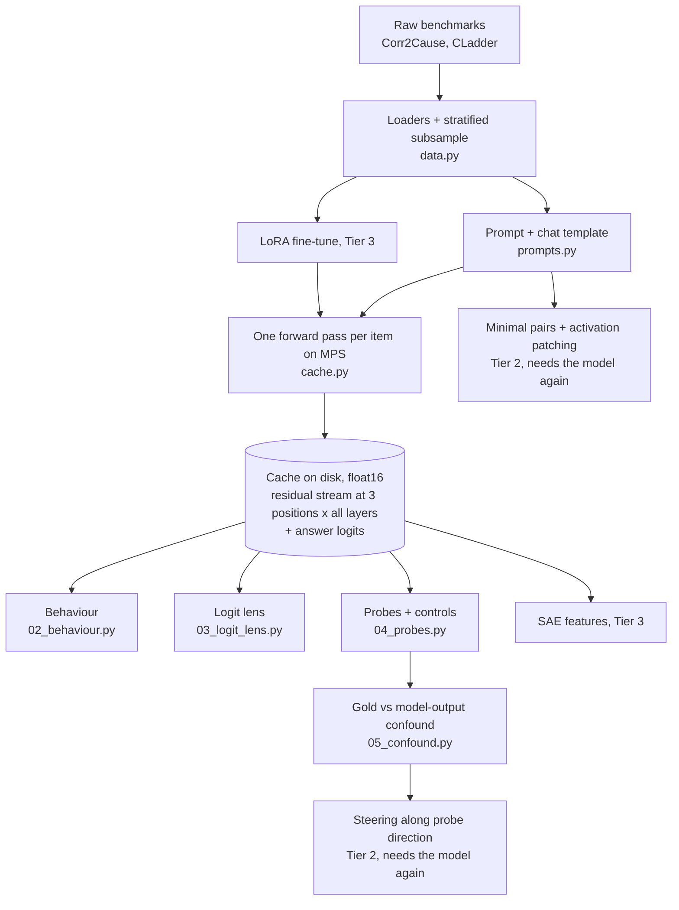
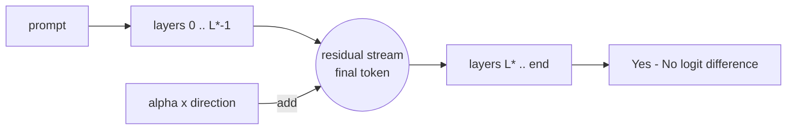
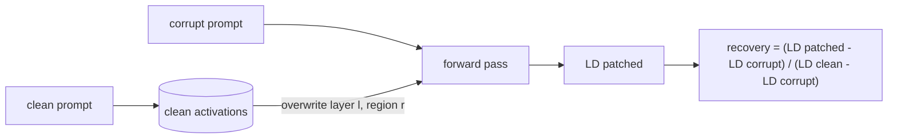

# EXPLAINER

Written for a smart first-year student who has not met these methods before. Read "Start here", then dip into the primer whenever a word is unfamiliar.

Contents: [Start here](#start-here) · [Pipeline](#pipeline) · [Concept primer](#concept-primer) · [Decision log](#decision-log) · [How to read each figure](#how-to-read-each-figure) · [Questions a professor would ask](#questions-a-professor-would-ask)

---

## Start here

<!-- START-HERE: updated as results arrive -->
**The question.** Small language models are bad at formal causal reasoning puzzles such as "given these correlations, must A cause B?". When such a model answers wrongly, is the right answer nevertheless sitting inside it, readable from its internal numbers? If it is, does the model actually use that information? And what changes inside when the model is trained on the task?

**What was done.** Three small open chat models (Qwen2.5 0.5B and 1.5B, Gemma-2 2B) were run once on two benchmarks, Corr2Cause and CLadder, and their internal activations were saved to disk. Everything else is analysis of those saved numbers on the CPU.

**What was found.** *(Results pending: this paragraph is rewritten as each tier completes.)*
<!-- /START-HERE -->

---

## Pipeline

The expensive step (D) runs once per model. Steps F–I never touch the model again.

---

## Concept primer

In dependency order. Each entry: what it is, a tiny example, where it lives in the code.

### Token, prompt, chat template
A model reads text as a sequence of **tokens** (word pieces, each an integer id). An instruct model was trained on conversations wrapped in special marker tokens; the **chat template** is the recipe that wraps your message in those markers. Skip it and the model sees text unlike anything it was trained to answer. *Example:* for Qwen, the user text `Is 2+2=4?` becomes `<|im_start|>user\nIs 2+2=4?<|im_end|>\n<|im_start|>assistant\n`; the model's answer is whatever it predicts next. *Code:* `prompts.render`, `prompts.encode_with_positions`.

### Logit and answer-token scoring
For the next token the model outputs one number per vocabulary entry, a **logit**; larger means more likely. We score a yes/no question by comparing the logits of "Yes"-like tokens against "No"-like tokens right after the prompt. Because "Yes", " yes" and "YES" are different tokens, we pool the variants (log-sum-exp) and take the **answer logit difference** = pooled Yes minus pooled No; positive means the model says Yes. *Example:* logits Yes=11.2, No=12.0 → difference −0.8 → the model answers No. *Code:* `models.answer_token_ids`, `models.answer_logit_diff`.

### Residual stream
A transformer keeps, for every token position, a running vector (896 numbers in Qwen-0.5B, 2304 in Gemma-2B). Each layer reads this vector and *adds* its contribution back. That running sum is the **residual stream**; it is the model's working memory at that position. *Example:* after layer 10 at the last prompt token, the residual stream is the embedding plus everything layers 0–10 added. *Code:* `cache.ResidCollector` (captures it), cache layout in `cache.py` docstring.

### Activation cache
Running a model is slow; analysing saved numbers is fast. We run each prompt once and save the residual stream at every layer for three positions: the **final** prompt token (where the answer is produced), the **end of the hypothesis/question**, and the **end of the premise**. *Example:* one Gemma item is 27 layers × 3 positions × 2304 numbers × 2 bytes ≈ 373 KB. *Code:* `cache.build_cache`, `cache.load_cache`.

### Logit lens
Normally only the last layer's residual stream is turned into logits. The **logit lens** applies that same final step (normalise, then multiply by the unembedding matrix) to an *earlier* layer, asking "if the model had to answer right now, what would it say?". It shows when the answer takes shape. *Example:* if the Yes−No difference is ≈0 up to layer 15 and then swings to −3, the decision is written into the stream after layer 15. *Code:* `lens.lens_logit_diff`, `scripts/03_logit_lens.py`.

### Linear probe
A **probe** is a small classifier trained to predict some property from an activation vector. A *linear* probe (logistic regression) can only draw a flat boundary, so if it succeeds the property is "linearly decodable": readable by one weighted sum. *Example:* take the layer-12 vectors of 2,400 puzzles, fit logistic regression to predict the correct answer, test on puzzles it has not seen. *Code:* `probes.fit_predict`, `probes.oof_scores`, `scripts/04_probes.py`.

### Held-out evaluation, cross-validation and grouped folds
A probe must be tested on data it was not trained on. In k-fold **cross-validation** the data is cut in k parts; each part is tested by a probe trained on the others. Items here come in families (88 hypotheses share a Corr2Cause premise; many questions share a CLadder story), and family members look alike, so a whole family must sit on one side: **grouped** folds. *Example:* all 8 pooled questions about premise #17 are either all training or all test. *Code:* `data.grouped_folds`.

### Baselines and controls for probes
A high probe score can have boring causes. Controls rule them out one at a time. **Shuffled labels:** train on scrambled labels; should fall to 50%, otherwise the pipeline leaks. **Text baseline (TF-IDF):** word counts of the prompt, same classifier; if it matches the probe, the model did no work. **Type prior:** predict from the question type alone. **Random-init model:** same architecture with untrained weights; whatever a probe reads there is in the input, not learned. *Code:* `probes.shuffled_labels`, `probes.tfidf_oof`, `probes.query_only_oof`, `models.load_model(random_init=True)`.

### Control task and selectivity (Hewitt & Liang, 2019)
A probe with enough capacity can memorise. A **control task** gives each input *type* a fixed random label (here: each hypothesis string, or each graph × query-type pair). Nothing about causality predicts these labels; only memorising type→label does. **Selectivity** = accuracy on the real task minus accuracy on the control task. High selectivity means the probe is reading structure rather than memorising. *Example:* real 80%, control 55% → selectivity 25 points. *Code:* `probes.control_task_labels`.

### Confidence interval and the (cluster) bootstrap
An accuracy from 1,000 items is an estimate; a **95% confidence interval** is a range that would cover the true value in about 95% of repetitions of the study. The **bootstrap** builds it by resampling the items with replacement many times and looking at the spread of the recomputed statistic. Because items sharing a premise or story are not independent, we resample whole premises/stories (**cluster** bootstrap), which gives honestly wider intervals. *Example:* accuracy 0.56 [0.48, 0.63]: we cannot rule out chance (0.50). *Code:* `stats.bootstrap_ci`.

### Accuracy, macro-F1 and AUROC
**Accuracy** is the share answered correctly; with 85% "No" labels, always saying "No" scores 85%, so accuracy alone misleads. **F1** for a class balances precision and recall; **macro-F1** averages F1 over both classes, so ignoring the rare class is punished. **AUROC** asks whether a score ranks positives above negatives (0.5 = no better than chance, 1 = perfect), independent of any threshold. *Code:* `stats.macro_f1`, `stats.auroc`, `stats.baselines`.

### Decodable is not the same as used
A probe finding information in a layer shows the information is *present*. It does not show the model *uses* it: the information could be a by-product that no later layer reads. To claim use, you must intervene (change the activation and watch the output) rather than just observe. The next four entries are interventions. *Example:* a thermometer on a car's exhaust lets you decode engine speed, but warming the exhaust does not make the car go faster. *Code:* observational = `04_probes.py`; interventional = `07_steering.py`, `08_patching.py`.

### Steering vector
Pick a direction in activation space (a vector), add a multiple of it to the residual stream at some layer and position during the forward pass, and see whether the output changes. If adding "the Yes direction" flips answers to Yes far more than adding a random direction of the same length, the model reads that direction. *Example:* at layer 15, final token, add 2 × (typical activation spread) × direction; the Yes−No logit difference moves from −1.1 to +3.0. We test three directions: the gold-label probe's weight vector, the difference between the mean activation of gold-Yes and gold-No items, and a probe for the model's own answer; plus random directions as the control. *Code:* `steer.AddAtLast`, `steer.steered_logit_diffs`, `scripts/07_steering.py`.

### Directional ablation
The opposite of steering: instead of adding a direction, remove the activation's own component along it (set it to the dataset average). If the model relied on that component, its answer should move. *Example:* an item sits 3 units along the direction and the average is 1; ablation subtracts 2 units of the direction. *Code:* the `ablate` block in `scripts/07_steering.py`.

### Minimal pair
Two prompts that differ in as little as possible but have different correct answers. Any difference in the model's behaviour between them must come from that small difference. We use two kinds, both with identical token counts: **hyp** (same premise, hypothesis asks about a different variable) and **prem** (same hypothesis, two variable letters swapped throughout the premise, i.e. a relabelled causal graph). *Example:* "…Hypothesis: A directly causes B." (Yes) vs "…Hypothesis: A directly causes C." (No). *Code:* `patch.build_pairs`, `patch.encode_pair`.

### Activation patching
Run the model on the clean prompt and save its activations. Run it on the corrupt prompt, but at one chosen place (a layer and a token region) overwrite the activation with the clean one. If the answer moves towards the clean answer, that place carries the information that distinguishes the two prompts. Sweeping over layers and regions maps where the answer-relevant information lives and when it moves. *Example:* overwriting the final token's residual stream at layer 15 restores 80% of the clean-vs-corrupt logit difference, at layer 14 only 11%: the information arrives at the final token around layer 15. *Code:* `patch.ResidPatcher`, `patch.resid_patch_grid`, `scripts/08_patching.py`.

### Random-donor control for patching
Overwriting an activation with *anything* might disturb the answer. As a control we patch in activations from the clean run of an unrelated premise of the same token length. If that "recovers" as much as the true clean run, the effect is not specific to the pair's causal content. *Code:* the `ctrl` grid in `scripts/08_patching.py`.

### Attention heads and MLPs
Each layer has two kinds of component that write into the residual stream: several **attention heads** (each moves information between token positions) and one **MLP** (which transforms information at a position). Patching one head or MLP at a time asks which specific components matter. *Code:* `patch.ComponentIO`.

### Attribution patching
Patching every head and MLP separately needs one forward pass each (hundreds). **Attribution patching** approximates all of them at once with one backward pass: effect ≈ (clean activation − corrupt activation) × gradient of the output with respect to that activation. It is a first-order (straight-line) approximation, so it can be wrong; we therefore re-check the top-ranked components and some random ones with real patching and report the correlation. *Example:* head L14H5: attribution 0.21, real patching 0.20. *Code:* `patch.record_components`, Part B of `scripts/08_patching.py`.

*(Tier 3 concepts: sparse autoencoder, LoRA are added below when that tier runs.)*

---

## Decision log

Each entry was written when the decision was made. Format: decision · alternatives · why · what would have changed it.

**D1. Plain Hugging Face models with forward hooks; TransformerLens only as a cross-check.** (Thu 17:20)
*Alternatives:* TransformerLens for everything. *Why:* the installed TransformerLens is 4.4, where `HookedTransformer` no longer exists; its replacement `TransformerBridge` wraps the HF model and forces "eager" attention, which is slower and uses more memory on an 8 GB machine. HF hooks give the same residual stream with no extra cost. We verified the bridge's logits equal HF's on 5 prompts (max difference 7e-5, `results/env_check_qwen0.5b.json`). *Would change it:* a mismatch between the bridge and HF, or needing TL-only utilities.

**D2. Models: Qwen2.5-0.5B, Qwen2.5-1.5B, Gemma-2-2B (all instruct). No 3B model.** (Thu 17:20)
*Alternatives:* add Qwen2.5-3B. *Why:* the Mac has 8 GB RAM in total, shared between CPU and GPU. 3B weights in float16 are ≈6.2 GB, leaving too little for activations and the OS; it would swap for hours. Gemma-2-2B (≈5.2 GB) is the largest that plausibly fits and is needed for the SAE tier. *Would change it:* 16 GB of RAM.

**D3. Run models in float16 on MPS.** (Thu 17:22)
*Alternatives:* float32 on MPS; float32 on CPU; bfloat16. *Why:* measured on Qwen-0.5B: MPS float16 is 8.5 items/s vs CPU float32 2.7 and MPS float32 0.8 (it thrashes memory). Float16 changes logits by at most 0.05 and the answer logit difference by 0.023, never the top-1 token; bfloat16 is 4× less accurate at the same speed. *Would change it:* NaNs or answer flips in float16 for a larger model (checked per model in `results/env_check_*.json`).

**D4. Subsample sizes and the cache arithmetic.** (Thu 17:25)
Cached sets: Corr2Cause test (all 1,162), a balanced Corr2Cause probe pool from train (300 premises × 8 hypotheses = 2,400, half positive), CLadder (3,000 stratified by label × query type), the renamed test set (1,162) and two 500-item few-shot sets: 8,724 items, plus 5,400 for the random-init control. Bytes per item = (layers+1) × 3 positions × width × 2: Qwen-0.5B 25×3×896×2 = 134 KB; Qwen-1.5B 29×3×1536×2 = 267 KB; Gemma 27×3×2304×2 = 373 KB. Totals ≈ 1.9 + 3.8 + 5.3 = 11 GB against 252 GB free. Disk is not the limit; forward-pass time is (≈3 M tokens per model). *Alternatives:* cache all 10k CLadder items / more train premises. *Why not:* each extra thousand items costs Gemma ≈10–15 minutes and the probe CIs are already driven by the number of premises/stories, not items. *Would change it:* CIs too wide to separate probe from baseline.

**D5. Probe pool for Corr2Cause is balanced and sampled by premise; the natural-distribution test set is kept for behaviour and an external probe check.** (Thu 17:25)
*Alternatives:* probe directly on the 1,162 test items. *Why:* test has only 21 distinct premises and 15.5% positives; a probe trained there would have ~180 positives from ~21 families. Sampling 300 train premises with 4 positive + 4 negative hypotheses each gives chance = 50% and 300 independent families. Imbalance is handled explicitly: balanced pool for probing, macro-F1/AUROC and majority baselines for behaviour. *Would change it:* nothing foreseeable.

**D6. Prompt format and positions.** (Thu 17:25)
Instruction first, then premise, then hypothesis, single user turn, default system prompt of each template; the assistant turn is left empty so the next token is the answer. *Alternatives:* instruction last; prefilled "Answer:". *Why:* with the query last, "end of user text" coincides with "end of hypothesis", giving a principled second position; no prefill keeps to the documented template. Positions are found from character offsets, taking the token that covers the last character of the span (tokenizers merge ".\n" into one token). *Would change it:* a model that mostly emits non-answer tokens first (measured: `top1_not_an_answer_token`).

**D7. Probe = logistic regression on standardised activations, L2 with C = 0.01 fixed in advance, 5 grouped folds × 3 seeds.** (Thu 17:30)
*Alternatives:* tune C per layer by inner cross-validation; PCA first; MLP probes. *Why:* width (896–2304) is comparable to the number of training items (≈1,900), so strong regularisation is needed; fixing it in advance removes any temptation to tune until something works, and keeps ~3,000 fits per model affordable. Linear only, because the question is about *linear* decodability. A sensitivity check at other C values is reported, not used for selection. *Would change it:* the sensitivity check showing conclusions flip with C.

**D8. Control task adapted from word types to item types.** (Thu 17:30)
Hewitt & Liang assign a random label per word type. Our unit is a whole prompt, so the type is the hypothesis string (Corr2Cause) or graph × query type (CLadder). *Alternatives:* a random label per premise/story (unlearnable under grouped folds, so it would trivially give 50% and flatter selectivity); a random label per item (same problem). *Why:* types recur across premises/stories, so a memorising probe *can* succeed, which is what makes the control informative. *Would change it:* nothing; the limitation (it is an adaptation) is stated wherever selectivity is reported.

**D9. Robustness check = our own variable renaming (A,B,C… → Z,Y,X…) of the test set.** (Thu 17:30)
*Alternatives:* the released perturbation files. *Why:* the released files have 2,246 rows that do not align with the 1,162-row test set and differ in label scheme (upstream issue U4), so no paired comparison is possible. Renaming our own test items gives a paired design: same item, same label, different letters. *Would change it:* an aligned release.

**D10. All CIs are cluster bootstraps over premises/stories (2,000 resamples).** (Thu 17:30)
*Alternatives:* item-level bootstrap. *Why:* 1,162 test items come from 21 premises; treating them as independent would understate uncertainty several-fold. *Would change it:* nothing.

**D11. Headline layer chosen on half the premises/stories, reported on the other half; "represents but doesn't say" criterion fixed before seeing results.** (Thu 17:35)
*Alternatives:* report the best layer on the same data. *Why:* picking the maximum of ~27 noisy numbers inflates it. The criterion (in `05_confound.py`): on items the model gets wrong, the gold probe's accuracy CI must exclude 50% and its paired advantage over TF-IDF and over the type prior must exclude 0. We additionally report within each model-answer stratum (model said Yes / said No), where the model's binary answer is constant and so cannot help the probe, and compare with the model's own graded confidence. *Would change it:* nothing; written before any probe was run.

**D12. Gemma's embedding matrix lives on disk; Gemma runs one item at a time and stores answer-token logits only.** (Thu 19:00)
*Alternatives:* drop Gemma; run the full model anyway; a 4-bit quantised Gemma. *Why:* the full float16 model (5.3 GB) thrashes 8 GB of unified memory (0.07–0.2 items/s; ~20 hours for the cache). Gemma's embedding matrix is 256k × 2304 = 1.18 GB and is used for exactly two things: looking up the input tokens' rows, and producing logits. Keeping it as a memory-mapped file and computing only the Yes/No rows per item brings the GPU footprint to 4.4 GB and the speed to ~1.1 items/s. The arithmetic is unchanged (answer logit differences agree with the full model to 0.012 on the check prompts). Dropping Gemma would lose the SAE tier; quantisation would change the model being studied. *Cost:* no full-vocabulary top-1 token in Gemma's cache, and its generated-text check is first-token-only on 100 items per set. *Would change it:* 16 GB of RAM.

**D13. A "calibrated" model answer (median split of the logit difference) is analysed next to the raw answer.** (Thu 19:10, after seeing data)
*Alternatives:* raw answer only. *Why:* Qwen-0.5B answers "No" to essentially everything, so its raw answer is a constant; "model-wrong items" is then just "gold-Yes items" and a model-output probe has nothing to predict. The median split removes the constant bias and asks about the model's *relative* preference. This was added after seeing results, so the pre-registered verdict (D11) stays on the raw answer and the calibrated one is labelled secondary. *Would change it:* n/a.

**D14. Steering: three meaningful directions + random; scale in units of typical activation spread; final position only; KV-cache shortcut.** (Thu 19:35)
*Alternatives:* steer at all positions; scale in units of the residual norm; probe direction only. *Why:* the probes were trained at the final position, so that is where the direction is defined. The unit s = RMS distance of an activation from the layer mean makes "alpha = 1" comparable across models of different width. Difference-of-means is included because probe weights are discriminative (they include an inverse-covariance factor) and are known to steer worse than mean differences; reporting only the probe direction could wrongly suggest "no causal role". Directions are fitted on the selection half and tested on the report half. Because a final-position edit cannot affect earlier positions, the prefix is computed once and only the last token is re-run per vector (tested equal to the full computation). *Would change it:* a need to steer earlier positions.

**D15. Minimal pairs on Corr2Cause only, two kinds (hyp, prem), premises with at most 5 variables; effect = pooled recovery.** (Thu 19:40)
*Alternatives:* CLadder pairs; per-pair normalised recovery; only pairs the model answers correctly. *Why:* Corr2Cause has exact token-aligned pairs for free (same premise, sibling hypotheses), and relabelling variables gives a second kind that changes the causal structure rather than the question. CLadder stories do not align token-for-token. Five-variable premises keep prompts ~350 tokens so the sweep is affordable. The models are near chance, so "pairs answered correctly" would leave almost nothing; pooled recovery (sum of signed effects over sum of |clean−corrupt| differences) uses all pairs and weights them by how much the model distinguishes them, in whichever direction. *Would change it:* a model that solved the pairs (then the standard per-pair normalisation on correct pairs would be reported too).

**D16. Patch token regions, not single tokens; attribution patching for components, validated on top-10 + 10 random.** (Thu 19:40)
*Alternatives:* per-token patching; exhaustive head patching. *Why:* (layers × ~350 tokens) forward passes per pair is out of reach; five regions (differing tokens, rest of premise, rest of hypothesis, chat-template tail, final token) answer "where" at the granularity we can interpret. Exhaustive component patching is 300–450 passes per pair; one backward pass approximates it, and the 20-component validation tells us whether to trust it. *Would change it:* validation correlation below ~0.7 (then only really-patched components would be reported).

**D17. (Revises D7.) Probe regularisation is chosen from a small grid on the selection half; the fixed-C result is kept as a sensitivity analysis.** (Thu 19:57–20:20, after seeing the pre-planned sensitivity check)
*What happened:* D7 fixed C = 0.01 and said a sensitivity check showing the conclusion depends on C would change it. The check showed Corr2Cause probe accuracy rising from 0.76 (C = 0.01) to 0.80 (C = 1), while the TF-IDF baseline had been run at C = 1: the probe was handicapped. *Decision:* run every probe (all targets, controls and the random-init model) at C ∈ {0.01, 0.1, 1} and TF-IDF at C ∈ {0.1, 1, 10}. D11 already splits premises/stories into a selection half and a report half to choose the layer; now the pair (layer, C) is chosen there too, and the TF-IDF C likewise. Every reported number is on the report half, which plays no part in any choice. *Alternatives tried:* true nested cross-validation inside every training fold (statistically equivalent in spirit, but 10× the fits; it ran 20 minutes without finishing one model and was abandoned); keep C = 0.01 (biased against the probe); choose C by test accuracy (tuning on the test set). *Safeguard:* the original setting (probe C = 0.01, TF-IDF C = 1) is reported next to the selected one (`results/confound_*_fixedC.json`), because this change was made after seeing results and it moves towards the more exciting hypothesis. *Would change it:* nothing further; the probe has no other hyperparameters.

**D18. A stronger, parsed-feature text baseline is added as a secondary check; the pre-registered verdict is left as it is.** (Thu 23:00, after the criterion was first met)
*What happened:* for Qwen-1.5B on Corr2Cause the D11 criterion came out positive: on items the model gets wrong, the gold probe beats TF-IDF and the type prior. *Decision:* before believing it, test it against a text baseline that can do what bag-of-words cannot, namely tie premise statements to the two variables in the hypothesis (Corr2Cause), or compare the quoted probabilities and read the question's polarity (CLadder), using gradient boosting on those parsed features. *Alternatives:* accept the TF-IDF comparison as specified (it is what was pre-registered, but TF-IDF is a weak model of "what is in the text" for a task whose label is a function of the text); swap the baseline silently (would hide a post-hoc choice). *Why:* the claim "the model represents the answer beyond what the text gives away" is only as strong as the text baseline. This check can only weaken the claim, so adding it after the fact does not risk a false positive. Both verdicts are reported side by side. *Would change it:* nothing.

---

## How to read each figure

All figures are drawn by `scripts/06_figures.py` from `results/*.json`. Shaded bands and whiskers are 95% cluster-bootstrap confidence intervals (premises or stories are resampled). Each model keeps the same colour in every figure.

**fig1_behaviour.png — how well do the models answer?** One bar per model: macro-F1 and accuracy on the Corr2Cause test set, accuracy on CLadder, scored from the answer-token logits. The dashed line is the majority-class baseline (always answer the commoner label) and the dotted line is a coin flip. A bar level with the dashed line means the model is doing no better than answering "No" every time. On Corr2Cause read macro-F1, not accuracy: 84.5% of labels are "No", so accuracy rewards a model that never says "Yes".

**fig2_logit_lens.png — when does the answer take shape?** x: layer. y: the Yes−No logit difference the model would produce if it stopped at that layer, sign-flipped so that positive always means "leaning towards the correct answer". Blue: items the model finally gets right; red: items it finally gets wrong. If red rose above zero in the middle and fell later, the model would have "known and then overwritten" the answer. Caution: for a model that always says "No", "correct" simply means "gold label is No", so the two curves are mirror images by construction. Layer 0 is omitted (the lens on raw embeddings is off-scale noise).

**fig2b_lens_auroc.png — the same lens, threshold-free.** y: AUROC of the per-layer lens logit difference for the gold label (0.5 = no information, 1 = perfect ranking). This ignores any constant Yes/No bias and asks only whether the model's would-be answer ranks true-Yes items above true-No items. x is relative depth so models with different numbers of layers can share an axis.

**fig3_probes_<dataset>.png — what can a linear probe read, and is it more than the controls?** One panel per model. Solid blue: held-out accuracy of the gold-label probe at each layer. Solid orange: probe for the model's own answer (shown only where the model's answers vary). Dashed yellow: control task (random label per question type; high = the probe can memorise). Dashed pink: same probe on a randomly initialised model. Dotted grey: shuffled labels (must sit at 0.5). Horizontal dash-dot lines: TF-IDF text baseline (black) and type-prior baseline (violet), which have no layers. The claim "the model's activations hold the answer beyond what the text gives away" needs blue clearly above the black line.

**fig4_selectivity_positions_<dataset>.png.** Left: selectivity (gold accuracy minus control-task accuracy) against relative depth, one line per model; near or below zero means the probe's success is within what memorising question types could achieve. Right: the gold probe at three token positions for the largest model: final token, end of hypothesis/question, end of premise. The end of the premise comes before the question is asked, so a probe there cannot know which hypothesis is being tested; it is a built-in sanity check and should sit near the baselines.

**fig5_confound_<dataset>.png — the key test.** Report-half items only. Left: accuracy of each scorer on the items the model gets wrong. Middle and right: AUROC for the gold label *within* the items where the model said Yes, and within those where it said No; inside one group the model's yes/no answer is constant, so a probe that merely reads that answer scores 0.5. Bars: gold probe (blue), TF-IDF (black), type prior (violet), random-init probe (pink), the model's own graded confidence (orange). "Represents but doesn't say" needs blue above the dashed chance line *and* above black and violet by more than the whiskers. In the left panel the orange bar is zero by definition (those are the items the model's own answer gets wrong).

**fig6_steering_<dataset>.png — is the decodable direction used?** Top row: fraction of items whose answer flips when α × direction is added at the final token. Bottom row: accuracy when each item is pushed towards its gold answer. x: α on a log scale; α = 1 is one typical item-to-item spread of the activations. Blue: the gold probe's direction. Green: difference of class means. Orange: the model-output direction. Grey dashed: random directions of the same length. A direction the model reads from rises quickly; one it ignores stays with (or below) the grey line.

**fig7_patching_<kind>.png — where is the answer determined?** Heat-map per model. x: layer at which the residual stream is overwritten; y: token region. Colour: pooled recovery (blue = patching in the clean activation makes the corrupt run answer like the clean run; grey = no effect; orange = pushes the other way). Top row: true clean donor. Bottom row: random-donor control (an unrelated premise), which should stay grey wherever the top row's effect is specific to the pair. Read the blue band from top-left to bottom-right: it traces the information moving from the tokens that differ, through later tokens, to the final token.

**fig8_attribution_validation.png — can the cheap method be trusted?** Each point is one attention head or MLP. x: effect predicted by attribution patching (one gradient). y: effect measured by really patching that component. Blue: the ten components ranked highest by attribution; grey: ten random ones. Points on the diagonal mean the approximation is accurate.

**fig9_cross_model.png — does it scale with size?** x: parameters (log scale). Left: gold-probe accuracy on the report half. Middle: probe minus TF-IDF (paired); whiskers that cross zero mean no detectable advantage over the text baseline. Right: relative depth of the selected layer (large marker) and of the first layer within one point of the maximum (small marker). Filled circles: Corr2Cause pool; open squares: CLadder.

*(Tier 3 figures are added below when produced.)*

---

## Questions a professor would ask

Short model answers. Numbers are quoted from `report/tables/*.md` (generated from `results/*.json`); where a number is not given here, the table is named.

<!-- QA-TIER1 -->
### Tier 1 — behaviour, logit lens, probes

**1. Why score with answer-token logits rather than just reading the generated text?**
Logits give a graded score for every item (so AUROC and calibration are available), cost one forward pass, and cannot be "unparseable". The risk is that the first-token logits might not match what the model would actually write, so both were computed on 500 items per set; they disagree on under 1% of items for the Qwen models (`behaviour_generation.md`).

**2. Corr2Cause is 85% "No". How do you stop that from flattering the models?**
Three ways: macro-F1 and AUROC are reported next to accuracy; the majority-class baseline is shown on the same items; and probing uses a pool built to be exactly 50/50, so chance is 50%.

**3. The test set has 1,162 items. Why are your confidence intervals so wide?**
Because those items come from only 21 distinct premises, and hypotheses about one premise share their fate. The bootstrap resamples premises, not items. Treating items as independent would shrink the intervals several-fold and be wrong.

**4. What exactly is a "held-out" item for a probe here?**
One whose whole premise (Corr2Cause) or story (CLadder) was absent from the probe's training fold. `tests/test_data.py::test_grouped_folds_have_no_group_leakage` enforces it.

**5. Your probe gets ~80% on Corr2Cause. Doesn't that show the model knows the answer?**
No. A bag-of-words classifier on the prompt text gets about the same (`probes_summary.md`). Corr2Cause labels are a deterministic function of the text, and simple surface statistics (which template, how many independence statements) predict them well. A probe on activations can be re-reading those statistics.

**6. Then what would count as evidence that the model "represents but doesn't say"?**
The criterion fixed before any probe was run (decision D11): on items the model gets wrong, on premises not used to choose the layer or C, the gold probe's accuracy must exceed 50% and exceed both text baselines, with 95% intervals excluding zero. The outcome per model and dataset is in `confound_wrong_items.md`.

**7. Why isn't "probe beats chance on the items the model gets wrong" enough by itself?**
If a model answers "No" to everything, the items it gets wrong are exactly the gold-Yes items. Any classifier with some skill at spotting Yes items "beats chance on wrong items", including TF-IDF. The comparison with the text baselines is what carries the claim.

**8. What does the "within stratum" analysis add?**
It holds the model's own answer fixed (all items where it said No, say) and asks whether the probe can still rank gold-Yes above gold-No. Inside a stratum a probe that only reads the model's yes/no decision is useless (AUROC 0.5), so any skill there is information beyond the binary answer. It is also compared with the model's own graded confidence.

**9. What is the control task and why is your selectivity sometimes negative?**
Each question *type* gets a fixed random label; only memorisation can predict it. On CLadder the probe predicts those random labels better (≈0.79) than the real ones (≈0.56): the residual stream identifies the graph and query type very clearly, while the gold answer is barely decodable. Negative selectivity says "this probe is expressive enough to memorise types, and still cannot find the answer".

**10. Why include a randomly initialised model?**
To measure what a probe can read from the architecture and the input alone. A random transformer still mixes token embeddings into the final position, so some text statistics survive. The trained model must beat it for the result to be about learned computation.

**11. You changed the regularisation after seeing results. Isn't that p-hacking?**
It is the reason the change is documented so heavily (decision D17). The sensitivity check was planned in advance, with its trigger written down. The new procedure chooses C on the selection half only, is applied to the text baseline and every control as well, and the original fixed-C result is reported next to it (`confound_fixedC_*.md`). The verdicts are shown under both settings.

**12. Why choose the layer on half the data?**
Taking the best of ~25 noisy layer scores and reporting it inflates the number (winner's curse). Selection on one half of the premises/stories and reporting on the other removes that bias at the cost of wider intervals.

**13. What does the logit lens show that probes do not?**
The lens uses the model's *own* readout, so it shows what the model is on course to say at each depth. A probe uses a readout we trained, so it shows what is *available*. A gap between them (probe AUROC far above lens AUROC at the same layer) is exactly "available but not on the path to the output".

**14. Why is few-shot prompting not simply "better"?**
Four demonstrations changed the answer bias more than the skill: see `behaviour_few_shot.md` (for the smallest model the fraction of "Yes" answers on Corr2Cause moved from 0% to 81%, and accuracy fell because the labels are mostly "No"). Macro-F1 and AUROC are the fairer readings.

**15. What does the variable-renaming check tell you?**
Renaming A,B,C to Z,Y,X leaves the logic untouched. A model that reasons should not care. Prediction flips and the change in macro-F1 are in `robustness_renaming.md`; the original paper used the same idea to show that fine-tuned models had learned surface patterns.
<!-- /QA-TIER1 -->

<!-- QA-TIER2 -->
*(Tier 2 and 3 questions follow when those tiers are written up.)*
<!-- /QA-TIER2 -->
