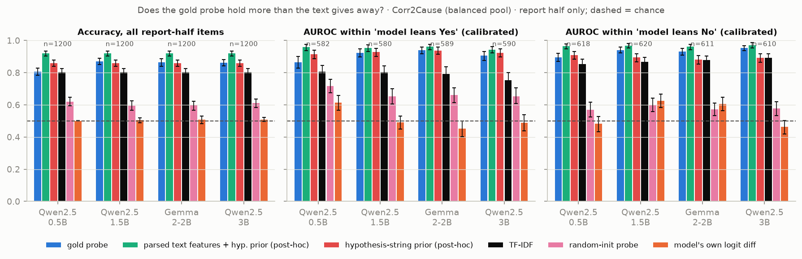
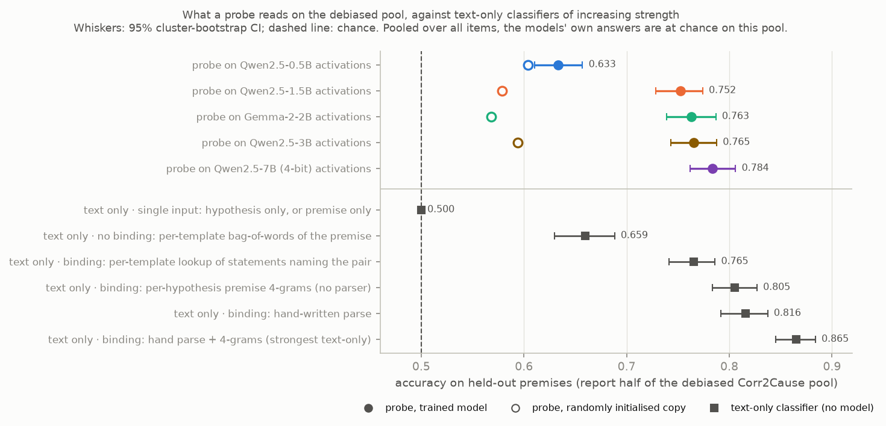
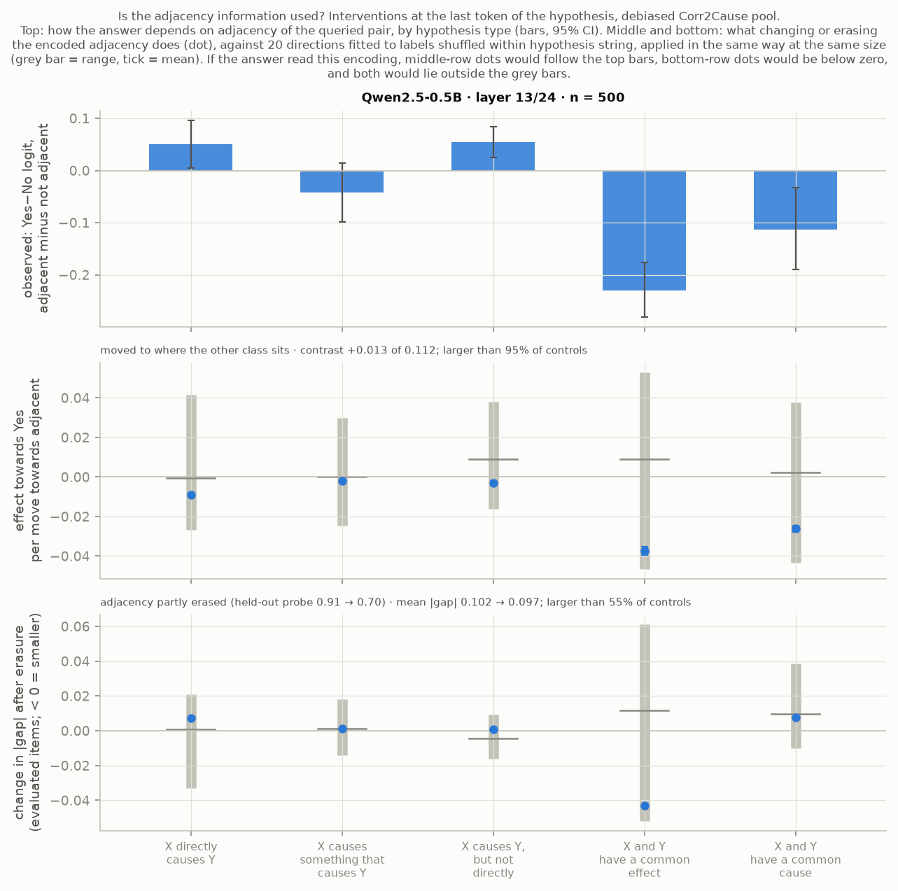
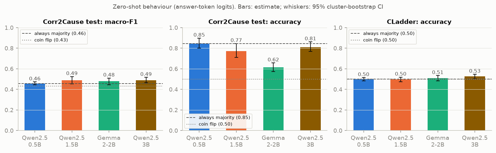
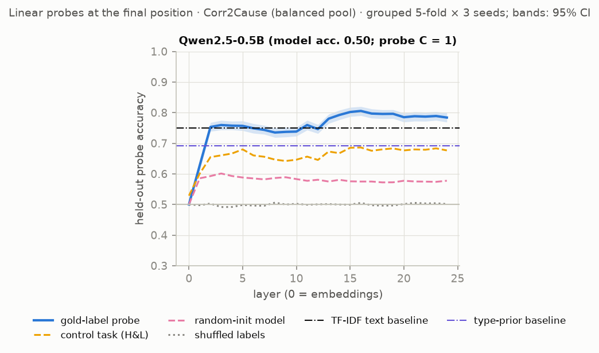

<!-- GENERATED by scripts/13_build_docs.py from report/README_template.md; edit the template, not this file -->
# causal-probe

Do small open-weight language models internally represent the correct answer to formal causal-reasoning questions that they answer wrongly? A probing, steering and patching study on Corr2Cause and CLadder, run on an 8 GB laptop plus free Kaggle and Colab GPU sessions.

**Status:** work in progress until Sunday 15 November 2026, 14:00 (Toronto). GPU runs for three models are still returning; what has and has not arrived is marked.

**Question.** When small language models answer formal causal-reasoning questions wrongly, is the correct answer nevertheless linearly readable from their activations, and is it used?

**Run:** Qwen2.5-0.5B, 1.5B, 3B and Gemma-2-2B on Corr2Cause and CLadder; probes against text-only baselines, steering, patching; six independent audits. Numbers are from `results/*.json`; details and all caveats are in `report/report.md`.

## Three headline claims

**1. A probe's accuracy for the correct answer means nothing until it is compared with what the text alone gives away.**
- *Number:* on the official Corr2Cause test split a classifier that sees only the hypothesis, never the premise, reaches AUROC 0.895 [0.863, 0.919]. Gold-label probes are below the strongest text-only classifier in all eight model × benchmark cells.
- *Figure* (three of the eight cells): `fig5_confound_c2c_probe.png`. *Checked by* audit 1 (it found the shortcut and forced the first retraction) and audit 6 (recomputed for four models).



**2. With every single-input shortcut removed, a probe on the larger models' activations is as accurate as a lookup of the premise statements about the two queried variables, no more; pooled over hypothesis types the models answer at chance.**
- *Number:* on the debiased pool Qwen2.5-3B's probe scores 0.765 [0.743, 0.788], the lookup 0.765, a hand-written parse 0.816; the model's answers have AUROC 0.507 [0.484, 0.530].
- *Caveats:* equal accuracy is not equal content (probe and text models are right on partly different items); within a hypothesis type the answers deviate from chance in both directions.
- *Figure:* `fig13_debiased_ladder.png`. *Checked by* audit 3 (two models; it replaced my baseline list), audits 5 and 6 (four models, recomputed).



**3. No intervention shows that what a probe reads is what the answer is computed from.**
- *Number:* in Qwen2.5-0.5B, shifting items at the end of the hypothesis along the encoding of adjacency (a structural property the answers depend on) gives a pre-specified contrast of +0.013 out of a possible 0.112: above 100% of 20 label-shuffled directions of the same size, larger in absolute value than 95%. That is the weakest result 20 controls can register, and the effect is a push towards No for every hypothesis type.
- *Caveats:* at the answer position the same shift removes the dependence for one hypothesis type and creates one for another; the answer is already a linear function of the activation there (held-out R² 0.96), so that locates the answer. Steering along the gold-label probe's weight vector stays within the range of matched controls per unit of norm. One model so far.
- *Figure:* `fig12_adjacency_end_of_hypothesis.png`. *Checked by* audits 2, 4, 5 and 6.



## What we retracted, and why

| Claim as first made | What was wrong | Caught by |
|---|---|---|
| "Qwen2.5-1.5B represents the answer but doesn't say it" | Baselines too weak: the hypothesis string alone predicts 86% of labels | Audit 1 |
| "The gold-probe direction is inert; the model-output direction flips answers" | One sign shown, three random directions, steps far beyond natural scale | Audit 2 |
| "Patching shows where the answer is formed" | It shows where a prompt difference arrives | Audit 2 |
| "The probe beats the shallow controls and adds nothing to the parser" | Controls at 50% by construction; an insensitive test | Audit 3 |
| "The answers do not express what the probe reads" | False per hypothesis type; opposite signs cancel | Audit 3 |
| First adjacency experiment | Its "removal" left the property readable | Audit 4 |
| "Erasing adjacency removes a sixth of the dependence, beyond all 20 controls"; "at the answer position, almost all" | A control that could not fail; a summary in which opposite errors cancelled | Audit 5 |
| "The model reacts to letters out of alphabetical order" | A one-sided pair construction | Audit 5 |
| "Splitting the class difference shows an answer shift, not an adjacency variable" | True by construction; no control | Audit 6 |
| Four bugs (a CLadder sample differing between machines; an SAE interval; a fix reported but not applied; an ingest that could overwrite newer results) | `notes/log.md` | Ingest check, own review, audits 4 to 6 |

## Limitations

- Models up to 3 billion parameters, at or near chance; two benchmarks; linear probes. Nothing here says what a model that can do the task would show (a 7B behaviour check is running).
- Claim 3: one model, four sites, 20 controls, and an erasure that removes about half of the readable adjacency on held-out items. "No intervention shows" is not "unused".
- The stronger baselines, the debiased pool and every corrected analysis were introduced after seeing results; the pre-registered analysis is reported next to them (report Section 3.4).
- Probe accuracies are three-seed ensembles; for Gemma-2-2B and Qwen2.5-3B only final-token activations exist.
- Qwen2.5-3B's CLadder numbers are on a different draw of the sample (marked † in the tables).

The same page as a file: `RESULTS.md`. How the story unfolded, in plain language: `EXPLAINER.md`, "Start here".

## Further results (not headline claims)

- **Behaviour.** All four models answer both benchmarks at or near chance; part of that is answer bias, and the bias-free ranking score is near 0.5 as well (table below).
- **Patching.** A change of one variable in the prompt reaches the answer position at about 60% of the network's depth (three models). The answer logit moves as much when the edit leaves the correct answer unchanged as when it changes it, and its sign follows where the queried variable stands in the premise, not validity (Qwen2.5-0.5B so far): this locates where a prompt difference arrives, not where a judgement is made.
- **In the report's appendix:** logit lens, cross-model comparison, sparse-autoencoder features, attribution patching of components.

## What was pre-registered, what passed, what was retracted

- **Pre-registered** (written in the decision log before any probe was run, D11): on report-half items the model answers wrongly, gold-probe accuracy must exceed 0.5, a TF-IDF baseline and a template prior, by 95% confidence-interval lower bounds. Layer selection on one half of the premises, reporting on the other.
- **Passed as coded.** In the current result files that criterion is met for Qwen2.5-1.5B and Gemma-2-2B on CLadder, in variants also on Corr2Cause, and for all four models on the debiased pool. One cell (Qwen2.5-1.5B on Corr2Cause, as first run) was logged as a positive result on Thursday night.
- **Retracted** after an independent audit of code and results on Friday: the pre-registered baselines were too weak. The audit showed that the hypothesis string alone predicts 86% of labels in the pool, and that "accuracy above 0.5 on wrongly answered items" is not a chance test when those items are mostly one class.
- **Added after seeing results** (and therefore not pre-registered): the hypothesis-string, question-only and parsed-feature baselines (D18); the audited criterion, probe versus strongest text-only baseline (D19); the debiased pool (D21); the ladder of baselines on it (D25); matched steering controls (D24); the adjacency test, its second version and its transfer arm (D27, `notes/log.md` 13 November). Each can only make the claim harder to pass. The pre-registered analysis is still reported in full next to them.

## Headline tables

Behaviour, separating bias from chance:

| Model | Item set | Prompt | Items | Yes-rate | Accuracy | Majority-class accuracy | AUROC of Yes−No logit difference | Accuracy at best threshold (cross-fitted) | Reading |
|---|---|---|---|---|---|---|---|---|---|
| Qwen2.5-0.5B | Corr2Cause test | zero-shot | 1162 | 0.00 | 0.845 [0.803, 0.898] | 0.845 | 0.589 [0.531, 0.660] | 0.843 [0.801, 0.895] | informative (AUROC CI above 0.5) |
| Qwen2.5-0.5B | Corr2Cause pool | zero-shot | 2400 | 0.00 | 0.502 [0.500, 0.504] | 0.500 | 0.591 [0.569, 0.614] | 0.578 [0.558, 0.598] | informative (AUROC CI above 0.5) |
| Qwen2.5-0.5B | Corr2Cause debiased pool | zero-shot | 2400 | 0.00 | 0.498 [0.496, 0.501] | 0.500 | 0.505 [0.485, 0.526] | 0.498 [0.484, 0.512] | at chance (AUROC CI includes 0.5) |
| Qwen2.5-0.5B | CLadder | zero-shot | 3000 | 0.04 | 0.500 [0.483, 0.515] | 0.500 | 0.499 [0.468, 0.527] | 0.509 [0.484, 0.531] | at chance (AUROC CI includes 0.5) |
| Qwen2.5-0.5B | Corr2Cause test, variables renamed | zero-shot, variables renamed | 1162 | 0.01 | 0.842 [0.800, 0.895] | 0.845 | 0.511 [0.455, 0.572] | 0.843 [0.800, 0.896] | at chance (AUROC CI includes 0.5) |
| Qwen2.5-0.5B | Corr2Cause test (500 items) | 4-shot | 500 | 0.81 | 0.314 [0.260, 0.367] | 0.840 | 0.660 [0.579, 0.741] | 0.846 [0.814, 0.887] | informative (AUROC CI above 0.5) |
| Qwen2.5-0.5B | CLadder (500 items) | 4-shot | 500 | 0.20 | 0.516 [0.481, 0.552] | 0.500 | 0.495 [0.451, 0.542] | 0.486 [0.452, 0.521] | at chance (AUROC CI includes 0.5) |
| Qwen2.5-1.5B | Corr2Cause test | zero-shot | 1162 | 0.10 | 0.773 [0.711, 0.846] | 0.845 | 0.561 [0.503, 0.614] | 0.843 [0.801, 0.895] | informative (AUROC CI above 0.5) |
| Qwen2.5-1.5B | Corr2Cause pool | zero-shot | 2400 | 0.10 | 0.500 [0.488, 0.512] | 0.500 | 0.568 [0.545, 0.590] | 0.565 [0.551, 0.580] | informative (AUROC CI above 0.5) |
| Qwen2.5-1.5B | Corr2Cause debiased pool | zero-shot | 2400 | 0.16 | 0.492 [0.478, 0.507] | 0.500 | 0.510 [0.488, 0.533] | 0.511 [0.495, 0.526] | at chance (AUROC CI includes 0.5) |
| Qwen2.5-1.5B | CLadder | zero-shot | 3000 | 0.64 | 0.497 [0.474, 0.519] | 0.500 | 0.509 [0.478, 0.542] | 0.499 [0.480, 0.519] | at chance (AUROC CI includes 0.5) |
| Qwen2.5-1.5B | Corr2Cause test, variables renamed | zero-shot, variables renamed | 1162 | 0.17 | 0.729 [0.667, 0.803] | 0.845 | 0.579 [0.523, 0.630] | 0.843 [0.800, 0.897] | informative (AUROC CI above 0.5) |
| Qwen2.5-1.5B | Corr2Cause test (500 items) | 4-shot | 500 | 0.05 | 0.800 [0.752, 0.856] | 0.840 | 0.556 [0.502, 0.606] | 0.818 [0.770, 0.877] | informative (AUROC CI above 0.5) |
| Qwen2.5-1.5B | CLadder (500 items) | 4-shot | 500 | 0.72 | 0.528 [0.487, 0.565] | 0.500 | 0.559 [0.511, 0.601] | 0.496 [0.460, 0.533] | informative (AUROC CI above 0.5) |
| Gemma-2-2B | Corr2Cause test | zero-shot | 1162 | 0.34 | 0.615 [0.573, 0.658] | 0.845 | 0.536 [0.495, 0.566] | 0.843 [0.800, 0.897] | at chance (AUROC CI includes 0.5) |
| Gemma-2-2B | Corr2Cause pool | zero-shot | 2400 | 0.25 | 0.505 [0.487, 0.525] | 0.500 | 0.559 [0.537, 0.582] | 0.565 [0.553, 0.576] | informative (AUROC CI above 0.5) |
| Gemma-2-2B | Corr2Cause debiased pool | zero-shot | 2400 | 0.31 | 0.496 [0.477, 0.515] | 0.500 | 0.492 [0.468, 0.515] | 0.497 [0.481, 0.513] | at chance (AUROC CI includes 0.5) |
| Gemma-2-2B | CLadder | zero-shot | 3000 | 0.63 | 0.508 [0.482, 0.535] | 0.500 | 0.519 [0.482, 0.557] | 0.500 [0.483, 0.520] | at chance (AUROC CI includes 0.5) |
| Gemma-2-2B | Corr2Cause test, variables renamed | zero-shot, variables renamed | 1162 | 0.32 | 0.602 [0.562, 0.641] | 0.845 | 0.504 [0.464, 0.531] | 0.844 [0.801, 0.897] | at chance (AUROC CI includes 0.5) |
| Gemma-2-2B | Corr2Cause test (500 items) | 4-shot | 500 | 0.54 | 0.486 [0.445, 0.526] | 0.840 | 0.569 [0.523, 0.613] | 0.834 [0.793, 0.886] | informative (AUROC CI above 0.5) |
| Gemma-2-2B | CLadder (500 items) | 4-shot | 500 | 0.83 | 0.504 [0.458, 0.546] | 0.500 | 0.543 [0.498, 0.585] | 0.504 [0.465, 0.543] | at chance (AUROC CI includes 0.5) |
| Qwen2.5-3B | Corr2Cause test | zero-shot | 1162 | 0.05 | 0.812 [0.768, 0.862] | 0.845 | 0.534 [0.493, 0.573] | 0.838 [0.794, 0.892] | at chance (AUROC CI includes 0.5) |
| Qwen2.5-3B | Corr2Cause pool | zero-shot | 2400 | 0.05 | 0.509 [0.500, 0.519] | 0.500 | 0.581 [0.559, 0.603] | 0.593 [0.573, 0.613] | informative (AUROC CI above 0.5) |
| Qwen2.5-3B | Corr2Cause debiased pool | zero-shot | 2400 | 0.04 | 0.495 [0.487, 0.503] | 0.500 | 0.507 [0.484, 0.530] | 0.506 [0.490, 0.524] | at chance (AUROC CI includes 0.5) |
| Qwen2.5-3B | CLadder † | zero-shot | 3000 | 0.50 | 0.526 [0.502, 0.548] | 0.500 | 0.543 [0.518, 0.568] | 0.507 [0.487, 0.528] | informative (AUROC CI above 0.5) |
| Qwen2.5-3B | Corr2Cause test, variables renamed | zero-shot, variables renamed | 1162 | 0.04 | 0.822 [0.783, 0.868] | 0.845 | 0.512 [0.463, 0.553] | 0.844 [0.802, 0.896] | at chance (AUROC CI includes 0.5) |
| Qwen2.5-3B | Corr2Cause test (500 items) | 4-shot | 500 | 0.46 | 0.556 [0.517, 0.596] | 0.840 | 0.538 [0.507, 0.569] | 0.838 [0.797, 0.890] | informative (AUROC CI above 0.5) |
| Qwen2.5-3B | CLadder (500 items) † | 4-shot | 500 | 0.56 | 0.560 [0.518, 0.602] | 0.500 | 0.564 [0.517, 0.608] | 0.510 [0.476, 0.543] | informative (AUROC CI above 0.5) |

<sub>Source: `results/answer_bias.json`</sub><br><sub>† computed on the GPU machine's draw of the 3,000-item CLadder sample (2,271 items shared with the other models' draw; Section 7).</sub>

Probe versus strongest text-only baseline (report half; "Corr2Cause debiased pool" rows appear once those runs finish):

| Model | Dataset | Gold probe acc. | Strongest text baseline | Its acc. | Probe − baseline (acc., all items) | Probe − baseline (AUROC, model leans Yes) | Probe − baseline (AUROC, model leans No) | Audited criterion met | Pre-registered criterion met (as coded) | Pre-registered wrong-items test applicable |
|---|---|---|---|---|---|---|---|---|---|---|
| Qwen2.5-0.5B | Corr2Cause pool | 0.807 [0.784, 0.828] | structural | 0.919 [0.902, 0.935] | -0.113 [-0.136, -0.091] | -0.093 [-0.126, -0.063] | -0.069 [-0.093, -0.045] | no | no | no (100% gold-Yes) |
| Qwen2.5-0.5B | CLadder | 0.561 [0.534, 0.586] | structural | 0.800 [0.767, 0.839] | -0.240 [-0.285, -0.203] | -0.316 [-0.363, -0.271] | -0.252 [-0.320, -0.194] | no | no | no (97% gold-Yes) |
| Qwen2.5-0.5B | Corr2Cause debiased pool | 0.633 [0.609, 0.658] | structural | 0.816 [0.792, 0.837] | -0.183 [-0.214, -0.149] | -0.215 [-0.257, -0.172] | -0.245 [-0.288, -0.201] | no | yes | no (99% gold-Yes) |
| Qwen2.5-1.5B | Corr2Cause pool | 0.870 [0.850, 0.890] | structural | 0.919 [0.902, 0.935] | -0.049 [-0.068, -0.032] | -0.030 [-0.052, -0.009] | -0.027 [-0.044, -0.011] | no | no | no (90% gold-Yes) |
| Qwen2.5-1.5B | CLadder | 0.605 [0.580, 0.631] | structural | 0.800 [0.767, 0.839] | -0.196 [-0.234, -0.162] | -0.174 [-0.214, -0.129] | -0.267 [-0.327, -0.216] | no | yes | yes |
| Qwen2.5-1.5B | Corr2Cause debiased pool | 0.752 [0.729, 0.776] | structural | 0.816 [0.792, 0.837] | -0.063 [-0.094, -0.034] | -0.053 [-0.090, -0.015] | -0.094 [-0.125, -0.065] | no | yes | no (84% gold-Yes) |
| Gemma-2-2B | Corr2Cause pool | 0.863 [0.841, 0.886] | structural | 0.919 [0.902, 0.935] | -0.056 [-0.078, -0.033] | -0.020 [-0.039, -0.001] | -0.030 [-0.051, -0.008] | no | no | yes |
| Gemma-2-2B | CLadder | 0.626 [0.590, 0.664] | structural | 0.800 [0.767, 0.839] | -0.174 [-0.220, -0.133] | -0.159 [-0.215, -0.100] | -0.237 [-0.297, -0.185] | no | yes | yes |
| Gemma-2-2B | Corr2Cause debiased pool | 0.763 [0.739, 0.787] | structural | 0.816 [0.792, 0.837] | -0.053 [-0.081, -0.023] | -0.049 [-0.091, -0.010] | -0.076 [-0.103, -0.050] | no | yes | yes |
| Qwen2.5-3B | Corr2Cause pool | 0.862 [0.843, 0.880] | structural | 0.919 [0.902, 0.935] | -0.057 [-0.077, -0.038] | -0.039 [-0.064, -0.015] | -0.018 [-0.032, -0.004] | no | no | no (96% gold-Yes) |
| Qwen2.5-3B | CLadder † | 0.628 [0.600, 0.654] | structural | 0.763 [0.733, 0.800] | -0.135 [-0.176, -0.096] | -0.225 [-0.277, -0.179] | -0.151 [-0.227, -0.087] | no | no | yes |
| Qwen2.5-3B | Corr2Cause debiased pool | 0.765 [0.743, 0.788] | structural | 0.816 [0.792, 0.837] | -0.050 [-0.079, -0.020] | -0.039 [-0.080, +0.000] | -0.074 [-0.103, -0.047] | no | yes | no (95% gold-Yes) |

<sub>Source: `results/confound_qwen0.5b_c2c_probe.json`, `results/confound_qwen0.5b_cladder.json`, `results/confound_qwen0.5b_c2c_debiased.json`, `results/confound_qwen1.5b_c2c_probe.json`, `results/confound_qwen1.5b_cladder.json`, `results/confound_qwen1.5b_c2c_debiased.json`, `results/confound_gemma2b_c2c_probe.json`, `results/confound_gemma2b_cladder.json`, `results/confound_gemma2b_c2c_debiased.json`, `results/confound_qwen3b_c2c_probe.json`, `results/confound_qwen3b_cladder.json`, `results/confound_qwen3b_c2c_debiased.json`</sub><br><sub>† computed on the GPU machine's draw of the 3,000-item CLadder sample (2,271 items shared with the other models' draw; Section 7).</sub>

What the text alone gives away on Corr2Cause (official splits):

| Split | Text-only baseline (fit on train) | Items | Premises | Accuracy | Macro-F1 | F1 (valid class) | AUROC | Predicted valid |
|---|---|---|---|---|---|---|---|---|
| test | Majority class | 1162 | 21 | 0.845 [0.803, 0.898] | 0.458 [0.445, 0.473] | 0.000 [0.000, 0.000] | 0.500 [0.500, 0.500] | 0.00 |
| test | Template prior (6 templates) | 1162 | 21 | 0.845 [0.803, 0.898] | 0.458 [0.445, 0.473] | 0.000 [0.000, 0.000] | 0.751 [0.722, 0.786] | 0.00 |
| test | Hypothesis only (string prior) | 1162 | 21 | 0.855 [0.833, 0.876] | 0.702 [0.636, 0.744] | 0.488 [0.365, 0.566] | 0.895 [0.863, 0.919] | 0.13 |
| test | Hypothesis only, F1-tuned threshold | 1162 | 21 | 0.807 [0.768, 0.840] | 0.724 [0.641, 0.784] | 0.573 [0.425, 0.674] | 0.895 [0.863, 0.919] | 0.30 |
| test | Premise only (TF-IDF) | 1162 | 21 | 0.845 [0.803, 0.898] | 0.458 [0.445, 0.473] | 0.000 [0.000, 0.000] | 0.693 [0.604, 0.787] | 0.00 |
| test | Parsed features + hypothesis prior (GBM) | 1162 | 21 | 0.938 [0.921, 0.957] | 0.883 [0.837, 0.913] | 0.802 [0.713, 0.855] | 0.977 [0.968, 0.985] | 0.16 |
| dev | Majority class | 1076 | 22 | 0.871 [0.818, 0.922] | 0.465 [0.450, 0.480] | 0.000 [0.000, 0.000] | 0.500 [0.500, 0.500] | 0.00 |
| dev | Template prior (6 templates) | 1076 | 22 | 0.871 [0.818, 0.922] | 0.465 [0.450, 0.480] | 0.000 [0.000, 0.000] | 0.756 [0.703, 0.814] | 0.00 |
| dev | Hypothesis only (string prior) | 1076 | 22 | 0.850 [0.827, 0.871] | 0.664 [0.617, 0.704] | 0.415 [0.317, 0.492] | 0.863 [0.838, 0.888] | 0.13 |
| dev | Hypothesis only, F1-tuned threshold | 1076 | 22 | 0.769 [0.740, 0.798] | 0.656 [0.582, 0.716] | 0.460 [0.324, 0.567] | 0.863 [0.838, 0.888] | 0.30 |
| dev | Premise only (TF-IDF) | 1076 | 22 | 0.871 [0.818, 0.922] | 0.465 [0.450, 0.480] | 0.000 [0.000, 0.000] | 0.707 [0.592, 0.793] | 0.00 |
| dev | Parsed features + hypothesis prior (GBM) | 1076 | 22 | 0.921 [0.894, 0.948] | 0.834 [0.777, 0.874] | 0.714 [0.601, 0.787] | 0.972 [0.959, 0.982] | 0.15 |
| dev | Parsed features, dev premises also in train removed | 1034 | 20 | 0.921 [0.892, 0.948] | 0.831 [0.766, 0.875] | 0.707 [0.581, 0.787] | 0.971 [0.957, 0.983] | 0.14 |

<sub>Source: `results/benchmark_baselines.json`</sub>

## Other figures




How to read each figure: `EXPLAINER.md`, section "How to read each figure".

## What this shows / what it does not

*Shows:*
- For these four models, on these two benchmarks, a linear probe's above-chance accuracy for the gold label is almost entirely accounted for by what text-only classifiers extract from the prompt. On the debiased pool the three larger models' probes add 0.003 to 0.004 AUROC to the strongest text-only model (intervals exclude zero) and zero to one point of accuracy (intervals reach zero).
- On the released Corr2Cause data, a classifier that sees only the hypothesis ranks valid above invalid test items with AUROC 0.895 [0.863, 0.919]; this follows from the benchmark's variable-naming construction (details and prior work: `report/benchmark_text_baselines.md`).

*Does not show:*
- That these models contain no causal-reasoning structure at all: a linear probe at three token positions is a limited instrument, and absence of evidence here is not evidence of absence.
- Anything about models that can do the task. The largest model analysed here has 3 billion parameters and answers at chance.
- That any of these models "uses an adjacency feature": the one clear causal effect is at the answer position, where it shows only that the answer is there.
- That the benchmarks are unsuitable for their purpose. Zero-shot evaluation, which the benchmarks were designed for, cannot exploit a label prior it has never seen. The finding concerns classifiers trained on in-distribution items, which includes probes.

## Documents

| File | What it is |
|---|---|
| `RESULTS.md` | The one-page results shown at the top of this README |
| `EXPLAINER.md` | Start here. Concept primer, decision log, how to read each figure, questions a professor would ask |
| `report/report.md` | Method, tables and figures per tier |
| `report/benchmark_text_baselines.md` | Stand-alone note on text-only baselines for the two benchmarks |
| `notes/log.md` | Dated lab notebook: expectation before each experiment, comparison after |
| `notes/upstream_issues.md` | Bugs and documentation gaps found on the way, with minimal reproductions (not filed) |
| `notes/prior_work.md` | Prior-work check for the benchmark note: what was opened, what was found, the queries |
| `notes/audit_*_raw.md` | The raw reports of the independent audits (Tier 1, Tier 2, debiased pool, round-2 code) |
| `study/` | Reading order, 40 graded questions with answers, five predict-then-check exercises |
| `KAGGLE.md` | How to run the GPU part (first run and round 2) |
| `YOUR_TURN.md` | Two small experiments left for the reader |

## Limitations

The short list is in the results page at the top; the full list is Section 7 of `report/report.md`.

## Reproduction

```bash
uv venv --python 3.12 .venv && uv pip install --python .venv/bin/python -r requirements.txt -e .
```

```bash
.venv/bin/python scripts/download_data.py
```

```bash
.venv/bin/python scripts/14_benchmark_baselines.py
```

The last command reproduces every number in `report/benchmark_text_baselines.md` and needs no model. The model-dependent parts need the activation cache (`scripts/build_cache.sh` for the two Qwen models; `KAGGLE.md` for Gemma and the larger model), after which `scripts/run_all.sh` regenerates every number and figure. *(run_all.sh: pending.)*

## Citations

- Jin et al. (2024). Can Large Language Models Infer Causation from Correlation? ICLR 2024. arXiv:2306.05836.
- Jin et al. (2023). CLadder: Assessing Causal Reasoning in Language Models. NeurIPS 2023. arXiv:2312.04350.
- Clarke et al. (2026). Evaluating Causal Reasoning in LLMs: A Case Study in the Challenges of Procedural Generation. arXiv:2610.38100.
- Hewitt and Liang (2019). Designing and Interpreting Probes with Control Tasks. EMNLP-IJCNLP 2019.
- Poliak et al. (2018). Hypothesis Only Baselines in Natural Language Inference. *SEM 2018.
- Gururangan et al. (2018). Annotation Artifacts in Natural Language Inference Data. NAACL-HLT 2018.
- Lieberum et al. (2024). Gemma Scope. arXiv:2408.05147.
