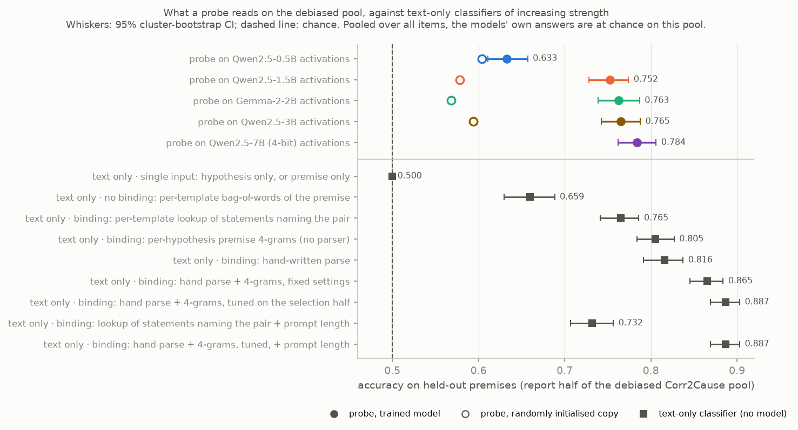
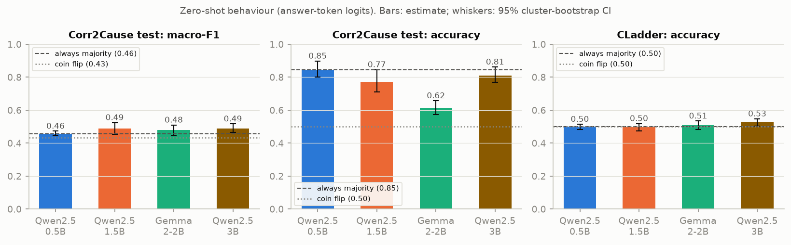
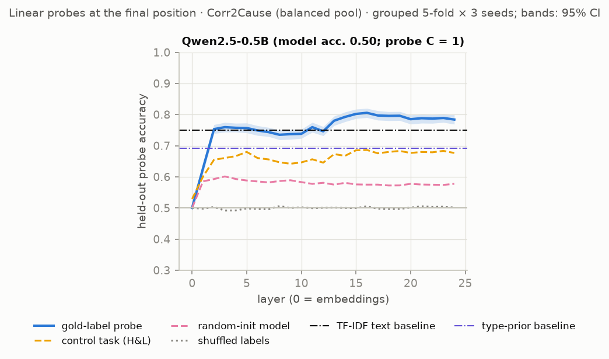

<!-- GENERATED by scripts/13_build_docs.py from report/README_template.md; edit the template, not this file -->
# causal-probe

Do small open-weight language models internally represent the correct answer to formal causal-reasoning questions that they answer wrongly? A probing, steering and patching study on Corr2Cause and CLadder, run on an 8 GB laptop plus free Kaggle and Colab GPU sessions.

**Status:** final, version **v1.0** (git tag `v1.0`, Sunday 15 November 2026). The results page below was checked sentence by sentence against the result files by an independent reviewer (`notes/audit_results_wording_raw.md`); every number on it is read from `results/*.json` when the documents are built, and the end-to-end script regenerated every number of the project on 14 to 15 November (`notes/log.md`). What is left for next week is in `notes/handoff.md`.

**Question.** When small language models answer formal causal-reasoning questions wrongly, is the correct answer nevertheless linearly readable from their activations, and is it used?

**Run:** Qwen2.5-0.5B, 1.5B, 3B and Gemma-2-2B on Corr2Cause and CLadder: probes against text-only baselines, steering, patching. Qwen2.5-7B (4-bit) and Gemma-2-9B: answers, and probes on the debiased pool. Seventeen reviews by fresh reviewer agents; those of results were given code and files, not the conclusions. Numbers: `results/*.json`; caveats: `report/report.md`.

## Three headline claims

**1. A probe's accuracy for the correct answer means nothing until it is compared with what the text alone gives away.**
- *Number:* on the official Corr2Cause test split (21 premises) a classifier that sees only the hypothesis, never the premise, reaches AUROC 0.895 [0.863, 0.919]. Gold-label probes are below the strongest text-only classifier in all eight model × benchmark cells.
- *Figure:* [four of the eight cells](figures/fig5_confound_c2c_probe.png).

**2. With the hypothesis-only and premise-only shortcuts removed (prompt length still leaks within a hypothesis type), a probe on the activations of the models from 1.5B to 7B is about as accurate as a lookup of the premise statements about the two queried variables, and less accurate than a hand-written parse; ranked across all items at once, the models' answers are at chance.**
- *Number:* on the debiased pool Qwen2.5-3B's probe scores 0.765 [0.743, 0.788], the lookup 0.765, a hand-written parse 0.816; its answers have AUROC 0.507 [0.484, 0.530]. Qwen2.5-7B: probe 0.784 [0.762, 0.806]; answers 0.514 [0.490, 0.536].
- *Caveats:* inside a hypothesis string the four smaller models' answers do not follow validity (AUROC 0.47 to 0.51); they depend on adjacency of the queried pair. The 7B model's follow validity on average, weakly: AUROC within string 0.549 [0.530, 0.569], about 0.53 with prompt length removed; the valid item of a premise gets the higher answer logit in 53.6% of premises (Qwen2.5-3B: 52.0%). Gemma-2-9B has the same raw figure (0.542) and it is not shown beyond a response to prompt length (0.52 with length removed).



**3. No intervention shows that what a probe reads is what the answer is computed from.**
- *Number:* steering along a gold-label direction was compared with 20 matched control directions 32 times (four models, two item pools, two tokens, two kinds of direction). The gold direction exceeds all its controls in 4, where chance gives 1.52; on the debiased pool in 3 of 16 (0.76). None survives a correction for multiple comparisons, and with 20 controls none could.
- *The four:* Qwen2.5-3B, end of the hypothesis, class-mean difference (+0.738) and Qwen2.5-1.5B, same token, probe direction (-0.251) were tested again by a rule fixed beforehand, refitted on the other half of the data: both kept their sign and lay inside 500 controls (p = 0.08 and 0.12). Gemma-2-2B, answer position, probe direction (+0.475, first by 3%) and Qwen2.5-0.5B, original pool, class-mean difference (+0.865) are undecided.
- *Caveats:* taken together the gold class-mean differences do rank above their controls (mean rank 6.44 of 21; 11 expected). At the answer position on the debiased pool that is the answers' own within-question correlation with the label read back (three of four models) and does not show that validity is used; at the end of the hypothesis it is unexplained. Shifting items along the encoding of adjacency before the answer position is outside its controls in one of four models ([figure](figures/fig12_adjacency_end_of_hypothesis.png)); at the answer position it moves the answer the same way for every hypothesis type, which locates the answer.

*Checked by:* claim 1, audits 1 and 6; claim 2, audits 3, 5, 6, 11, 14 and 16; claim 3, audits 2, 4, 5, 6, 8, 11, 15 and 17.

## What was retracted, and why

| Claim as first made | What was wrong | Caught by |
|---|---|---|
| "Qwen2.5-1.5B represents the answer but doesn't say it" | Baselines too weak: the hypothesis string alone predicts 86% of labels | Audit 1 |
| "The gold-probe direction is inert; the model-output direction flips answers" | One sign shown, three random directions, steps far beyond natural scale | Audit 2 |
| Two adjacency experiments: "erasing adjacency removes a sixth of the dependence, beyond all 20 controls" | The first "removal" left the property readable; the second used a control that could not fail | Audits 4 and 5 |

The other retractions, each with the review that caught it, are in report Section 6.

## Limitations

- Interventions on models of up to 3 billion parameters whose answers do not follow validity. The 7B model follows it weakly, was run in 4-bit quantisation, and was not intervened on. Inside a hypothesis type the pool still leaks through prompt length, which Gemma-2-9B's answers follow. Two benchmarks; linear probes. Nothing here says what a model that can do the task would show.
- Claim 3: four models, three of one family. "No intervention shows" is not "unused".
- The stronger baselines, the debiased pool, the within-string statistics and every corrected analysis were introduced after seeing results; the pre-registered analysis is reported next to them (report Section 3.4).

The same page as a file: `RESULTS.md`. How the story unfolded, in plain language: `EXPLAINER.md`, "Start here".

## Further results (not headline claims)

- **Behaviour.** The four smaller models answer both benchmarks at or near chance; part of that is answer bias, and the bias-free ranking score is near 0.5 as well (table below). Qwen2.5-7B (4-bit) is at chance on the debiased pool when all items are ranked at once and follows validity weakly inside a hypothesis string (results page, claim 2).
- **Patching.** A change of one variable in the prompt reaches the answer position at 60 to 70% of the network's depth (four models). When the edit leaves the correct answer unchanged the answer logit moves by an amount of the same order as when it changes it (four models); in Qwen2.5-0.5B it moves as much, and its sign follows where the queried variable stands in the premise, not validity (a pattern that Qwen2.5-1.5B and Qwen2.5-3B do not reproduce): this locates where a prompt difference arrives, not where a judgement is made.
- **In the report's appendix:** logit lens, cross-model comparison, sparse-autoencoder features, attribution patching of components.

## What was pre-registered, what passed, what was retracted

- **Pre-registered** (written in the decision log before any probe was run, D11): on report-half items the model answers wrongly, gold-probe accuracy must exceed 0.5, a TF-IDF baseline and a template prior, by 95% confidence-interval lower bounds. Layer selection on one half of the premises, reporting on the other.
- **Passed as coded.** In the current result files that criterion is met for Qwen2.5-1.5B and Gemma-2-2B on CLadder, in variants also on Corr2Cause, and for all four models on the debiased pool. One cell (Qwen2.5-1.5B on Corr2Cause, as first run) was logged as a positive result on Thursday night.
- **Retracted** after an independent audit of code and results on Friday: the pre-registered baselines were too weak. The audit showed that the hypothesis string alone predicts 86% of labels in the pool, and that "accuracy above 0.5 on wrongly answered items" is not a chance test when those items are mostly one class.
- **Added after seeing results** (and therefore not pre-registered): the hypothesis-string, question-only and parsed-feature baselines (D18); the audited criterion, probe versus strongest text-only baseline (D19); the debiased pool (D21); the ladder of baselines on it (D25); matched steering controls (D24); the adjacency test, its second version and its transfer arm (D27, `notes/log.md` 13 November). Each of D18 to D25 can only make the claim harder to pass; the adjacency test is exploratory, and one of its changes made a positive reading easier (report 4.4, "Status"). The pre-registered analysis is still reported in full next to them.

## Headline tables

Behaviour, separating bias from chance:

| Model | Item set | Prompt | Items | Yes-rate | Accuracy | Majority-class accuracy | AUROC of Yes−No logit difference | Accuracy at best threshold (cross-fitted) | Reading |
|---|---|---|---|---|---|---|---|---|---|
| Qwen2.5-0.5B | Corr2Cause test | zero-shot | 1162 | 0.00 | 0.845 [0.803, 0.898] | 0.845 | 0.589 [0.531, 0.660] | 0.843 [0.801, 0.895] | informative (AUROC CI above 0.5) |
| Qwen2.5-0.5B | Corr2Cause pool | zero-shot | 2400 | 0.00 | 0.502 [0.500, 0.504] | 0.500 | 0.591 [0.569, 0.614] | 0.578 [0.558, 0.598] | informative (AUROC CI above 0.5) |
| Qwen2.5-0.5B | Corr2Cause debiased pool | zero-shot | 2400 | 0.00 | 0.498 [0.496, 0.501] | 0.500 | 0.505 [0.485, 0.526] | 0.498 [0.484, 0.512] | at chance (AUROC CI includes 0.5) |
| Qwen2.5-0.5B | CLadder | zero-shot | 3000 | 0.04 | 0.500 [0.483, 0.515] | 0.500 | 0.499 [0.468, 0.527] | 0.509 [0.484, 0.531] | at chance (AUROC CI includes 0.5) |
| Qwen2.5-0.5B | Corr2Cause test, variables renamed | zero-shot, variables renamed | 1162 | 0.01 | 0.842 [0.800, 0.895] | 0.845 | 0.511 [0.455, 0.572] | 0.843 [0.800, 0.896] | at chance (AUROC CI includes 0.5) |
| Qwen2.5-0.5B | Corr2Cause test (500 items) | 4-shot | 500 | 0.81 | 0.314 [0.260, 0.367] | 0.840 | 0.660 [0.579, 0.741] | 0.846 [0.814, 0.887] | informative (AUROC CI above 0.5) |
| Qwen2.5-0.5B | CLadder (500 items) | 4-shot | 500 | 0.20 | 0.516 [0.481, 0.552] | 0.500 | 0.495 [0.451, 0.542] | 0.486 [0.452, 0.521] | at chance (AUROC CI includes 0.5) |
| Qwen2.5-1.5B | Corr2Cause test | zero-shot | 1162 | 0.10 | 0.773 [0.711, 0.846] | 0.845 | 0.561 [0.503, 0.614] | 0.843 [0.801, 0.895] | informative (AUROC CI above 0.5) |
| Qwen2.5-1.5B | Corr2Cause pool | zero-shot | 2400 | 0.10 | 0.500 [0.488, 0.512] | 0.500 | 0.568 [0.545, 0.590] | 0.565 [0.551, 0.580] | informative (AUROC CI above 0.5) |
| Qwen2.5-1.5B | Corr2Cause debiased pool | zero-shot | 2400 | 0.16 | 0.492 [0.478, 0.507] | 0.500 | 0.510 [0.488, 0.533] | 0.511 [0.495, 0.526] | at chance (AUROC CI includes 0.5) |
| Qwen2.5-1.5B | CLadder | zero-shot | 3000 | 0.64 | 0.497 [0.474, 0.519] | 0.500 | 0.509 [0.478, 0.542] | 0.499 [0.480, 0.519] | at chance (AUROC CI includes 0.5) |
| Qwen2.5-1.5B | Corr2Cause test, variables renamed | zero-shot, variables renamed | 1162 | 0.17 | 0.729 [0.667, 0.803] | 0.845 | 0.579 [0.523, 0.630] | 0.843 [0.800, 0.897] | informative (AUROC CI above 0.5) |
| Qwen2.5-1.5B | Corr2Cause test (500 items) | 4-shot | 500 | 0.05 | 0.800 [0.752, 0.856] | 0.840 | 0.556 [0.502, 0.606] | 0.818 [0.770, 0.877] | informative (AUROC CI above 0.5) |
| Qwen2.5-1.5B | CLadder (500 items) | 4-shot | 500 | 0.72 | 0.528 [0.487, 0.565] | 0.500 | 0.559 [0.511, 0.601] | 0.496 [0.460, 0.533] | informative (AUROC CI above 0.5) |
| Gemma-2-2B | Corr2Cause test | zero-shot | 1162 | 0.34 | 0.615 [0.573, 0.658] | 0.845 | 0.536 [0.495, 0.566] | 0.843 [0.800, 0.897] | at chance (AUROC CI includes 0.5) |
| Gemma-2-2B | Corr2Cause pool | zero-shot | 2400 | 0.25 | 0.505 [0.487, 0.525] | 0.500 | 0.559 [0.537, 0.582] | 0.565 [0.553, 0.576] | informative (AUROC CI above 0.5) |
| Gemma-2-2B | Corr2Cause debiased pool | zero-shot | 2400 | 0.31 | 0.496 [0.477, 0.515] | 0.500 | 0.492 [0.468, 0.515] | 0.497 [0.481, 0.513] | at chance (AUROC CI includes 0.5) |
| Gemma-2-2B | CLadder | zero-shot | 3000 | 0.63 | 0.508 [0.482, 0.535] | 0.500 | 0.519 [0.482, 0.557] | 0.500 [0.483, 0.520] | at chance (AUROC CI includes 0.5) |
| Gemma-2-2B | Corr2Cause test, variables renamed | zero-shot, variables renamed | 1162 | 0.32 | 0.602 [0.562, 0.641] | 0.845 | 0.504 [0.464, 0.531] | 0.844 [0.801, 0.897] | at chance (AUROC CI includes 0.5) |
| Gemma-2-2B | Corr2Cause test (500 items) | 4-shot | 500 | 0.54 | 0.486 [0.445, 0.526] | 0.840 | 0.569 [0.523, 0.613] | 0.834 [0.793, 0.886] | informative (AUROC CI above 0.5) |
| Gemma-2-2B | CLadder (500 items) | 4-shot | 500 | 0.83 | 0.504 [0.458, 0.546] | 0.500 | 0.543 [0.498, 0.585] | 0.504 [0.465, 0.543] | at chance (AUROC CI includes 0.5) |
| Qwen2.5-3B | Corr2Cause test | zero-shot | 1162 | 0.05 | 0.812 [0.768, 0.862] | 0.845 | 0.534 [0.493, 0.573] | 0.838 [0.794, 0.892] | at chance (AUROC CI includes 0.5) |
| Qwen2.5-3B | Corr2Cause pool | zero-shot | 2400 | 0.05 | 0.509 [0.500, 0.519] | 0.500 | 0.581 [0.559, 0.603] | 0.593 [0.573, 0.613] | informative (AUROC CI above 0.5) |
| Qwen2.5-3B | Corr2Cause debiased pool | zero-shot | 2400 | 0.04 | 0.495 [0.487, 0.503] | 0.500 | 0.507 [0.484, 0.530] | 0.506 [0.490, 0.524] | at chance (AUROC CI includes 0.5) |
| Qwen2.5-3B | CLadder † | zero-shot | 3000 | 0.50 | 0.526 [0.502, 0.548] | 0.500 | 0.543 [0.518, 0.568] | 0.507 [0.487, 0.528] | informative (AUROC CI above 0.5) |
| Qwen2.5-3B | Corr2Cause test, variables renamed | zero-shot, variables renamed | 1162 | 0.04 | 0.822 [0.783, 0.868] | 0.845 | 0.512 [0.463, 0.553] | 0.844 [0.802, 0.896] | at chance (AUROC CI includes 0.5) |
| Qwen2.5-3B | Corr2Cause test (500 items) | 4-shot | 500 | 0.46 | 0.556 [0.517, 0.596] | 0.840 | 0.538 [0.507, 0.569] | 0.838 [0.797, 0.890] | informative (AUROC CI above 0.5) |
| Qwen2.5-3B | CLadder (500 items) † | 4-shot | 500 | 0.56 | 0.560 [0.518, 0.602] | 0.500 | 0.564 [0.517, 0.608] | 0.510 [0.476, 0.543] | informative (AUROC CI above 0.5) |
| Qwen2.5-7B (4-bit) | Corr2Cause test | zero-shot | 1162 | 0.08 | 0.786 [0.741, 0.839] | 0.845 | 0.581 [0.545, 0.611] | 0.844 [0.802, 0.897] | informative (AUROC CI above 0.5) |
| Qwen2.5-7B (4-bit) | Corr2Cause pool | zero-shot | 2400 | 0.09 | 0.496 [0.485, 0.508] | 0.500 | 0.594 [0.572, 0.618] | 0.601 [0.582, 0.620] | informative (AUROC CI above 0.5) |
| Qwen2.5-7B (4-bit) | Corr2Cause debiased pool | zero-shot | 2400 | 0.07 | 0.506 [0.496, 0.517] | 0.500 | 0.514 [0.490, 0.536] | 0.525 [0.505, 0.543] | at chance (AUROC CI includes 0.5) |
| Qwen2.5-7B (4-bit) | CLadder | zero-shot | 3000 | 0.49 | 0.544 [0.520, 0.568] | 0.500 | 0.570 [0.541, 0.601] | 0.534 [0.511, 0.555] | informative (AUROC CI above 0.5) |
| Gemma-2-9B | Corr2Cause test | zero-shot | 1162 | 0.02 | 0.842 [0.803, 0.888] | 0.845 | 0.553 [0.496, 0.602] | 0.842 [0.800, 0.893] | at chance (AUROC CI includes 0.5) |
| Gemma-2-9B | Corr2Cause pool | zero-shot | 2400 | 0.01 | 0.505 [0.501, 0.508] | 0.500 | 0.574 [0.552, 0.597] | 0.598 [0.578, 0.619] | informative (AUROC CI above 0.5) |
| Gemma-2-9B | Corr2Cause debiased pool | zero-shot | 2400 | 0.01 | 0.507 [0.503, 0.512] | 0.500 | 0.512 [0.490, 0.535] | 0.517 [0.502, 0.531] | at chance (AUROC CI includes 0.5) |
| Gemma-2-9B | CLadder | zero-shot | 3000 | 0.75 | 0.566 [0.546, 0.586] | 0.500 | 0.598 [0.569, 0.626] | 0.555 [0.536, 0.575] | informative (AUROC CI above 0.5) |

<sub>Source: `results/answer_bias.json`</sub><br><sub>† computed on the GPU machine's draw of the 3,000-item CLadder sample (2,271 items shared with the other models' draw; Section 7).</sub>

Probe versus strongest text-only baseline (report half):

| Model | Dataset | Gold probe acc. | Strongest text baseline | Its acc. | Probe − baseline (acc., all items) | Probe − baseline (AUROC, model leans Yes) | Probe − baseline (AUROC, model leans No) | Audited criterion met | Pre-registered criterion met (as coded) | Pre-registered wrong-items test applicable |
|---|---|---|---|---|---|---|---|---|---|---|
| Qwen2.5-0.5B | Corr2Cause pool | 0.807 [0.784, 0.828] | structural | 0.919 [0.902, 0.935] | -0.113 [-0.136, -0.091] | -0.093 [-0.126, -0.063] | -0.069 [-0.093, -0.045] | no | no | no (100% gold-Yes) |
| Qwen2.5-0.5B | CLadder | 0.561 [0.534, 0.586] | structural | 0.800 [0.767, 0.839] | -0.240 [-0.285, -0.203] | -0.316 [-0.363, -0.271] | -0.252 [-0.320, -0.194] | no | no | no (97% gold-Yes) |
| Qwen2.5-0.5B | Corr2Cause debiased pool | 0.633 [0.609, 0.658] | structural | 0.816 [0.792, 0.837] | -0.183 [-0.214, -0.149] | -0.215 [-0.257, -0.172] | -0.245 [-0.288, -0.201] | no | yes | no (99% gold-Yes) |
| Qwen2.5-1.5B | Corr2Cause pool | 0.870 [0.850, 0.890] | structural | 0.919 [0.902, 0.935] | -0.049 [-0.068, -0.032] | -0.030 [-0.052, -0.009] | -0.027 [-0.044, -0.011] | no | no | no (90% gold-Yes) |
| Qwen2.5-1.5B | CLadder | 0.605 [0.580, 0.631] | structural | 0.800 [0.767, 0.839] | -0.196 [-0.234, -0.162] | -0.174 [-0.214, -0.129] | -0.267 [-0.327, -0.216] | no | yes | yes |
| Qwen2.5-1.5B | Corr2Cause debiased pool | 0.752 [0.729, 0.776] | structural | 0.816 [0.792, 0.837] | -0.063 [-0.094, -0.034] | -0.053 [-0.090, -0.015] | -0.094 [-0.125, -0.065] | no | yes | no (84% gold-Yes) |
| Gemma-2-2B | Corr2Cause pool | 0.863 [0.841, 0.886] | structural | 0.919 [0.902, 0.935] | -0.056 [-0.078, -0.033] | -0.020 [-0.039, -0.001] | -0.030 [-0.051, -0.008] | no | no | yes |
| Gemma-2-2B | CLadder | 0.626 [0.590, 0.664] | structural | 0.800 [0.767, 0.839] | -0.174 [-0.220, -0.133] | -0.159 [-0.215, -0.100] | -0.237 [-0.297, -0.185] | no | yes | yes |
| Gemma-2-2B | Corr2Cause debiased pool | 0.763 [0.739, 0.787] | structural | 0.816 [0.792, 0.837] | -0.053 [-0.081, -0.023] | -0.049 [-0.091, -0.010] | -0.076 [-0.103, -0.050] | no | yes | yes |
| Qwen2.5-3B | Corr2Cause pool | 0.862 [0.843, 0.880] | structural | 0.919 [0.902, 0.935] | -0.057 [-0.077, -0.038] | -0.039 [-0.064, -0.015] | -0.018 [-0.032, -0.004] | no | no | no (96% gold-Yes) |
| Qwen2.5-3B | CLadder † | 0.628 [0.600, 0.654] | structural | 0.763 [0.733, 0.800] | -0.135 [-0.176, -0.096] | -0.225 [-0.277, -0.179] | -0.151 [-0.227, -0.087] | no | no | yes |
| Qwen2.5-3B | Corr2Cause debiased pool | 0.765 [0.743, 0.788] | structural | 0.816 [0.792, 0.837] | -0.050 [-0.079, -0.020] | -0.039 [-0.080, +0.000] | -0.074 [-0.103, -0.047] | no | yes | no (95% gold-Yes) |
| Qwen2.5-7B (4-bit) | Corr2Cause debiased pool | 0.784 [0.760, 0.806] | structural | 0.816 [0.792, 0.837] | -0.032 [-0.060, -0.002] | -0.042 [-0.078, -0.006] | -0.043 [-0.070, -0.017] | no | yes | no (93% gold-Yes) |
| Gemma-2-9B | Corr2Cause debiased pool | 0.771 [0.748, 0.792] | structural | 0.816 [0.792, 0.837] | -0.045 [-0.073, -0.016] | -0.047 [-0.086, -0.009] | -0.057 [-0.082, -0.032] | no | yes | no (99% gold-Yes) |

<sub>Source: `results/confound_qwen0.5b_c2c_probe.json`, `results/confound_qwen0.5b_cladder.json`, `results/confound_qwen0.5b_c2c_debiased.json`, `results/confound_qwen1.5b_c2c_probe.json`, `results/confound_qwen1.5b_cladder.json`, `results/confound_qwen1.5b_c2c_debiased.json`, `results/confound_gemma2b_c2c_probe.json`, `results/confound_gemma2b_cladder.json`, `results/confound_gemma2b_c2c_debiased.json`, `results/confound_qwen3b_c2c_probe.json`, `results/confound_qwen3b_cladder.json`, `results/confound_qwen3b_c2c_debiased.json`, `results/confound_qwen7b-4bit_c2c_debiased.json`, `results/confound_gemma9b_c2c_debiased.json`</sub><br><sub>† computed on the GPU machine's draw of the 3,000-item CLadder sample (2,271 items shared with the other models' draw; Section 7).</sub>

What the text alone gives away on Corr2Cause (official splits):

| Split | Text-only baseline (fit on train) | Items | Premises | Accuracy | Macro-F1 | F1 (valid class) | AUROC | Predicted valid |
|---|---|---|---|---|---|---|---|---|
| test | Majority class | 1162 | 21 | 0.845 [0.803, 0.898] | 0.458 [0.445, 0.473] | 0.000 [0.000, 0.000] | 0.500 [0.500, 0.500] | 0.00 |
| test | Template prior (6 templates) | 1162 | 21 | 0.845 [0.803, 0.898] | 0.458 [0.445, 0.473] | 0.000 [0.000, 0.000] | 0.751 [0.722, 0.786] | 0.00 |
| test | Hypothesis only (string prior) | 1162 | 21 | 0.855 [0.833, 0.876] | 0.702 [0.636, 0.744] | 0.488 [0.365, 0.566] | 0.895 [0.863, 0.919] | 0.13 |
| test | Hypothesis only, F1-tuned threshold | 1162 | 21 | 0.807 [0.768, 0.840] | 0.724 [0.641, 0.784] | 0.573 [0.425, 0.674] | 0.895 [0.863, 0.919] | 0.30 |
| test | Premise only (TF-IDF) | 1162 | 21 | 0.845 [0.803, 0.898] | 0.458 [0.445, 0.473] | 0.000 [0.000, 0.000] | 0.693 [0.604, 0.787] | 0.00 |
| test | Parsed features + hypothesis prior (GBM) | 1162 | 21 | 0.938 [0.921, 0.957] | 0.883 [0.837, 0.913] | 0.802 [0.713, 0.855] | 0.977 [0.968, 0.985] | 0.16 |
| dev | Majority class | 1076 | 22 | 0.871 [0.818, 0.922] | 0.465 [0.450, 0.480] | 0.000 [0.000, 0.000] | 0.500 [0.500, 0.500] | 0.00 |
| dev | Template prior (6 templates) | 1076 | 22 | 0.871 [0.818, 0.922] | 0.465 [0.450, 0.480] | 0.000 [0.000, 0.000] | 0.756 [0.703, 0.814] | 0.00 |
| dev | Hypothesis only (string prior) | 1076 | 22 | 0.850 [0.827, 0.871] | 0.664 [0.617, 0.704] | 0.415 [0.317, 0.492] | 0.863 [0.838, 0.888] | 0.13 |
| dev | Hypothesis only, F1-tuned threshold | 1076 | 22 | 0.769 [0.740, 0.798] | 0.656 [0.582, 0.716] | 0.460 [0.324, 0.567] | 0.863 [0.838, 0.888] | 0.30 |
| dev | Premise only (TF-IDF) | 1076 | 22 | 0.871 [0.818, 0.922] | 0.465 [0.450, 0.480] | 0.000 [0.000, 0.000] | 0.707 [0.592, 0.793] | 0.00 |
| dev | Parsed features + hypothesis prior (GBM) | 1076 | 22 | 0.921 [0.894, 0.948] | 0.834 [0.777, 0.874] | 0.714 [0.601, 0.787] | 0.972 [0.959, 0.982] | 0.15 |
| dev | Parsed features, dev premises also in train removed | 1034 | 20 | 0.921 [0.892, 0.948] | 0.831 [0.766, 0.875] | 0.707 [0.581, 0.787] | 0.971 [0.957, 0.983] | 0.14 |

<sub>Source: `results/benchmark_baselines.json`</sub>

## Other figures




How to read each figure: `EXPLAINER.md`, section "How to read each figure".

## What this shows / what it does not

*Shows:*
- For these models, on these two benchmarks, a linear probe's above-chance accuracy for the gold label is almost entirely accounted for by what text-only classifiers extract from the prompt. On the debiased pool no probe's gain in accuracy over a text-only stack with one tuned setting is demonstrable for any of five models; gains in AUROC over that stack are one to two thousandths, with intervals that exclude zero for Qwen2.5-3B and Qwen2.5-7B only (report Section 3.6).
- On the released Corr2Cause data, a classifier that sees only the hypothesis ranks valid above invalid test items with AUROC 0.895 [0.863, 0.919]; this follows from the benchmark's variable-naming construction (details and prior work: `report/benchmark_text_baselines.md`).

*Does not show:*
- That these models contain no causal-reasoning structure at all: a linear probe at three token positions is a limited instrument, and absence of evidence here is not evidence of absence.
- Anything about models that can do the task. Interventions ran on models of up to 3 billion parameters; Qwen2.5-7B and Gemma-2-9B were analysed for answers and probes only, and none of the six models can do the task.
- That any of these models "uses an adjacency feature": the one clear causal effect is at the answer position, where it shows only that the answer is there.
- That the benchmarks are unsuitable for their purpose. Zero-shot evaluation, which the benchmarks were designed for, cannot exploit a label prior it has never seen. The finding concerns classifiers trained on in-distribution items, which includes probes.

## Documents

| File | What it is |
|---|---|
| `RESULTS.md` | The one-page results shown at the top of this README |
| `EXPLAINER.md` | Start here. Concept primer, decision log, how to read each figure, questions a professor would ask |
| `report/report.md` | Method, tables and figures per tier |
| `report/benchmark_text_baselines.md` | Stand-alone note on text-only baselines for the two benchmarks |
| `notes/log.md` | Dated lab notebook: expectation before each experiment, comparison after |
| `notes/upstream_issues.md` | Bugs and documentation gaps found on the way, with minimal reproductions (not filed) |
| `notes/prior_work.md` | Prior-work check for the benchmark note: what was opened, what was found, the queries |
| `notes/audit_*_raw.md`, `notes/claims_pass_*_raw.md` | The raw reports of the eighteen independent reviews and two claims passes |
| `notes/handoff.md` | What is finished, the next phase, and what to verify by hand before using any of this |
| `study/` | Reading order for a week, 55 graded questions with answers (15 marked as the likeliest in an interview), six predict-then-check exercises |
| `KAGGLE.md` | How to run the GPU part (first run and round 2) |
| `YOUR_TURN.md` | Two small experiments left for the reader |

## Limitations

The short list is in the results page at the top; the full list is Section 7 of `report/report.md`.

## Reproduction

Everything below is for the tagged version: `git checkout v1.0`. Times are for the machine this was built on (an 8 GB Apple M3, CPU only for everything except cache building).

1. Environment (Python 3.12; torch 2.15 and transformers 5.22.2 were used):

```bash
uv venv --python 3.12 .venv && uv pip install --python .venv/bin/python -r requirements.txt -e .
```

2. Data (Corr2Cause and CLadder, from their public releases):

```bash
.venv/bin/python scripts/download_data.py
```

3. The text-only results, including claim 1's number, without any model (about 5 minutes):

```bash
.venv/bin/python scripts/14_benchmark_baselines.py
```

4. The activation caches. For Qwen2.5-0.5B, Qwen2.5-1.5B and Gemma-2-2B on a laptop (resumable; Gemma needs a Hugging Face token with the Gemma licence accepted, in `HF_TOKEN`; several hours):

```bash
./scripts/build_cache.sh
```

   For Qwen2.5-3B, Qwen2.5-7B, Gemma-2-9B and every intervention (steering, patching, the adjacency test, the held-out tests): the Kaggle notebooks in `notebooks/`, one per run, each pinned to the commit it was run at; `KAGGLE.md` lists them with their GPU, secret and running time. Each notebook writes its output to the kept output directory and a `STATUS.txt`; bring the downloads into `kaggle_out/<run>/` and ingest each with

```bash
.venv/bin/python scripts/kaggle_ingest.py --run <run name> --dir kaggle_out/<folder>
```

   The run names are in `KAGGLE.md`; the ingest refuses a run whose status is missing or not OK.

5. Every number, table, figure and document from the caches (CPU only; about eight hours on the laptop; one model at a time under a memory watchdog):

```bash
./scripts/run_all.sh
```

6. Check that nothing moved:

```bash
git status --short && git diff --stat
```

   On 14 to 15 November this regenerated every number that existed before identically (`notes/log.md`, entries of 20:30 and 07:34); interventions are not rerun by `run_all.sh`, which recomputes their statistics from the saved raw outputs.

## Citations

- Jin et al. (2024). Can Large Language Models Infer Causation from Correlation? ICLR 2024. arXiv:2306.05836.
- Jin et al. (2023). CLadder: Assessing Causal Reasoning in Language Models. NeurIPS 2023. arXiv:2312.04350.
- Clarke et al. (2026). Evaluating Causal Reasoning in LLMs: A Case Study in the Challenges of Procedural Generation. arXiv:2610.38100.
- Hewitt and Liang (2019). Designing and Interpreting Probes with Control Tasks. EMNLP-IJCNLP 2019.
- Poliak et al. (2018). Hypothesis Only Baselines in Natural Language Inference. *SEM 2018.
- Gururangan et al. (2018). Annotation Artifacts in Natural Language Inference Data. NAACL-HLT 2018.
- Lieberum et al. (2024). Gemma Scope. arXiv:2408.05147.
