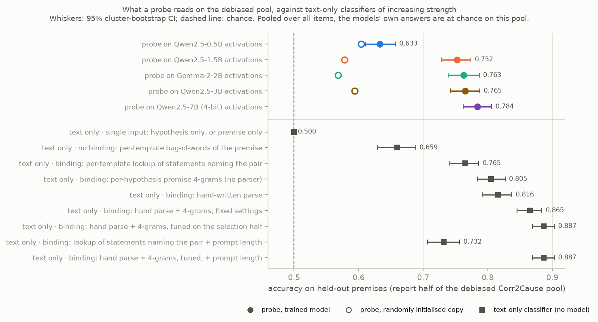

<!-- GENERATED by scripts/13_build_docs.py from report/RESULTS_template.md; edit the template, not this file -->
# Results in one page

**Question.** When small language models answer formal causal-reasoning questions wrongly, is the correct answer nevertheless linearly readable from their activations, and is it used?

**Run:** Qwen2.5-0.5B, 1.5B, 3B and Gemma-2-2B on Corr2Cause and CLadder: probes against text-only baselines, steering, patching. Qwen2.5-7B (4-bit): answers, and probes on the debiased pool. Fifteen reviews by fresh reviewer agents; those of results were given code and files, not the conclusions. Numbers are from `results/*.json`; details and all caveats are in `report/report.md`.

**Not in this page:** Gemma-2-9B (returned 14 Nov, under audit); the held-out test of the Qwen2.5-3B case and patching on all available pairs for Qwen2.5-3B (launched 14 Nov).

## Three headline claims

**1. A probe's accuracy for the correct answer means nothing until it is compared with what the text alone gives away.**
- *Number:* on the official Corr2Cause test split (21 premises) a classifier that sees only the hypothesis, never the premise, reaches AUROC 0.895 [0.863, 0.919]. Gold-label probes are below the strongest text-only classifier in all eight model × benchmark cells.
- *Figure:* [probe against text, four of the eight cells](figures/fig5_confound_c2c_probe.png).

**2. With every single-input shortcut removed, a probe on the activations of the models from 1.5B to 7B is about as accurate as a lookup of the premise statements about the two queried variables, and less accurate than a hand-written parse; ranked across all items at once, the models' answers are at chance.**
- *Number:* on the debiased pool Qwen2.5-3B's probe scores 0.765 [0.743, 0.788], the lookup 0.765, a hand-written parse 0.816; its answers have AUROC 0.507 [0.484, 0.530]. Qwen2.5-7B: probe 0.784 [0.762, 0.806]; answers 0.514 [0.490, 0.536].
- *Caveats:* inside a hypothesis string the four smaller models' answers do not follow validity (AUROC 0.47 to 0.51); they depend on adjacency of the queried pair. The 7B model's follow validity on average, weakly, and go against it for direct-causation hypotheses (0.442): AUROC within string 0.549 [0.530, 0.569]; the valid item of a premise gets the higher answer logit in 53.6% of premises (Qwen2.5-3B: 52.0%).

**3. No intervention shows that what a probe reads is what the answer is computed from.**
- *Number:* steering along a gold-label direction was compared with 20 matched control directions 32 times (four models, two item pools, two tokens, two kinds of direction). The gold direction exceeds all its controls in 4, where chance gives 1.52; on the debiased pool in 3 of 16 (0.76). None survives a correction for multiple comparisons, and with 20 controls none could.
- *The four:* Qwen2.5-3B, end of the hypothesis, class-mean difference (+0.738); Qwen2.5-1.5B, same token, probe direction (-0.251; inside its 500 controls in a test fixed beforehand, p = 0.12); Gemma-2-2B, answer position, probe direction (+0.475, first by 3%); Qwen2.5-0.5B, original pool, class-mean difference (+0.865). Three are undecided and one was not confirmed.
- *Caveats:* taken together the gold class-mean differences do rank above their controls (mean rank 6.44 of 21; 11 expected). At the answer position on the debiased pool that is the answers' own within-question correlation with the label read back (three of four models) and does not show that validity is used; at the end of the hypothesis it is unexplained. Shifting items along the encoding of adjacency before the answer position is outside its controls in one of four models ([figure](figures/fig12_adjacency_end_of_hypothesis.png)); at the answer position it moves the answer the same way for every hypothesis type, which locates the answer.

*Checked by:* claim 1, audits 1 and 6; claim 2, audits 3, 5, 6, 11 and 14; claim 3, audits 2, 4, 5, 6, 8, 11 and 15.

## What was retracted, and why

| Claim as first made | What was wrong | Caught by |
|---|---|---|
| "Qwen2.5-1.5B represents the answer but doesn't say it" | Baselines too weak: the hypothesis string alone predicts 86% of labels | Audit 1 |
| "The gold-probe direction is inert; the model-output direction flips answers" | One sign shown, three random directions, steps far beyond natural scale | Audit 2 |
| Two adjacency experiments: "erasing adjacency removes a sixth of the dependence, beyond all 20 controls" | The first "removal" left the property readable; the second used a control that could not fail | Audits 4 and 5 |

The other retractions, each with the review that caught it, are in report Section 6.

## Limitations

- Interventions on models of up to 3 billion parameters whose answers do not follow validity. The 7B model follows it weakly, was run in 4-bit quantisation, and was not intervened on. Two benchmarks; linear probes. Nothing here says what a model that can do the task would show.
- Claim 3: four models, three of one family. "No intervention shows" is not "unused".
- The stronger baselines, the debiased pool, the within-string statistics and every corrected analysis were introduced after seeing results; the pre-registered analysis is reported next to them (report Section 3.4).
