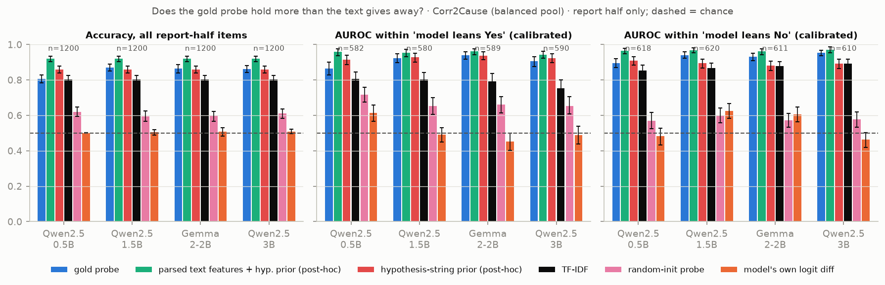
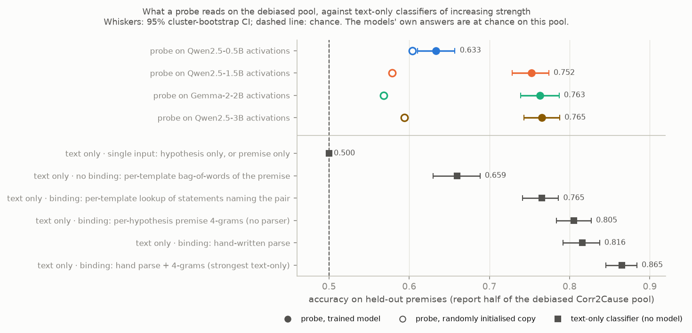
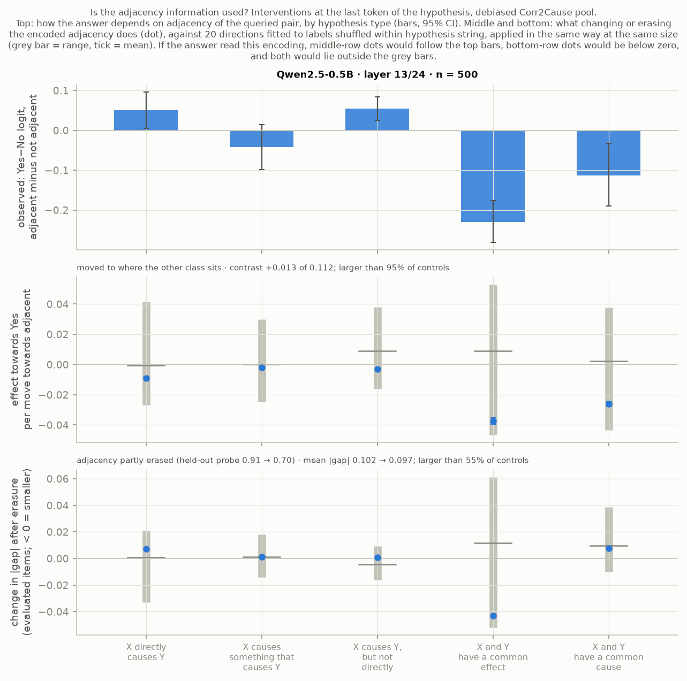

<!-- GENERATED by scripts/13_build_docs.py from report/RESULTS_template.md; edit the template, not this file -->
# Results in one page

**Question.** When small language models answer formal causal-reasoning questions wrongly, is the correct answer nevertheless linearly readable from their activations, and is it used?

**Run:** Qwen2.5-0.5B, 1.5B, 3B and Gemma-2-2B on Corr2Cause and CLadder; probes against text-only baselines, steering, patching; five independent audits. Every number is from `results/*.json`; the full account is `report/report.md`.

## Three headline claims

**1. A probe's accuracy for the correct answer means nothing until it is compared with what the text alone gives away.** On the official Corr2Cause test split a classifier that sees only the hypothesis, never the premise, reaches AUROC 0.895 [0.863, 0.919]. Gold-label probes lose to the strongest text-only classifier in all eight model × benchmark cells. *Checked by* audit 1, which found it and forced the retraction of my first positive result.

**2. With every single-input shortcut removed, the larger models' activations hold about what a lookup of the premise statements about the two queried variables gives, and the models answer at chance.** On the debiased pool Qwen2.5-3B's probe scores 0.765 [0.743, 0.788], the lookup 0.765, a hand-written parse 0.816; Qwen2.5-1.5B and Gemma-2-2B score 0.752 and 0.763; the four models' answers have AUROC 0.505, 0.510, 0.492 and 0.507. *Checked by* audit 3 (two models; it replaced my baseline list) and audit 5 (four models, recomputed).

**3. There is no evidence that what a probe reads is what the answer is computed from.** In Qwen2.5-0.5B, intervening at the end of the hypothesis on the encoding of adjacency (the one structural property the answers depend on) has an effect that is larger in absolute value than 95% of 20 random directions of the same size: inside their range. At the answer position it removes the dependence for one hypothesis type, where the answer is already a linear function of the activation (held-out R² 0.96): that locates the answer, nothing more. Steering along the gold-label probe direction stays within the range of matched controls. *Checked by* audits 2, 4 and 5; the reruns after audit 5 are not yet audited. One model so far.

## What we retracted, and why

| Claim as first made | What was wrong | Caught by |
|---|---|---|
| "Qwen2.5-1.5B represents the answer but doesn't say it" | Baselines too weak: the hypothesis string alone predicts 86% of labels | Audit 1 |
| "The gold-probe direction is inert; the model-output direction flips answers" | One sign shown, three random directions, steps far beyond natural scale | Audit 2 |
| "The probe beats the shallow controls and adds nothing to the parser" | Controls at 50% by construction; an insensitive test | Audit 3 |
| "The answers do not express what the probe reads" | False per hypothesis type; opposite signs cancel | Audit 3 |
| First adjacency experiment | Its "removal" left the property readable (AUROC 0.84) | Audit 4 |
| "Erasing adjacency removes a sixth of the dependence, beyond all 20 controls" | A control that could not fail; a summary that counted a gap growing as a reduction | Audit 5 |
| "The model reacts to letters out of alphabetical order" | A one-sided pair construction | Audit 5 |
| Three bugs: CLadder sample differing between machines; an overstated SAE interval; a fix reported but not applied | See `notes/log.md` | Ingest check, own review, audit 5 |

## Limitations

- Models up to 3 billion parameters, all at or near chance; two benchmarks; linear probes. Nothing here says what a model that can do the task would show (a 7B behaviour check is running).
- Claim 3 rests on one model, four sites and 20 controls. "No evidence" is not "evidence of absence".
- The stronger baselines, the debiased pool and every corrected analysis were introduced after seeing results; the pre-registered analysis is reported next to them (report Section 3.4).
- Interventions act on one layer and one token at a time.
- Qwen2.5-3B's CLadder numbers are on a different draw of the sample (marked † in the tables).
