<!-- GENERATED by scripts/13_build_docs.py from report/report_template.md; edit the template, not this file -->
# Do small LLMs represent causal answers they fail to give? A probing, steering and patching study

Technical report. Every number in a table comes from `results/*.json` via `scripts/12_tables.py`; the source file is named under each table. Figures are drawn from the same files by `scripts/06_figures.py`. For background on any method see `EXPLAINER.md`.

## 1. Question and summary

**Question.** Do small open-weight language models internally represent the correct answer to formal causal-reasoning questions they answer wrongly; is that representation used; and where is the answer formed?

**Summary of findings.**

1. *Behaviour.* Qwen2.5-0.5B, Qwen2.5-1.5B, Gemma-2-2B and Qwen2.5-3B are at or near chance on Corr2Cause and CLadder. Part of the picture is answer bias; the bias-free ranking score is at or near 0.5 as well. All four show a small signal on the original Corr2Cause pool (AUROC 0.56 to 0.59) that is gone on the debiased pool (0.49 to 0.51). Qwen2.5-3B is the only model above chance on CLadder, barely (accuracy 0.526 [0.502, 0.548], on Kaggle's draw of the CLadder sample; see Section 7) (Section 3.1).
2. *First probing result and its retraction.* Linear probes decode the gold label at 0.807 to 0.870 on a balanced Corr2Cause pool, and the pre-registered criterion for "represents but doesn't say" passed as coded in some cells. An independent audit showed the criterion's baselines were too weak: the hypothesis string alone predicts the label at 0.859 on that pool. Against the strongest text-only baseline the probes lose in all eight model × benchmark cells (four models, two benchmarks). The positive verdict was retracted (Section 3.4).
3. *Text-only baselines on the benchmarks.* On the official Corr2Cause test split a hypothesis-only classifier reaches AUROC 0.895 [0.863, 0.919] and a parsed-feature classifier accuracy 0.938 [0.921, 0.957]; on CLadder, quoted numbers plus question polarity reach 0.835 [0.818, 0.853] on held-out stories. The Corr2Cause effect follows from the benchmark's published construction; the CLadder one is largely documented by prior work (Section 3.5 and `report/benchmark_text_baselines.md`).
4. *A fairer test (two models named here; all four in Section 3.6).* On a debiased Corr2Cause pool, in which the hypothesis alone and the premise alone carry no label information in any fold, the gold probe scores 0.633 [0.609, 0.658] for Qwen2.5-0.5B and 0.752 [0.729, 0.776] for Qwen2.5-1.5B. For the 1.5B model this is above every interaction control that binds nothing to the queried variables (strongest: 0.659), level with a per-template lookup of the statements naming the queried pair (0.765), and below a hand-written parse (0.816); it adds about two points to that parse and, in accuracy, nothing to a stronger text-only model (in AUROC 0.003, with an interval that excludes zero). Gemma-2-2B and Qwen2.5-3B give the same picture as the 1.5B model. For the 0.5B model the final-token probe is not above the no-binding controls. Pooled, all four models answer at chance; by hypothesis type their answers depend on adjacency of the queried pair, with signs that differ between models. The audited criterion for "represents but doesn't say" is not met (Section 3.6; post hoc, audited).
5. *Steering.* At the probed layer and final token (Qwen2.5-0.5B and 1.5B), and at the end of the hypothesis (Qwen2.5-0.5B), adding the gold probe's weight direction shifts the answer by an amount within the range of probe directions fitted to shuffled labels, and a movement of natural size along it changes nothing measurable. This neither shows nor excludes a causal role. The difference-of-class-means direction moves the answer about as much as differences of means for shuffled labels on the debiased pool, and more than all 20 on the original pool for Qwen2.5-0.5B (Section 4.1; rewritten after the second audit, wording tightened after the third).
6. *Patching.* A change of one variable in the prompt reaches the answer position at about 0.6 of the network's depth in three models. With pairs whose correct answer does not change (Qwen2.5-0.5B so far), the answer logit moves as much, and its sign follows which variable letter is asked about. This locates the arrival of a prompt difference, not a causal judgement (Section 4.2).
7. *Is the adjacency information used? (Qwen2.5-0.5B so far.)* No evidence of an adjacency feature. At the final token from layer 15 of 24 the within-question answer is a linear function of the activation, and the part that goes with adjacency for common-effect hypotheses can be moved and removed there, beyond every control; at the end of the hypothesis the same intervention is not distinguishable from a random direction of the same size. Two earlier readings of this experiment were wrong and were corrected by the fourth and fifth audits (Section 4.4).
8. *Sparse-autoencoder features (Gemma-2-2B, CLadder).* The public SAEs reconstruct most of each activation but little of what differs between items. The features most associated with a causal graph type are not specific to it (one partial exception, for collision), and removing them shifts the answer somewhat more than removing three sets of matched random features in four of five cases (Section 5).
9. *Remote runs.* Gemma-2-2B interventions and everything for Qwen2.5-3B ran on a Kaggle GPU and are included. A second round (Qwen2.5-7B behaviour; matched steering controls for Gemma and Qwen2.5-3B; steering at the end of the hypothesis; label-preserving patching pairs; a causal test of the adjacency information) is reported where its results have arrived and marked as pending where they have not.

**Pre-registration status.** Pre-registered before any probe was run: the wrong-items criterion (D11) with TF-IDF and template-prior baselines, grouped cross-validation, split-half selection, cluster bootstrap. Added after seeing results, each making the claim harder to pass or narrowing it: stronger text baselines (D18), the audited criterion (D19), the debiased pool (D21), the steering metric and matched controls (D24), the two-group reading and its three tests (D25). The pre-registered analysis is reported in full alongside.

## 2. Setup

### 2.1 Benchmarks

| | Corr2Cause (Jin et al., 2023a) | CLadder (Jin et al., 2023b) |
|---|---|---|
| Source | HF `causal-nlp/corr2cause`, default config | HF `causal-nlp/CLadder`, `full_v1.5_default` |
| Task | Premise: all correlations and (conditional) independences among 2–6 variables. Hypothesis: one causal claim. Label 1 iff the claim holds in every graph of the Markov equivalence class | Yes/no question about an association, intervention or counterfactual in a small described causal model |
| Size | train 205,734 / dev 1,076 / test 1,162 | 10,112 |
| Label balance | 18.5% / 12.9% / 15.5% positive (**imbalanced**) | 50.0% yes |
| Structure | 6 hypothesis templates; train has 2,338 distinct premises, test only 21 | rung 1/2/3; 10 query types; 10 graph types; 47 stories |
| Licence | No licence on the HF card; code repository MIT | No licence on the HF card; code repository MIT |

Item sets used (all deterministic given seed 0; `causal_probe.data.get_dataset`):

- **Corr2Cause test** (all 1,162 items): behaviour at the natural label distribution, and an external check of probes.
- **Corr2Cause probe pool** (2,400 items): 300 train premises × (4 valid + 4 invalid hypotheses). Exactly 50% positive, so chance is 50%. Disjoint from test premises (also up to variable relabelling; checked by the audit).
- **CLadder sample** (3,000 items): proportional stratified sample over label × query type (rung is a function of query type).
- **Renamed test** (1,162): the test set with variables A…F renamed Z…U (robustness check; the released perturbation files do not align with the released test set).
- **Few-shot / generation subsets**: 500 evenly spaced items of each of the two evaluation sets.

Imbalance is handled explicitly: macro-F1, AUROC and a majority-class baseline for behaviour; a balanced pool for probing. Items that share a premise (Corr2Cause) or story (CLadder) are never split between probe training and evaluation, and all confidence intervals resample premises/stories (cluster bootstrap, 2,000 resamples).

### 2.2 Models, hardware and the cache

Apple M3, 8 GB unified memory. Models: Qwen2.5-0.5B-Instruct (24 layers, width 896), Qwen2.5-1.5B-Instruct (28, 1536), Gemma-2-2B-it (26, 2304), each with its own chat template (single user turn; Qwen's default system prompt). Qwen2.5-3B does not fit on this machine; it and all Gemma interventions were run on a Kaggle GPU (two T4s, float16, the same code at a pinned commit; `KAGGLE.md`), and the exported activations at the final prompt token were analysed on the laptop with the same scripts. Gemma's answer logit differences agree between the two machines to 0.054 (largest difference over the 2,400 pool items; correlation 0.9999947557043617). Models run in float16 on MPS through plain Hugging Face modules with forward hooks; TransformerLens 4.4's bridge was verified to give the same logits (max difference 7e-5 on five prompts) and not used further. MPS float16 agrees with CPU float32 to 0.02 in the answer logit difference for the 0.5B model; for the two larger models a float32 reference does not fit in memory and the check is against CPU half precision (`results/env_check_*.json`).

Gemma only runs at usable speed if its 256k × 2304 embedding matrix is kept on disk (memory-mapped) and only the answer-token rows of the unembedding are used; its answer logit differences match the full model to 0.012 on the check prompts. Consequences: Gemma's cache has no full-vocabulary top-1 token and its generated-text check is first-token-only on 100 items per set.

**Prompt.** `instruction + premise + hypothesis` (Corr2Cause) or `instruction + context + question` (CLadder), the instruction asking for one word, Yes or No. The model's answer is read from the next-token logits at the final prompt token as logsumexp over {Yes, " Yes", yes, " yes", YES, " YES"} minus the same for No ("answer logit difference", LD).

**Cache.** One forward pass per item; the residual stream at every layer (index 0 = embeddings, index l = output of block l−1) is stored in float16 for three positions: the final prompt token, the last token of the hypothesis/question, and the last token of the premise/context. All Tier 1 analyses run from this cache on CPU. A randomly initialised copy of each model is cached on the probe sets as a control.

### 2.3 Analyses

**Behaviour.** Accuracy, macro-F1, AUROC of LD; majority and random baselines; zero-shot and 4-shot (demonstrations as chat turns); logit scoring vs greedy generated text; variable renaming.

**Logit lens.** Final norm + answer-token unembedding applied to the final-position residual at each layer.

**Probes.** L2 logistic regression on standardised activations, per layer, 5 premise/story-grouped folds × 3 seeds, at C ∈ {0.01, 0.1, 1}. Targets: gold label; the model's own answer (raw sign of LD where it varies; and a median split of LD, "calibrated"). Controls: shuffled training labels; a Hewitt & Liang control task (a fixed random label per hypothesis string / per graph × query type) with selectivity; the random-init model; text-only baselines.

**Text-only baselines** (same folds): TF-IDF (1–2 grams) of the whole prompt, C ∈ {0.1, 1, 10, 100}; template / type prior; and, added post hoc (decisions D18, D19): TF-IDF of the question alone; the label prior of the exact hypothesis string (Corr2Cause); gradient boosting on parsed features (Corr2Cause: premise statements bound to the hypothesis variables, e.g. skeleton adjacency, plus the hypothesis-string prior; CLadder: the quoted probabilities, their differences, polarity words, query and graph type). None of them applies causal inference rules.

**Selection and reporting.** Premises/stories are split in half once. The probe's (layer, C), the TF-IDF C and the choice of strongest text baseline are made on the selection half; all reported probe-vs-baseline numbers are on the report half.

**Criteria for "represents but doesn't say".** *Pre-registered (D11):* on report-half items the model answers wrongly, gold-probe accuracy > 0.5 and > TF-IDF and > template prior (95% CI lower bounds). *Audited (D19):* the gold probe beats the strongest text-only baseline on all report-half items (paired accuracy) and inside both calibrated model-answer strata (paired AUROC). The second was adopted after an independent audit showed the first can be passed by shortcut (Section 3.4).

**Steering (Tier 2).** At the selected layer, final token: add ±α·s·d for unit directions d ∈ {gold-probe weights, gold difference of class means, model-output probe weights, 3 random}, s = RMS distance of activations from their mean, α ∈ {¼, ½, 1, 2, 4, 8}; and directional ablation (set the component along d to its mean). Directions are fitted on the selection half and applied to 300 report-half items per dataset.

**Patching (Tier 2).** Token-aligned Corr2Cause minimal pairs with opposite gold labels: *hyp* (same premise, hypothesis variable changed) and *prem* (same hypothesis, two variable letters swapped throughout the premise). Residual-stream patching clean→corrupt over layer × token region, with a random-donor control; attribution patching over all heads and MLPs, validated by real patching of the top 10 and 10 random components. Effect size: pooled recovery Σ sign(D)·(LD_patched − LD_corrupt) / Σ|D| with D = LD_clean − LD_corrupt.

## 3. Tier 1 results

### 3.1 Behaviour

| Model | Dataset | n | clusters | Accuracy | Macro-F1 | AUROC of logit diff | Pred. Yes | Majority acc. | Majority macro-F1 | Random macro-F1 |
|---|---|---|---|---|---|---|---|---|---|---|
| Qwen2.5-0.5B | Corr2Cause test | 1162 | 21 | 0.845 [0.803, 0.898] | 0.458 [0.445, 0.473] | 0.589 [0.531, 0.660] | 0.00 | 0.845 | 0.458 | 0.433 |
| Qwen2.5-0.5B | CLadder | 3000 | 47 | 0.500 [0.483, 0.515] | 0.366 [0.352, 0.380] | 0.499 [0.468, 0.527] | 0.04 | 0.500 | 0.333 | 0.500 |
| Qwen2.5-1.5B | Corr2Cause test | 1162 | 21 | 0.773 [0.711, 0.846] | 0.489 [0.453, 0.525] | 0.561 [0.503, 0.614] | 0.10 | 0.845 | 0.458 | 0.433 |
| Qwen2.5-1.5B | CLadder | 3000 | 47 | 0.497 [0.474, 0.519] | 0.486 [0.464, 0.509] | 0.509 [0.478, 0.542] | 0.64 | 0.500 | 0.333 | 0.500 |
| Gemma-2-2B | Corr2Cause test | 1162 | 21 | 0.615 [0.573, 0.658] | 0.481 [0.444, 0.510] | 0.536 [0.495, 0.566] | 0.34 | 0.845 | 0.458 | 0.433 |
| Gemma-2-2B | CLadder | 3000 | 47 | 0.508 [0.482, 0.535] | 0.500 [0.474, 0.526] | 0.519 [0.482, 0.557] | 0.63 | 0.500 | 0.333 | 0.500 |
| Qwen2.5-3B | Corr2Cause test | 1162 | 21 | 0.812 [0.768, 0.862] | 0.489 [0.467, 0.517] | 0.534 [0.493, 0.573] | 0.05 | 0.845 | 0.458 | 0.433 |
| Qwen2.5-3B | CLadder † | 3000 | 47 | 0.526 [0.502, 0.548] | 0.526 [0.502, 0.548] | 0.543 [0.518, 0.568] | 0.50 | 0.500 | 0.333 | 0.500 |

Source: `results/behaviour_qwen0.5b.json`, `results/behaviour_qwen1.5b.json`, `results/behaviour_gemma2b.json`, `results/behaviour_qwen3b.json` † computed on the GPU machine's draw of the 3,000-item CLadder sample (2,271 items shared with the other models' draw; Section 7).

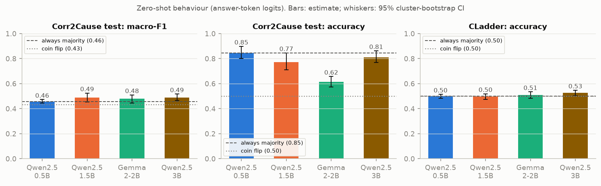

**No model answers above chance, and for different reasons.** On the Corr2Cause test set (15.5% valid) Qwen2.5-0.5B answers "No" to essentially everything (Yes-rate 0.00), so its accuracy 0.845 is the majority rate and its macro-F1 0.458 is the majority baseline's. Qwen2.5-1.5B says Yes 10% of the time and Gemma-2-2B 34%; their accuracies (0.773 [0.711, 0.846], 0.615 [0.573, 0.658]) are *below* the majority rate because the extra Yes answers are mostly wrong. Qwen2.5-3B, run remotely, behaves like Qwen2.5-0.5B on Corr2Cause (Yes-rate 0.05, accuracy 0.812 [0.768, 0.862], below the majority rate). On CLadder (50% yes) the three local models are at 0.50 and Qwen2.5-3B at 0.526 [0.502, 0.548].

Accuracy alone cannot tell "no information" from "information hidden by a bias towards one answer". The next table separates them: the Yes-rate, the AUROC of the Yes−No logit difference (which ignores any constant bias), and the accuracy when the decision threshold is moved to its best position (chosen on one half of the premises or stories, scored on the other).

| Model | Item set | Prompt | Items | Yes-rate | Accuracy | Majority-class accuracy | AUROC of Yes−No logit difference | Accuracy at best threshold (cross-fitted) | Reading |
|---|---|---|---|---|---|---|---|---|---|
| Qwen2.5-0.5B | Corr2Cause test | zero-shot | 1162 | 0.00 | 0.845 [0.803, 0.898] | 0.845 | 0.589 [0.531, 0.660] | 0.843 [0.801, 0.895] | informative (AUROC CI above 0.5) |
| Qwen2.5-0.5B | Corr2Cause pool | zero-shot | 2400 | 0.00 | 0.502 [0.500, 0.504] | 0.500 | 0.591 [0.569, 0.614] | 0.578 [0.558, 0.598] | informative (AUROC CI above 0.5) |
| Qwen2.5-0.5B | Corr2Cause debiased pool | zero-shot | 2400 | 0.00 | 0.498 [0.496, 0.501] | 0.500 | 0.505 [0.485, 0.526] | 0.498 [0.484, 0.512] | at chance (AUROC CI includes 0.5) |
| Qwen2.5-0.5B | CLadder | zero-shot | 3000 | 0.04 | 0.500 [0.483, 0.515] | 0.500 | 0.499 [0.468, 0.527] | 0.509 [0.484, 0.531] | at chance (AUROC CI includes 0.5) |
| Qwen2.5-0.5B | Corr2Cause test, variables renamed | zero-shot, variables renamed | 1162 | 0.01 | 0.842 [0.800, 0.895] | 0.845 | 0.511 [0.455, 0.572] | 0.843 [0.800, 0.896] | at chance (AUROC CI includes 0.5) |
| Qwen2.5-0.5B | Corr2Cause test (500 items) | 4-shot | 500 | 0.81 | 0.314 [0.260, 0.367] | 0.840 | 0.660 [0.579, 0.741] | 0.846 [0.814, 0.887] | informative (AUROC CI above 0.5) |
| Qwen2.5-0.5B | CLadder (500 items) | 4-shot | 500 | 0.20 | 0.516 [0.481, 0.552] | 0.500 | 0.495 [0.451, 0.542] | 0.486 [0.452, 0.521] | at chance (AUROC CI includes 0.5) |
| Qwen2.5-1.5B | Corr2Cause test | zero-shot | 1162 | 0.10 | 0.773 [0.711, 0.846] | 0.845 | 0.561 [0.503, 0.614] | 0.843 [0.801, 0.895] | informative (AUROC CI above 0.5) |
| Qwen2.5-1.5B | Corr2Cause pool | zero-shot | 2400 | 0.10 | 0.500 [0.488, 0.512] | 0.500 | 0.568 [0.545, 0.590] | 0.565 [0.551, 0.580] | informative (AUROC CI above 0.5) |
| Qwen2.5-1.5B | Corr2Cause debiased pool | zero-shot | 2400 | 0.16 | 0.492 [0.478, 0.507] | 0.500 | 0.510 [0.488, 0.533] | 0.511 [0.495, 0.526] | at chance (AUROC CI includes 0.5) |
| Qwen2.5-1.5B | CLadder | zero-shot | 3000 | 0.64 | 0.497 [0.474, 0.519] | 0.500 | 0.509 [0.478, 0.542] | 0.499 [0.480, 0.519] | at chance (AUROC CI includes 0.5) |
| Qwen2.5-1.5B | Corr2Cause test, variables renamed | zero-shot, variables renamed | 1162 | 0.17 | 0.729 [0.667, 0.803] | 0.845 | 0.579 [0.523, 0.630] | 0.843 [0.800, 0.897] | informative (AUROC CI above 0.5) |
| Qwen2.5-1.5B | Corr2Cause test (500 items) | 4-shot | 500 | 0.05 | 0.800 [0.752, 0.856] | 0.840 | 0.556 [0.502, 0.606] | 0.818 [0.770, 0.877] | informative (AUROC CI above 0.5) |
| Qwen2.5-1.5B | CLadder (500 items) | 4-shot | 500 | 0.72 | 0.528 [0.487, 0.565] | 0.500 | 0.559 [0.511, 0.601] | 0.496 [0.460, 0.533] | informative (AUROC CI above 0.5) |
| Gemma-2-2B | Corr2Cause test | zero-shot | 1162 | 0.34 | 0.615 [0.573, 0.658] | 0.845 | 0.536 [0.495, 0.566] | 0.843 [0.800, 0.897] | at chance (AUROC CI includes 0.5) |
| Gemma-2-2B | Corr2Cause pool | zero-shot | 2400 | 0.25 | 0.505 [0.487, 0.525] | 0.500 | 0.559 [0.537, 0.582] | 0.565 [0.553, 0.576] | informative (AUROC CI above 0.5) |
| Gemma-2-2B | Corr2Cause debiased pool | zero-shot | 2400 | 0.31 | 0.496 [0.477, 0.515] | 0.500 | 0.492 [0.468, 0.515] | 0.497 [0.481, 0.513] | at chance (AUROC CI includes 0.5) |
| Gemma-2-2B | CLadder | zero-shot | 3000 | 0.63 | 0.508 [0.482, 0.535] | 0.500 | 0.519 [0.482, 0.557] | 0.500 [0.483, 0.520] | at chance (AUROC CI includes 0.5) |
| Gemma-2-2B | Corr2Cause test, variables renamed | zero-shot, variables renamed | 1162 | 0.32 | 0.602 [0.562, 0.641] | 0.845 | 0.504 [0.464, 0.531] | 0.844 [0.801, 0.897] | at chance (AUROC CI includes 0.5) |
| Gemma-2-2B | Corr2Cause test (500 items) | 4-shot | 500 | 0.54 | 0.486 [0.445, 0.526] | 0.840 | 0.569 [0.523, 0.613] | 0.834 [0.793, 0.886] | informative (AUROC CI above 0.5) |
| Gemma-2-2B | CLadder (500 items) | 4-shot | 500 | 0.83 | 0.504 [0.458, 0.546] | 0.500 | 0.543 [0.498, 0.585] | 0.504 [0.465, 0.543] | at chance (AUROC CI includes 0.5) |
| Qwen2.5-3B | Corr2Cause test | zero-shot | 1162 | 0.05 | 0.812 [0.768, 0.862] | 0.845 | 0.534 [0.493, 0.573] | 0.838 [0.794, 0.892] | at chance (AUROC CI includes 0.5) |
| Qwen2.5-3B | Corr2Cause pool | zero-shot | 2400 | 0.05 | 0.509 [0.500, 0.519] | 0.500 | 0.581 [0.559, 0.603] | 0.593 [0.573, 0.613] | informative (AUROC CI above 0.5) |
| Qwen2.5-3B | Corr2Cause debiased pool | zero-shot | 2400 | 0.04 | 0.495 [0.487, 0.503] | 0.500 | 0.507 [0.484, 0.530] | 0.506 [0.490, 0.524] | at chance (AUROC CI includes 0.5) |
| Qwen2.5-3B | CLadder † | zero-shot | 3000 | 0.50 | 0.526 [0.502, 0.548] | 0.500 | 0.543 [0.518, 0.568] | 0.507 [0.487, 0.528] | informative (AUROC CI above 0.5) |
| Qwen2.5-3B | Corr2Cause test, variables renamed | zero-shot, variables renamed | 1162 | 0.04 | 0.822 [0.783, 0.868] | 0.845 | 0.512 [0.463, 0.553] | 0.844 [0.802, 0.896] | at chance (AUROC CI includes 0.5) |
| Qwen2.5-3B | Corr2Cause test (500 items) | 4-shot | 500 | 0.46 | 0.556 [0.517, 0.596] | 0.840 | 0.538 [0.507, 0.569] | 0.838 [0.797, 0.890] | informative (AUROC CI above 0.5) |
| Qwen2.5-3B | CLadder (500 items) † | 4-shot | 500 | 0.56 | 0.560 [0.518, 0.602] | 0.500 | 0.564 [0.517, 0.608] | 0.510 [0.476, 0.543] | informative (AUROC CI above 0.5) |

Source: `results/answer_bias.json` † computed on the GPU machine's draw of the 3,000-item CLadder sample (2,271 items shared with the other models' draw; Section 7).

Reading. On the original Corr2Cause sets the logit difference is weakly informative: AUROC 0.589 [0.531, 0.660] for Qwen2.5-0.5B, 0.561 [0.503, 0.614] for Qwen2.5-1.5B on test, and 0.56 to 0.59 on the balanced pool for all three, where a re-thresholded answer reaches about 0.57 accuracy. So the smallest model is biased rather than empty there. This weak signal does not survive on the debiased pool of Section 3.6 for any model (0.505 [0.485, 0.526], 0.510 [0.488, 0.533], 0.492 [0.468, 0.515] and 0.507 [0.484, 0.530] for Qwen2.5-0.5B, Qwen2.5-1.5B, Gemma-2-2B and Qwen2.5-3B). Renaming the variables removes it for three of the four models (Qwen2.5-0.5B 0.511 [0.455, 0.572], Gemma-2-2B 0.504 [0.464, 0.531], Qwen2.5-3B 0.512 [0.463, 0.553]) but not for Qwen2.5-1.5B (0.579 [0.523, 0.630]); an earlier version of this paragraph quoted the 0.5B model only. On CLadder the three local models are at chance by AUROC as well (0.50 to 0.52); Qwen2.5-3B is slightly above (0.543 [0.518, 0.568]). The behavioural picture is therefore: at chance on the task, with a small shortcut-driven signal on the original Corr2Cause items that is masked by answer bias.

Other checks. Four demonstrations change the bias, not the skill: Qwen2.5-0.5B flips to mostly Yes (accuracy change -0.526 [-0.611, -0.456]), Gemma loses -0.118 [-0.186, -0.054]. Scoring by answer-token logits and by generated text disagree on under 1% of items for the Qwen models; for Gemma on CLadder 13% of first tokens are neither Yes nor No (first-token-only check, 100 items). Renaming variables flips 0.085 [0.062, 0.106] of Qwen2.5-1.5B's answers and 0.091 [0.074, 0.109] of Gemma's.

Few-shot (500-item subsets, paired with zero-shot on the same items):

| Model | Dataset | n | Zero-shot acc. | 4-shot acc. | Δ acc. | Zero-shot macro-F1 | 4-shot macro-F1 | 4-shot pred. Yes |
|---|---|---|---|---|---|---|---|---|
| Qwen2.5-0.5B | Corr2Cause test | 500 | 0.840 [0.799, 0.891] | 0.314 [0.260, 0.367] | -0.526 [-0.611, -0.456] | 0.457 [0.444, 0.471] | 0.313 [0.258, 0.363] | 0.81 |
| Qwen2.5-0.5B | CLadder | 500 | 0.510 [0.478, 0.539] | 0.516 [0.481, 0.552] | +0.006 [-0.030, +0.045] | 0.380 [0.356, 0.404] | 0.468 [0.425, 0.510] | 0.20 |
| Qwen2.5-1.5B | Corr2Cause test | 500 | 0.756 [0.690, 0.832] | 0.800 [0.752, 0.856] | +0.044 [+0.005, +0.080] | 0.481 [0.445, 0.515] | 0.463 [0.436, 0.498] | 0.05 |
| Qwen2.5-1.5B | CLadder | 500 | 0.510 [0.475, 0.543] | 0.528 [0.487, 0.565] | +0.018 [-0.020, +0.055] | 0.500 [0.464, 0.535] | 0.504 [0.464, 0.540] | 0.72 |
| Gemma-2-2B | Corr2Cause test | 500 | 0.604 [0.555, 0.656] | 0.486 [0.445, 0.526] | -0.118 [-0.186, -0.054] | 0.480 [0.434, 0.515] | 0.436 [0.391, 0.474] | 0.54 |
| Gemma-2-2B | CLadder | 500 | 0.502 [0.465, 0.536] | 0.504 [0.458, 0.546] | +0.002 [-0.035, +0.042] | 0.490 [0.453, 0.525] | 0.443 [0.397, 0.486] | 0.83 |
| Qwen2.5-3B | Corr2Cause test | 500 | 0.808 [0.767, 0.859] | 0.556 [0.517, 0.596] | -0.252 [-0.315, -0.200] | 0.502 [0.466, 0.542] | 0.479 [0.436, 0.517] | 0.46 |
| Qwen2.5-3B | CLadder † | 500 | 0.532 [0.496, 0.567] | 0.560 [0.518, 0.602] | +0.028 [-0.009, +0.065] | 0.532 [0.496, 0.567] | 0.559 [0.515, 0.600] | 0.56 |

Source: `results/behaviour_qwen0.5b.json`, `results/behaviour_qwen1.5b.json`, `results/behaviour_gemma2b.json`, `results/behaviour_qwen3b.json` † computed on the GPU machine's draw of the 3,000-item CLadder sample (2,271 items shared with the other models' draw; Section 7).

Logit scoring vs generated text:

| Model | Item set | n | Logit-scored acc. | Generated-text acc. | Disagreement | Unparseable |
|---|---|---|---|---|---|---|
| Qwen2.5-0.5B | c2c_test_sub | 500 | 0.840 [0.799, 0.891] | 0.840 [0.799, 0.891] | 0.000 | 0.000 |
| Qwen2.5-0.5B | c2c_test_sub_fewshot | 500 | 0.314 [0.260, 0.367] | 0.316 [0.266, 0.368] | 0.006 | 0.000 |
| Qwen2.5-0.5B | cladder_sub | 500 | 0.510 [0.478, 0.539] | 0.508 [0.476, 0.538] | 0.002 | 0.000 |
| Qwen2.5-0.5B | cladder_sub_fewshot | 500 | 0.516 [0.481, 0.552] | 0.518 [0.483, 0.555] | 0.006 | 0.000 |
| Qwen2.5-1.5B | c2c_test_sub | 500 | 0.756 [0.690, 0.832] | 0.758 [0.692, 0.834] | 0.002 | 0.000 |
| Qwen2.5-1.5B | c2c_test_sub_fewshot | 500 | 0.800 [0.752, 0.856] | 0.804 [0.756, 0.859] | 0.004 | 0.000 |
| Qwen2.5-1.5B | cladder_sub | 500 | 0.510 [0.475, 0.543] | 0.510 [0.475, 0.543] | 0.000 | 0.000 |
| Qwen2.5-1.5B | cladder_sub_fewshot | 500 | 0.528 [0.487, 0.565] | 0.530 [0.490, 0.566] | 0.006 | 0.000 |
| Gemma-2-2B | c2c_test_sub | 100 | 0.580 [0.489, 0.653] | 0.580 [0.489, 0.653] | 0.000 | 0.000 |
| Gemma-2-2B | c2c_test_sub_fewshot | 100 | 0.510 [0.403, 0.608] | 0.510 [0.403, 0.608] | 0.000 | 0.000 |
| Gemma-2-2B | cladder_sub | 100 | 0.480 [0.385, 0.576] | 0.400 [0.318, 0.495] | 0.130 | 0.130 |
| Gemma-2-2B | cladder_sub_fewshot | 100 | 0.420 [0.325, 0.515] | 0.420 [0.325, 0.515] | 0.000 | 0.000 |
| Qwen2.5-3B | c2c_test_sub | 500 | 0.808 [0.767, 0.859] | 0.808 [0.767, 0.859] | 0.000 | 0.000 |
| Qwen2.5-3B | c2c_test_sub_fewshot | 500 | 0.556 [0.517, 0.596] | 0.556 [0.517, 0.596] | 0.000 | 0.000 |
| Qwen2.5-3B | cladder_sub | 500 | 0.532 [0.496, 0.567] | 0.530 [0.494, 0.564] | 0.002 | 0.000 |
| Qwen2.5-3B | cladder_sub_fewshot | 500 | 0.560 [0.518, 0.602] | 0.560 [0.518, 0.602] | 0.000 | 0.000 |

Source: `results/behaviour_qwen0.5b.json`, `results/behaviour_qwen1.5b.json`, `results/behaviour_gemma2b.json`, `results/behaviour_qwen3b.json`

Robustness to variable renaming (paired on the test set):

| Model | Macro-F1 original | Macro-F1 renamed | Δ macro-F1 | Δ accuracy | Predictions flipped | r(logit diff) |
|---|---|---|---|---|---|---|
| Qwen2.5-0.5B | 0.458 [0.445, 0.473] | 0.473 [0.449, 0.506] | +0.015 [-0.002, +0.044] | -0.003 [-0.009, +0.001] | 0.009 [0.002, 0.018] | 0.77 |
| Qwen2.5-1.5B | 0.489 [0.453, 0.525] | 0.501 [0.457, 0.546] | +0.012 [-0.012, +0.040] | -0.044 [-0.058, -0.030] | 0.085 [0.062, 0.106] | 0.97 |
| Gemma-2-2B | 0.481 [0.444, 0.510] | 0.448 [0.420, 0.472] | -0.033 [-0.060, -0.008] | -0.014 [-0.038, +0.012] | 0.091 [0.074, 0.109] | 0.98 |
| Qwen2.5-3B | 0.489 [0.467, 0.517] | 0.482 [0.460, 0.510] | -0.007 [-0.026, +0.013] | +0.010 [+0.002, +0.019] | 0.031 [0.022, 0.040] | 0.98 |

Source: `results/behaviour_qwen0.5b.json`, `results/behaviour_qwen1.5b.json`, `results/behaviour_gemma2b.json`, `results/behaviour_qwen3b.json`

By rung and query type (CLadder) and by template (Corr2Cause test):

| Model | rung=1 | rung=2 | rung=3 |
|---|---|---|---|
| Qwen2.5-0.5B | 0.50 [0.47, 0.53] | 0.49 [0.46, 0.52] | 0.50 [0.47, 0.53] |
| Qwen2.5-1.5B | 0.49 [0.45, 0.52] | 0.49 [0.45, 0.54] | 0.51 [0.48, 0.54] |
| Gemma-2-2B | 0.48 [0.44, 0.52] | 0.51 [0.47, 0.57] | 0.53 [0.49, 0.56] |
| Qwen2.5-3B | 0.51 [0.46, 0.54] | 0.54 [0.51, 0.58] | 0.53 [0.49, 0.56] |
| *n / frac. gold Yes* | 938 / 0.50 | 936 / 0.50 | 1126 / 0.50 |

Source: `results/behaviour_qwen0.5b.json`, `results/behaviour_qwen1.5b.json`, `results/behaviour_gemma2b.json`, `results/behaviour_qwen3b.json`

| Model | query_type=ate | query_type=backadj | query_type=collider_bias | query_type=correlation | query_type=det-counterfactual | query_type=ett | query_type=exp_away | query_type=marginal | query_type=nde | query_type=nie |
|---|---|---|---|---|---|---|---|---|---|---|
| Qwen2.5-0.5B | 0.50 [0.45, 0.56] | 0.50 [0.46, 0.55] | 0.33 [0.14, 0.42] | 0.50 [0.45, 0.54] | 0.51 [0.46, 0.55] | 0.50 [0.45, 0.55] | 0.50 [0.40, 0.56] | 0.50 [0.46, 0.54] | 0.50 [0.41, 0.58] | 0.50 [0.42, 0.60] |
| Qwen2.5-1.5B | 0.54 [0.47, 0.60] | 0.49 [0.45, 0.52] | 0.13 [0.02, 0.26] | 0.50 [0.46, 0.55] | 0.55 [0.50, 0.59] | 0.47 [0.42, 0.52] | 0.33 [0.16, 0.55] | 0.48 [0.44, 0.53] | 0.51 [0.43, 0.61] | 0.50 [0.45, 0.56] |
| Gemma-2-2B | 0.51 [0.44, 0.59] | 0.52 [0.45, 0.59] | 0.43 [0.34, 0.54] | 0.50 [0.45, 0.55] | 0.58 [0.54, 0.62] | 0.48 [0.41, 0.53] | 0.19 [0.06, 0.42] | 0.49 [0.44, 0.55] | 0.52 [0.43, 0.61] | 0.51 [0.44, 0.59] |
| Qwen2.5-3B | 0.60 [0.54, 0.66] | 0.50 [0.46, 0.54] | 0.50 [0.45, 0.63] | 0.51 [0.46, 0.56] | 0.59 [0.54, 0.63] | 0.45 [0.38, 0.51] | 0.37 [0.22, 0.53] | 0.51 [0.46, 0.57] | 0.62 [0.52, 0.71] | 0.51 [0.45, 0.57] |
| *n / frac. gold Yes* | 422 / 0.50 | 468 / 0.50 | 46 / 0.50 | 422 / 0.50 | 422 / 0.50 | 376 / 0.50 | 48 / 0.50 | 468 / 0.50 | 94 / 0.50 | 234 / 0.50 |

Source: `results/behaviour_qwen0.5b.json`, `results/behaviour_qwen1.5b.json`, `results/behaviour_gemma2b.json`, `results/behaviour_qwen3b.json`

| Model | template=child | template=has_collider | template=has_confounder | template=non-child descendant | template=non-parent ancestor | template=parent |
|---|---|---|---|---|---|---|
| Qwen2.5-0.5B | 1.00 [1.00, 1.00] | 0.67 [0.56, 0.79] | 0.91 [0.86, 0.96] | 0.94 [0.89, 0.98] | 0.89 [0.84, 0.94] | 0.66 [0.57, 0.78] |
| Qwen2.5-1.5B | 1.00 [1.00, 1.00] | 0.66 [0.55, 0.79] | 0.66 [0.53, 0.81] | 0.76 [0.68, 0.84] | 0.88 [0.83, 0.94] | 0.67 [0.58, 0.78] |
| Gemma-2-2B | 1.00 [1.00, 1.00] | 0.58 [0.47, 0.69] | 0.27 [0.18, 0.36] | 0.30 [0.17, 0.44] | 0.88 [0.82, 0.93] | 0.66 [0.57, 0.78] |
| Qwen2.5-3B | 1.00 [1.00, 1.00] | 0.65 [0.55, 0.78] | 0.72 [0.64, 0.80] | 0.94 [0.89, 0.98] | 0.89 [0.84, 0.94] | 0.66 [0.57, 0.78] |
| *n / frac. gold Yes* | 194 / 0.00 | 193 / 0.33 | 193 / 0.09 | 193 / 0.06 | 195 / 0.11 | 194 / 0.34 |

Source: `results/behaviour_qwen0.5b.json`, `results/behaviour_qwen1.5b.json`, `results/behaviour_gemma2b.json`, `results/behaviour_qwen3b.json`

### 3.2 Logit lens

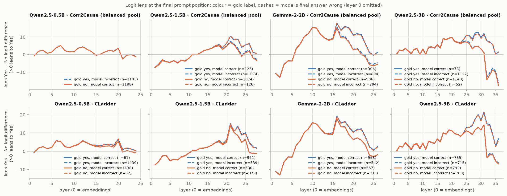
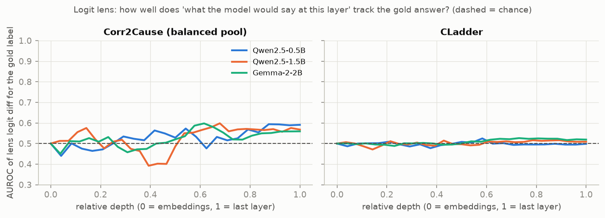

The first figure shows the Yes−No logit difference the model would produce if it stopped at each layer, for gold-Yes and gold-No items separately. In every panel the curves move together: the lens shows a shared drift towards one answer, not a separation by the correct answer. The second figure removes the drift by asking only whether the lens value ranks gold-Yes above gold-No items (AUROC). On the Corr2Cause pool it never exceeds 0.60 at any layer for the three local models (the maxima are 0.59 to 0.60, reached in the second half of the network) and reaches 0.63 for Qwen2.5-3B; on CLadder it stays between 0.47 and 0.53 at every layer for the local models and reaches 0.54 for Qwen2.5-3B (`results/lens_*.json`, key `auroc_gold_by_layer`). The lens at the last layer reproduces the model's actual answer logits (maximum error and sign agreement are in `results/lens_*.json`). So the lens gives no sign of a correct answer that forms in the middle of the network and is then overwritten.

### 3.3 Probes and controls

| Model | Dataset | Layer | C | Gold probe acc. | TF-IDF acc. | Type prior acc. | Random-init probe acc. | Shuffled labels (all items) | Control task (all items) | Selectivity (all items) | Probe − TF-IDF |
|---|---|---|---|---|---|---|---|---|---|---|---|
| Qwen2.5-0.5B | Corr2Cause pool | 15/24 | 1 | 0.807 [0.784, 0.828] | 0.802 [0.778, 0.826] | 0.699 [0.672, 0.726] | 0.621 [0.595, 0.647] | 0.499 | 0.685 | +0.117 | +0.004 [-0.022, +0.030] |
| Qwen2.5-0.5B | CLadder | 16/24 | 0.1 | 0.561 [0.534, 0.586] | 0.527 [0.494, 0.566] | 0.484 [0.462, 0.504] | 0.498 [0.475, 0.522] | 0.510 | 0.791 | -0.234 | +0.034 [-0.014, +0.074] |
| Qwen2.5-1.5B | Corr2Cause pool | 21/28 | 0.1 | 0.870 [0.850, 0.890] | 0.802 [0.778, 0.826] | 0.699 [0.672, 0.726] | 0.594 [0.566, 0.624] | 0.498 | 0.777 | +0.088 | +0.068 [+0.042, +0.091] |
| Qwen2.5-1.5B | CLadder | 24/28 | 0.1 | 0.605 [0.580, 0.631] | 0.527 [0.494, 0.566] | 0.484 [0.462, 0.504] | 0.508 [0.484, 0.535] | 0.500 | 0.807 | -0.221 | +0.077 [+0.034, +0.115] |
| Gemma-2-2B | Corr2Cause pool | 18/26 | 1 | 0.863 [0.841, 0.886] | 0.802 [0.778, 0.826] | 0.699 [0.672, 0.726] | 0.596 [0.568, 0.623] | 0.499 | 0.790 | +0.071 | +0.061 [+0.035, +0.088] |
| Gemma-2-2B | CLadder | 20/26 | 1 | 0.626 [0.590, 0.664] | 0.527 [0.494, 0.566] | 0.484 [0.462, 0.504] | 0.519 [0.494, 0.548] | 0.499 | 0.812 | -0.194 | +0.099 [+0.038, +0.150] |
| Qwen2.5-3B | Corr2Cause pool | 27/36 | 1 | 0.862 [0.843, 0.880] | 0.802 [0.778, 0.826] | 0.699 [0.672, 0.726] | 0.611 [0.584, 0.637] | 0.497 | 0.795 | +0.071 | +0.059 [+0.034, +0.085] |
| Qwen2.5-3B | CLadder † | 27/36 | 1 | 0.628 [0.600, 0.654] | 0.529 [0.497, 0.569] | 0.501 [0.483, 0.519] | 0.516 [0.496, 0.538] | 0.511 | 0.819 | -0.195 | +0.099 [+0.047, +0.143] |

Source: `results/confound_gemma2b_c2c_probe.json`, `results/confound_gemma2b_cladder.json`, `results/confound_qwen0.5b_c2c_probe.json`, `results/confound_qwen0.5b_cladder.json`, `results/confound_qwen1.5b_c2c_probe.json`, `results/confound_qwen1.5b_cladder.json`, `results/confound_qwen3b_c2c_probe.json`, `results/confound_qwen3b_cladder.json`, `results/probes_gemma2b_c2c_probe_C1.json`, `results/probes_gemma2b_cladder_C1.json`, `results/probes_qwen0.5b_c2c_probe_C1.json`, `results/probes_qwen0.5b_cladder_C0.1.json`, `results/probes_qwen1.5b_c2c_probe_C0.1.json`, `results/probes_qwen1.5b_cladder_C0.1.json`, `results/probes_qwen3b_c2c_probe_C1.json`, `results/probes_qwen3b_cladder_C1.json` † computed on the GPU machine's draw of the 3,000-item CLadder sample (2,271 items shared with the other models' draw; Section 7).

Layer index counts the embeddings as 0, so layer l is the output of block l−1. Probe/TF-IDF/prior/random-init columns: report half, scores averaged over 3 seeds. Shuffled/control/selectivity: all items, mean of per-seed accuracies at the selected layer and C.

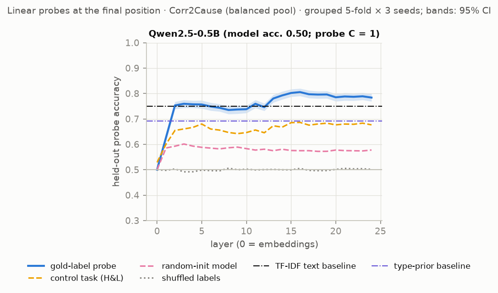
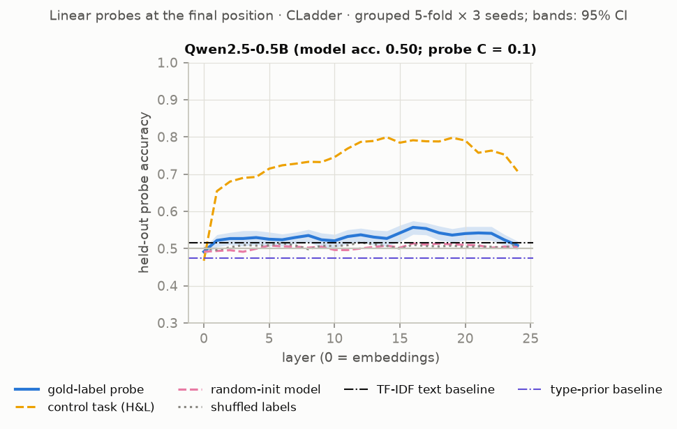
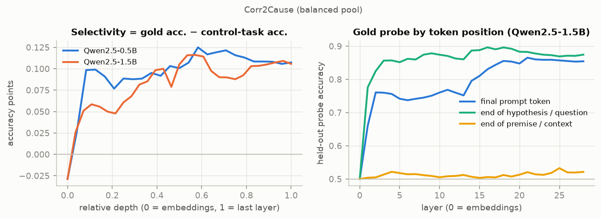

Probe accuracy by token position:

| Model | Dataset | Final token | End of hypothesis / question | End of premise / context (question not yet read) | Final − end of premise | Final − end of hypothesis | Random-init model, final token | Random-init model, end of hypothesis | Trained − random-init, end of hypothesis |
|---|---|---|---|---|---|---|---|---|---|
| Qwen2.5-0.5B | Corr2Cause pool | 0.807 [0.784, 0.828] | 0.868 [0.848, 0.888] | 0.517 [0.504, 0.532] | +0.289 [+0.263, +0.314] | -0.062 [-0.083, -0.039] | 0.621 [0.595, 0.647] | – | – |
| Qwen2.5-0.5B | CLadder | 0.561 [0.534, 0.586] | 0.542 [0.512, 0.576] | 0.561 [0.536, 0.586] | +0.000 [-0.038, +0.036] | +0.018 [-0.015, +0.050] | 0.498 [0.475, 0.522] | – | – |
| Qwen2.5-0.5B | Corr2Cause debiased pool | 0.633 [0.609, 0.658] | 0.737 [0.713, 0.760] | 0.486 [0.470, 0.502] | +0.147 [+0.119, +0.175] | -0.104 [-0.131, -0.075] | 0.604 [0.580, 0.628] | 0.601 [0.578, 0.625] | +0.136 [+0.105, +0.167] |
| Qwen2.5-1.5B | Corr2Cause pool | 0.870 [0.850, 0.890] | 0.898 [0.879, 0.916] | 0.534 [0.517, 0.552] | +0.336 [+0.311, +0.361] | -0.028 [-0.046, -0.011] | 0.594 [0.566, 0.624] | – | – |
| Qwen2.5-1.5B | CLadder | 0.605 [0.580, 0.631] | 0.588 [0.549, 0.625] | 0.569 [0.548, 0.589] | +0.035 [+0.008, +0.068] | +0.016 [-0.024, +0.060] | 0.508 [0.484, 0.535] | – | – |
| Qwen2.5-1.5B | Corr2Cause debiased pool | 0.752 [0.729, 0.776] | 0.788 [0.766, 0.809] | 0.502 [0.490, 0.513] | +0.251 [+0.225, +0.276] | -0.036 [-0.062, -0.010] | 0.579 [0.554, 0.604] | 0.585 [0.560, 0.610] | +0.204 [+0.171, +0.234] |
| Gemma-2-2B | Corr2Cause pool | 0.863 [0.841, 0.886] | 0.905 [0.887, 0.922] | 0.499 [0.497, 0.500] | +0.364 [+0.341, +0.387] | -0.042 [-0.061, -0.022] | 0.596 [0.568, 0.623] | – | – |
| Gemma-2-2B | CLadder | 0.626 [0.590, 0.664] | 0.623 [0.598, 0.647] | 0.556 [0.528, 0.580] | +0.070 [+0.021, +0.120] | +0.003 [-0.032, +0.038] | 0.519 [0.494, 0.548] | – | – |

Source: `results/confound_qwen0.5b_c2c_probe.json`, `results/confound_qwen0.5b_cladder.json`, `results/confound_qwen0.5b_c2c_debiased.json`, `results/confound_qwen1.5b_c2c_probe.json`, `results/confound_qwen1.5b_cladder.json`, `results/confound_qwen1.5b_c2c_debiased.json`, `results/confound_gemma2b_c2c_probe.json`, `results/confound_gemma2b_cladder.json`, `results/confound_gemma2b_c2c_debiased.json`, `results/confound_qwen3b_c2c_probe.json`, `results/confound_qwen3b_cladder.json`, `results/confound_qwen3b_c2c_debiased.json`

Probes decode the gold label from held-out premises at 0.807 [0.784, 0.828], 0.870 [0.850, 0.890] and 0.863 [0.841, 0.886] on the Corr2Cause pool, and at 0.561 [0.534, 0.586], 0.605 [0.580, 0.631] and 0.626 [0.590, 0.664] on CLadder (report half; layer and regularisation chosen on the other half). The controls behave as controls should: shuffled labels give 0.50, and a randomly initialised model gives 0.50 to 0.62. Taken alone, this is the pattern that is usually read as "the model represents the answer".

Three observations already argue against that reading before any text baseline is considered. (1) Selectivity is small on Corr2Cause (+0.07 to +0.12) and negative on CLadder (about −0.2): the same probes memorise an arbitrary label per hypothesis string, or per graph and query type, almost as well as or better than they decode the gold label. The activations expose *which question is being asked* very well, and on Corr2Cause that alone predicts validity (Section 3.5). (2) On Corr2Cause the probe is better at the last token of the hypothesis than at the final prompt token where the answer is produced (final minus end-of-hypothesis is negative for all three models), and at the end of the premise, before the hypothesis has been read, it is at chance as it must be in a pool balanced within premise. (3) On CLadder most of the probe's small signal is present at the end of the context, before the question has been read: the gain from reading the question is +0.000 [-0.038, +0.036] for Qwen2.5-0.5B, +0.035 [+0.008, +0.068] for Qwen2.5-1.5B and +0.070 [+0.021, +0.120] for Gemma-2-2B.

### 3.4 Gold label vs model output: is anything represented beyond the text?

All scorers on the report half:

| Model | Dataset | Gold probe | TF-IDF (full prompt) | Template / type prior | TF-IDF (question only) | Hypothesis-string prior | Parsed features + prior (GBM) | Random-init probe | Model's own answer |
|---|---|---|---|---|---|---|---|---|---|
| Qwen2.5-0.5B | Corr2Cause pool | 0.807 [0.784, 0.828] | 0.802 [0.778, 0.826] | 0.699 [0.672, 0.726] | 0.848 [0.827, 0.868] | 0.859 [0.839, 0.879] | 0.919 [0.902, 0.935] | 0.621 [0.595, 0.647] | 0.501 [0.500, 0.502] |
| Qwen2.5-0.5B | CLadder | 0.561 [0.534, 0.586] | 0.527 [0.494, 0.566] | 0.484 [0.462, 0.504] | 0.510 [0.482, 0.541] | – | 0.800 [0.767, 0.839] | 0.498 [0.475, 0.522] | 0.506 [0.483, 0.525] |
| Qwen2.5-0.5B | Corr2Cause debiased pool | 0.633 [0.609, 0.658] | 0.518 [0.495, 0.541] | 0.500 [0.500, 0.500] | 0.500 [0.500, 0.500] | 0.500 [0.500, 0.500] | 0.816 [0.792, 0.837] | 0.604 [0.580, 0.628] | 0.497 [0.493, 0.500] |
| Qwen2.5-1.5B | Corr2Cause pool | 0.870 [0.850, 0.890] | 0.802 [0.778, 0.826] | 0.699 [0.672, 0.726] | 0.848 [0.827, 0.868] | 0.859 [0.839, 0.879] | 0.919 [0.902, 0.935] | 0.594 [0.566, 0.624] | 0.505 [0.489, 0.520] |
| Qwen2.5-1.5B | CLadder | 0.605 [0.580, 0.631] | 0.527 [0.494, 0.566] | 0.484 [0.462, 0.504] | 0.510 [0.482, 0.541] | – | 0.800 [0.767, 0.839] | 0.508 [0.484, 0.535] | 0.506 [0.468, 0.545] |
| Qwen2.5-1.5B | Corr2Cause debiased pool | 0.752 [0.729, 0.776] | 0.518 [0.495, 0.541] | 0.500 [0.500, 0.500] | 0.500 [0.500, 0.500] | 0.500 [0.500, 0.500] | 0.816 [0.792, 0.837] | 0.579 [0.554, 0.604] | 0.494 [0.474, 0.513] |
| Gemma-2-2B | Corr2Cause pool | 0.863 [0.841, 0.886] | 0.802 [0.778, 0.826] | 0.699 [0.672, 0.726] | 0.848 [0.827, 0.868] | 0.859 [0.839, 0.879] | 0.919 [0.902, 0.935] | 0.596 [0.568, 0.623] | 0.507 [0.483, 0.532] |
| Gemma-2-2B | CLadder | 0.626 [0.590, 0.664] | 0.527 [0.494, 0.566] | 0.484 [0.462, 0.504] | 0.510 [0.482, 0.541] | – | 0.800 [0.767, 0.839] | 0.519 [0.494, 0.548] | 0.506 [0.464, 0.549] |
| Gemma-2-2B | Corr2Cause debiased pool | 0.763 [0.739, 0.787] | 0.518 [0.495, 0.541] | 0.500 [0.500, 0.500] | 0.500 [0.500, 0.500] | 0.500 [0.500, 0.500] | 0.816 [0.792, 0.837] | 0.568 [0.542, 0.593] | 0.494 [0.468, 0.518] |
| Qwen2.5-3B | Corr2Cause pool | 0.862 [0.843, 0.880] | 0.802 [0.778, 0.826] | 0.699 [0.672, 0.726] | 0.848 [0.827, 0.868] | 0.859 [0.839, 0.879] | 0.919 [0.902, 0.935] | 0.611 [0.584, 0.637] | 0.509 [0.497, 0.522] |
| Qwen2.5-3B | CLadder † | 0.628 [0.600, 0.654] | 0.529 [0.497, 0.569] | 0.501 [0.483, 0.519] | 0.509 [0.475, 0.550] | – | 0.763 [0.733, 0.800] | 0.516 [0.496, 0.538] | 0.528 [0.494, 0.563] |
| Qwen2.5-3B | Corr2Cause debiased pool | 0.765 [0.743, 0.788] | 0.518 [0.495, 0.541] | 0.500 [0.500, 0.500] | 0.500 [0.500, 0.500] | 0.500 [0.500, 0.500] | 0.816 [0.792, 0.837] | 0.594 [0.568, 0.619] | 0.490 [0.478, 0.501] |

Source: `results/confound_qwen0.5b_c2c_probe.json`, `results/confound_qwen0.5b_cladder.json`, `results/confound_qwen0.5b_c2c_debiased.json`, `results/confound_qwen1.5b_c2c_probe.json`, `results/confound_qwen1.5b_cladder.json`, `results/confound_qwen1.5b_c2c_debiased.json`, `results/confound_gemma2b_c2c_probe.json`, `results/confound_gemma2b_cladder.json`, `results/confound_gemma2b_c2c_debiased.json`, `results/confound_qwen3b_c2c_probe.json`, `results/confound_qwen3b_cladder.json`, `results/confound_qwen3b_c2c_debiased.json` † computed on the GPU machine's draw of the 3,000-item CLadder sample (2,271 items shared with the other models' draw; Section 7).

Audited criterion (and, for comparison, the pre-registered one as coded):

| Model | Dataset | Gold probe acc. | Strongest text baseline | Its acc. | Probe − baseline (acc., all items) | Probe − baseline (AUROC, model leans Yes) | Probe − baseline (AUROC, model leans No) | Audited criterion met | Pre-registered criterion met (as coded) | Pre-registered wrong-items test applicable |
|---|---|---|---|---|---|---|---|---|---|---|
| Qwen2.5-0.5B | Corr2Cause pool | 0.807 [0.784, 0.828] | structural | 0.919 [0.902, 0.935] | -0.113 [-0.136, -0.091] | -0.093 [-0.126, -0.063] | -0.069 [-0.093, -0.045] | no | no | no (100% gold-Yes) |
| Qwen2.5-0.5B | CLadder | 0.561 [0.534, 0.586] | structural | 0.800 [0.767, 0.839] | -0.240 [-0.285, -0.203] | -0.316 [-0.363, -0.271] | -0.252 [-0.320, -0.194] | no | no | no (97% gold-Yes) |
| Qwen2.5-0.5B | Corr2Cause debiased pool | 0.633 [0.609, 0.658] | structural | 0.816 [0.792, 0.837] | -0.183 [-0.214, -0.149] | -0.215 [-0.257, -0.172] | -0.245 [-0.288, -0.201] | no | yes | no (99% gold-Yes) |
| Qwen2.5-1.5B | Corr2Cause pool | 0.870 [0.850, 0.890] | structural | 0.919 [0.902, 0.935] | -0.049 [-0.068, -0.032] | -0.030 [-0.052, -0.009] | -0.027 [-0.044, -0.011] | no | no | no (90% gold-Yes) |
| Qwen2.5-1.5B | CLadder | 0.605 [0.580, 0.631] | structural | 0.800 [0.767, 0.839] | -0.196 [-0.234, -0.162] | -0.174 [-0.214, -0.129] | -0.267 [-0.327, -0.216] | no | yes | yes |
| Qwen2.5-1.5B | Corr2Cause debiased pool | 0.752 [0.729, 0.776] | structural | 0.816 [0.792, 0.837] | -0.063 [-0.094, -0.034] | -0.053 [-0.090, -0.015] | -0.094 [-0.125, -0.065] | no | yes | no (84% gold-Yes) |
| Gemma-2-2B | Corr2Cause pool | 0.863 [0.841, 0.886] | structural | 0.919 [0.902, 0.935] | -0.056 [-0.078, -0.033] | -0.020 [-0.039, -0.001] | -0.030 [-0.051, -0.008] | no | no | yes |
| Gemma-2-2B | CLadder | 0.626 [0.590, 0.664] | structural | 0.800 [0.767, 0.839] | -0.174 [-0.220, -0.133] | -0.159 [-0.215, -0.100] | -0.237 [-0.297, -0.185] | no | yes | yes |
| Gemma-2-2B | Corr2Cause debiased pool | 0.763 [0.739, 0.787] | structural | 0.816 [0.792, 0.837] | -0.053 [-0.081, -0.023] | -0.049 [-0.091, -0.010] | -0.076 [-0.103, -0.050] | no | yes | yes |
| Qwen2.5-3B | Corr2Cause pool | 0.862 [0.843, 0.880] | structural | 0.919 [0.902, 0.935] | -0.057 [-0.077, -0.038] | -0.039 [-0.064, -0.015] | -0.018 [-0.032, -0.004] | no | no | no (96% gold-Yes) |
| Qwen2.5-3B | CLadder † | 0.628 [0.600, 0.654] | structural | 0.763 [0.733, 0.800] | -0.135 [-0.176, -0.096] | -0.225 [-0.277, -0.179] | -0.151 [-0.227, -0.087] | no | no | yes |
| Qwen2.5-3B | Corr2Cause debiased pool | 0.765 [0.743, 0.788] | structural | 0.816 [0.792, 0.837] | -0.050 [-0.079, -0.020] | -0.039 [-0.080, +0.000] | -0.074 [-0.103, -0.047] | no | yes | no (95% gold-Yes) |

Source: `results/confound_qwen0.5b_c2c_probe.json`, `results/confound_qwen0.5b_cladder.json`, `results/confound_qwen0.5b_c2c_debiased.json`, `results/confound_qwen1.5b_c2c_probe.json`, `results/confound_qwen1.5b_cladder.json`, `results/confound_qwen1.5b_c2c_debiased.json`, `results/confound_gemma2b_c2c_probe.json`, `results/confound_gemma2b_cladder.json`, `results/confound_gemma2b_c2c_debiased.json`, `results/confound_qwen3b_c2c_probe.json`, `results/confound_qwen3b_cladder.json`, `results/confound_qwen3b_c2c_debiased.json` † computed on the GPU machine's draw of the 3,000-item CLadder sample (2,271 items shared with the other models' draw; Section 7).

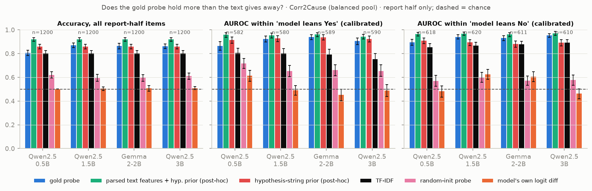
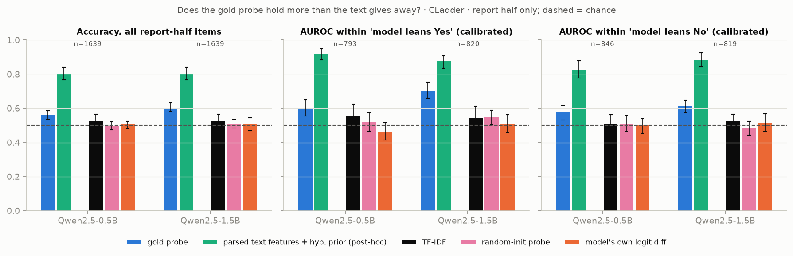

Pre-registered analysis in full (items the model gets wrong):

| Model | Dataset | Model answer | n wrong | Frac. gold-Yes among them | Gold probe balanced acc. | Gold probe acc. | TF-IDF acc. | Type prior acc. | Probe − TF-IDF | Probe − type prior | Pre-registered criterion met | Parsed features + prior acc. (post-hoc) | Probe − parsed features (post-hoc) |
|---|---|---|---|---|---|---|---|---|---|---|---|---|---|
| Qwen2.5-0.5B | Corr2Cause pool | raw | 599 | 1.00 | 0.418 [0.399, 0.437] | 0.835 [0.798, 0.872] | 0.893 [0.865, 0.920] | 0.651 [0.608, 0.692] | -0.058 [-0.102, -0.013] | +0.184 [+0.127, +0.244] | no | 0.960 [0.942, 0.977] | -0.125 [-0.165, -0.087] |
| Qwen2.5-0.5B | Corr2Cause pool | calibrated | 524 | 0.52 | 0.762 [0.723, 0.802] | 0.763 [0.723, 0.804] | 0.750 [0.711, 0.788] | 0.628 [0.584, 0.672] | +0.013 [-0.030, +0.057] | +0.135 [+0.079, +0.190] | no | 0.897 [0.866, 0.928] | -0.134 [-0.176, -0.092] |
| Qwen2.5-0.5B | CLadder | raw | 810 | 0.97 | 0.603 [0.484, 0.745] | 0.567 [0.502, 0.631] | 0.601 [0.518, 0.691] | 0.502 [0.453, 0.557] | -0.035 [-0.101, +0.033] | +0.064 [-0.009, +0.137] | no | 0.821 [0.779, 0.869] | -0.254 [-0.347, -0.171] |
| Qwen2.5-0.5B | CLadder | calibrated | 791 | 0.52 | 0.558 [0.505, 0.609] | 0.558 [0.507, 0.610] | 0.539 [0.484, 0.595] | 0.506 [0.458, 0.554] | +0.019 [-0.053, +0.083] | +0.052 [-0.007, +0.117] | no | 0.817 [0.781, 0.859] | -0.259 [-0.333, -0.193] |
| Qwen2.5-1.5B | Corr2Cause pool | raw | 594 | 0.90 | 0.856 [0.798, 0.907] | 0.892 [0.866, 0.919] | 0.886 [0.856, 0.913] | 0.717 [0.675, 0.756] | +0.007 [-0.030, +0.043] | +0.175 [+0.127, +0.226] | no | 0.951 [0.934, 0.968] | -0.059 [-0.088, -0.031] |
| Qwen2.5-1.5B | Corr2Cause pool | calibrated | 542 | 0.52 | 0.869 [0.839, 0.898] | 0.871 [0.841, 0.900] | 0.810 [0.775, 0.844] | 0.821 [0.790, 0.851] | +0.061 [+0.022, +0.101] | +0.050 [+0.012, +0.088] | **yes** | 0.921 [0.898, 0.942] | -0.050 [-0.077, -0.023] |
| Qwen2.5-1.5B | CLadder | raw | 810 | 0.36 | 0.603 [0.552, 0.653] | 0.604 [0.545, 0.660] | 0.510 [0.453, 0.572] | 0.473 [0.408, 0.534] | +0.094 [+0.031, +0.160] | +0.131 [+0.053, +0.212] | **yes** | 0.796 [0.760, 0.838] | -0.193 [-0.252, -0.132] |
| Qwen2.5-1.5B | CLadder | calibrated | 800 | 0.50 | 0.596 [0.544, 0.653] | 0.596 [0.544, 0.653] | 0.562 [0.519, 0.610] | 0.486 [0.420, 0.547] | +0.034 [-0.025, +0.087] | +0.110 [+0.039, +0.197] | no | 0.812 [0.779, 0.851] | -0.216 [-0.275, -0.154] |
| Gemma-2-2B | Corr2Cause pool | raw | 591 | 0.76 | 0.853 [0.815, 0.890] | 0.865 [0.830, 0.897] | 0.876 [0.849, 0.903] | 0.805 [0.772, 0.836] | -0.012 [-0.052, +0.027] | +0.059 [+0.014, +0.103] | no | 0.934 [0.916, 0.952] | -0.069 [-0.105, -0.036] |
| Gemma-2-2B | Corr2Cause pool | calibrated | 541 | 0.51 | 0.870 [0.833, 0.905] | 0.871 [0.832, 0.906] | 0.795 [0.757, 0.828] | 0.771 [0.737, 0.805] | +0.076 [+0.034, +0.115] | +0.100 [+0.053, +0.147] | **yes** | 0.921 [0.894, 0.946] | -0.050 [-0.086, -0.016] |
| Gemma-2-2B | CLadder | raw | 810 | 0.39 | 0.619 [0.554, 0.680] | 0.617 [0.549, 0.681] | 0.521 [0.468, 0.576] | 0.472 [0.403, 0.532] | +0.096 [+0.012, +0.166] | +0.146 [+0.077, +0.208] | **yes** | 0.793 [0.753, 0.841] | -0.175 [-0.251, -0.110] |
| Gemma-2-2B | CLadder | calibrated | 810 | 0.50 | 0.606 [0.538, 0.669] | 0.606 [0.536, 0.669] | 0.548 [0.501, 0.602] | 0.479 [0.417, 0.535] | +0.058 [-0.030, +0.129] | +0.127 [+0.061, +0.184] | no | 0.811 [0.770, 0.858] | -0.205 [-0.289, -0.134] |
| Qwen2.5-3B | Corr2Cause pool | raw | 589 | 0.96 | 0.850 [0.759, 0.920] | 0.866 [0.837, 0.893] | 0.900 [0.870, 0.926] | 0.705 [0.664, 0.741] | -0.034 [-0.071, +0.007] | +0.161 [+0.119, +0.207] | no | 0.961 [0.944, 0.977] | -0.095 [-0.129, -0.063] |
| Qwen2.5-3B | Corr2Cause pool | calibrated | 474 | 0.51 | 0.828 [0.792, 0.866] | 0.829 [0.793, 0.867] | 0.743 [0.700, 0.784] | 0.776 [0.740, 0.812] | +0.086 [+0.040, +0.138] | +0.053 [+0.004, +0.103] | **yes** | 0.895 [0.863, 0.926] | -0.065 [-0.102, -0.029] |
| Qwen2.5-3B | CLadder † | raw | 773 | 0.49 | 0.610 [0.571, 0.647] | 0.608 [0.568, 0.648] | 0.549 [0.496, 0.609] | 0.470 [0.418, 0.526] | +0.060 [-0.011, +0.125] | +0.138 [+0.082, +0.194] | no | 0.759 [0.717, 0.805] | -0.151 [-0.202, -0.100] |
| Qwen2.5-3B | CLadder † | calibrated | 775 | 0.49 | 0.608 [0.568, 0.646] | 0.605 [0.563, 0.646] | 0.548 [0.496, 0.609] | 0.472 [0.421, 0.528] | +0.057 [-0.013, +0.122] | +0.133 [+0.078, +0.186] | no | 0.759 [0.718, 0.804] | -0.154 [-0.204, -0.104] |

Source: `results/confound_qwen0.5b_c2c_probe.json`, `results/confound_qwen0.5b_cladder.json`, `results/confound_qwen1.5b_c2c_probe.json`, `results/confound_qwen1.5b_cladder.json`, `results/confound_gemma2b_c2c_probe.json`, `results/confound_gemma2b_cladder.json`, `results/confound_qwen3b_c2c_probe.json`, `results/confound_qwen3b_cladder.json` † computed on the GPU machine's draw of the 3,000-item CLadder sample (2,271 items shared with the other models' draw; Section 7).

Within model-answer strata:

| Model | Dataset | Model answer | Stratum | n | Gold probe AUROC | TF-IDF AUROC | Type prior AUROC | Model logit-diff AUROC | Probe − TF-IDF | Structural AUROC (post-hoc) | Probe − structural (post-hoc) |
|---|---|---|---|---|---|---|---|---|---|---|---|
| Qwen2.5-0.5B | Corr2Cause pool | raw | said no | 1197 | 0.884 [0.862, 0.904] | 0.837 [0.812, 0.862] | 0.739 [0.709, 0.769] | 0.584 [0.555, 0.617] | +0.047 [+0.024, +0.070] | 0.962 [0.949, 0.973] | -0.078 [-0.097, -0.059] |
| Qwen2.5-0.5B | Corr2Cause pool | calibrated | said yes | 582 | 0.865 [0.827, 0.901] | 0.807 [0.764, 0.846] | 0.726 [0.681, 0.766] | 0.613 [0.568, 0.658] | +0.058 [+0.018, +0.098] | 0.959 [0.936, 0.976] | -0.093 [-0.126, -0.063] |
| Qwen2.5-0.5B | Corr2Cause pool | calibrated | said no | 618 | 0.895 [0.869, 0.921] | 0.853 [0.822, 0.884] | 0.740 [0.698, 0.776] | 0.482 [0.434, 0.528] | +0.041 [+0.016, +0.070] | 0.964 [0.948, 0.978] | -0.069 [-0.093, -0.045] |
| Qwen2.5-0.5B | CLadder | raw | said yes | 64 | 0.694 [0.489, 0.889] | 0.691 [0.461, 0.855] | 0.441 [0.222, 0.671] | 0.480 [0.280, 0.723] | +0.003 [-0.143, +0.212] | 0.859 [0.709, 0.953] | -0.165 [-0.321, +0.033] |
| Qwen2.5-0.5B | CLadder | raw | said no | 1575 | 0.585 [0.552, 0.619] | 0.527 [0.484, 0.577] | 0.474 [0.444, 0.499] | 0.504 [0.463, 0.539] | +0.059 [+0.000, +0.108] | 0.878 [0.848, 0.909] | -0.293 [-0.335, -0.259] |
| Qwen2.5-0.5B | CLadder | calibrated | said yes | 793 | 0.605 [0.554, 0.650] | 0.557 [0.497, 0.624] | 0.437 [0.392, 0.484] | 0.464 [0.415, 0.515] | +0.048 [-0.018, +0.110] | 0.920 [0.883, 0.949] | -0.316 [-0.363, -0.271] |
| Qwen2.5-0.5B | CLadder | calibrated | said no | 846 | 0.575 [0.530, 0.616] | 0.509 [0.459, 0.561] | 0.504 [0.461, 0.545] | 0.499 [0.452, 0.539] | +0.065 [-0.004, +0.124] | 0.826 [0.777, 0.879] | -0.252 [-0.320, -0.194] |
| Qwen2.5-1.5B | Corr2Cause pool | raw | said yes | 122 | 0.907 [0.846, 0.955] | 0.876 [0.803, 0.939] | 0.560 [0.460, 0.658] | 0.455 [0.348, 0.570] | +0.031 [-0.027, +0.081] | 0.970 [0.942, 0.991] | -0.062 [-0.121, -0.013] |
| Qwen2.5-1.5B | Corr2Cause pool | raw | said no | 1078 | 0.935 [0.918, 0.952] | 0.832 [0.805, 0.857] | 0.755 [0.724, 0.786] | 0.593 [0.562, 0.625] | +0.104 [+0.083, +0.125] | 0.961 [0.947, 0.973] | -0.025 [-0.040, -0.012] |
| Qwen2.5-1.5B | Corr2Cause pool | calibrated | said yes | 580 | 0.924 [0.898, 0.947] | 0.803 [0.761, 0.843] | 0.645 [0.594, 0.695] | 0.491 [0.451, 0.531] | +0.121 [+0.083, +0.159] | 0.954 [0.931, 0.972] | -0.030 [-0.052, -0.009] |
| Qwen2.5-1.5B | Corr2Cause pool | calibrated | said no | 620 | 0.940 [0.922, 0.958] | 0.868 [0.838, 0.895] | 0.800 [0.765, 0.835] | 0.624 [0.583, 0.667] | +0.073 [+0.051, +0.095] | 0.967 [0.952, 0.981] | -0.027 [-0.044, -0.011] |
| Qwen2.5-1.5B | CLadder | raw | said yes | 1050 | 0.674 [0.640, 0.716] | 0.543 [0.489, 0.613] | 0.476 [0.434, 0.512] | 0.523 [0.474, 0.569] | +0.131 [+0.065, +0.190] | 0.871 [0.837, 0.902] | -0.197 [-0.230, -0.159] |
| Qwen2.5-1.5B | CLadder | raw | said no | 589 | 0.628 [0.578, 0.673] | 0.507 [0.455, 0.558] | 0.467 [0.424, 0.505] | 0.528 [0.472, 0.585] | +0.121 [+0.051, +0.190] | 0.896 [0.851, 0.941] | -0.269 [-0.340, -0.203] |
| Qwen2.5-1.5B | CLadder | calibrated | said yes | 820 | 0.701 [0.658, 0.753] | 0.542 [0.488, 0.613] | 0.490 [0.443, 0.533] | 0.511 [0.458, 0.562] | +0.159 [+0.082, +0.226] | 0.875 [0.835, 0.909] | -0.174 [-0.214, -0.129] |
| Qwen2.5-1.5B | CLadder | calibrated | said no | 819 | 0.615 [0.576, 0.648] | 0.524 [0.485, 0.565] | 0.454 [0.418, 0.488] | 0.517 [0.463, 0.566] | +0.091 [+0.040, +0.138] | 0.882 [0.842, 0.924] | -0.267 [-0.327, -0.216] |
| Gemma-2-2B | Corr2Cause pool | raw | said yes | 291 | 0.930 [0.892, 0.959] | 0.778 [0.715, 0.836] | 0.528 [0.450, 0.599] | 0.561 [0.492, 0.634] | +0.152 [+0.092, +0.215] | 0.960 [0.937, 0.980] | -0.030 [-0.061, -0.001] |
| Gemma-2-2B | Corr2Cause pool | raw | said no | 909 | 0.937 [0.920, 0.955] | 0.855 [0.830, 0.880] | 0.790 [0.759, 0.819] | 0.594 [0.558, 0.630] | +0.082 [+0.057, +0.107] | 0.962 [0.947, 0.975] | -0.025 [-0.041, -0.008] |
| Gemma-2-2B | Corr2Cause pool | calibrated | said yes | 589 | 0.941 [0.918, 0.960] | 0.792 [0.747, 0.836] | 0.654 [0.601, 0.704] | 0.452 [0.403, 0.501] | +0.149 [+0.106, +0.190] | 0.961 [0.942, 0.977] | -0.020 [-0.039, -0.001] |
| Gemma-2-2B | Corr2Cause pool | calibrated | said no | 611 | 0.931 [0.909, 0.952] | 0.877 [0.849, 0.903] | 0.789 [0.750, 0.826] | 0.605 [0.563, 0.646] | +0.054 [+0.026, +0.082] | 0.961 [0.943, 0.977] | -0.030 [-0.051, -0.008] |
| Gemma-2-2B | CLadder | raw | said yes | 1002 | 0.696 [0.634, 0.754] | 0.532 [0.474, 0.596] | 0.466 [0.420, 0.515] | 0.538 [0.475, 0.598] | +0.164 [+0.062, +0.246] | 0.866 [0.830, 0.900] | -0.170 [-0.221, -0.115] |
| Gemma-2-2B | CLadder | raw | said no | 637 | 0.650 [0.587, 0.709] | 0.530 [0.471, 0.594] | 0.481 [0.427, 0.525] | 0.496 [0.445, 0.542] | +0.120 [+0.047, +0.193] | 0.897 [0.862, 0.935] | -0.246 [-0.313, -0.194] |
| Gemma-2-2B | CLadder | calibrated | said yes | 812 | 0.697 [0.631, 0.756] | 0.534 [0.474, 0.600] | 0.471 [0.422, 0.522] | 0.555 [0.479, 0.624] | +0.163 [+0.057, +0.248] | 0.856 [0.816, 0.895] | -0.159 [-0.215, -0.100] |
| Gemma-2-2B | CLadder | calibrated | said no | 827 | 0.661 [0.603, 0.717] | 0.530 [0.475, 0.595] | 0.473 [0.427, 0.511] | 0.501 [0.446, 0.550] | +0.131 [+0.059, +0.196] | 0.898 [0.866, 0.934] | -0.237 [-0.297, -0.185] |
| Qwen2.5-3B | Corr2Cause pool | raw | said yes | 59 | 0.939 [0.854, 0.997] | 0.867 [0.748, 0.964] | 0.374 [0.235, 0.527] | 0.538 [0.397, 0.703] | +0.073 [-0.001, +0.156] | 0.986 [0.958, 1.000] | -0.046 [-0.127, +0.005] |
| Qwen2.5-3B | Corr2Cause pool | raw | said no | 1141 | 0.935 [0.919, 0.949] | 0.839 [0.814, 0.864] | 0.746 [0.716, 0.775] | 0.593 [0.565, 0.620] | +0.096 [+0.074, +0.119] | 0.960 [0.946, 0.972] | -0.026 [-0.039, -0.013] |
| Qwen2.5-3B | Corr2Cause pool | calibrated | said yes | 590 | 0.905 [0.877, 0.931] | 0.752 [0.700, 0.801] | 0.599 [0.549, 0.652] | 0.489 [0.437, 0.538] | +0.153 [+0.107, +0.201] | 0.944 [0.922, 0.963] | -0.039 [-0.064, -0.015] |
| Qwen2.5-3B | Corr2Cause pool | calibrated | said no | 610 | 0.954 [0.937, 0.969] | 0.894 [0.868, 0.917] | 0.817 [0.784, 0.850] | 0.463 [0.420, 0.503] | +0.060 [+0.039, +0.083] | 0.971 [0.953, 0.986] | -0.018 [-0.032, -0.004] |
| Qwen2.5-3B | CLadder † | raw | said yes | 827 | 0.567 [0.526, 0.605] | 0.504 [0.450, 0.565] | 0.489 [0.456, 0.523] | 0.545 [0.489, 0.606] | +0.063 [+0.001, +0.126] | 0.789 [0.747, 0.835] | -0.222 [-0.274, -0.175] |
| Qwen2.5-3B | CLadder † | raw | said no | 811 | 0.752 [0.692, 0.803] | 0.567 [0.510, 0.640] | 0.492 [0.460, 0.522] | 0.515 [0.422, 0.600] | +0.185 [+0.090, +0.265] | 0.906 [0.865, 0.944] | -0.155 [-0.231, -0.090] |
| Qwen2.5-3B | CLadder † | calibrated | said yes | 833 | 0.565 [0.525, 0.602] | 0.501 [0.446, 0.562] | 0.490 [0.457, 0.524] | 0.547 [0.489, 0.612] | +0.064 [-0.000, +0.128] | 0.790 [0.748, 0.836] | -0.225 [-0.277, -0.179] |
| Qwen2.5-3B | CLadder † | calibrated | said no | 805 | 0.756 [0.698, 0.805] | 0.572 [0.514, 0.645] | 0.492 [0.462, 0.522] | 0.517 [0.425, 0.601] | +0.184 [+0.090, +0.262] | 0.906 [0.865, 0.944] | -0.151 [-0.227, -0.087] |

Source: `results/confound_qwen0.5b_c2c_probe.json`, `results/confound_qwen0.5b_cladder.json`, `results/confound_qwen1.5b_c2c_probe.json`, `results/confound_qwen1.5b_cladder.json`, `results/confound_gemma2b_c2c_probe.json`, `results/confound_gemma2b_cladder.json`, `results/confound_qwen3b_c2c_probe.json`, `results/confound_qwen3b_cladder.json` † computed on the GPU machine's draw of the 3,000-item CLadder sample (2,271 items shared with the other models' draw; Section 7).

The same under the original fixed regularisation (probe C = 0.01, TF-IDF C = 1):

| Model | Dataset | Model answer | n wrong | Frac. gold-Yes among them | Gold probe balanced acc. | Gold probe acc. | TF-IDF acc. | Type prior acc. | Probe − TF-IDF | Probe − type prior | Pre-registered criterion met | Parsed features + prior acc. (post-hoc) | Probe − parsed features (post-hoc) |
|---|---|---|---|---|---|---|---|---|---|---|---|---|---|
| Qwen2.5-0.5B | Corr2Cause pool | raw | 599 | 1.00 | 0.405 [0.386, 0.425] | 0.808 [0.770, 0.846] | 0.775 [0.741, 0.805] | 0.651 [0.608, 0.692] | +0.033 [-0.007, +0.072] | +0.157 [+0.108, +0.207] | no | 0.960 [0.942, 0.977] | -0.152 [-0.192, -0.115] |
| Qwen2.5-0.5B | Corr2Cause pool | calibrated | 524 | 0.52 | 0.666 [0.627, 0.706] | 0.668 [0.629, 0.707] | 0.649 [0.612, 0.685] | 0.628 [0.584, 0.672] | +0.019 [-0.022, +0.059] | +0.040 [-0.008, +0.086] | no | 0.897 [0.866, 0.928] | -0.229 [-0.270, -0.188] |
| Qwen2.5-0.5B | CLadder | raw | 810 | 0.97 | 0.499 [0.378, 0.643] | 0.564 [0.442, 0.689] | 0.499 [0.428, 0.575] | 0.502 [0.453, 0.557] | +0.065 [-0.038, +0.175] | +0.062 [-0.072, +0.194] | no | 0.821 [0.779, 0.869] | -0.257 [-0.373, -0.144] |
| Qwen2.5-0.5B | CLadder | calibrated | 791 | 0.52 | 0.555 [0.501, 0.611] | 0.555 [0.500, 0.614] | 0.511 [0.449, 0.588] | 0.506 [0.458, 0.554] | +0.044 [-0.027, +0.102] | +0.049 [-0.030, +0.122] | no | 0.817 [0.781, 0.859] | -0.262 [-0.328, -0.198] |
| Qwen2.5-1.5B | Corr2Cause pool | raw | 594 | 0.90 | 0.785 [0.721, 0.851] | 0.848 [0.817, 0.877] | 0.790 [0.758, 0.819] | 0.717 [0.675, 0.756] | +0.059 [+0.019, +0.097] | +0.131 [+0.080, +0.183] | **yes** | 0.951 [0.934, 0.968] | -0.103 [-0.136, -0.072] |
| Qwen2.5-1.5B | Corr2Cause pool | calibrated | 542 | 0.52 | 0.809 [0.774, 0.844] | 0.812 [0.776, 0.846] | 0.788 [0.756, 0.817] | 0.821 [0.790, 0.851] | +0.024 [-0.011, +0.058] | -0.009 [-0.051, +0.030] | no | 0.921 [0.898, 0.942] | -0.109 [-0.144, -0.075] |
| Qwen2.5-1.5B | CLadder | raw | 810 | 0.36 | 0.634 [0.573, 0.693] | 0.638 [0.581, 0.694] | 0.483 [0.414, 0.552] | 0.473 [0.408, 0.534] | +0.156 [+0.103, +0.201] | +0.165 [+0.084, +0.253] | **yes** | 0.796 [0.760, 0.838] | -0.158 [-0.216, -0.101] |
| Qwen2.5-1.5B | CLadder | calibrated | 800 | 0.50 | 0.650 [0.597, 0.704] | 0.650 [0.598, 0.705] | 0.524 [0.474, 0.578] | 0.486 [0.420, 0.547] | +0.126 [+0.082, +0.168] | +0.164 [+0.084, +0.251] | **yes** | 0.812 [0.779, 0.851] | -0.162 [-0.219, -0.106] |
| Gemma-2-2B | Corr2Cause pool | raw | 591 | 0.76 | 0.861 [0.824, 0.897] | 0.892 [0.861, 0.919] | 0.839 [0.812, 0.866] | 0.805 [0.772, 0.836] | +0.052 [+0.018, +0.085] | +0.086 [+0.048, +0.124] | **yes** | 0.934 [0.916, 0.952] | -0.042 [-0.074, -0.013] |
| Gemma-2-2B | Corr2Cause pool | calibrated | 541 | 0.51 | 0.853 [0.818, 0.886] | 0.854 [0.819, 0.887] | 0.771 [0.737, 0.801] | 0.771 [0.737, 0.805] | +0.083 [+0.044, +0.122] | +0.083 [+0.039, +0.127] | **yes** | 0.921 [0.894, 0.946] | -0.067 [-0.102, -0.035] |
| Gemma-2-2B | CLadder | raw | 810 | 0.39 | 0.623 [0.569, 0.675] | 0.631 [0.577, 0.683] | 0.498 [0.424, 0.573] | 0.472 [0.403, 0.532] | +0.133 [+0.051, +0.205] | +0.159 [+0.093, +0.233] | **yes** | 0.793 [0.753, 0.841] | -0.162 [-0.227, -0.109] |
| Gemma-2-2B | CLadder | calibrated | 810 | 0.50 | 0.617 [0.564, 0.669] | 0.617 [0.566, 0.668] | 0.506 [0.443, 0.566] | 0.479 [0.417, 0.535] | +0.111 [+0.032, +0.180] | +0.138 [+0.063, +0.217] | **yes** | 0.811 [0.770, 0.858] | -0.194 [-0.261, -0.140] |
| Qwen2.5-3B | Corr2Cause pool | raw | 589 | 0.96 | 0.857 [0.768, 0.930] | 0.879 [0.849, 0.907] | 0.823 [0.793, 0.852] | 0.705 [0.664, 0.741] | +0.056 [+0.020, +0.091] | +0.175 [+0.131, +0.220] | **yes** | 0.961 [0.944, 0.977] | -0.081 [-0.115, -0.049] |
| Qwen2.5-3B | Corr2Cause pool | calibrated | 474 | 0.51 | 0.803 [0.763, 0.843] | 0.804 [0.764, 0.844] | 0.717 [0.679, 0.753] | 0.776 [0.740, 0.812] | +0.086 [+0.044, +0.129] | +0.027 [-0.021, +0.077] | no | 0.895 [0.863, 0.926] | -0.091 [-0.126, -0.056] |
| Qwen2.5-3B | CLadder † | raw | 773 | 0.49 | 0.508 [0.447, 0.559] | 0.506 [0.446, 0.560] | 0.501 [0.444, 0.559] | 0.470 [0.418, 0.526] | +0.005 [-0.081, +0.085] | +0.036 [-0.028, +0.096] | no | 0.759 [0.717, 0.805] | -0.254 [-0.321, -0.198] |
| Qwen2.5-3B | CLadder † | calibrated | 775 | 0.49 | 0.509 [0.449, 0.560] | 0.507 [0.446, 0.561] | 0.499 [0.441, 0.559] | 0.472 [0.421, 0.528] | +0.008 [-0.077, +0.087] | +0.035 [-0.029, +0.094] | no | 0.759 [0.718, 0.804] | -0.252 [-0.318, -0.196] |

Source: `results/confound_qwen0.5b_c2c_probe_fixedC.json`, `results/confound_qwen0.5b_cladder_fixedC.json`, `results/confound_qwen1.5b_c2c_probe_fixedC.json`, `results/confound_qwen1.5b_cladder_fixedC.json`, `results/confound_gemma2b_c2c_probe_fixedC.json`, `results/confound_gemma2b_cladder_fixedC.json`, `results/confound_qwen3b_c2c_probe_fixedC.json`, `results/confound_qwen3b_cladder_fixedC.json` † computed on the GPU machine's draw of the 3,000-item CLadder sample (2,271 items shared with the other models' draw; Section 7).

External check: probe trained on the pool, evaluated on the Corr2Cause test set (15.5% positive; AUROC):

| Model | n | Gold probe AUROC | TF-IDF AUROC | Type prior AUROC | Model logit-diff AUROC | Probe − TF-IDF | Hypothesis-prior AUROC | Probe − hypothesis prior | Parsed features + prior AUROC | Probe − parsed features |
|---|---|---|---|---|---|---|---|---|---|---|
| Qwen2.5-0.5B | 1162 | 0.887 [0.849, 0.925] | 0.844 [0.803, 0.877] | 0.762 [0.729, 0.801] | 0.589 [0.531, 0.660] | +0.043 [+0.000, +0.097] | 0.885 [0.856, 0.910] | +0.002 [-0.038, +0.054] | 0.956 [0.938, 0.971] | -0.069 [-0.107, -0.028] |
| Qwen2.5-1.5B | 1162 | 0.919 [0.898, 0.939] | 0.844 [0.803, 0.877] | 0.762 [0.729, 0.801] | 0.561 [0.503, 0.614] | +0.074 [+0.046, +0.111] | 0.885 [0.856, 0.910] | +0.033 [+0.016, +0.056] | 0.956 [0.938, 0.971] | -0.038 [-0.059, -0.013] |
| Gemma-2-2B | 1162 | 0.933 [0.907, 0.954] | 0.844 [0.803, 0.877] | 0.762 [0.729, 0.801] | 0.536 [0.495, 0.566] | +0.089 [+0.047, +0.137] | 0.885 [0.856, 0.910] | +0.048 [+0.021, +0.083] | 0.956 [0.938, 0.971] | -0.023 [-0.049, +0.004] |

Source: `results/confound_qwen0.5b_c2c_probe.json`, `results/confound_qwen1.5b_c2c_probe.json`, `results/confound_gemma2b_c2c_probe.json`

**Result: the audited criterion is not met in any of the eight model × dataset cells** (six from the three local models; two from Qwen2.5-3B, added after the Kaggle run: probe minus strongest text baseline -0.057 [-0.077, -0.038] on Corr2Cause and -0.135 [-0.176, -0.096] on its draw of CLadder). The strongest text-only baseline is the parsed-feature classifier everywhere. On all report-half items the probe trails it by -0.113 [-0.136, -0.091], -0.049 [-0.068, -0.032] and -0.056 [-0.078, -0.033] on Corr2Cause, and by -0.240 [-0.285, -0.203], -0.196 [-0.234, -0.162] and -0.174 [-0.220, -0.133] on CLadder. On Corr2Cause the hypothesis string alone scores 0.859; the probe's paired difference to it is -0.052 [-0.077, -0.030] for Qwen2.5-0.5B, +0.011 [-0.012, +0.032] for Qwen2.5-1.5B and +0.004 [-0.017, +0.024] for Gemma-2-2B. Nothing in these data requires the models to represent more about the answer than a shallow reader of the prompt could compute.

**What was pre-registered, what passed, and what was retracted.** Before any probe was run, the decision log fixed this criterion (D11): on report-half items the model answers wrongly, gold-probe accuracy must exceed 0.5, TF-IDF and the template prior, by 95% CI lower bounds. As coded, that criterion is met for Qwen2.5-1.5B on CLadder and for Gemma-2-2B on CLadder, and in variants (median-split model answer, or the original fixed regularisation) also for Qwen2.5-1.5B and Gemma-2-2B on Corr2Cause; the full tables are above. When the first of these appeared (Qwen2.5-1.5B, Thursday night) I logged it as a positive result. The independent audit then showed why it does not support the claim, and I retracted it:

- the pre-registered baselines were too weak. TF-IDF of the whole prompt dilutes the hypothesis, and a six-template prior ignores which variables are named. The hypothesis string alone, and parsed features, are far stronger (table above);
- "accuracy above 0.5 on the items the model gets wrong" is not a test against chance when those items are mostly one class (for Qwen2.5-1.5B on Corr2Cause, 90% of wrong items are gold-Yes);
- with model answers almost independent of the gold label, "items the model gets wrong" is close to a random half of the data, so the design reduces to probe versus text baseline.

The stronger baselines (D18), the audited criterion (D19) and the debiased pool of Section 3.6 (D21) were all added **after** seeing results. They can only make the claim harder to pass, and they are reported next to the pre-registered analysis, not instead of it.

The external check agrees: a probe trained on the pool and applied to the natural-distribution test set ranks valid above invalid items well (AUROC in the table), but so does the hypothesis-string prior on the same items: the table's value is for a prior fitted on the 300-premise pool, like the probe; fitted on the whole train split it reaches 0.895 [0.863, 0.919].

### 3.5 What the text alone gives away

The full analysis, with data versions, definitions and what is and is not already known, is in `report/benchmark_text_baselines.md` and is reproducible from one script (`scripts/14_benchmark_baselines.py`). The two tables that matter for this study:

| Corr2Cause item set | Text-only baseline (premise-held-out cross-validation) | Items | Premises | Accuracy | Macro-F1 | AUROC |
|---|---|---|---|---|---|---|
| Balanced pool | Hypothesis only (string prior) | 2400 | 300 | 0.859 [0.846, 0.871] | 0.857 [0.844, 0.870] | 0.913 [0.902, 0.924] |
| Balanced pool | Hypothesis only (TF-IDF) | 2400 | 300 | 0.842 [0.829, 0.856] | 0.841 [0.827, 0.856] | 0.909 [0.898, 0.920] |
| Balanced pool | Premise only (TF-IDF) | 2400 | 300 | 0.500 [0.500, 0.500] | 0.333 [0.333, 0.333] | 0.500 [0.500, 0.500] |
| Balanced pool | Whole prompt (TF-IDF) | 2400 | 300 | 0.753 [0.734, 0.770] | 0.753 [0.734, 0.770] | 0.812 [0.793, 0.830] |
| Balanced pool | Parsed features + hypothesis prior (GBM) | 2400 | 300 | 0.924 [0.913, 0.934] | 0.924 [0.913, 0.934] | 0.965 [0.957, 0.973] |
| Debiased pool | Hypothesis only (string prior) | 2400 | 1200 | 0.500 [0.500, 0.500] | 0.333 [0.333, 0.333] | 0.500 [0.500, 0.500] |
| Debiased pool | Hypothesis only (TF-IDF) | 2400 | 1200 | 0.500 [0.500, 0.500] | 0.333 [0.333, 0.333] | 0.500 [0.500, 0.500] |
| Debiased pool | Premise only (TF-IDF) | 2400 | 1200 | 0.500 [0.500, 0.500] | 0.333 [0.333, 0.333] | 0.500 [0.500, 0.500] |
| Debiased pool | Whole prompt (TF-IDF) | 2400 | 1200 | 0.495 [0.476, 0.514] | 0.493 [0.474, 0.512] | 0.512 [0.491, 0.535] |
| Debiased pool | Parsed features + hypothesis prior (GBM) | 2400 | 1200 | 0.812 [0.797, 0.829] | 0.812 [0.797, 0.829] | 0.901 [0.889, 0.913] |
| Rejected first design (strings balanced over the whole pool only) | Hypothesis only (string prior) | 2400 | 1498 | 0.315 [0.296, 0.334] | 0.314 [0.296, 0.333] | 0.247 [0.228, 0.267] |
| Rejected first design (strings balanced over the whole pool only) | Hypothesis only (TF-IDF) | 2400 | 1498 | 0.341 [0.323, 0.359] | 0.341 [0.323, 0.359] | 0.283 [0.263, 0.303] |
| Rejected first design (strings balanced over the whole pool only) | Premise only (TF-IDF) | 2400 | 1498 | 0.722 [0.701, 0.742] | 0.721 [0.700, 0.741] | 0.797 [0.776, 0.818] |
| Rejected first design (strings balanced over the whole pool only) | Whole prompt (TF-IDF) | 2400 | 1498 | 0.713 [0.692, 0.733] | 0.712 [0.691, 0.732] | 0.792 [0.770, 0.813] |
| Rejected first design (strings balanced over the whole pool only) | Parsed features + hypothesis prior (GBM) | 2400 | 1498 | 0.808 [0.790, 0.824] | 0.808 [0.790, 0.824] | 0.892 [0.878, 0.905] |

Source: `results/benchmark_baselines.json`

| Text-only baseline (story-held-out cross-validation) | Items | Stories | Accuracy | Macro-F1 | AUROC |
|---|---|---|---|---|---|
| Graph x query-type prior | 10112 | 47 | 0.446 [0.439, 0.454] | 0.446 [0.439, 0.453] | 0.429 [0.420, 0.439] |
| Question only (TF-IDF) | 10112 | 47 | 0.513 [0.499, 0.530] | 0.504 [0.488, 0.523] | 0.522 [0.499, 0.549] |
| Whole prompt (TF-IDF) | 10112 | 47 | 0.517 [0.499, 0.536] | 0.513 [0.494, 0.533] | 0.527 [0.501, 0.557] |
| Quoted numbers + question polarity (GBM) | 10112 | 47 | 0.835 [0.818, 0.853] | 0.835 [0.818, 0.853] | 0.936 [0.924, 0.949] |

Source: `results/benchmark_baselines.json`

| Query type / rung | Items | Fraction yes | Accuracy of numbers + polarity baseline | AUROC |
|---|---|---|---|---|
| ate | 1422 | 0.50 | 0.903 [0.862, 0.941] | 0.968 |
| backadj | 1580 | 0.50 | 1.000 [1.000, 1.000] | 1.000 |
| collider_bias | 158 | 0.50 | 1.000 [1.000, 1.000] | 1.000 |
| correlation | 1422 | 0.50 | 0.840 [0.799, 0.880] | 0.911 |
| det-counterfactual | 1422 | 0.50 | 0.480 [0.460, 0.501] | 0.481 |
| ett | 1264 | 0.50 | 0.907 [0.866, 0.948] | 0.971 |
| exp_away | 158 | 0.50 | 0.734 [0.598, 0.838] | 0.756 |
| marginal | 1580 | 0.50 | 0.941 [0.919, 0.956] | 0.984 |
| nde | 316 | 0.50 | 0.642 [0.578, 0.693] | 0.659 |
| nie | 790 | 0.50 | 0.746 [0.669, 0.814] | 0.851 |
| rung 1 | 3160 | 0.50 | 0.885 [0.858, 0.907] | 0.948 |
| rung 2 | 3160 | 0.50 | 0.956 [0.937, 0.973] | 0.994 |
| rung 3 | 3792 | 0.50 | 0.691 [0.666, 0.722] | 0.807 |

Source: `results/benchmark_baselines.json`

On the balanced Corr2Cause pool the hypothesis string alone predicts the label with 0.859 [0.846, 0.871] accuracy; this follows from how the benchmark names variables (causes get earlier letters), which makes 72 of the 120 hypothesis strings never valid. On CLadder, the quoted numbers and the polarity of the question predict 0.835 [0.818, 0.853] on held-out stories, a result largely anticipated by Clarke et al. (2026). These are properties of how text-only classifiers perform on the released data; for a probing study they set the bar a probe has to clear.

### 3.6 A fairer test: the debiased Corr2Cause pool

The original pool cannot separate "represents the answer" from "represents the hypothesis". The debiased pool (D21) removes every single-input route: 2,400 items in which each premise contributes one valid and one invalid hypothesis and each of the 48 usable hypothesis strings is half valid in every cross-validation fold. A classifier that sees only the hypothesis or only the premise scores exactly 0.50 by construction, and whole-prompt TF-IDF scores 0.495 [0.476, 0.514]. The parsed-feature classifier still reaches 0.812 [0.797, 0.829]: it binds the premise's statements to the two variables named in the hypothesis, which is the first step of the task itself.

Gold-label probes on the debiased pool (report half; layer and regularisation chosen on the other half; hypothesis-only and premise-only classifiers are at 0.500 by construction):

| Model | Gold probe, final token | Random-init model's probe, final token | Whole-prompt TF-IDF | Parsed features | Probe − random-init | Probe − parsed features | Gold probe, end of hypothesis | Random-init, end of hypothesis |
|---|---|---|---|---|---|---|---|---|
| Qwen2.5-0.5B | 0.633 [0.609, 0.658] | 0.604 [0.580, 0.628] | 0.518 [0.495, 0.541] | 0.816 [0.792, 0.837] | +0.029 [+0.000, +0.059] | -0.183 [-0.214, -0.149] | 0.737 [0.713, 0.760] | 0.601 [0.578, 0.625] |
| Qwen2.5-1.5B | 0.752 [0.729, 0.776] | 0.579 [0.554, 0.604] | 0.518 [0.495, 0.541] | 0.816 [0.792, 0.837] | +0.174 [+0.142, +0.207] | -0.063 [-0.094, -0.034] | 0.788 [0.766, 0.809] | 0.585 [0.560, 0.610] |
| Gemma-2-2B (activations from Kaggle) | 0.763 [0.739, 0.787] | 0.568 [0.542, 0.593] | 0.518 [0.495, 0.541] | 0.816 [0.792, 0.837] | +0.195 [+0.163, +0.228] | -0.053 [-0.081, -0.023] | not exported | not exported |
| Qwen2.5-3B (activations from Kaggle) | 0.765 [0.743, 0.788] | 0.594 [0.568, 0.619] | 0.518 [0.495, 0.541] | 0.816 [0.792, 0.837] | +0.171 [+0.138, +0.205] | -0.050 [-0.079, -0.020] | not exported | not exported |

Source: `results/confound_<model>_c2c_debiased.json`. For the two models cached on Kaggle only the final-token activations were exported in the first run. The whole-prompt TF-IDF column is the pre-registered baseline with its regularisation chosen on the selection half and scored on the report half; the same classifier appears with a fixed setting in the ladder table below (0.49) and on all 2,400 items in the benchmark note (0.50). All three are chance.

**Verdicts under the two criteria, unchanged.** The audited criterion (probe beats the strongest text-only baseline; D19) is **not met** for any of the four models: the probe trails the parsed-feature classifier by -0.183 [-0.214, -0.149] (Qwen2.5-0.5B), -0.063 [-0.094, -0.034] (Qwen2.5-1.5B), -0.053 [-0.081, -0.023] (Gemma-2-2B) and -0.050 [-0.079, -0.020] (Qwen2.5-3B). The three larger models land within a point and a half of one another (0.75 to 0.77): going from 1.5 to 3 billion parameters makes no visible difference. The original pre-registered criterion as coded (D11: against TF-IDF and the template prior, on wrongly answered items) is met for all four models on this pool; as explained in Section 3.4 it does not test the claim, and it is reported, not relied on.

#### 3.6.1 Post-hoc reading: a ladder of baselines in two groups

*Everything in 3.6.1 to 3.6.6 was designed after the debiased-pool probe results were seen (13 November; `scripts/05b_probe_content.py`) and revised after the third independent audit (`notes/audit_debiased_raw.md`). It is a labelled post-hoc analysis and changes neither criterion above.*

In this pool a classifier that sees only the hypothesis, or only the premise, is at 0.50 by construction, and so is any model that is additive in premise and hypothesis features, such as a linear bag-of-words of the whole prompt. Label information can only come from an *interaction* between hypothesis and premise. Listing the single-input controls as things the probe "beats" would therefore say nothing; they are shown as group (a0) to confirm the construction. The informative baselines form a ladder, ordered by how much they bind the premise to the hypothesis:

- **(a) Shallow confound controls**: interaction models that bind nothing to the queried variables. One model per hypothesis template on premise-level counts or on a bag-of-words of the premise; and a probe on a randomly initialised copy of the network.
- **(b) Structure-aware text references**: models that bind premise statements to the queried variables. Per template, counts of statements mentioning each queried variable separately; per template, a lookup of the statements naming the queried pair; per hypothesis string, a bag of premise n-grams (no parser; a separate model for each of the 48 strings can learn which statements matter for that string); the hand-written parse with all features; and the hand parse stacked with the per-string n-gram model, the strongest text-only model used here.

| Model | Group | Scorer | Accuracy | AUROC | Gold probe − this (accuracy, paired) |
|---|---|---|---|---|---|
| Qwen2.5-0.5B | — | **Gold-label probe, final token, layer 14** | 0.633 [0.611, 0.657] | 0.676 [0.650, 0.704] | — |
| Qwen2.5-0.5B | (a0) single-input control: 0.50 by construction | Hypothesis-string prior | 0.500 [0.500, 0.500] | 0.500 [0.500, 0.500] | +0.133 [+0.111, +0.157] |
| Qwen2.5-0.5B | (a0) single-input control: 0.50 by construction | Bag-of-words, premise only | 0.500 [0.500, 0.500] | 0.500 [0.500, 0.500] | +0.133 [+0.111, +0.157] |
| Qwen2.5-0.5B | (a0) single-input control: 0.50 by construction | Bag-of-words, whole prompt (linear) | 0.489 [0.460, 0.516] | 0.514 [0.481, 0.545] | +0.144 [+0.110, +0.180] |
| Qwen2.5-0.5B | (a0) single-input control: 0.50 by construction | Probe trained on shuffled labels (20 shuffles) | 0.497 ± 0.013 (max 0.517) | – | – |
| Qwen2.5-0.5B | (a) shallow confound control: interaction, nothing bound to the queried variables | Per template: premise-level counts | 0.593 [0.565, 0.619] | 0.619 [0.588, 0.650] | +0.040 [+0.006, +0.071] |
| Qwen2.5-0.5B | (a) shallow confound control: interaction, nothing bound to the queried variables | Per template: bag-of-words of the premise | 0.659 [0.630, 0.688] | 0.706 [0.676, 0.736] | -0.026 [-0.062, +0.006] |
| Qwen2.5-0.5B | (a) shallow confound control: interaction, nothing bound to the queried variables | Probe on a randomly initialised copy of the model | 0.604 [0.580, 0.628] | 0.627 [0.599, 0.653] | +0.029 [+0.002, +0.060] |
| Qwen2.5-0.5B | (b) structure-aware text reference: binds premise statements to the queried variables | Per template: statement counts for each queried variable separately | 0.743 [0.717, 0.768] | 0.819 [0.795, 0.843] | -0.110 [-0.141, -0.076] |
| Qwen2.5-0.5B | (b) structure-aware text reference: binds premise statements to the queried variables | Per template: statements naming the queried pair (lookup) | 0.765 [0.741, 0.786] | 0.834 [0.811, 0.855] | -0.132 [-0.167, -0.098] |
| Qwen2.5-0.5B | (b) structure-aware text reference: binds premise statements to the queried variables | Per hypothesis string: bag of premise 1–2-grams (no parser) | 0.742 [0.717, 0.767] | 0.821 [0.797, 0.844] | -0.109 [-0.141, -0.079] |
| Qwen2.5-0.5B | (b) structure-aware text reference: binds premise statements to the queried variables | Per hypothesis string: bag of premise 1–4-grams (no parser) | 0.805 [0.784, 0.827] | 0.885 [0.866, 0.904] | -0.172 [-0.201, -0.141] |
| Qwen2.5-0.5B | (b) structure-aware text reference: binds premise statements to the queried variables | Hand-written parse, all features (gradient boosting) | 0.816 [0.792, 0.837] | 0.908 [0.891, 0.922] | -0.183 [-0.216, -0.151] |
| Qwen2.5-0.5B | (b) structure-aware text reference: binds premise statements to the queried variables | Hand parse stacked with per-string 4-grams (strongest text-only model here) | 0.865 [0.845, 0.884] | 0.944 [0.931, 0.955] | -0.232 [-0.260, -0.202] |
| Qwen2.5-1.5B | — | **Gold-label probe, final token, layer 22** | 0.752 [0.728, 0.774] | 0.829 [0.807, 0.850] | — |
| Qwen2.5-1.5B | (a0) single-input control: 0.50 by construction | Hypothesis-string prior | 0.500 [0.500, 0.500] | 0.500 [0.500, 0.500] | +0.252 [+0.228, +0.274] |
| Qwen2.5-1.5B | (a0) single-input control: 0.50 by construction | Bag-of-words, premise only | 0.500 [0.500, 0.500] | 0.500 [0.500, 0.500] | +0.252 [+0.228, +0.274] |
| Qwen2.5-1.5B | (a0) single-input control: 0.50 by construction | Bag-of-words, whole prompt (linear) | 0.489 [0.460, 0.516] | 0.514 [0.481, 0.545] | +0.264 [+0.226, +0.300] |
| Qwen2.5-1.5B | (a0) single-input control: 0.50 by construction | Probe trained on shuffled labels (20 shuffles) | 0.498 ± 0.013 (max 0.519) | – | – |
| Qwen2.5-1.5B | (a) shallow confound control: interaction, nothing bound to the queried variables | Per template: premise-level counts | 0.593 [0.565, 0.619] | 0.619 [0.588, 0.650] | +0.159 [+0.126, +0.192] |
| Qwen2.5-1.5B | (a) shallow confound control: interaction, nothing bound to the queried variables | Per template: bag-of-words of the premise | 0.659 [0.630, 0.688] | 0.706 [0.676, 0.736] | +0.093 [+0.060, +0.125] |
| Qwen2.5-1.5B | (a) shallow confound control: interaction, nothing bound to the queried variables | Probe on a randomly initialised copy of the model | 0.579 [0.554, 0.604] | 0.617 [0.589, 0.646] | +0.174 [+0.142, +0.205] |
| Qwen2.5-1.5B | (b) structure-aware text reference: binds premise statements to the queried variables | Per template: statement counts for each queried variable separately | 0.743 [0.717, 0.768] | 0.819 [0.795, 0.843] | +0.010 [-0.022, +0.038] |
| Qwen2.5-1.5B | (b) structure-aware text reference: binds premise statements to the queried variables | Per template: statements naming the queried pair (lookup) | 0.765 [0.741, 0.786] | 0.834 [0.811, 0.855] | -0.013 [-0.045, +0.016] |
| Qwen2.5-1.5B | (b) structure-aware text reference: binds premise statements to the queried variables | Per hypothesis string: bag of premise 1–2-grams (no parser) | 0.742 [0.717, 0.767] | 0.821 [0.797, 0.844] | +0.010 [-0.020, +0.038] |
| Qwen2.5-1.5B | (b) structure-aware text reference: binds premise statements to the queried variables | Per hypothesis string: bag of premise 1–4-grams (no parser) | 0.805 [0.784, 0.827] | 0.885 [0.866, 0.904] | -0.053 [-0.080, -0.026] |
| Qwen2.5-1.5B | (b) structure-aware text reference: binds premise statements to the queried variables | Hand-written parse, all features (gradient boosting) | 0.816 [0.792, 0.837] | 0.908 [0.891, 0.922] | -0.063 [-0.095, -0.036] |
| Qwen2.5-1.5B | (b) structure-aware text reference: binds premise statements to the queried variables | Hand parse stacked with per-string 4-grams (strongest text-only model here) | 0.865 [0.845, 0.884] | 0.944 [0.931, 0.955] | -0.113 [-0.139, -0.088] |
| Gemma-2-2B | — | **Gold-label probe, final token, layer 17** | 0.763 [0.739, 0.787] | 0.840 [0.820, 0.859] | — |
| Gemma-2-2B | (a0) single-input control: 0.50 by construction | Hypothesis-string prior | 0.500 [0.500, 0.500] | 0.500 [0.500, 0.500] | +0.263 [+0.239, +0.287] |
| Gemma-2-2B | (a0) single-input control: 0.50 by construction | Bag-of-words, premise only | 0.500 [0.500, 0.500] | 0.500 [0.500, 0.500] | +0.263 [+0.239, +0.287] |
| Gemma-2-2B | (a0) single-input control: 0.50 by construction | Bag-of-words, whole prompt (linear) | 0.489 [0.460, 0.516] | 0.514 [0.481, 0.545] | +0.274 [+0.238, +0.309] |
| Gemma-2-2B | (a0) single-input control: 0.50 by construction | Probe trained on shuffled labels (20 shuffles) | 0.500 ± 0.016 (max 0.524) | – | – |
| Gemma-2-2B | (a) shallow confound control: interaction, nothing bound to the queried variables | Per template: premise-level counts | 0.593 [0.565, 0.619] | 0.619 [0.588, 0.650] | +0.170 [+0.136, +0.201] |
| Gemma-2-2B | (a) shallow confound control: interaction, nothing bound to the queried variables | Per template: bag-of-words of the premise | 0.659 [0.630, 0.688] | 0.706 [0.676, 0.736] | +0.103 [+0.069, +0.139] |
| Gemma-2-2B | (a) shallow confound control: interaction, nothing bound to the queried variables | Probe on a randomly initialised copy of the model | 0.568 [0.541, 0.593] | 0.593 [0.563, 0.622] | +0.195 [+0.163, +0.228] |
| Gemma-2-2B | (b) structure-aware text reference: binds premise statements to the queried variables | Per template: statement counts for each queried variable separately | 0.743 [0.717, 0.768] | 0.819 [0.795, 0.843] | +0.020 [-0.008, +0.049] |
| Gemma-2-2B | (b) structure-aware text reference: binds premise statements to the queried variables | Per template: statements naming the queried pair (lookup) | 0.765 [0.741, 0.786] | 0.834 [0.811, 0.855] | -0.002 [-0.035, +0.030] |
| Gemma-2-2B | (b) structure-aware text reference: binds premise statements to the queried variables | Per hypothesis string: bag of premise 1–2-grams (no parser) | 0.742 [0.717, 0.767] | 0.821 [0.797, 0.844] | +0.021 [-0.009, +0.052] |
| Gemma-2-2B | (b) structure-aware text reference: binds premise statements to the queried variables | Per hypothesis string: bag of premise 1–4-grams (no parser) | 0.805 [0.784, 0.827] | 0.885 [0.866, 0.904] | -0.042 [-0.071, -0.012] |
| Gemma-2-2B | (b) structure-aware text reference: binds premise statements to the queried variables | Hand-written parse, all features (gradient boosting) | 0.816 [0.792, 0.837] | 0.908 [0.891, 0.922] | -0.053 [-0.082, -0.025] |
| Gemma-2-2B | (b) structure-aware text reference: binds premise statements to the queried variables | Hand parse stacked with per-string 4-grams (strongest text-only model here) | 0.865 [0.845, 0.884] | 0.944 [0.931, 0.955] | -0.103 [-0.131, -0.073] |
| Qwen2.5-3B | — | **Gold-label probe, final token, layer 25** | 0.765 [0.743, 0.788] | 0.845 [0.826, 0.866] | — |
| Qwen2.5-3B | (a0) single-input control: 0.50 by construction | Hypothesis-string prior | 0.500 [0.500, 0.500] | 0.500 [0.500, 0.500] | +0.265 [+0.243, +0.288] |
| Qwen2.5-3B | (a0) single-input control: 0.50 by construction | Bag-of-words, premise only | 0.500 [0.500, 0.500] | 0.500 [0.500, 0.500] | +0.265 [+0.243, +0.288] |
| Qwen2.5-3B | (a0) single-input control: 0.50 by construction | Bag-of-words, whole prompt (linear) | 0.489 [0.460, 0.516] | 0.514 [0.481, 0.545] | +0.276 [+0.242, +0.312] |
| Qwen2.5-3B | (a0) single-input control: 0.50 by construction | Probe trained on shuffled labels (20 shuffles) | 0.499 ± 0.014 (max 0.525) | – | – |
| Qwen2.5-3B | (a) shallow confound control: interaction, nothing bound to the queried variables | Per template: premise-level counts | 0.593 [0.565, 0.619] | 0.619 [0.588, 0.650] | +0.172 [+0.139, +0.206] |
| Qwen2.5-3B | (a) shallow confound control: interaction, nothing bound to the queried variables | Per template: bag-of-words of the premise | 0.659 [0.630, 0.688] | 0.706 [0.676, 0.736] | +0.106 [+0.072, +0.142] |
| Qwen2.5-3B | (a) shallow confound control: interaction, nothing bound to the queried variables | Probe on a randomly initialised copy of the model | 0.594 [0.568, 0.619] | 0.629 [0.600, 0.658] | +0.171 [+0.140, +0.204] |
| Qwen2.5-3B | (b) structure-aware text reference: binds premise statements to the queried variables | Per template: statement counts for each queried variable separately | 0.743 [0.717, 0.768] | 0.819 [0.795, 0.843] | +0.022 [-0.006, +0.051] |
| Qwen2.5-3B | (b) structure-aware text reference: binds premise statements to the queried variables | Per template: statements naming the queried pair (lookup) | 0.765 [0.741, 0.786] | 0.834 [0.811, 0.855] | +0.000 [-0.030, +0.029] |
| Qwen2.5-3B | (b) structure-aware text reference: binds premise statements to the queried variables | Per hypothesis string: bag of premise 1–2-grams (no parser) | 0.742 [0.717, 0.767] | 0.821 [0.797, 0.844] | +0.023 [-0.006, +0.055] |
| Qwen2.5-3B | (b) structure-aware text reference: binds premise statements to the queried variables | Per hypothesis string: bag of premise 1–4-grams (no parser) | 0.805 [0.784, 0.827] | 0.885 [0.866, 0.904] | -0.040 [-0.068, -0.013] |
| Qwen2.5-3B | (b) structure-aware text reference: binds premise statements to the queried variables | Hand-written parse, all features (gradient boosting) | 0.816 [0.792, 0.837] | 0.908 [0.891, 0.922] | -0.050 [-0.081, -0.022] |
| Qwen2.5-3B | (b) structure-aware text reference: binds premise statements to the queried variables | Hand parse stacked with per-string 4-grams (strongest text-only model here) | 0.865 [0.845, 0.884] | 0.944 [0.931, 0.955] | -0.100 [-0.127, -0.073] |

Source: `results/probe_content_qwen0.5b_c2c_debiased.json`, `results/probe_content_qwen1.5b_c2c_debiased.json`, `results/probe_content_gemma2b_c2c_debiased.json`, `results/probe_content_qwen3b_c2c_debiased.json`

For Qwen2.5-1.5B the final-token probe (0.752 [0.728, 0.774] accuracy, AUROC 0.829 [0.807, 0.850]) is above every control in group (a): the strongest is the per-template bag-of-words of the premise (0.659 [0.630, 0.688]; probe minus control +0.093 [+0.060, +0.125]). Within group (b) it is indistinguishable from the per-template lookup of statements naming the pair (0.765 [0.741, 0.786]; difference -0.013 [-0.045, +0.016]) and from per-variable statement counts (0.743 [0.717, 0.768]), and below the per-string 4-gram model (0.805 [0.784, 0.827]), the hand parse (0.816 [0.792, 0.837]) and their stack (0.865 [0.845, 0.884]). "Shallow" and "structure-aware" are ends of a continuum, and the probe sits where the binding starts: at the level of looking up what the premise says about the two queried variables.

Gemma-2-2B (0.763 [0.739, 0.787]) and Qwen2.5-3B (0.765 [0.743, 0.788]) sit in the same place on the ladder as Qwen2.5-1.5B: above the per-template bag-of-words of the premise (by +0.103 [+0.069, +0.139] and +0.106 [+0.072, +0.142]), indistinguishable from the per-template lookup of statements naming the pair (-0.002 [-0.035, +0.030] and +0.000 [-0.030, +0.029]), and below the hand parse (-0.053 [-0.082, -0.025] and -0.050 [-0.081, -0.022]).

For Qwen2.5-0.5B the final-token probe (0.633 [0.611, 0.657]) is **not** above group (a): it is level with the random-init probe (0.604 [0.580, 0.628]; difference +0.029 [+0.002, +0.060], one random initialisation) and no better than the per-template bag-of-words (0.659 [0.630, 0.688]; difference -0.026 [-0.062, +0.006]). At the final token there is no evidence of binding for this model. Evidence for it exists elsewhere: at the end of the hypothesis its probe scores 0.737 [0.713, 0.760], and the adjacency probe below is well above its controls.

Robustness of the headline number:

| Model | Probe accuracy, 3-seed ensemble (report half) | Single seeds | Shuffled-label null (20 shuffles) | Probe trained on the selection half only |
|---|---|---|---|---|
| Qwen2.5-0.5B | 0.633 | 0.624 / 0.634 / 0.624 | 0.497 ± 0.013 | 0.620 [0.596, 0.646] |
| Qwen2.5-1.5B | 0.752 | 0.736 / 0.741 / 0.754 | 0.498 ± 0.013 | 0.708 [0.684, 0.730] |
| Gemma-2-2B | 0.763 | 0.746 / 0.754 / 0.759 | 0.500 ± 0.016 | 0.712 [0.687, 0.736] |
| Qwen2.5-3B | 0.765 | 0.754 / 0.754 / 0.763 | 0.499 ± 0.014 | 0.714 [0.690, 0.736] |

Source: `results/probe_content_qwen0.5b_c2c_debiased.json`, `results/probe_content_qwen1.5b_c2c_debiased.json`, `results/probe_content_gemma2b_c2c_debiased.json`, `results/probe_content_qwen3b_c2c_debiased.json`

The reported accuracy is an ensemble over three fold assignments; single assignments are one to two points lower for Qwen2.5-1.5B, and up to two points lower for Gemma-2-2B and Qwen2.5-3B (table). The text baselines gain less from the same averaging, so "level with the per-template lookup" holds for the ensemble; a single probe is up to two or three points below it. A probe trained on the selection half only (half the data) scores lower still. The shuffled-label null is centred on 0.50 with a standard deviation of about 0.013.

#### 3.6.2 Does the probe add predictive power beyond the text models?

Nested logistic stacking: for every outer fold, the text model's score and the probe's score for the training rows come from an inner cross-validation, a two- or three-parameter logistic regression is fitted on them, and it is applied to the test rows.

| Model | Probe added to | Base accuracy | Base + probe | Gain in accuracy (report half) | Gain in AUROC (report half) | Gain in accuracy (all items) |
|---|---|---|---|---|---|---|
| Qwen2.5-0.5B | hand-written parse | 0.817 [0.794, 0.840] | 0.826 [0.803, 0.847] | +0.009 [-0.002, +0.018] | +0.003 [-0.000, +0.006] | +0.006 [-0.001, +0.013] |
| Qwen2.5-0.5B | strongest text-only model (parse + per-string 4-grams) | 0.865 [0.845, 0.884] | 0.868 [0.849, 0.886] | +0.002 [-0.003, +0.008] | +0.000 [-0.000, +0.001] | -0.000 [-0.004, +0.003] |
| Qwen2.5-1.5B | hand-written parse | 0.817 [0.794, 0.840] | 0.839 [0.818, 0.858] | +0.022 [+0.005, +0.038] | +0.017 [+0.010, +0.024] | +0.019 [+0.008, +0.029] |
| Qwen2.5-1.5B | strongest text-only model (parse + per-string 4-grams) | 0.865 [0.845, 0.884] | 0.865 [0.844, 0.884] | -0.001 [-0.010, +0.008] | +0.003 [+0.001, +0.005] | -0.001 [-0.008, +0.005] |
| Gemma-2-2B | hand-written parse | 0.817 [0.794, 0.840] | 0.852 [0.832, 0.870] | +0.034 [+0.021, +0.048] | +0.020 [+0.014, +0.026] | +0.025 [+0.015, +0.035] |
| Gemma-2-2B | strongest text-only model (parse + per-string 4-grams) | 0.865 [0.845, 0.884] | 0.874 [0.855, 0.891] | +0.009 [-0.002, +0.019] | +0.003 [+0.001, +0.006] | +0.007 [+0.000, +0.014] |
| Qwen2.5-3B | hand-written parse | 0.817 [0.794, 0.840] | 0.850 [0.829, 0.869] | +0.033 [+0.018, +0.047] | +0.022 [+0.016, +0.029] | +0.020 [+0.008, +0.031] |
| Qwen2.5-3B | strongest text-only model (parse + per-string 4-grams) | 0.865 [0.845, 0.884] | 0.874 [0.856, 0.893] | +0.009 [+0.000, +0.018] | +0.004 [+0.002, +0.007] | +0.005 [-0.002, +0.012] |

Source: `results/probe_content_qwen0.5b_c2c_debiased.json`, `results/probe_content_qwen1.5b_c2c_debiased.json`, `results/probe_content_gemma2b_c2c_debiased.json`, `results/probe_content_qwen3b_c2c_debiased.json`

For Qwen2.5-1.5B the probe adds +0.022 [+0.005, +0.038] accuracy (AUROC +0.017 [+0.010, +0.024]) to the hand-written parse, and -0.001 [-0.010, +0.008] to the strongest text-only model. For Qwen2.5-0.5B: +0.009 [-0.002, +0.018] and +0.002 [-0.003, +0.008]. For Gemma-2-2B: +0.034 [+0.021, +0.048] over the hand parse and +0.009 [-0.002, +0.019] over the strongest text-only model; for Qwen2.5-3B: +0.033 [+0.018, +0.047] and +0.009 [+0.000, +0.018]. So the activations of the three larger models hold two to three points' worth of validity information that this particular hand parse lacks. Over the strongest text-only model the gain is zero for Qwen2.5-1.5B and about one point, with an interval that reaches zero, for Gemma-2-2B and Qwen2.5-3B. In AUROC the gain over the strongest text-only model is small and its interval excludes zero for the three larger models (+0.003 [+0.001, +0.005], +0.003 [+0.001, +0.006], +0.004 [+0.002, +0.007]; Qwen2.5-0.5B +0.000 [-0.000, +0.001]). So the activations of the larger models hold a little that this text model lacks; "nothing beyond text" would overstate it, and so would "a hidden answer".

*History of this number, for the record.* A first, non-nested stacking gave +0.023; I withdrew it for not being nested and replaced it with "add the probe score as one column to gradient boosting", which gave +0.006 [−0.015, +0.026] and which I reported as "no measurable gain". The third audit showed with a synthetic column of known value that this second test cannot detect a two-point gain, and that proper nesting reproduces the first number. The insensitive test's result is kept in the result file (`gbm_plus_one_column_insensitive`).

#### 3.6.3 Which parsed properties can be read from the activations?

A probe for each binary property a parser reads off the item, at the layer the gold probe uses, with a shuffled-label null (10 shuffles), the same probe on the random-init model, two text baselines for the same property, and the same probe at the end of the premise, before the hypothesis has been read.

| Model | Property of the item | Majority rate | Probe AUROC, trained model | Shuffled-label null (mean ± SD, 10 shuffles) | Random-init model, same layer | Random-init, its best layer | Text, no binding (per template: premise counts + string id) | Text, per-variable statement counts | Trained model at end of premise (hypothesis not yet read) | Gold accuracy from this property alone |
|---|---|---|---|---|---|---|---|---|---|---|
| Qwen2.5-0.5B | queried pair adjacent in the skeleton (never separated) | 0.60 | 0.892 [0.874, 0.909] | 0.484 ± 0.020 | 0.656 [0.625, 0.687] | 0.660 | 0.682 [0.653, 0.712] | 0.899 [0.883, 0.916] | 0.563 [0.528, 0.597] | 0.539 |
| Qwen2.5-0.5B | queried pair correlates | 0.92 | 0.969 [0.955, 0.982] | 0.401 ± 0.046 | 0.895 [0.867, 0.919] | 0.916 | 0.946 [0.927, 0.961] | 0.988 [0.974, 0.996] | 0.834 [0.794, 0.868] | 0.525 |
| Qwen2.5-0.5B | pair has a common neighbour | 0.83 | 0.765 [0.728, 0.806] | 0.466 ± 0.028 | 0.723 [0.688, 0.759] | 0.735 | 0.749 [0.713, 0.786] | 0.828 [0.800, 0.857] | 0.683 [0.648, 0.719] | 0.553 |
| Qwen2.5-0.5B | a common neighbour lies in a separating set | 0.70 | 0.851 [0.829, 0.874] | 0.493 ± 0.027 | 0.676 [0.642, 0.707] | 0.690 | 0.718 [0.686, 0.748] | 0.871 [0.848, 0.892] | 0.595 [0.560, 0.630] | 0.506 |
| Qwen2.5-0.5B | a common neighbour lies in no separating set | 0.84 | 0.848 [0.820, 0.874] | 0.489 ± 0.030 | 0.742 [0.697, 0.781] | 0.778 | 0.799 [0.770, 0.826] | 0.864 [0.839, 0.890] | 0.634 [0.585, 0.677] | 0.510 |
| Qwen2.5-0.5B | premise has six variables | 0.97 | 1.000 [0.999, 1.000] | 0.445 ± 0.078 | 1.000 [1.000, 1.000] | 1.000 | 1.000 [0.999, 1.000] | 1.000 [0.999, 1.000] | 1.000 [1.000, 1.000] | 0.500 |
| Qwen2.5-0.5B | many correlation statements (≥ median) | 0.59 | 1.000 [0.999, 1.000] | 0.495 ± 0.040 | 1.000 [1.000, 1.000] | 1.000 | 1.000 [1.000, 1.000] | 1.000 [1.000, 1.000] | 1.000 [1.000, 1.000] | 0.500 |
| Qwen2.5-0.5B | premise states a marginal independence | 0.74 | 0.999 [0.997, 1.000] | 0.508 ± 0.029 | 1.000 [1.000, 1.000] | 1.000 | 1.000 [1.000, 1.000] | 1.000 [1.000, 1.000] | 1.000 [1.000, 1.000] | 0.500 |
| Qwen2.5-0.5B | many conditional-independence statements (≥ median) | 0.53 | 1.000 [0.999, 1.000] | 0.502 ± 0.032 | 1.000 [1.000, 1.000] | 1.000 | 1.000 [1.000, 1.000] | 1.000 [1.000, 1.000] | 1.000 [1.000, 1.000] | 0.500 |
| Qwen2.5-1.5B | queried pair adjacent in the skeleton (never separated) | 0.60 | 0.980 [0.974, 0.986] | 0.494 ± 0.027 | 0.619 [0.589, 0.649] | 0.647 | 0.682 [0.653, 0.712] | 0.899 [0.883, 0.916] | 0.562 [0.528, 0.592] | 0.539 |
| Qwen2.5-1.5B | queried pair correlates | 0.92 | 0.995 [0.990, 0.999] | 0.412 ± 0.058 | 0.882 [0.851, 0.908] | 0.896 | 0.946 [0.927, 0.961] | 0.988 [0.974, 0.996] | 0.823 [0.785, 0.858] | 0.525 |
| Qwen2.5-1.5B | pair has a common neighbour | 0.83 | 0.842 [0.813, 0.871] | 0.467 ± 0.025 | 0.695 [0.658, 0.730] | 0.715 | 0.749 [0.713, 0.786] | 0.828 [0.800, 0.857] | 0.710 [0.671, 0.746] | 0.553 |
| Qwen2.5-1.5B | a common neighbour lies in a separating set | 0.70 | 0.945 [0.929, 0.958] | 0.494 ± 0.021 | 0.644 [0.612, 0.675] | 0.665 | 0.718 [0.686, 0.748] | 0.871 [0.848, 0.892] | 0.606 [0.569, 0.638] | 0.506 |
| Qwen2.5-1.5B | a common neighbour lies in no separating set | 0.84 | 0.944 [0.929, 0.959] | 0.507 ± 0.032 | 0.698 [0.657, 0.740] | 0.768 | 0.799 [0.770, 0.826] | 0.864 [0.839, 0.890] | 0.621 [0.576, 0.663] | 0.510 |
| Qwen2.5-1.5B | premise has six variables | 0.97 | 1.000 [0.999, 1.000] | 0.481 ± 0.070 | 1.000 [1.000, 1.000] | 1.000 | 1.000 [0.999, 1.000] | 1.000 [0.999, 1.000] | 1.000 [1.000, 1.000] | 0.500 |
| Qwen2.5-1.5B | many correlation statements (≥ median) | 0.59 | 1.000 [0.999, 1.000] | 0.508 ± 0.029 | 1.000 [1.000, 1.000] | 1.000 | 1.000 [1.000, 1.000] | 1.000 [1.000, 1.000] | 1.000 [1.000, 1.000] | 0.500 |
| Qwen2.5-1.5B | premise states a marginal independence | 0.74 | 1.000 [1.000, 1.000] | 0.503 ± 0.023 | 1.000 [1.000, 1.000] | 1.000 | 1.000 [1.000, 1.000] | 1.000 [1.000, 1.000] | 1.000 [1.000, 1.000] | 0.500 |
| Qwen2.5-1.5B | many conditional-independence statements (≥ median) | 0.53 | 0.999 [0.997, 0.999] | 0.506 ± 0.030 | 1.000 [1.000, 1.000] | 1.000 | 1.000 [1.000, 1.000] | 1.000 [1.000, 1.000] | 1.000 [1.000, 1.000] | 0.500 |
| Gemma-2-2B | queried pair adjacent in the skeleton (never separated) | 0.60 | 0.963 [0.952, 0.972] | 0.495 ± 0.018 | 0.605 [0.574, 0.632] | 0.628 | 0.682 [0.653, 0.712] | 0.899 [0.883, 0.916] | – | 0.539 |
| Gemma-2-2B | queried pair correlates | 0.92 | 0.988 [0.977, 0.995] | 0.407 ± 0.064 | 0.891 [0.857, 0.919] | 0.896 | 0.946 [0.927, 0.961] | 0.988 [0.974, 0.996] | – | 0.525 |
| Gemma-2-2B | pair has a common neighbour | 0.83 | 0.800 [0.767, 0.831] | 0.461 ± 0.028 | 0.695 [0.657, 0.731] | 0.700 | 0.749 [0.713, 0.786] | 0.828 [0.800, 0.857] | – | 0.553 |
| Gemma-2-2B | a common neighbour lies in a separating set | 0.70 | 0.933 [0.915, 0.947] | 0.511 ± 0.017 | 0.633 [0.599, 0.662] | 0.650 | 0.718 [0.686, 0.748] | 0.871 [0.848, 0.892] | – | 0.506 |
| Gemma-2-2B | a common neighbour lies in no separating set | 0.84 | 0.914 [0.892, 0.935] | 0.505 ± 0.020 | 0.699 [0.658, 0.738] | 0.717 | 0.799 [0.770, 0.826] | 0.864 [0.839, 0.890] | – | 0.510 |
| Gemma-2-2B | premise has six variables | 0.97 | 0.998 [0.992, 1.000] | 0.482 ± 0.074 | 1.000 [1.000, 1.000] | 1.000 | 1.000 [0.999, 1.000] | 1.000 [0.999, 1.000] | – | 0.500 |
| Gemma-2-2B | many correlation statements (≥ median) | 0.59 | 1.000 [0.999, 1.000] | 0.503 ± 0.028 | 1.000 [1.000, 1.000] | 1.000 | 1.000 [1.000, 1.000] | 1.000 [1.000, 1.000] | – | 0.500 |
| Gemma-2-2B | premise states a marginal independence | 0.74 | 1.000 [1.000, 1.000] | 0.515 ± 0.025 | 1.000 [1.000, 1.000] | 1.000 | 1.000 [1.000, 1.000] | 1.000 [1.000, 1.000] | – | 0.500 |
| Gemma-2-2B | many conditional-independence statements (≥ median) | 0.53 | 0.999 [0.998, 1.000] | 0.510 ± 0.027 | 1.000 [1.000, 1.000] | 1.000 | 1.000 [1.000, 1.000] | 1.000 [1.000, 1.000] | – | 0.500 |
| Qwen2.5-3B | queried pair adjacent in the skeleton (never separated) | 0.60 | 0.980 [0.973, 0.986] | 0.491 ± 0.017 | 0.601 [0.572, 0.634] | 0.638 | 0.682 [0.653, 0.712] | 0.899 [0.883, 0.916] | – | 0.539 |
| Qwen2.5-3B | queried pair correlates | 0.92 | 0.996 [0.991, 0.999] | 0.442 ± 0.049 | 0.873 [0.841, 0.903] | 0.891 | 0.946 [0.927, 0.961] | 0.988 [0.974, 0.996] | – | 0.525 |
| Qwen2.5-3B | pair has a common neighbour | 0.83 | 0.844 [0.817, 0.868] | 0.473 ± 0.035 | 0.704 [0.666, 0.739] | 0.707 | 0.749 [0.713, 0.786] | 0.828 [0.800, 0.857] | – | 0.553 |
| Qwen2.5-3B | a common neighbour lies in a separating set | 0.70 | 0.952 [0.939, 0.964] | 0.497 ± 0.017 | 0.618 [0.584, 0.652] | 0.654 | 0.718 [0.686, 0.748] | 0.871 [0.848, 0.892] | – | 0.506 |
| Qwen2.5-3B | a common neighbour lies in no separating set | 0.84 | 0.939 [0.920, 0.955] | 0.506 ± 0.019 | 0.691 [0.648, 0.730] | 0.734 | 0.799 [0.770, 0.826] | 0.864 [0.839, 0.890] | – | 0.510 |
| Qwen2.5-3B | premise has six variables | 0.97 | 0.999 [0.997, 1.000] | 0.467 ± 0.054 | 1.000 [1.000, 1.000] | 1.000 | 1.000 [0.999, 1.000] | 1.000 [0.999, 1.000] | – | 0.500 |
| Qwen2.5-3B | many correlation statements (≥ median) | 0.59 | 1.000 [1.000, 1.000] | 0.497 ± 0.023 | 1.000 [1.000, 1.000] | 1.000 | 1.000 [1.000, 1.000] | 1.000 [1.000, 1.000] | – | 0.500 |
| Qwen2.5-3B | premise states a marginal independence | 0.74 | 1.000 [1.000, 1.000] | 0.503 ± 0.024 | 1.000 [1.000, 1.000] | 1.000 | 1.000 [1.000, 1.000] | 1.000 [1.000, 1.000] | – | 0.500 |
| Qwen2.5-3B | many conditional-independence statements (≥ median) | 0.53 | 0.999 [0.998, 1.000] | 0.508 ± 0.018 | 1.000 [1.000, 1.000] | 1.000 | 1.000 [1.000, 1.000] | 1.000 [1.000, 1.000] | – | 0.500 |

Source: `results/probe_content_qwen0.5b_c2c_debiased.json`, `results/probe_content_qwen1.5b_c2c_debiased.json`, `results/probe_content_gemma2b_c2c_debiased.json`, `results/probe_content_qwen3b_c2c_debiased.json`

"The queried pair is adjacent in the skeleton" is decodable from Qwen2.5-1.5B at AUROC 0.980 [0.974, 0.986], against 0.619 [0.589, 0.649] from the random-init copy at the same layer (0.647 at its best layer), 0.682 [0.653, 0.712] from text without binding, and 0.562 [0.528, 0.592] at the end of the premise, where the model cannot yet know which pair is asked about. A text model with per-variable statement counts and no pair lookup already reaches 0.899 [0.883, 0.916] for this property, so most of what the probe reads requires binding statements to each queried variable; the excess over that (+0.081 [+0.066, +0.097]) is what points to the pair being bound. For Qwen2.5-0.5B the same property is decodable at 0.892 [0.874, 0.909] (random-init 0.656 [0.625, 0.687]; per-variable text 0.899 [0.883, 0.916]). Premise-level counts are perfectly decodable from every source, including the random-init model and the end of the premise, and say nothing about computation. "The pair correlates" is nearly as decodable without any binding (it is true for 92% of items). Shuffled-label nulls for rare properties sit a little below 0.5; that is a property of shuffling an imbalanced label, confirmed over repeated shuffles.

For Gemma-2-2B and Qwen2.5-3B adjacency is decodable at AUROC 0.963 [0.952, 0.972] and 0.980 [0.973, 0.986], against 0.605 [0.574, 0.632] and 0.601 [0.572, 0.634] from their random-init copies. The end-of-premise check is not available for these two models (final-token activations only).

#### 3.6.4 Is the probe's signal carried by one property, and how much is shared with text?

The gold probe's AUROC computed only over valid/invalid pairs that fall in the same stratum.

| Model | Stratified by | Strata | Gold accuracy from the strata alone | Gold-probe AUROC, unstratified | Gold-probe AUROC within strata (pair-weighted) |
|---|---|---|---|---|---|
| Qwen2.5-0.5B | hypothesis template | 5 | 0.500 | 0.676 [0.650, 0.704] | 0.691 [0.663, 0.719] |
| Qwen2.5-0.5B | pair adjacent in skeleton | 2 | 0.539 | 0.676 [0.650, 0.704] | 0.671 [0.645, 0.698] |
| Qwen2.5-0.5B | pair correlated | 2 | 0.525 | 0.676 [0.650, 0.704] | 0.665 [0.637, 0.694] |
| Qwen2.5-0.5B | pair has a common neighbour | 2 | 0.553 | 0.676 [0.650, 0.704] | 0.667 [0.637, 0.697] |
| Qwen2.5-0.5B | template × adjacent × common neighbour | 20 | 0.760 | 0.676 [0.650, 0.704] | 0.623 [0.581, 0.663] |
| Qwen2.5-0.5B | hand parse's prediction (2 strata) | 2 | 0.817 | 0.676 [0.650, 0.704] | 0.631 [0.592, 0.670] |
| Qwen2.5-0.5B | quintiles of the hand-parse score | 5 | 0.818 | 0.676 [0.650, 0.704] | 0.586 [0.543, 0.633] |
| Qwen2.5-0.5B | hand-parse quintile × per-string 4-gram quintile | 25 | 0.877 | 0.676 [0.650, 0.704] | 0.500 [0.446, 0.566] |
| Qwen2.5-1.5B | hypothesis template | 5 | 0.500 | 0.829 [0.807, 0.850] | 0.835 [0.813, 0.856] |
| Qwen2.5-1.5B | pair adjacent in skeleton | 2 | 0.539 | 0.829 [0.807, 0.850] | 0.824 [0.801, 0.845] |
| Qwen2.5-1.5B | pair correlated | 2 | 0.525 | 0.829 [0.807, 0.850] | 0.819 [0.794, 0.841] |
| Qwen2.5-1.5B | pair has a common neighbour | 2 | 0.553 | 0.829 [0.807, 0.850] | 0.821 [0.796, 0.843] |
| Qwen2.5-1.5B | template × adjacent × common neighbour | 20 | 0.760 | 0.829 [0.807, 0.850] | 0.766 [0.730, 0.798] |
| Qwen2.5-1.5B | hand parse's prediction (2 strata) | 2 | 0.817 | 0.829 [0.807, 0.850] | 0.775 [0.745, 0.806] |
| Qwen2.5-1.5B | quintiles of the hand-parse score | 5 | 0.818 | 0.829 [0.807, 0.850] | 0.723 [0.683, 0.761] |
| Qwen2.5-1.5B | hand-parse quintile × per-string 4-gram quintile | 25 | 0.877 | 0.829 [0.807, 0.850] | 0.607 [0.550, 0.664] |
| Gemma-2-2B | hypothesis template | 5 | 0.500 | 0.840 [0.820, 0.859] | 0.848 [0.827, 0.867] |
| Gemma-2-2B | pair adjacent in skeleton | 2 | 0.539 | 0.840 [0.820, 0.859] | 0.835 [0.814, 0.856] |
| Gemma-2-2B | pair correlated | 2 | 0.525 | 0.840 [0.820, 0.859] | 0.839 [0.818, 0.860] |
| Gemma-2-2B | pair has a common neighbour | 2 | 0.553 | 0.840 [0.820, 0.859] | 0.838 [0.817, 0.860] |
| Gemma-2-2B | template × adjacent × common neighbour | 20 | 0.760 | 0.840 [0.820, 0.859] | 0.778 [0.747, 0.810] |
| Gemma-2-2B | hand parse's prediction (2 strata) | 2 | 0.817 | 0.840 [0.820, 0.859] | 0.778 [0.747, 0.808] |
| Gemma-2-2B | quintiles of the hand-parse score | 5 | 0.818 | 0.840 [0.820, 0.859] | 0.739 [0.700, 0.776] |
| Gemma-2-2B | hand-parse quintile × per-string 4-gram quintile | 25 | 0.877 | 0.840 [0.820, 0.859] | 0.661 [0.603, 0.715] |
| Qwen2.5-3B | hypothesis template | 5 | 0.500 | 0.845 [0.826, 0.866] | 0.851 [0.831, 0.873] |
| Qwen2.5-3B | pair adjacent in skeleton | 2 | 0.539 | 0.845 [0.826, 0.866] | 0.839 [0.819, 0.859] |
| Qwen2.5-3B | pair correlated | 2 | 0.525 | 0.845 [0.826, 0.866] | 0.843 [0.824, 0.864] |
| Qwen2.5-3B | pair has a common neighbour | 2 | 0.553 | 0.845 [0.826, 0.866] | 0.847 [0.827, 0.869] |
| Qwen2.5-3B | template × adjacent × common neighbour | 20 | 0.760 | 0.845 [0.826, 0.866] | 0.790 [0.759, 0.822] |
| Qwen2.5-3B | hand parse's prediction (2 strata) | 2 | 0.817 | 0.845 [0.826, 0.866] | 0.798 [0.771, 0.826] |
| Qwen2.5-3B | quintiles of the hand-parse score | 5 | 0.818 | 0.845 [0.826, 0.866] | 0.756 [0.720, 0.791] |
| Qwen2.5-3B | hand-parse quintile × per-string 4-gram quintile | 25 | 0.877 | 0.845 [0.826, 0.866] | 0.656 [0.605, 0.708] |

Source: `results/probe_content_qwen0.5b_c2c_debiased.json`, `results/probe_content_qwen1.5b_c2c_debiased.json`, `results/probe_content_gemma2b_c2c_debiased.json`, `results/probe_content_qwen3b_c2c_debiased.json`

It does not fall inside strata of any single parsed property, which is expected because no single property predicts the label in this pool. It does fall inside strata of text-derived *scores*: for Qwen2.5-1.5B from 0.829 [0.807, 0.850] overall to 0.723 [0.683, 0.761] within quintiles of the hand-parse score and to 0.607 [0.550, 0.664] within 25 cells of two text scores; for Qwen2.5-0.5B to 0.500 [0.446, 0.566]; for Gemma-2-2B and Qwen2.5-3B to 0.661 [0.603, 0.715] and 0.656 [0.605, 0.708]. Most of the probe's signal is shared with what text models extract; what is left over is above chance in the three larger models and not distinguishable between them.

#### 3.6.5 Do the model's answers express it?

Pooled over all items the answers are at chance (AUROC 0.510 [0.488, 0.532] for Qwen2.5-1.5B). The pooling hides structure: the hypothesis string alone explains 83% of the variance of that model's answer logit, so the fair comparison is between a valid and an invalid item with the *same* hypothesis string.

| Model | Hypothesis template | Items | Answer logit: AUROC for gold within hypothesis string | …selection half | …report half | Answer logit: AUROC for pair adjacency | Correlation of answer logit with probe score (string means removed) | Gold probe: AUROC within hypothesis string |
|---|---|---|---|---|---|---|---|---|
| Qwen2.5-0.5B | all templates | 2400 | 0.506 [0.487, 0.525] | – | – | – | +0.025 [-0.022, +0.073] | – |
| Qwen2.5-0.5B | has_collider | 500 | 0.586 [0.536, 0.636] | 0.588 | 0.588 | 0.261 [0.220, 0.302] | +0.167 [+0.056, +0.270] | 0.645 [0.598, 0.692] |
| Qwen2.5-0.5B | has_confounder | 300 | 0.465 [0.396, 0.530] | 0.515 | 0.422 | 0.375 [0.305, 0.441] | +0.018 [-0.098, +0.127] | 0.563 [0.499, 0.633] |
| Qwen2.5-0.5B | non-child descendant | 450 | 0.449 [0.392, 0.504] | 0.453 | 0.450 | 0.570 [0.513, 0.632] | -0.170 [-0.251, -0.089] | 0.711 [0.663, 0.762] |
| Qwen2.5-0.5B | non-parent ancestor | 450 | 0.445 [0.388, 0.498] | 0.455 | 0.441 | 0.452 [0.394, 0.515] | -0.182 [-0.291, -0.068] | 0.630 [0.576, 0.686] |
| Qwen2.5-0.5B | parent: "X directly causes Y" | 700 | 0.541 [0.502, 0.586] | 0.557 | 0.530 | 0.531 [0.489, 0.573] | +0.132 [+0.055, +0.212] | 0.781 [0.744, 0.816] |
| Qwen2.5-1.5B | all templates | 2400 | 0.507 [0.486, 0.529] | – | – | – | +0.126 [+0.079, +0.174] | – |
| Qwen2.5-1.5B | has_collider | 500 | 0.500 [0.445, 0.559] | 0.535 | 0.475 | 0.381 [0.318, 0.446] | +0.050 [-0.039, +0.137] | 0.759 [0.717, 0.800] |
| Qwen2.5-1.5B | has_confounder | 300 | 0.442 [0.371, 0.513] | 0.477 | 0.419 | 0.427 [0.356, 0.496] | -0.202 [-0.308, -0.089] | 0.782 [0.725, 0.842] |
| Qwen2.5-1.5B | non-child descendant | 450 | 0.430 [0.375, 0.485] | 0.394 | 0.460 | 0.469 [0.409, 0.532] | -0.127 [-0.224, -0.028] | 0.817 [0.778, 0.859] |
| Qwen2.5-1.5B | non-parent ancestor | 450 | 0.449 [0.393, 0.508] | 0.448 | 0.446 | 0.434 [0.374, 0.496] | -0.133 [-0.229, -0.046] | 0.776 [0.730, 0.819] |
| Qwen2.5-1.5B | parent: "X directly causes Y" | 700 | 0.628 [0.581, 0.673] | 0.644 | 0.613 | 0.649 [0.603, 0.693] | +0.359 [+0.283, +0.425] | 0.886 [0.859, 0.912] |
| Gemma-2-2B | all templates | 2400 | 0.473 [0.452, 0.493] | – | – | – | -0.077 [-0.118, -0.035] | – |
| Gemma-2-2B | has_collider | 500 | 0.560 [0.510, 0.611] | 0.609 | 0.521 | 0.370 [0.315, 0.426] | +0.135 [+0.032, +0.236] | 0.757 [0.710, 0.806] |
| Gemma-2-2B | has_confounder | 300 | 0.507 [0.430, 0.575] | 0.458 | 0.562 | 0.309 [0.238, 0.383] | +0.009 [-0.094, +0.110] | 0.772 [0.713, 0.826] |
| Gemma-2-2B | non-child descendant | 450 | 0.482 [0.422, 0.540] | 0.440 | 0.517 | 0.557 [0.499, 0.619] | -0.077 [-0.164, +0.028] | 0.777 [0.729, 0.826] |
| Gemma-2-2B | non-parent ancestor | 450 | 0.480 [0.424, 0.534] | 0.484 | 0.483 | 0.439 [0.381, 0.492] | -0.115 [-0.212, -0.011] | 0.772 [0.725, 0.817] |
| Gemma-2-2B | parent: "X directly causes Y" | 700 | 0.387 [0.347, 0.432] | 0.393 | 0.375 | 0.420 [0.374, 0.465] | -0.262 [-0.338, -0.184] | 0.910 [0.887, 0.934] |
| Qwen2.5-3B | all templates | 2400 | 0.511 [0.491, 0.534] | – | – | – | +0.049 [+0.009, +0.088] | – |
| Qwen2.5-3B | has_collider | 500 | 0.565 [0.513, 0.621] | 0.545 | 0.588 | 0.515 [0.457, 0.573] | +0.119 [+0.026, +0.212] | 0.756 [0.711, 0.801] |
| Qwen2.5-3B | has_confounder | 300 | 0.415 [0.348, 0.489] | 0.470 | 0.375 | 0.196 [0.136, 0.257] | -0.207 [-0.314, -0.088] | 0.762 [0.706, 0.816] |
| Qwen2.5-3B | non-child descendant | 450 | 0.444 [0.390, 0.499] | 0.467 | 0.421 | 0.582 [0.524, 0.643] | -0.191 [-0.288, -0.089] | 0.817 [0.775, 0.855] |
| Qwen2.5-3B | non-parent ancestor | 450 | 0.506 [0.447, 0.564] | 0.473 | 0.528 | 0.637 [0.579, 0.693] | +0.027 [-0.074, +0.119] | 0.774 [0.727, 0.820] |
| Qwen2.5-3B | parent: "X directly causes Y" | 700 | 0.561 [0.517, 0.609] | 0.555 | 0.563 | 0.605 [0.560, 0.652] | +0.211 [+0.136, +0.284] | 0.920 [0.896, 0.942] |

Source: `results/probe_content_qwen0.5b_c2c_debiased.json`, `results/probe_content_qwen1.5b_c2c_debiased.json`, `results/probe_content_gemma2b_c2c_debiased.json`, `results/probe_content_qwen3b_c2c_debiased.json`

For "X directly causes Y" hypotheses, Qwen2.5-1.5B's answer logit does track validity (0.628 [0.581, 0.673]; similar in both halves of the data) and correlates with the probe's score (+0.359 [+0.283, +0.425]). For the two indirect-causation templates and for confounders it is weakly *anti*-correlated with validity, and for colliders flat. Summed over templates these cancel. So it is not accurate to say the model's answers ignore what the probe reads: for the simplest relation they use it in the right direction, and for others in the wrong one. This breakdown is post hoc over five templates; the direct-causation effect for Qwen2.5-1.5B is about five standard errors.

The other two models do not repeat that pattern, which is a reason not to read much into it. Qwen2.5-3B tracks validity for direct-causation hypotheses more weakly (0.561 [0.517, 0.609]) and runs against it for confounder hypotheses (0.415 [0.348, 0.489]). Gemma-2-2B runs *against* validity for direct-causation hypotheses (0.387 [0.347, 0.432]; correlation of its answer logit with the probe's score -0.262 [-0.338, -0.184]). What all four models share is that the answer depends on whether the queried pair is adjacent, with a sign that differs by hypothesis type and by model; Section 4.4 tests whether that dependence runs through a linear encoding of adjacency.

#### 3.6.6 What this supports

On a Corr2Cause pool built so that the hypothesis alone and the premise alone are exactly uninformative:

- **Qwen2.5-1.5B.** A linear probe on the final-token activations predicts validity above every interaction control that binds nothing to the queried variables, at the level of a per-template lookup of the statements naming the queried pair, and below a parser-free per-hypothesis n-gram model and a hand-written parse. It adds about two points to the hand parse and nothing measurable to a stronger text-only model. Whether the queried pair is adjacent in the premise's skeleton is linearly readable, far better than from a random-init copy or from text without binding, and not before the hypothesis is read. The answers are at chance when pooled but track validity for direct-causation hypotheses and run against it for others.
- **Gemma-2-2B and Qwen2.5-3B.** The same picture as Qwen2.5-1.5B at the final token: probe accuracy 0.76 to 0.77, equal to the per-template pair lookup, five points below the hand parse, about three points of incremental value over the hand parse and at most one over the strongest text-only model. Their answers are at chance when pooled; by hypothesis type they differ from Qwen2.5-1.5B and from each other.
- **Qwen2.5-0.5B.** At the final token nothing beyond no-binding controls; some binding is visible at the end of the hypothesis and in the adjacency probe.
- **Not supported:** that any of the four models holds a "correct answer" it fails to give; that the activations contain validity information unavailable to a text-only classifier; that the information is unused.

The steering evidence is in Section 4.1 and the test of the adjacency encoding in Section 4.4.

## 4. Tier 2 results

This section was rewritten after the second independent audit (Section 6), which showed that my first summary of the steering results ("the gold-probe direction is inert, the model-output direction flips answers") did not survive scrutiny as stated. The analysis below uses the audit's metrics and adds the controls it asked for. Results for Gemma-2-2B and Qwen2.5-3B come from the Kaggle run and are added when it returns; that run used three random directions only, so the matched controls exist for the two local Qwen models.

### 4.1 Steering: what does adding a decodable direction do to the answer?

**Design.** At one layer (the gold probe's selected layer) and the final prompt token, add ±α·s·d for a unit direction d and read the Yes−No answer logit difference (LD). s is the RMS distance of that layer's activations from their mean, a norm over all dimensions. Directions are fitted on the selection half and applied to 300 report-half items (150 valid, 150 invalid). Three real directions: the gold-label probe's weight vector; the difference between the mean activation of valid and invalid items; and, as a positive control, the weight vector of a probe for the model's own (median-split) answer, which is fitted to the very quantity being measured. The headline number is the **slope**, (LD(+α) − LD(−α)) / 2α at α = 1, in logits per unit of s.

| Model | Item set | Layer | Direction | Slope: Δ(Yes−No logit) per unit s | Share of items with positive slope | One unit of s in the direction's own SDs | Slope per own SD | Effect of moving across the natural gold-class gap | AUROC for gold label | AUROC for model's answer |
|---|---|---|---|---|---|---|---|---|---|---|
| Qwen2.5-0.5B | Corr2Cause pool | 15/24 | gold-label probe weights | -0.053 [-0.059, -0.048] | 0.08 | 119.0 | -0.0004 | -0.0007 | 0.864 | 0.593 |
| Qwen2.5-0.5B | Corr2Cause pool | 15/24 | gold difference of class means | +0.867 [+0.859, +0.876] | 1.00 | 2.9 | +0.2956 | +0.1229 | 0.670 | 0.695 |
| Qwen2.5-0.5B | Corr2Cause pool | 15/24 | model-answer probe weights (positive control) | +1.705 [+1.694, +1.717] | 1.00 | 15.3 | +0.1112 | +0.0351 | 0.587 | 0.994 |
| Qwen2.5-0.5B | Corr2Cause pool | 15/24 | random direction 0 | +0.028 [+0.023, +0.034] | 0.77 | 22.3 | +0.0013 | -0.0003 | 0.403 | 0.349 |
| Qwen2.5-0.5B | Corr2Cause pool | 15/24 | random direction 1 | +0.485 [+0.481, +0.489] | 1.00 | 45.6 | +0.0106 | +0.0023 | 0.560 | 0.620 |
| Qwen2.5-0.5B | Corr2Cause pool | 15/24 | random direction 2 | -0.271 [-0.276, -0.265] | 0.00 | 34.5 | -0.0079 | +0.0019 | 0.438 | 0.254 |
| Qwen2.5-0.5B | Corr2Cause pool | 12/24 | gold-label probe weights | +0.159 [+0.154, +0.164] | 1.00 | 188.1 | +0.0008 | +0.0012 | 0.800 | 0.579 |
| Qwen2.5-0.5B | Corr2Cause pool | 12/24 | gold difference of class means | -0.082 [-0.088, -0.077] | 0.01 | 3.2 | -0.0259 | -0.0077 | 0.600 | 0.560 |
| Qwen2.5-0.5B | Corr2Cause pool | 12/24 | model-answer probe weights (positive control) | -0.013 [-0.018, -0.009] | 0.31 | 83.2 | -0.0002 | -0.0000 | 0.593 | 0.926 |
| Qwen2.5-0.5B | Corr2Cause pool | 12/24 | random direction 0 | -0.081 [-0.084, -0.077] | 0.00 | 28.8 | -0.0028 | +0.0004 | 0.445 | 0.481 |
| Qwen2.5-0.5B | Corr2Cause pool | 12/24 | random direction 1 | +0.105 [+0.101, +0.109] | 1.00 | 37.0 | +0.0028 | +0.0003 | 0.525 | 0.627 |
| Qwen2.5-0.5B | Corr2Cause pool | 12/24 | random direction 2 | +0.238 [+0.234, +0.241] | 1.00 | 29.4 | +0.0081 | +0.0003 | 0.526 | 0.566 |
| Qwen2.5-0.5B | Corr2Cause pool | 20/24 | gold-label probe weights | +0.108 [+0.106, +0.110] | 1.00 | 146.2 | +0.0007 | +0.0011 | 0.840 | 0.606 |
| Qwen2.5-0.5B | Corr2Cause pool | 20/24 | gold difference of class means | +0.822 [+0.818, +0.826] | 1.00 | 2.7 | +0.2989 | +0.1272 | 0.619 | 0.842 |
| Qwen2.5-0.5B | Corr2Cause pool | 20/24 | model-answer probe weights (positive control) | +1.363 [+1.357, +1.368] | 1.00 | 6.7 | +0.2033 | +0.0646 | 0.585 | 0.998 |
| Qwen2.5-0.5B | Corr2Cause pool | 20/24 | random direction 0 | +0.080 [+0.078, +0.082] | 1.00 | 27.1 | +0.0030 | +0.0001 | 0.511 | 0.570 |
| Qwen2.5-0.5B | Corr2Cause pool | 20/24 | random direction 1 | +0.170 [+0.168, +0.172] | 1.00 | 32.0 | +0.0053 | -0.0001 | 0.487 | 0.615 |
| Qwen2.5-0.5B | Corr2Cause pool | 20/24 | random direction 2 | -0.075 [-0.077, -0.074] | 0.00 | 17.9 | -0.0042 | +0.0010 | 0.418 | 0.269 |
| Qwen2.5-0.5B | Corr2Cause debiased pool | 14/24 | gold-label probe weights | -0.228 [-0.232, -0.224] | 0.00 | 322.9 | -0.0007 | -0.0009 | 0.672 | 0.502 |
| Qwen2.5-0.5B | Corr2Cause debiased pool | 14/24 | gold difference of class means | +0.153 [+0.149, +0.158] | 1.00 | 8.8 | +0.0174 | +0.0027 | 0.525 | 0.458 |
| Qwen2.5-0.5B | Corr2Cause debiased pool | 14/24 | model-answer probe weights (positive control) | +0.525 [+0.520, +0.531] | 1.00 | 42.8 | +0.0123 | -0.0001 | 0.486 | 0.960 |
| Qwen2.5-0.5B | Corr2Cause debiased pool | 14/24 | random direction 0 | -0.048 [-0.053, -0.043] | 0.11 | 36.4 | -0.0013 | -0.0000 | 0.508 | 0.469 |
| Qwen2.5-0.5B | Corr2Cause debiased pool | 14/24 | random direction 1 | +0.127 [+0.123, +0.130] | 1.00 | 38.5 | +0.0033 | -0.0000 | 0.508 | 0.513 |
| Qwen2.5-0.5B | Corr2Cause debiased pool | 14/24 | random direction 2 | -0.072 [-0.076, -0.069] | 0.00 | 39.8 | -0.0018 | +0.0000 | 0.496 | 0.515 |
| Qwen2.5-0.5B | CLadder | 16/24 | gold-label probe weights | +0.232 [+0.227, +0.240] | 1.00 | 135.1 | +0.0017 | +0.0018 | 0.547 | 0.448 |
| Qwen2.5-0.5B | CLadder | 16/24 | gold difference of class means | -0.814 [-0.829, -0.797] | 0.00 | 2.5 | -0.3274 | -0.0430 | 0.487 | 0.172 |
| Qwen2.5-0.5B | CLadder | 16/24 | model-answer probe weights (positive control) | +1.447 [+1.431, +1.461] | 1.00 | 12.0 | +0.1211 | -0.0105 | 0.505 | 0.956 |
| Qwen2.5-0.5B | CLadder | 16/24 | random direction 0 | +0.095 [+0.083, +0.104] | 0.99 | 20.4 | +0.0046 | -0.0001 | 0.488 | 0.474 |
| Qwen2.5-0.5B | CLadder | 16/24 | random direction 1 | +0.240 [+0.226, +0.253] | 1.00 | 36.7 | +0.0065 | -0.0003 | 0.498 | 0.636 |
| Qwen2.5-0.5B | CLadder | 16/24 | random direction 2 | -0.074 [-0.083, -0.063] | 0.08 | 30.3 | -0.0024 | -0.0002 | 0.481 | 0.345 |
| Qwen2.5-1.5B | Corr2Cause pool | 21/28 | gold-label probe weights | -0.366 [-0.376, -0.357] | 0.00 | 63.1 | -0.0058 | -0.0087 | 0.915 | 0.539 |
| Qwen2.5-1.5B | Corr2Cause pool | 21/28 | gold difference of class means | +1.989 [+1.952, +2.029] | 1.00 | 1.9 | +1.0589 | +0.4599 | 0.650 | 0.942 |
| Qwen2.5-1.5B | Corr2Cause pool | 21/28 | model-answer probe weights (positive control) | +2.353 [+2.319, +2.390] | 1.00 | 2.9 | +0.8227 | +0.2218 | 0.581 | 0.999 |
| Qwen2.5-1.5B | Corr2Cause pool | 21/28 | random direction 0 | -0.135 [-0.145, -0.124] | 0.06 | 30.9 | -0.0044 | -0.0001 | 0.530 | 0.792 |
| Qwen2.5-1.5B | Corr2Cause pool | 21/28 | random direction 1 | -0.351 [-0.366, -0.338] | 0.00 | 64.4 | -0.0055 | +0.0005 | 0.477 | 0.237 |
| Qwen2.5-1.5B | Corr2Cause pool | 21/28 | random direction 2 | -0.089 [-0.099, -0.078] | 0.12 | 58.8 | -0.0015 | -0.0003 | 0.538 | 0.318 |
| Qwen2.5-1.5B | Corr2Cause debiased pool | 22/28 | gold-label probe weights | -0.211 [-0.224, -0.198] | 0.03 | 280.4 | -0.0008 | -0.0011 | 0.779 | 0.490 |
| Qwen2.5-1.5B | Corr2Cause debiased pool | 22/28 | gold difference of class means | +1.874 [+1.850, +1.897] | 1.00 | 2.8 | +0.6639 | +0.0757 | 0.526 | 0.950 |
| Qwen2.5-1.5B | Corr2Cause debiased pool | 22/28 | model-answer probe weights (positive control) | +1.705 [+1.688, +1.723] | 1.00 | 3.3 | +0.5142 | +0.0232 | 0.507 | 0.999 |
| Qwen2.5-1.5B | Corr2Cause debiased pool | 22/28 | random direction 0 | +0.022 [+0.017, +0.027] | 0.67 | 32.9 | +0.0007 | +0.0000 | 0.507 | 0.896 |
| Qwen2.5-1.5B | Corr2Cause debiased pool | 22/28 | random direction 1 | -0.376 [-0.383, -0.369] | 0.00 | 38.5 | -0.0098 | +0.0002 | 0.502 | 0.174 |
| Qwen2.5-1.5B | Corr2Cause debiased pool | 22/28 | random direction 2 | +0.216 [+0.211, +0.222] | 1.00 | 51.2 | +0.0042 | -0.0002 | 0.492 | 0.268 |
| Qwen2.5-1.5B | CLadder | 24/28 | gold-label probe weights | -0.058 [-0.068, -0.050] | 0.17 | 149.6 | -0.0004 | -0.0005 | 0.622 | 0.525 |
| Qwen2.5-1.5B | CLadder | 24/28 | gold difference of class means | +0.720 [+0.695, +0.742] | 1.00 | 2.5 | +0.2851 | +0.0337 | 0.497 | 0.496 |
| Qwen2.5-1.5B | CLadder | 24/28 | model-answer probe weights (positive control) | +3.550 [+3.517, +3.582] | 1.00 | 5.2 | +0.6865 | +0.0017 | 0.518 | 0.997 |
| Qwen2.5-1.5B | CLadder | 24/28 | random direction 0 | +0.140 [+0.122, +0.163] | 0.78 | 34.2 | +0.0041 | +0.0001 | 0.496 | 0.577 |
| Qwen2.5-1.5B | CLadder | 24/28 | random direction 1 | -0.257 [-0.268, -0.246] | 0.00 | 68.3 | -0.0038 | -0.0002 | 0.473 | 0.393 |
| Qwen2.5-1.5B | CLadder | 24/28 | random direction 2 | +0.198 [+0.186, +0.210] | 0.97 | 32.9 | +0.0060 | +0.0004 | 0.525 | 0.654 |
| Gemma-2-2B | Corr2Cause pool | 18/26 | gold-label probe weights | +0.247 [+0.224, +0.269] | 0.87 | 151.0 | +0.0016 | +0.0026 | 0.917 | 0.555 |
| Gemma-2-2B | Corr2Cause pool | 18/26 | gold difference of class means | +2.091 [+1.963, +2.215] | 0.94 | 1.7 | +1.2253 | +0.4718 | 0.637 | 0.994 |
| Gemma-2-2B | Corr2Cause pool | 18/26 | model-answer probe weights (positive control) | +1.796 [+1.759, +1.831] | 1.00 | 3.2 | +0.5564 | +0.0785 | 0.560 | 1.000 |
| Gemma-2-2B | Corr2Cause pool | 18/26 | random direction 0 | +0.969 [+0.901, +1.036] | 0.96 | 38.6 | +0.0251 | +0.0073 | 0.591 | 0.943 |
| Gemma-2-2B | Corr2Cause pool | 18/26 | random direction 1 | -0.094 [-0.117, -0.072] | 0.42 | 32.9 | -0.0028 | -0.0007 | 0.572 | 0.993 |
| Gemma-2-2B | Corr2Cause pool | 18/26 | random direction 2 | +0.063 [+0.044, +0.082] | 0.67 | 66.5 | +0.0009 | +0.0000 | 0.524 | 0.958 |
| Gemma-2-2B | Corr2Cause pool | 13/26 | gold-label probe weights | -0.259 [-0.278, -0.239] | 0.07 | 219.9 | -0.0012 | -0.0019 | 0.861 | 0.559 |
| Gemma-2-2B | Corr2Cause pool | 13/26 | gold difference of class means | +0.136 [+0.112, +0.159] | 0.73 | 3.6 | +0.0373 | +0.0128 | 0.626 | 0.755 |
| Gemma-2-2B | Corr2Cause pool | 13/26 | model-answer probe weights (positive control) | +0.113 [+0.104, +0.122] | 0.94 | 15.9 | +0.0071 | +0.0006 | 0.538 | 0.996 |
| Gemma-2-2B | Corr2Cause pool | 13/26 | random direction 0 | +0.008 [-0.011, +0.026] | 0.59 | 54.9 | +0.0001 | +0.0000 | 0.543 | 0.755 |
| Gemma-2-2B | Corr2Cause pool | 13/26 | random direction 1 | -0.182 [-0.193, -0.171] | 0.01 | 87.3 | -0.0021 | +0.0004 | 0.433 | 0.578 |
| Gemma-2-2B | Corr2Cause pool | 13/26 | random direction 2 | +0.322 [+0.309, +0.334] | 1.00 | 85.5 | +0.0038 | +0.0003 | 0.549 | 0.417 |
| Gemma-2-2B | Corr2Cause pool | 22/26 | gold-label probe weights | -0.182 [-0.195, -0.169] | 0.00 | 180.6 | -0.0010 | -0.0016 | 0.906 | 0.544 |
| Gemma-2-2B | Corr2Cause pool | 22/26 | gold difference of class means | +2.896 [+2.801, +2.992] | 1.00 | 1.6 | +1.8215 | +0.5959 | 0.615 | 1.000 |
| Gemma-2-2B | Corr2Cause pool | 22/26 | model-answer probe weights (positive control) | +2.376 [+2.333, +2.418] | 1.00 | 3.2 | +0.7374 | +0.1157 | 0.570 | 1.000 |
| Gemma-2-2B | Corr2Cause pool | 22/26 | random direction 0 | +0.373 [+0.366, +0.381] | 1.00 | 71.4 | +0.0052 | -0.0003 | 0.514 | 0.959 |
| Gemma-2-2B | Corr2Cause pool | 22/26 | random direction 1 | +0.050 [+0.042, +0.057] | 0.82 | 48.7 | +0.0010 | -0.0000 | 0.499 | 0.917 |
| Gemma-2-2B | Corr2Cause pool | 22/26 | random direction 2 | +0.158 [+0.151, +0.165] | 1.00 | 78.0 | +0.0020 | -0.0002 | 0.483 | 0.891 |
| Gemma-2-2B | Corr2Cause debiased pool | 17/26 | gold-label probe weights | +0.468 [+0.453, +0.481] | 1.00 | 349.1 | +0.0013 | +0.0021 | 0.780 | 0.473 |
| Gemma-2-2B | Corr2Cause debiased pool | 17/26 | gold difference of class means | -1.766 [-1.814, -1.718] | 0.00 | 3.3 | -0.5297 | -0.0609 | 0.525 | 0.013 |
| Gemma-2-2B | Corr2Cause debiased pool | 17/26 | model-answer probe weights (positive control) | +1.854 [+1.804, +1.901] | 1.00 | 4.2 | +0.4376 | -0.0123 | 0.486 | 1.000 |
| Gemma-2-2B | Corr2Cause debiased pool | 17/26 | random direction 0 | +0.553 [+0.497, +0.607] | 0.82 | 42.6 | +0.0130 | -0.0003 | 0.496 | 0.845 |
| Gemma-2-2B | Corr2Cause debiased pool | 17/26 | random direction 1 | +0.046 [+0.018, +0.073] | 0.57 | 43.7 | +0.0011 | -0.0000 | 0.489 | 0.888 |
| Gemma-2-2B | Corr2Cause debiased pool | 17/26 | random direction 2 | +0.170 [+0.149, +0.191] | 0.78 | 55.7 | +0.0031 | -0.0000 | 0.496 | 0.618 |
| Gemma-2-2B | CLadder | 20/26 | gold-label probe weights | -0.719 [-0.743, -0.689] | 0.00 | 285.8 | -0.0025 | -0.0040 | 0.648 | 0.557 |
| Gemma-2-2B | CLadder | 20/26 | gold difference of class means | +1.007 [+0.985, +1.032] | 1.00 | 1.8 | +0.5486 | +0.0634 | 0.505 | 0.852 |
| Gemma-2-2B | CLadder | 20/26 | model-answer probe weights (positive control) | +3.943 [+3.831, +4.064] | 1.00 | 4.8 | +0.8279 | +0.0582 | 0.517 | 0.998 |
| Gemma-2-2B | CLadder | 20/26 | random direction 0 | +0.278 [+0.234, +0.326] | 0.75 | 62.5 | +0.0045 | -0.0007 | 0.476 | 0.360 |
| Gemma-2-2B | CLadder | 20/26 | random direction 1 | -0.147 [-0.171, -0.123] | 0.18 | 62.1 | -0.0024 | +0.0000 | 0.486 | 0.593 |
| Gemma-2-2B | CLadder | 20/26 | random direction 2 | +0.313 [+0.279, +0.342] | 1.00 | 66.6 | +0.0047 | +0.0005 | 0.511 | 0.688 |
| Gemma-2-2B | CLadder | 13/26 | gold-label probe weights | -0.145 [-0.166, -0.120] | 0.07 | 352.0 | -0.0004 | -0.0006 | 0.580 | 0.488 |
| Gemma-2-2B | CLadder | 13/26 | gold difference of class means | -0.248 [-0.264, -0.232] | 0.00 | 3.3 | -0.0756 | -0.0111 | 0.478 | 0.562 |
| Gemma-2-2B | CLadder | 13/26 | model-answer probe weights (positive control) | +0.226 [+0.201, +0.248] | 0.96 | 64.3 | +0.0035 | -0.0000 | 0.513 | 0.911 |
| Gemma-2-2B | CLadder | 13/26 | random direction 0 | -0.030 [-0.056, -0.005] | 0.48 | 41.5 | -0.0007 | -0.0000 | 0.481 | 0.527 |
| Gemma-2-2B | CLadder | 13/26 | random direction 1 | -0.042 [-0.061, -0.026] | 0.39 | 41.9 | -0.0010 | +0.0001 | 0.509 | 0.559 |
| Gemma-2-2B | CLadder | 13/26 | random direction 2 | -0.017 [-0.031, -0.001] | 0.38 | 58.6 | -0.0003 | -0.0000 | 0.491 | 0.443 |
| Gemma-2-2B | CLadder | 22/26 | gold-label probe weights | +0.099 [+0.078, +0.119] | 0.83 | 280.3 | +0.0004 | +0.0006 | 0.656 | 0.532 |
| Gemma-2-2B | CLadder | 22/26 | gold difference of class means | +1.030 [+0.982, +1.085] | 1.00 | 1.8 | +0.5591 | +0.0626 | 0.506 | 0.855 |
| Gemma-2-2B | CLadder | 22/26 | model-answer probe weights (positive control) | +4.413 [+4.311, +4.526] | 1.00 | 4.5 | +0.9794 | +0.0636 | 0.516 | 0.999 |
| Gemma-2-2B | CLadder | 22/26 | random direction 0 | +0.501 [+0.485, +0.520] | 1.00 | 58.3 | +0.0086 | -0.0009 | 0.482 | 0.274 |
| Gemma-2-2B | CLadder | 22/26 | random direction 1 | +0.082 [+0.073, +0.092] | 0.95 | 46.0 | +0.0018 | +0.0001 | 0.494 | 0.833 |
| Gemma-2-2B | CLadder | 22/26 | random direction 2 | +0.251 [+0.223, +0.279] | 1.00 | 57.4 | +0.0044 | +0.0005 | 0.510 | 0.673 |
| Qwen2.5-3B | Corr2Cause pool | 25/36 | gold-label probe weights | -0.776 [-0.813, -0.737] | 0.01 | 64.4 | -0.0121 | -0.0197 | 0.919 | 0.622 |
| Qwen2.5-3B | Corr2Cause pool | 25/36 | gold difference of class means | +4.768 [+4.390, +5.144] | 0.92 | 1.7 | +2.7888 | +1.4156 | 0.657 | 0.985 |
| Qwen2.5-3B | Corr2Cause pool | 25/36 | model-answer probe weights (positive control) | +4.711 [+4.362, +5.046] | 0.99 | 3.5 | +1.3557 | +0.4743 | 0.613 | 0.999 |
| Qwen2.5-3B | Corr2Cause pool | 25/36 | random direction 0 | +0.641 [+0.598, +0.679] | 1.00 | 30.7 | +0.0209 | +0.0056 | 0.617 | 0.924 |
| Qwen2.5-3B | Corr2Cause pool | 25/36 | random direction 1 | +0.219 [+0.149, +0.297] | 0.59 | 53.4 | +0.0041 | +0.0016 | 0.604 | 0.813 |
| Qwen2.5-3B | Corr2Cause pool | 25/36 | random direction 2 | -0.329 [-0.370, -0.290] | 0.14 | 59.4 | -0.0055 | +0.0002 | 0.458 | 0.272 |
| Qwen2.5-3B | Corr2Cause pool | 18/36 | gold-label probe weights | +0.118 [+0.106, +0.130] | 0.90 | 103.8 | +0.0011 | +0.0015 | 0.798 | 0.614 |
| Qwen2.5-3B | Corr2Cause pool | 18/36 | gold difference of class means | +0.131 [+0.106, +0.158] | 0.62 | 3.1 | +0.0422 | +0.0104 | 0.597 | 0.882 |
| Qwen2.5-3B | Corr2Cause pool | 18/36 | model-answer probe weights (positive control) | +0.342 [+0.324, +0.359] | 1.00 | 19.0 | +0.0179 | +0.0054 | 0.603 | 0.970 |
| Qwen2.5-3B | Corr2Cause pool | 18/36 | random direction 0 | +0.152 [+0.143, +0.162] | 0.96 | 40.8 | +0.0037 | -0.0000 | 0.507 | 0.457 |
| Qwen2.5-3B | Corr2Cause pool | 18/36 | random direction 1 | +0.160 [+0.146, +0.172] | 0.97 | 39.8 | +0.0040 | +0.0002 | 0.536 | 0.578 |
| Qwen2.5-3B | Corr2Cause pool | 18/36 | random direction 2 | +0.032 [+0.012, +0.053] | 0.50 | 61.5 | +0.0005 | -0.0000 | 0.507 | 0.616 |
| Qwen2.5-3B | Corr2Cause pool | 31/36 | gold-label probe weights | +0.670 [+0.651, +0.689] | 1.00 | 105.0 | +0.0064 | +0.0104 | 0.901 | 0.623 |
| Qwen2.5-3B | Corr2Cause pool | 31/36 | gold difference of class means | +4.907 [+4.796, +5.026] | 1.00 | 1.5 | +3.3455 | +1.2556 | 0.625 | 0.994 |
| Qwen2.5-3B | Corr2Cause pool | 31/36 | model-answer probe weights (positive control) | +5.710 [+5.625, +5.787] | 1.00 | 3.0 | +1.8815 | +0.4651 | 0.600 | 1.000 |
| Qwen2.5-3B | Corr2Cause pool | 31/36 | random direction 0 | +0.855 [+0.829, +0.881] | 1.00 | 68.4 | +0.0125 | -0.0037 | 0.439 | 0.508 |
| Qwen2.5-3B | Corr2Cause pool | 31/36 | random direction 1 | -0.076 [-0.088, -0.066] | 0.21 | 49.3 | -0.0015 | -0.0005 | 0.622 | 0.963 |
| Qwen2.5-3B | Corr2Cause pool | 31/36 | random direction 2 | -0.105 [-0.122, -0.088] | 0.18 | 47.9 | -0.0022 | +0.0005 | 0.427 | 0.071 |
| Qwen2.5-3B | Corr2Cause debiased pool | 25/36 | gold-label probe weights | -0.244 [-0.303, -0.182] | 0.23 | 228.3 | -0.0011 | -0.0017 | 0.791 | 0.491 |
| Qwen2.5-3B | Corr2Cause debiased pool | 25/36 | gold difference of class means | +3.912 [+3.663, +4.150] | 0.95 | 4.5 | +0.8618 | +0.1548 | 0.544 | 0.941 |
| Qwen2.5-3B | Corr2Cause debiased pool | 25/36 | model-answer probe weights (positive control) | +5.173 [+4.886, +5.436] | 1.00 | 5.2 | +1.0032 | +0.0333 | 0.512 | 0.999 |
| Qwen2.5-3B | Corr2Cause debiased pool | 25/36 | random direction 0 | +0.641 [+0.601, +0.681] | 1.00 | 33.9 | +0.0189 | +0.0006 | 0.523 | 0.897 |
| Qwen2.5-3B | Corr2Cause debiased pool | 25/36 | random direction 1 | +0.124 [+0.062, +0.186] | 0.57 | 62.1 | +0.0020 | +0.0001 | 0.523 | 0.734 |
| Qwen2.5-3B | Corr2Cause debiased pool | 25/36 | random direction 2 | -0.336 [-0.369, -0.302] | 0.11 | 52.0 | -0.0065 | -0.0001 | 0.510 | 0.337 |
| Qwen2.5-3B | CLadder † | 29/36 | gold-label probe weights | +0.797 [+0.692, +0.937] | 0.91 | 130.9 | +0.0061 | +0.0093 | 0.639 | 0.621 |
| Qwen2.5-3B | CLadder † | 29/36 | gold difference of class means | +12.240 [+12.052, +12.427] | 1.00 | 2.1 | +5.7158 | +0.9348 | 0.536 | 0.987 |
| Qwen2.5-3B | CLadder † | 29/36 | model-answer probe weights (positive control) | +11.255 [+11.061, +11.419] | 1.00 | 4.3 | +2.6211 | +0.3838 | 0.541 | 0.997 |
| Qwen2.5-3B | CLadder † | 29/36 | random direction 0 | +0.790 [+0.734, +0.857] | 1.00 | 29.5 | +0.0268 | +0.0006 | 0.516 | 0.803 |
| Qwen2.5-3B | CLadder † | 29/36 | random direction 1 | -0.743 [-0.795, -0.698] | 0.00 | 23.6 | -0.0315 | +0.0021 | 0.492 | 0.122 |
| Qwen2.5-3B | CLadder † | 29/36 | random direction 2 | -0.424 [-0.479, -0.376] | 0.12 | 39.9 | -0.0106 | +0.0002 | 0.506 | 0.342 |

Source: `results/steering_analysis_qwen0.5b_c2c_probe.json`, `results/steering_analysis_qwen0.5b_c2c_probe_d0.5.json`, `results/steering_analysis_qwen0.5b_c2c_probe_d0.85.json`, `results/steering_analysis_qwen0.5b_c2c_debiased.json`, `results/steering_analysis_qwen0.5b_cladder.json`, `results/steering_analysis_qwen1.5b_c2c_probe.json`, `results/steering_analysis_qwen1.5b_c2c_debiased.json`, `results/steering_analysis_qwen1.5b_cladder.json`, `results/steering_analysis_gemma2b_c2c_probe.json`, `results/steering_analysis_gemma2b_c2c_probe_d0.5.json`, `results/steering_analysis_gemma2b_c2c_probe_d0.85.json`, `results/steering_analysis_gemma2b_c2c_debiased.json`, `results/steering_analysis_gemma2b_cladder.json`, `results/steering_analysis_gemma2b_cladder_d0.5.json`, `results/steering_analysis_gemma2b_cladder_d0.85.json`, `results/steering_analysis_qwen3b_c2c_probe.json`, `results/steering_analysis_qwen3b_c2c_probe_d0.5.json`, `results/steering_analysis_qwen3b_c2c_probe_d0.85.json`, `results/steering_analysis_qwen3b_c2c_debiased.json`, `results/steering_analysis_qwen3b_cladder.json` † computed on the GPU machine's draw of the 3,000-item CLadder sample (2,271 items shared with the other models' draw; Section 7).

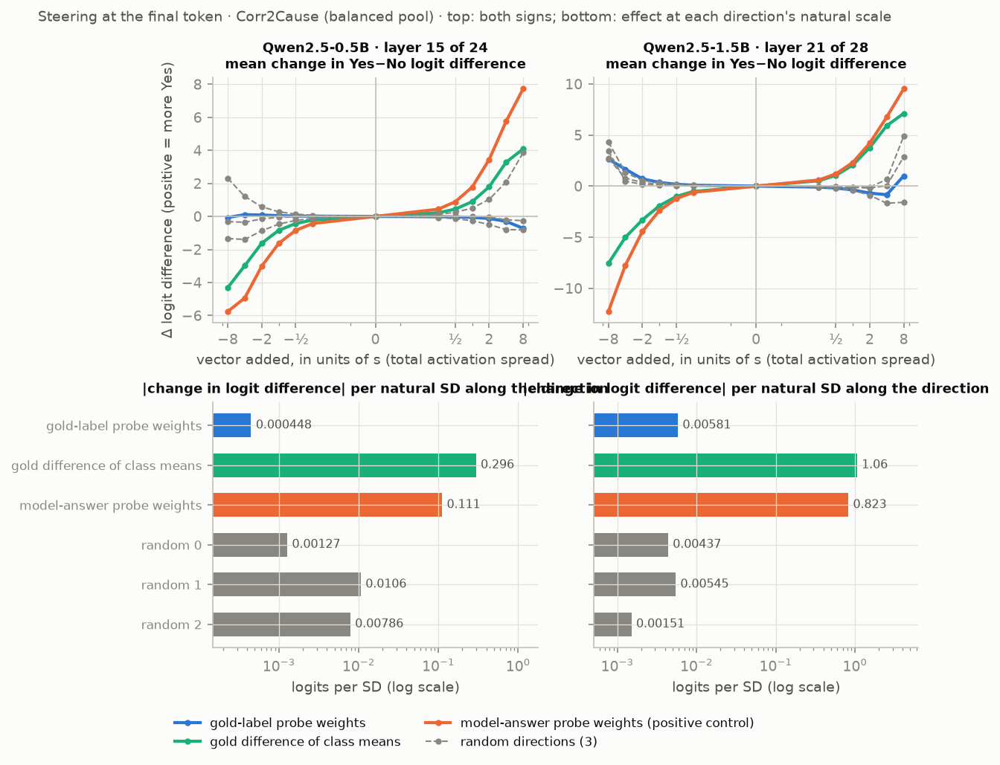
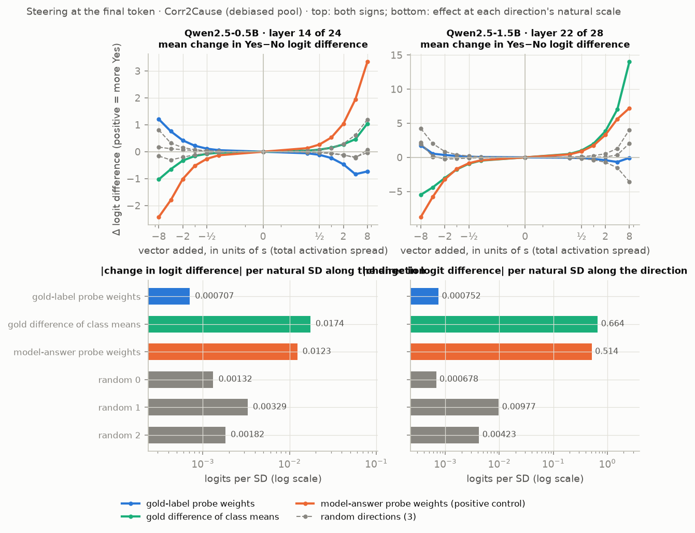
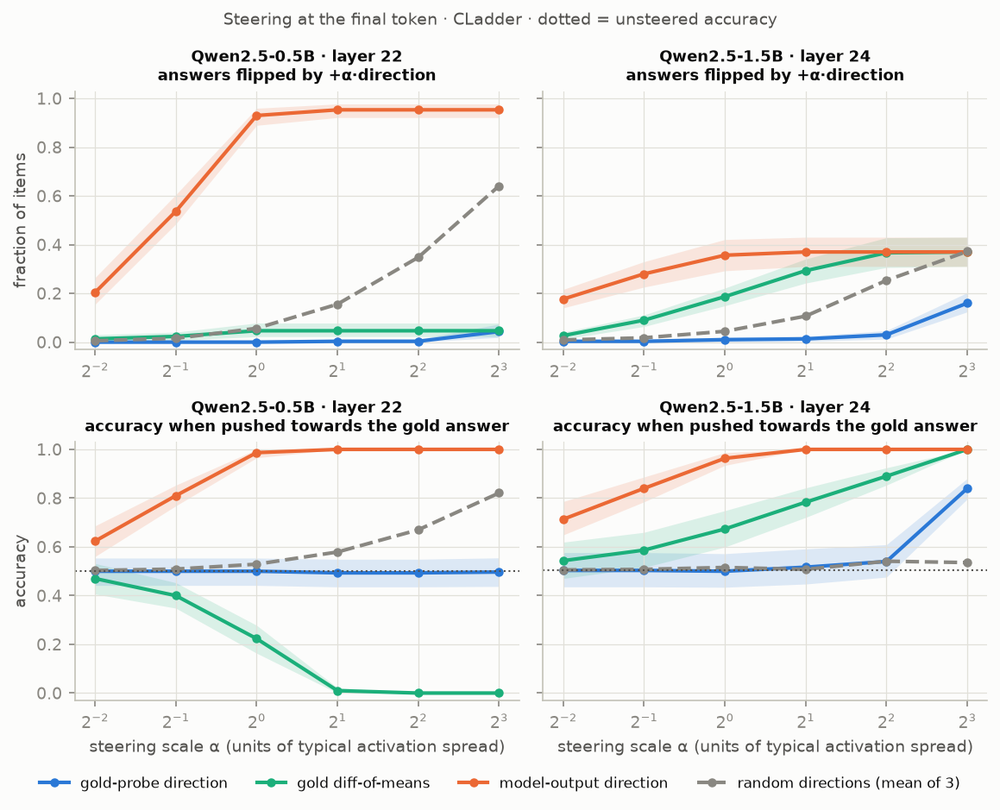

**Matched controls** (150 report-half items for Qwen2.5-0.5B, 100 for Qwen2.5-1.5B): 100 isotropic random directions; 20 probe weight vectors fitted to shuffled labels, the control of the same kind as a probe direction; 20 differences of class means for shuffled labels, the control of the same kind as a difference of means.

| Model | Item set | Token | Layer | Direction | Slope per unit s | Percentile among 100 isotropic directions (|slope|) | Isotropic median |slope| | Isotropic max |slope| | Matched control family (20 directions) | Percentile among matched controls | Matched median |slope| | Matched max |slope| | Ratio to matched median | Natural SD along this direction (units of s) | Natural SD, matched controls (median) | Percentile among matched controls, per natural SD | Ratio to matched median, per natural SD | Control labels shuffled |
|---|---|---|---|---|---|---|---|---|---|---|---|---|---|---|---|---|---|---|
| Qwen2.5-0.5B | Corr2Cause pool | final | 15 | gold-label probe weights | -0.049 [-0.056, -0.042] | 22 | 0.125 | 0.685 | shuffled-label probe | 20 | 0.130 | 0.294 | 0.4 | 0.0083 | 0.0031 | 50 | 1.0 | over the whole item set |
| Qwen2.5-0.5B | Corr2Cause pool | final | 15 | gold difference of class means | +0.865 [+0.855, +0.875] | 100 | 0.125 | 0.685 | shuffled-label difference of means | 100 | 0.189 | 0.628 | 4.6 | 0.3410 | 0.3316 | 100 | 4.0 | over the whole item set |
| Qwen2.5-0.5B | Corr2Cause pool | final | 15 | model-answer probe weights (positive control) | +1.700 [+1.685, +1.714] | 100 | 0.125 | 0.685 | shuffled-label probe | 100 | 0.130 | 0.294 | 13.1 | 0.0652 | 0.0031 | 100 | 267.8 | over the whole item set |
| Qwen2.5-0.5B | Corr2Cause debiased pool | final | 14 | gold-label probe weights | -0.229 [-0.235, -0.222] | 88 | 0.104 | 0.373 | shuffled-label probe | 75 | 0.173 | 0.378 | 1.3 | 0.0031 | 0.0031 | 75 | 1.3 | within hypothesis string |
| Qwen2.5-0.5B | Corr2Cause debiased pool | final | 14 | gold difference of class means | +0.150 [+0.144, +0.157] | 63 | 0.104 | 0.373 | shuffled-label difference of means | 70 | 0.081 | 0.257 | 1.9 | 0.1132 | 0.2641 | 45 | 0.8 | within hypothesis string |
| Qwen2.5-0.5B | Corr2Cause debiased pool | final | 14 | model-answer probe weights (positive control) | +0.524 [+0.516, +0.532] | 100 | 0.104 | 0.373 | shuffled-label probe | 100 | 0.173 | 0.378 | 3.0 | 0.0234 | 0.0031 | 100 | 23.3 | within hypothesis string |
| Qwen2.5-0.5B | Corr2Cause pool | end of hypothesis | 11 | gold-label probe weights | -0.133 [-0.147, -0.117] | 70 | 0.080 | 0.328 | shuffled-label probe | 60 | 0.112 | 0.307 | 1.2 | 0.0086 | 0.0021 | 100 | 4.8 | over the whole item set |
| Qwen2.5-0.5B | Corr2Cause pool | end of hypothesis | 11 | gold difference of class means | +0.092 [+0.083, +0.101] | 56 | 0.080 | 0.328 | shuffled-label difference of means | 60 | 0.081 | 0.209 | 1.1 | 0.4286 | 0.4047 | 60 | 1.4 | over the whole item set |
| Qwen2.5-0.5B | Corr2Cause pool | end of hypothesis | 11 | model-answer probe weights (positive control) | +0.261 [+0.243, +0.280] | 95 | 0.080 | 0.328 | shuffled-label probe | 95 | 0.112 | 0.307 | 2.3 | 0.0116 | 0.0021 | 100 | 12.9 | over the whole item set |
| Qwen2.5-0.5B | Corr2Cause debiased pool | end of hypothesis | 13 | gold-label probe weights | +0.095 [+0.074, +0.115] | 61 | 0.069 | 0.320 | shuffled-label probe | 45 | 0.099 | 0.182 | 1.0 | 0.0063 | 0.0052 | 55 | 1.1 | within hypothesis string |
| Qwen2.5-0.5B | Corr2Cause debiased pool | end of hypothesis | 13 | gold difference of class means | +0.287 [+0.262, +0.313] | 99 | 0.069 | 0.320 | shuffled-label difference of means | 80 | 0.106 | 0.420 | 2.7 | 0.1323 | 0.1341 | 85 | 3.1 | within hypothesis string |
| Qwen2.5-0.5B | Corr2Cause debiased pool | end of hypothesis | 13 | model-answer probe weights (positive control) | +0.756 [+0.709, +0.807] | 100 | 0.069 | 0.320 | shuffled-label probe | 100 | 0.099 | 0.182 | 7.6 | 0.0280 | 0.0052 | 100 | 38.4 | within hypothesis string |
| Qwen2.5-1.5B | Corr2Cause pool | final | 21 | gold-label probe weights | -0.367 [-0.382, -0.351] | 84 | 0.162 | 1.043 | shuffled-label probe | 85 | 0.206 | 0.533 | 1.8 | 0.0159 | 0.0052 | 100 | 5.6 | over the whole item set |
| Qwen2.5-1.5B | Corr2Cause pool | final | 21 | gold difference of class means | +1.981 [+1.925, +2.042] | 100 | 0.162 | 1.043 | shuffled-label difference of means | 85 | 1.131 | 2.685 | 1.8 | 0.5324 | 0.3511 | 85 | 2.3 | over the whole item set |
| Qwen2.5-1.5B | Corr2Cause pool | final | 21 | model-answer probe weights (positive control) | +2.360 [+2.305, +2.424] | 100 | 0.162 | 1.043 | shuffled-label probe | 100 | 0.206 | 0.533 | 11.5 | 0.3503 | 0.0052 | 100 | 800.8 | over the whole item set |
| Qwen2.5-1.5B | Corr2Cause debiased pool | final | 22 | gold-label probe weights | -0.201 [-0.226, -0.178] | 55 | 0.184 | 0.850 | shuffled-label probe | 65 | 0.113 | 0.449 | 1.8 | 0.0035 | 0.0026 | 75 | 2.4 | over the whole item set |
| Qwen2.5-1.5B | Corr2Cause debiased pool | final | 22 | gold difference of class means | +1.897 [+1.865, +1.930] | 100 | 0.184 | 0.850 | shuffled-label difference of means | 80 | 1.330 | 2.674 | 1.4 | 0.3543 | 0.4113 | 60 | 1.4 | over the whole item set |
| Qwen2.5-1.5B | Corr2Cause debiased pool | final | 22 | model-answer probe weights (positive control) | +1.711 [+1.684, +1.743] | 100 | 0.184 | 0.850 | shuffled-label probe | 100 | 0.113 | 0.449 | 15.1 | 0.3029 | 0.0026 | 100 | 1798.5 | over the whole item set |

Source: `results/steering_controls_qwen0.5b_c2c_probe.json`, `results/steering_controls_qwen0.5b_c2c_debiased.json`, `results/steering_controls_qwen0.5b_c2c_probe_hyp.json`, `results/steering_controls_qwen0.5b_c2c_debiased_hyp.json`, `results/steering_controls_qwen1.5b_c2c_probe.json`, `results/steering_controls_qwen1.5b_c2c_debiased.json`

**What the data show.**

1. *The gold-probe weight direction shifts the answer by an amount within the range of label-free directions of the same kind.* Slope, with its place among 20 probe directions fitted to shuffled labels: original pool -0.049 [-0.056, -0.042] (20% percentile of 20; 0.38 times their median, 0.17 of their maximum) for Qwen2.5-0.5B and -0.367 [-0.382, -0.351] (85% percentile of 20; 1.78 times their median, 0.69 of their maximum) for Qwen2.5-1.5B; debiased pool -0.229 [-0.235, -0.222] (75% percentile of 20; 1.32 times their median, 0.60 of their maximum) and -0.201 [-0.226, -0.178] (65% percentile of 20; 1.77 times their median, 0.45 of their maximum). The slope is small but not zero: it is negative in all four cases and has the same sign for nearly every item (pushing "towards valid" lowers the Yes logit; my first table showed one sign only and hid this). Twenty controls cannot exclude an effect two or three times the control median, so the statement is "within the range of", not "no more than".
2. *The comparison depends on the unit.* The shuffled-label directions have the same natural spread as the gold direction on the debiased pool, but on the original pool the gold direction is about three times wider. Per natural standard deviation, the gold direction for Qwen2.5-1.5B on the original pool exceeds all 20 shuffled controls (5.63 times their median); in the other three cases it is at the 50%, 75% and 75% percentile. The original pool is the one in which the gold label is confounded with the hypothesis string.
3. *At natural scale the effect is negligible either way.* One unit of s is 119.00 (Qwen2.5-0.5B) and 63.08 (Qwen2.5-1.5B) natural standard deviations along the gold-probe direction on the original pool, and 322.89 and 280.42 on the debiased pool. Moving an item across the whole natural gap between valid and invalid items along that direction would change LD by -0.001 and -0.009 logits (original pool), against a standard deviation of LD across items of 0.41 and 2.28.
4. *The difference-of-means direction moves the answer, mostly not because it separates valid from invalid items.* Original pool: +0.865 [+0.855, +0.875] (100% percentile of 20; 4.59 times their median, 1.38 of their maximum) for Qwen2.5-0.5B and +1.981 [+1.925, +2.042] (85% percentile of 20; 1.75 times their median, 0.74 of their maximum) for Qwen2.5-1.5B; debiased pool: +0.150 [+0.144, +0.157] (70% percentile of 20; 1.87 times their median, 0.59 of their maximum) and +1.897 [+1.865, +1.930] (80% percentile of 20; 1.43 times their median, 0.71 of their maximum). A difference of class means lies in the high-variance part of activation space, and so does a difference of means for random labels. On the original pool it separates the model's own answer at least as well as the gold label (AUROC 0.942 against 0.650 for Qwen2.5-1.5B).
5. *The positive control works, with one qualification.* The model-answer probe direction exceeds all 100 isotropic and all 20 shuffled-label probe directions in every case. It does not have the largest slope of anything steered: for Qwen2.5-1.5B on the debiased pool the gold difference of means is larger (+1.897 against +1.711), and the largest shuffled-label difference of means there has |slope| 2.674. Differences of means, for real or shuffled labels, point into the high-variance directions that the answer is most sensitive to; a probe direction is the fairer comparison for a probe direction. (An earlier version of this sentence said "largest slope everywhere"; that was wrong.)

**What may and may not be concluded.**

- May: adding the gold-probe direction at the probe's layer and the final token, in steps of one RMS activation radius (63 to 322 natural standard deviations along that direction, depending on model and pool), shifts the Yes−No logit by an amount inside the range of 20 shuffled-label probe directions. A movement of natural size changes the answer by less than 0.01 logits.
- May not: that the direction "is not read", or that the decoded information "is unused". With twenty controls and one site the experiment neither shows nor excludes a causal role. The probe's weights and the difference of class means are two views of one discriminant (the covariance times the probe weights has cosine 0.98 with the difference of means for Qwen2.5-1.5B). On the debiased pool the fitted direction is itself noisy (cosine 0.43 between the two halves of the data). And the probe is stronger at the end of the hypothesis, which was not steered.
- What the behavioural data add (Section 3.6.5): the answers are at chance when pooled, but for direct-causation hypotheses they track validity and the probe's score. "Not expressed" holds only on average.
- CLadder: the steered gold directions barely decode the gold label there (AUROC 0.547 and 0.622), so those rows are shown for completeness and no conclusion is drawn from them.

**Gemma-2-2B and Qwen2.5-3B (first Kaggle run).** Their rows in the first table come from the run that was designed before the second audit: three isotropic random directions and no matched controls. They can therefore not be placed "inside or outside the range of label-free directions", and I draw no conclusion from them yet. For the record: the gold-probe direction's slope is +0.247 [+0.224, +0.269] (Gemma-2-2B) and -0.776 [-0.813, -0.737] (Qwen2.5-3B) on the original pool and +0.468 [+0.453, +0.481] and -0.244 [-0.303, -0.182] on the debiased pool, while single isotropic directions in the same runs reach +0.969 (Gemma-2-2B, original pool; four times its gold-probe slope there), +0.553 (Gemma-2-2B, debiased pool) and +0.641 (Qwen2.5-3B, debiased pool). The matched controls for these two models are part of the second round of GPU runs and are added to the controls table when they arrive. Gemma's CLadder steering was run on Kaggle's draw of the CLadder sample (Section 7); its slopes are exact for the 228 of 300 steered items that are also in the laptop's draw (the others are not analysed), and the direction-dependent columns for those rows use directions refitted on the laptop's draw.

**Steering at the end of the hypothesis, and controls shuffled within hypothesis string (second round; so far Qwen2.5-0.5B).** The second audit pointed out that the probe is stronger at the last token of the hypothesis than at the final prompt token, and that only the latter had been steered. The fifth audit pointed out that on the debiased pool my control labels were shuffled over the whole pool: the gold label is balanced within every hypothesis string there and a global shuffle is not, so those control directions carried information about which hypothesis is asked and were a wider family than the real direction belongs to. Both are fixed for Qwen2.5-0.5B: directions fitted at the end of the hypothesis (layer chosen there on the selection half, answer read at the final token), and on the debiased pool control labels shuffled within hypothesis string (the natural spread of the control differences of means is now 0.134 s against 0.132 s for the real one at this site; with the global shuffle it was four times larger).

With the matched controls, on the debiased pool: at the end of the hypothesis the gold-probe direction's slope is +0.095 [+0.074, +0.115] (45% of 20 controls have a smaller slope in absolute value) and the gold difference of means' is +0.287 [+0.262, +0.313] (80%; largest control 0.420). At the final token: -0.229 [-0.235, -0.222] (75%) and +0.150 [+0.144, +0.157] (70%). The model-answer direction is larger than all 20 controls at both tokens. So on the debiased pool, with controls of the same kind, neither gold direction stands out at either token. (With the globally shuffled controls the difference of means at the end of the hypothesis had looked larger than all 20; the earlier result files are in `results/_superseded/`.) On the original pool, where labels are not balanced within string and the shuffle is global, the gold difference of means is larger than all 20 controls at the final token (+0.865 [+0.855, +0.875] against a largest control of 0.628); that is the pool on which the gold label is confounded with the hypothesis string. For Qwen2.5-1.5B the debiased-pool rows in the table still use globally shuffled controls until its second-round run returns; the table's last column says which.

Flip rates and the earlier "accuracy when pushed towards gold" (now called controllability) are in the next table. They are poor measures for models that answer No to most items: a flip is a threshold on slope × α against the margin, and controllability uses the gold label to choose the sign of the push, so any direction with a consistent slope reaches 0 or 1. Ablating the component along the probe or random directions changes LD by amounts at the float16 noise floor; no ablation comparison is claimed.

| Model | Item set | Layer | Direction | Flip rate +4s | Flip rate −4s | Controllability towards gold (4s) | Controllability away from gold (4s) | Ablation mean |ΔLD| | Noise floor | Ablation above 3× floor |
|---|---|---|---|---|---|---|---|---|---|---|
| Qwen2.5-0.5B | Corr2Cause pool | 15/24 | gold-label probe weights | 0.00 [0.00, 0.00] | 0.00 [0.00, 0.01] | 0.50 [0.46, 0.55] | 0.50 [0.46, 0.55] | 0.0048 | 0.0058 | no |
| Qwen2.5-0.5B | Corr2Cause pool | 15/24 | gold difference of class means | 1.00 [1.00, 1.00] | 0.00 [0.00, 0.00] | 1.00 [1.00, 1.00] | 0.00 [0.00, 0.00] | 0.2683 | 0.0058 | yes |
| Qwen2.5-0.5B | Corr2Cause pool | 15/24 | model-answer probe weights (positive control) | 1.00 [1.00, 1.00] | 0.00 [0.00, 0.00] | 1.00 [1.00, 1.00] | 0.00 [0.00, 0.00] | 0.0948 | 0.0058 | yes |
| Qwen2.5-0.5B | Corr2Cause pool | 15/24 | random direction 0 | 0.00 [0.00, 0.01] | 0.00 [0.00, 0.00] | 0.50 [0.46, 0.55] | 0.50 [0.45, 0.54] | 0.0047 | 0.0058 | no |
| Qwen2.5-0.5B | Corr2Cause pool | 15/24 | random direction 1 | 1.00 [1.00, 1.00] | 0.00 [0.00, 0.00] | 1.00 [1.00, 1.00] | 0.00 [0.00, 0.00] | 0.0100 | 0.0058 | no |
| Qwen2.5-0.5B | Corr2Cause pool | 15/24 | random direction 2 | 0.00 [0.00, 0.00] | 0.57 [0.51, 0.63] | 0.24 [0.19, 0.28] | 0.81 [0.76, 0.85] | 0.0077 | 0.0058 | no |
| Qwen2.5-0.5B | Corr2Cause pool | 12/24 | gold-label probe weights | 0.12 [0.08, 0.16] | 0.00 [0.00, 0.00] | 0.58 [0.53, 0.63] | 0.46 [0.42, 0.51] | 0.0045 | 0.0059 | no |
| Qwen2.5-0.5B | Corr2Cause pool | 12/24 | gold difference of class means | 0.00 [0.00, 0.00] | 0.06 [0.03, 0.09] | 0.49 [0.44, 0.53] | 0.54 [0.50, 0.59] | 0.0262 | 0.0059 | yes |
| Qwen2.5-0.5B | Corr2Cause pool | 12/24 | model-answer probe weights (positive control) | 0.02 [0.01, 0.04] | 0.01 [0.00, 0.02] | 0.51 [0.47, 0.56] | 0.50 [0.46, 0.55] | 0.0043 | 0.0059 | no |
| Qwen2.5-0.5B | Corr2Cause pool | 12/24 | random direction 0 | 0.00 [0.00, 0.00] | 0.01 [0.00, 0.03] | 0.50 [0.45, 0.54] | 0.51 [0.47, 0.56] | 0.0050 | 0.0059 | no |
| Qwen2.5-0.5B | Corr2Cause pool | 12/24 | random direction 1 | 0.15 [0.11, 0.19] | 0.00 [0.00, 0.00] | 0.61 [0.56, 0.66] | 0.46 [0.42, 0.51] | 0.0053 | 0.0059 | no |
| Qwen2.5-0.5B | Corr2Cause pool | 12/24 | random direction 2 | 0.27 [0.21, 0.33] | 0.00 [0.00, 0.00] | 0.67 [0.62, 0.72] | 0.40 [0.35, 0.45] | 0.0076 | 0.0059 | no |
| Qwen2.5-0.5B | Corr2Cause pool | 20/24 | gold-label probe weights | 0.06 [0.03, 0.09] | 0.00 [0.00, 0.00] | 0.55 [0.50, 0.59] | 0.49 [0.45, 0.54] | 0.0044 | 0.0056 | no |
| Qwen2.5-0.5B | Corr2Cause pool | 20/24 | gold difference of class means | 1.00 [1.00, 1.00] | 0.00 [0.00, 0.00] | 1.00 [1.00, 1.00] | 0.00 [0.00, 0.00] | 0.2374 | 0.0056 | yes |
| Qwen2.5-0.5B | Corr2Cause pool | 20/24 | model-answer probe weights (positive control) | 1.00 [1.00, 1.00] | 0.00 [0.00, 0.00] | 1.00 [1.00, 1.00] | 0.00 [0.00, 0.00] | 0.1710 | 0.0056 | yes |
| Qwen2.5-0.5B | Corr2Cause pool | 20/24 | random direction 0 | 0.07 [0.04, 0.10] | 0.00 [0.00, 0.00] | 0.55 [0.50, 0.60] | 0.49 [0.44, 0.53] | 0.0052 | 0.0056 | no |
| Qwen2.5-0.5B | Corr2Cause pool | 20/24 | random direction 1 | 0.36 [0.30, 0.42] | 0.00 [0.00, 0.00] | 0.71 [0.66, 0.77] | 0.36 [0.31, 0.41] | 0.0056 | 0.0056 | no |
| Qwen2.5-0.5B | Corr2Cause pool | 20/24 | random direction 2 | 0.00 [0.00, 0.00] | 0.05 [0.03, 0.08] | 0.49 [0.45, 0.54] | 0.54 [0.50, 0.59] | 0.0058 | 0.0056 | no |
| Qwen2.5-0.5B | Corr2Cause debiased pool | 14/24 | gold-label probe weights | 0.00 [0.00, 0.01] | 0.17 [0.12, 0.21] | 0.42 [0.37, 0.47] | 0.59 [0.54, 0.64] | 0.0046 | 0.0059 | no |
| Qwen2.5-0.5B | Corr2Cause debiased pool | 14/24 | gold difference of class means | 0.09 [0.06, 0.13] | 0.00 [0.00, 0.01] | 0.55 [0.49, 0.60] | 0.45 [0.40, 0.50] | 0.0144 | 0.0059 | no |
| Qwen2.5-0.5B | Corr2Cause debiased pool | 14/24 | model-answer probe weights (positive control) | 0.99 [0.98, 1.00] | 0.00 [0.00, 0.01] | 1.00 [1.00, 1.00] | 0.00 [0.00, 0.01] | 0.0107 | 0.0059 | no |
| Qwen2.5-0.5B | Corr2Cause debiased pool | 14/24 | random direction 0 | 0.00 [0.00, 0.01] | 0.03 [0.01, 0.05] | 0.49 [0.44, 0.54] | 0.52 [0.47, 0.57] | 0.0046 | 0.0059 | no |
| Qwen2.5-0.5B | Corr2Cause debiased pool | 14/24 | random direction 1 | 0.13 [0.09, 0.16] | 0.00 [0.00, 0.01] | 0.56 [0.51, 0.61] | 0.43 [0.38, 0.48] | 0.0052 | 0.0059 | no |
| Qwen2.5-0.5B | Corr2Cause debiased pool | 14/24 | random direction 2 | 0.00 [0.00, 0.01] | 0.05 [0.03, 0.08] | 0.47 [0.42, 0.52] | 0.53 [0.48, 0.58] | 0.0052 | 0.0059 | no |
| Qwen2.5-0.5B | CLadder | 16/24 | gold-label probe weights | 0.12 [0.09, 0.16] | 0.04 [0.02, 0.06] | 0.59 [0.53, 0.64] | 0.43 [0.37, 0.48] | 0.0040 | 0.0048 | no |
| Qwen2.5-0.5B | CLadder | 16/24 | gold difference of class means | 0.05 [0.02, 0.08] | 0.95 [0.92, 0.98] | 0.00 [0.00, 0.01] | 1.00 [1.00, 1.00] | 0.2176 | 0.0048 | yes |
| Qwen2.5-0.5B | CLadder | 16/24 | model-answer probe weights (positive control) | 0.95 [0.92, 0.98] | 0.05 [0.02, 0.08] | 1.00 [1.00, 1.00] | 0.00 [0.00, 0.00] | 0.1021 | 0.0048 | yes |
| Qwen2.5-0.5B | CLadder | 16/24 | random direction 0 | 0.35 [0.28, 0.42] | 0.03 [0.01, 0.04] | 0.70 [0.64, 0.77] | 0.33 [0.28, 0.38] | 0.0052 | 0.0048 | no |
| Qwen2.5-0.5B | CLadder | 16/24 | random direction 1 | 0.68 [0.61, 0.76] | 0.04 [0.02, 0.07] | 0.88 [0.83, 0.92] | 0.15 [0.09, 0.20] | 0.0066 | 0.0048 | no |
| Qwen2.5-0.5B | CLadder | 16/24 | random direction 2 | 0.02 [0.00, 0.03] | 0.54 [0.49, 0.60] | 0.25 [0.20, 0.30] | 0.78 [0.72, 0.83] | 0.0041 | 0.0048 | no |
| Qwen2.5-1.5B | Corr2Cause pool | 21/28 | gold-label probe weights | 0.10 [0.07, 0.14] | 0.30 [0.26, 0.35] | 0.31 [0.26, 0.35] | 0.71 [0.66, 0.76] | 0.0076 | 0.0080 | no |
| Qwen2.5-1.5B | Corr2Cause pool | 21/28 | gold difference of class means | 0.89 [0.85, 0.93] | 0.11 [0.07, 0.15] | 1.00 [1.00, 1.00] | 0.00 [0.00, 0.00] | 1.0198 | 0.0080 | yes |
| Qwen2.5-1.5B | Corr2Cause pool | 21/28 | model-answer probe weights (positive control) | 0.89 [0.85, 0.93] | 0.11 [0.07, 0.15] | 1.00 [1.00, 1.00] | 0.00 [0.00, 0.00] | 0.7409 | 0.0080 | yes |
| Qwen2.5-1.5B | Corr2Cause pool | 21/28 | random direction 0 | 0.04 [0.02, 0.06] | 0.05 [0.03, 0.07] | 0.51 [0.47, 0.56] | 0.51 [0.47, 0.56] | 0.0071 | 0.0080 | no |
| Qwen2.5-1.5B | Corr2Cause pool | 21/28 | random direction 1 | 0.08 [0.05, 0.12] | 0.21 [0.17, 0.26] | 0.35 [0.31, 0.39] | 0.64 [0.59, 0.69] | 0.0074 | 0.0080 | no |
| Qwen2.5-1.5B | Corr2Cause pool | 21/28 | random direction 2 | 0.13 [0.10, 0.17] | 0.06 [0.03, 0.09] | 0.55 [0.51, 0.60] | 0.48 [0.43, 0.52] | 0.0065 | 0.0080 | no |
| Qwen2.5-1.5B | Corr2Cause debiased pool | 22/28 | gold-label probe weights | 0.05 [0.03, 0.07] | 0.02 [0.00, 0.03] | 0.45 [0.40, 0.50] | 0.51 [0.46, 0.56] | 0.0042 | 0.0060 | no |
| Qwen2.5-1.5B | Corr2Cause debiased pool | 22/28 | gold difference of class means | 0.88 [0.84, 0.91] | 0.12 [0.09, 0.16] | 1.00 [1.00, 1.00] | 0.00 [0.00, 0.00] | 0.5521 | 0.0060 | yes |
| Qwen2.5-1.5B | Corr2Cause debiased pool | 22/28 | model-answer probe weights (positive control) | 0.88 [0.84, 0.91] | 0.12 [0.09, 0.16] | 1.00 [1.00, 1.00] | 0.00 [0.00, 0.00] | 0.4372 | 0.0060 | yes |
| Qwen2.5-1.5B | Corr2Cause debiased pool | 22/28 | random direction 0 | 0.04 [0.02, 0.07] | 0.03 [0.01, 0.05] | 0.52 [0.47, 0.57] | 0.44 [0.39, 0.49] | 0.0047 | 0.0060 | no |
| Qwen2.5-1.5B | Corr2Cause debiased pool | 22/28 | random direction 1 | 0.10 [0.07, 0.14] | 0.38 [0.32, 0.43] | 0.25 [0.20, 0.29] | 0.73 [0.68, 0.78] | 0.0088 | 0.0060 | no |
| Qwen2.5-1.5B | Corr2Cause debiased pool | 22/28 | random direction 2 | 0.24 [0.19, 0.28] | 0.02 [0.00, 0.03] | 0.60 [0.54, 0.65] | 0.37 [0.31, 0.42] | 0.0061 | 0.0060 | no |
| Qwen2.5-1.5B | CLadder | 24/28 | gold-label probe weights | 0.03 [0.01, 0.05] | 0.08 [0.05, 0.10] | 0.54 [0.48, 0.61] | 0.45 [0.39, 0.53] | 0.0047 | 0.0061 | no |
| Qwen2.5-1.5B | CLadder | 24/28 | gold difference of class means | 0.37 [0.31, 0.43] | 0.39 [0.34, 0.44] | 0.89 [0.85, 0.92] | 0.13 [0.09, 0.18] | 0.1670 | 0.0061 | yes |
| Qwen2.5-1.5B | CLadder | 24/28 | model-answer probe weights (positive control) | 0.37 [0.31, 0.43] | 0.63 [0.57, 0.69] | 1.00 [1.00, 1.00] | 0.00 [0.00, 0.00] | 0.6141 | 0.0061 | yes |
| Qwen2.5-1.5B | CLadder | 24/28 | random direction 0 | 0.17 [0.13, 0.21] | 0.14 [0.10, 0.18] | 0.65 [0.58, 0.73] | 0.35 [0.29, 0.41] | 0.0076 | 0.0061 | no |
| Qwen2.5-1.5B | CLadder | 24/28 | random direction 1 | 0.33 [0.27, 0.38] | 0.18 [0.13, 0.22] | 0.26 [0.20, 0.32] | 0.76 [0.71, 0.82] | 0.0053 | 0.0061 | no |
| Qwen2.5-1.5B | CLadder | 24/28 | random direction 2 | 0.27 [0.22, 0.32] | 0.12 [0.08, 0.16] | 0.71 [0.65, 0.78] | 0.32 [0.26, 0.39] | 0.0069 | 0.0061 | no |
| Gemma-2-2B | Corr2Cause pool | 18/26 | gold-label probe weights | 0.04 [0.02, 0.07] | 0.16 [0.12, 0.21] | 0.54 [0.49, 0.58] | 0.42 [0.37, 0.46] | 0.0050 | 0.0062 | no |
| Gemma-2-2B | Corr2Cause pool | 18/26 | gold difference of class means | 0.47 [0.41, 0.53] | 0.28 [0.22, 0.33] | 0.89 [0.86, 0.93] | 0.15 [0.11, 0.19] | 1.1813 | 0.0062 | yes |
| Gemma-2-2B | Corr2Cause pool | 18/26 | model-answer probe weights (positive control) | 0.72 [0.67, 0.78] | 0.28 [0.22, 0.33] | 1.00 [1.00, 1.00] | 0.00 [0.00, 0.00] | 0.5263 | 0.0062 | yes |
| Gemma-2-2B | Corr2Cause pool | 18/26 | random direction 0 | 0.19 [0.14, 0.24] | 0.18 [0.14, 0.23] | 0.68 [0.63, 0.73] | 0.31 [0.27, 0.36] | 0.0263 | 0.0062 | yes |
| Gemma-2-2B | Corr2Cause pool | 18/26 | random direction 1 | 0.00 [0.00, 0.00] | 0.08 [0.05, 0.11] | 0.51 [0.46, 0.56] | 0.45 [0.40, 0.50] | 0.0073 | 0.0062 | no |
| Gemma-2-2B | Corr2Cause pool | 18/26 | random direction 2 | 0.04 [0.02, 0.06] | 0.16 [0.12, 0.21] | 0.56 [0.51, 0.61] | 0.41 [0.36, 0.46] | 0.0050 | 0.0062 | no |
| Gemma-2-2B | Corr2Cause pool | 13/26 | gold-label probe weights | 0.11 [0.08, 0.15] | 0.09 [0.06, 0.12] | 0.38 [0.34, 0.43] | 0.58 [0.54, 0.64] | 0.0050 | 0.0059 | no |
| Gemma-2-2B | Corr2Cause pool | 13/26 | gold difference of class means | 0.08 [0.05, 0.11] | 0.17 [0.13, 0.22] | 0.61 [0.56, 0.66] | 0.36 [0.31, 0.41] | 0.0547 | 0.0059 | yes |
| Gemma-2-2B | Corr2Cause pool | 13/26 | model-answer probe weights (positive control) | 0.04 [0.02, 0.07] | 0.13 [0.09, 0.17] | 0.57 [0.52, 0.62] | 0.40 [0.35, 0.45] | 0.0089 | 0.0059 | no |
| Gemma-2-2B | Corr2Cause pool | 13/26 | random direction 0 | 0.04 [0.02, 0.07] | 0.09 [0.06, 0.12] | 0.41 [0.37, 0.47] | 0.55 [0.50, 0.60] | 0.0052 | 0.0059 | no |
| Gemma-2-2B | Corr2Cause pool | 13/26 | random direction 1 | 0.12 [0.08, 0.16] | 0.06 [0.03, 0.08] | 0.39 [0.34, 0.44] | 0.55 [0.51, 0.60] | 0.0048 | 0.0059 | no |
| Gemma-2-2B | Corr2Cause pool | 13/26 | random direction 2 | 0.10 [0.07, 0.13] | 0.18 [0.13, 0.23] | 0.62 [0.57, 0.67] | 0.34 [0.30, 0.39] | 0.0056 | 0.0059 | no |
| Gemma-2-2B | Corr2Cause pool | 22/26 | gold-label probe weights | 0.02 [0.00, 0.03] | 0.05 [0.02, 0.07] | 0.46 [0.41, 0.52] | 0.50 [0.45, 0.55] | 0.0045 | 0.0058 | no |
| Gemma-2-2B | Corr2Cause pool | 22/26 | gold difference of class means | 0.72 [0.67, 0.78] | 0.28 [0.22, 0.33] | 1.00 [1.00, 1.00] | 0.00 [0.00, 0.00] | 1.7006 | 0.0058 | yes |
| Gemma-2-2B | Corr2Cause pool | 22/26 | model-answer probe weights (positive control) | 0.72 [0.67, 0.78] | 0.28 [0.22, 0.33] | 1.00 [1.00, 1.00] | 0.00 [0.00, 0.00] | 0.6990 | 0.0058 | yes |
| Gemma-2-2B | Corr2Cause pool | 22/26 | random direction 0 | 0.11 [0.07, 0.14] | 0.11 [0.07, 0.15] | 0.59 [0.54, 0.64] | 0.38 [0.33, 0.43] | 0.0068 | 0.0058 | no |
| Gemma-2-2B | Corr2Cause pool | 22/26 | random direction 1 | 0.04 [0.02, 0.06] | 0.04 [0.02, 0.06] | 0.48 [0.44, 0.53] | 0.50 [0.45, 0.55] | 0.0048 | 0.0058 | no |
| Gemma-2-2B | Corr2Cause pool | 22/26 | random direction 2 | 0.09 [0.06, 0.13] | 0.11 [0.07, 0.15] | 0.58 [0.53, 0.64] | 0.38 [0.33, 0.43] | 0.0051 | 0.0058 | no |
| Gemma-2-2B | Corr2Cause debiased pool | 17/26 | gold-label probe weights | 0.24 [0.19, 0.28] | 0.19 [0.15, 0.23] | 0.70 [0.65, 0.75] | 0.27 [0.22, 0.32] | 0.0045 | 0.0063 | no |
| Gemma-2-2B | Corr2Cause debiased pool | 17/26 | gold difference of class means | 0.24 [0.19, 0.28] | 0.68 [0.63, 0.74] | 0.04 [0.02, 0.06] | 0.96 [0.93, 0.98] | 0.4507 | 0.0063 | yes |
| Gemma-2-2B | Corr2Cause debiased pool | 17/26 | model-answer probe weights (positive control) | 0.76 [0.72, 0.81] | 0.24 [0.19, 0.28] | 1.00 [1.00, 1.00] | 0.00 [0.00, 0.00] | 0.3792 | 0.0063 | yes |
| Gemma-2-2B | Corr2Cause debiased pool | 17/26 | random direction 0 | 0.13 [0.09, 0.16] | 0.06 [0.04, 0.09] | 0.55 [0.49, 0.61] | 0.36 [0.31, 0.42] | 0.0152 | 0.0063 | no |
| Gemma-2-2B | Corr2Cause debiased pool | 17/26 | random direction 1 | 0.08 [0.05, 0.11] | 0.06 [0.03, 0.08] | 0.53 [0.47, 0.58] | 0.40 [0.35, 0.46] | 0.0067 | 0.0063 | no |
| Gemma-2-2B | Corr2Cause debiased pool | 17/26 | random direction 2 | 0.07 [0.04, 0.10] | 0.08 [0.05, 0.11] | 0.48 [0.43, 0.54] | 0.48 [0.42, 0.53] | 0.0056 | 0.0063 | no |
| Gemma-2-2B | CLadder | 20/26 | gold-label probe weights | 0.04 [0.02, 0.06] | 0.22 [0.17, 0.28] | 0.42 [0.33, 0.50] | 0.65 [0.58, 0.73] | 0.0047 | 0.0052 | no |
| Gemma-2-2B | CLadder | 20/26 | gold difference of class means | 0.36 [0.30, 0.41] | 0.49 [0.40, 0.56] | 0.96 [0.94, 0.99] | 0.12 [0.06, 0.19] | 0.4658 | 0.0052 | yes |
| Gemma-2-2B | CLadder | 20/26 | model-answer probe weights (positive control) | 0.38 [0.32, 0.44] | 0.62 [0.56, 0.68] | 1.00 [1.00, 1.00] | 0.00 [0.00, 0.00] | 0.7086 | 0.0052 | yes |
| Gemma-2-2B | CLadder | 20/26 | random direction 0 | 0.33 [0.28, 0.38] | 0.07 [0.04, 0.11] | 0.67 [0.59, 0.74] | 0.39 [0.32, 0.48] | 0.0071 | 0.0052 | no |
| Gemma-2-2B | CLadder | 20/26 | random direction 1 | 0.04 [0.01, 0.06] | 0.09 [0.06, 0.12] | 0.57 [0.49, 0.66] | 0.52 [0.44, 0.59] | 0.0048 | 0.0052 | no |
| Gemma-2-2B | CLadder | 20/26 | random direction 2 | 0.16 [0.12, 0.21] | 0.26 [0.18, 0.33] | 0.75 [0.70, 0.80] | 0.33 [0.25, 0.43] | 0.0060 | 0.0052 | no |
| Gemma-2-2B | CLadder | 13/26 | gold-label probe weights | 0.12 [0.07, 0.16] | 0.10 [0.06, 0.13] | 0.42 [0.34, 0.51] | 0.63 [0.55, 0.70] | 0.0043 | 0.0053 | no |
| Gemma-2-2B | CLadder | 13/26 | gold difference of class means | 0.18 [0.13, 0.22] | 0.12 [0.08, 0.16] | 0.38 [0.29, 0.46] | 0.68 [0.60, 0.74] | 0.0613 | 0.0053 | yes |
| Gemma-2-2B | CLadder | 13/26 | model-answer probe weights (positive control) | 0.14 [0.10, 0.17] | 0.14 [0.09, 0.18] | 0.67 [0.61, 0.73] | 0.39 [0.31, 0.48] | 0.0051 | 0.0053 | no |
| Gemma-2-2B | CLadder | 13/26 | random direction 0 | 0.06 [0.03, 0.09] | 0.03 [0.01, 0.06] | 0.55 [0.48, 0.63] | 0.54 [0.46, 0.62] | 0.0047 | 0.0053 | no |
| Gemma-2-2B | CLadder | 13/26 | random direction 1 | 0.09 [0.05, 0.12] | 0.08 [0.04, 0.13] | 0.49 [0.39, 0.58] | 0.60 [0.52, 0.68] | 0.0046 | 0.0053 | no |
| Gemma-2-2B | CLadder | 13/26 | random direction 2 | 0.05 [0.03, 0.08] | 0.07 [0.04, 0.10] | 0.56 [0.48, 0.64] | 0.53 [0.46, 0.59] | 0.0046 | 0.0053 | no |
| Gemma-2-2B | CLadder | 22/26 | gold-label probe weights | 0.20 [0.14, 0.26] | 0.06 [0.03, 0.09] | 0.61 [0.53, 0.68] | 0.46 [0.37, 0.54] | 0.0040 | 0.0052 | no |
| Gemma-2-2B | CLadder | 22/26 | gold difference of class means | 0.38 [0.32, 0.44] | 0.49 [0.39, 0.57] | 0.96 [0.94, 0.99] | 0.10 [0.04, 0.17] | 0.3950 | 0.0052 | yes |
| Gemma-2-2B | CLadder | 22/26 | model-answer probe weights (positive control) | 0.38 [0.32, 0.44] | 0.62 [0.56, 0.68] | 1.00 [1.00, 1.00] | 0.00 [0.00, 0.00] | 0.8671 | 0.0052 | yes |
| Gemma-2-2B | CLadder | 22/26 | random direction 0 | 0.28 [0.22, 0.33] | 0.07 [0.05, 0.10] | 0.71 [0.65, 0.78] | 0.36 [0.28, 0.45] | 0.0088 | 0.0052 | no |
| Gemma-2-2B | CLadder | 22/26 | random direction 1 | 0.03 [0.00, 0.05] | 0.05 [0.02, 0.07] | 0.57 [0.50, 0.64] | 0.53 [0.45, 0.61] | 0.0042 | 0.0052 | no |
| Gemma-2-2B | CLadder | 22/26 | random direction 2 | 0.22 [0.16, 0.28] | 0.18 [0.12, 0.23] | 0.74 [0.68, 0.79] | 0.33 [0.24, 0.42] | 0.0062 | 0.0052 | no |
| Qwen2.5-3B | Corr2Cause pool | 25/36 | gold-label probe weights | 0.03 [0.01, 0.06] | 0.03 [0.01, 0.05] | 0.50 [0.46, 0.55] | 0.50 [0.46, 0.55] | 0.0151 | 0.0131 | no |
| Qwen2.5-3B | Corr2Cause pool | 25/36 | gold difference of class means | 0.76 [0.70, 0.81] | 0.03 [0.01, 0.06] | 0.94 [0.91, 0.96] | 0.15 [0.11, 0.19] | 2.9668 | 0.0131 | yes |
| Qwen2.5-3B | Corr2Cause pool | 25/36 | model-answer probe weights (positive control) | 0.49 [0.43, 0.55] | 0.03 [0.01, 0.06] | 0.82 [0.77, 0.86] | 0.29 [0.24, 0.34] | 1.1681 | 0.0131 | yes |
| Qwen2.5-3B | Corr2Cause pool | 25/36 | random direction 0 | 0.12 [0.08, 0.16] | 0.03 [0.01, 0.06] | 0.58 [0.53, 0.63] | 0.43 [0.38, 0.47] | 0.0218 | 0.0131 | no |
| Qwen2.5-3B | Corr2Cause pool | 25/36 | random direction 1 | 0.02 [0.00, 0.03] | 0.01 [0.00, 0.02] | 0.51 [0.46, 0.56] | 0.52 [0.47, 0.57] | 0.0156 | 0.0131 | no |
| Qwen2.5-3B | Corr2Cause pool | 25/36 | random direction 2 | 0.03 [0.01, 0.06] | 0.00 [0.00, 0.01] | 0.49 [0.45, 0.53] | 0.53 [0.48, 0.57] | 0.0125 | 0.0131 | no |
| Qwen2.5-3B | Corr2Cause pool | 18/36 | gold-label probe weights | 0.00 [0.00, 0.00] | 0.01 [0.00, 0.02] | 0.51 [0.47, 0.56] | 0.52 [0.47, 0.57] | 0.0105 | 0.0136 | no |
| Qwen2.5-3B | Corr2Cause pool | 18/36 | gold difference of class means | 0.02 [0.00, 0.03] | 0.01 [0.00, 0.02] | 0.53 [0.48, 0.57] | 0.50 [0.46, 0.55] | 0.0573 | 0.0136 | yes |
| Qwen2.5-3B | Corr2Cause pool | 18/36 | model-answer probe weights (positive control) | 0.02 [0.01, 0.04] | 0.01 [0.00, 0.02] | 0.53 [0.48, 0.58] | 0.50 [0.45, 0.54] | 0.0177 | 0.0136 | no |
| Qwen2.5-3B | Corr2Cause pool | 18/36 | random direction 0 | 0.00 [0.00, 0.00] | 0.00 [0.00, 0.01] | 0.52 [0.47, 0.57] | 0.51 [0.47, 0.56] | 0.0106 | 0.0136 | no |
| Qwen2.5-3B | Corr2Cause pool | 18/36 | random direction 1 | 0.01 [0.00, 0.02] | 0.00 [0.00, 0.00] | 0.52 [0.48, 0.57] | 0.51 [0.47, 0.56] | 0.0119 | 0.0136 | no |
| Qwen2.5-3B | Corr2Cause pool | 18/36 | random direction 2 | 0.01 [0.00, 0.03] | 0.01 [0.00, 0.02] | 0.53 [0.48, 0.57] | 0.51 [0.46, 0.55] | 0.0112 | 0.0136 | no |
| Qwen2.5-3B | Corr2Cause pool | 31/36 | gold-label probe weights | 0.07 [0.05, 0.10] | 0.02 [0.01, 0.04] | 0.55 [0.51, 0.60] | 0.46 [0.41, 0.50] | 0.0097 | 0.0114 | no |
| Qwen2.5-3B | Corr2Cause pool | 31/36 | gold difference of class means | 0.20 [0.15, 0.25] | 0.03 [0.01, 0.06] | 0.62 [0.57, 0.67] | 0.39 [0.34, 0.44] | 3.2282 | 0.0114 | yes |
| Qwen2.5-3B | Corr2Cause pool | 31/36 | model-answer probe weights (positive control) | 0.68 [0.62, 0.74] | 0.03 [0.01, 0.06] | 0.88 [0.84, 0.91] | 0.17 [0.13, 0.21] | 1.6372 | 0.0114 | yes |
| Qwen2.5-3B | Corr2Cause pool | 31/36 | random direction 0 | 0.05 [0.02, 0.07] | 0.03 [0.01, 0.06] | 0.54 [0.49, 0.59] | 0.46 [0.42, 0.51] | 0.0129 | 0.0114 | no |
| Qwen2.5-3B | Corr2Cause pool | 31/36 | random direction 1 | 0.01 [0.00, 0.02] | 0.01 [0.00, 0.03] | 0.52 [0.47, 0.57] | 0.52 [0.48, 0.57] | 0.0090 | 0.0114 | no |
| Qwen2.5-3B | Corr2Cause pool | 31/36 | random direction 2 | 0.00 [0.00, 0.00] | 0.05 [0.02, 0.07] | 0.49 [0.44, 0.53] | 0.53 [0.48, 0.58] | 0.0096 | 0.0114 | no |
| Qwen2.5-3B | Corr2Cause debiased pool | 25/36 | gold-label probe weights | 0.03 [0.02, 0.06] | 0.03 [0.02, 0.05] | 0.52 [0.47, 0.58] | 0.46 [0.40, 0.51] | 0.0092 | 0.0125 | no |
| Qwen2.5-3B | Corr2Cause debiased pool | 25/36 | gold difference of class means | 0.81 [0.77, 0.85] | 0.03 [0.02, 0.05] | 0.91 [0.87, 0.94] | 0.06 [0.03, 0.09] | 0.6433 | 0.0125 | yes |
| Qwen2.5-3B | Corr2Cause debiased pool | 25/36 | model-answer probe weights (positive control) | 0.81 [0.77, 0.86] | 0.03 [0.02, 0.05] | 0.91 [0.88, 0.94] | 0.07 [0.04, 0.10] | 0.8207 | 0.0125 | yes |
| Qwen2.5-3B | Corr2Cause debiased pool | 25/36 | random direction 0 | 0.10 [0.07, 0.13] | 0.03 [0.02, 0.05] | 0.57 [0.51, 0.62] | 0.43 [0.38, 0.48] | 0.0205 | 0.0125 | no |
| Qwen2.5-3B | Corr2Cause debiased pool | 25/36 | random direction 1 | 0.02 [0.01, 0.04] | 0.01 [0.00, 0.03] | 0.48 [0.43, 0.53] | 0.50 [0.44, 0.55] | 0.0126 | 0.0125 | no |
| Qwen2.5-3B | Corr2Cause debiased pool | 25/36 | random direction 2 | 0.03 [0.02, 0.05] | 0.01 [0.00, 0.02] | 0.47 [0.42, 0.52] | 0.51 [0.46, 0.56] | 0.0128 | 0.0125 | no |
| Qwen2.5-3B | CLadder † | 29/36 | gold-label probe weights | 0.09 [0.05, 0.13] | 0.23 [0.19, 0.27] | 0.71 [0.67, 0.74] | 0.39 [0.34, 0.44] | 0.0123 | 0.0125 | no |
| Qwen2.5-3B | CLadder † | 29/36 | gold difference of class means | 0.49 [0.42, 0.55] | 0.51 [0.45, 0.58] | 1.00 [1.00, 1.00] | 0.00 [0.00, 0.00] | 5.5224 | 0.0125 | yes |
| Qwen2.5-3B | CLadder † | 29/36 | model-answer probe weights (positive control) | 0.49 [0.42, 0.55] | 0.51 [0.45, 0.58] | 1.00 [1.00, 1.00] | 0.00 [0.00, 0.00] | 2.6181 | 0.0125 | yes |
| Qwen2.5-3B | CLadder † | 29/36 | random direction 0 | 0.06 [0.04, 0.08] | 0.10 [0.07, 0.13] | 0.64 [0.59, 0.67] | 0.47 [0.43, 0.51] | 0.0235 | 0.0125 | no |
| Qwen2.5-3B | CLadder † | 29/36 | random direction 1 | 0.19 [0.15, 0.23] | 0.13 [0.10, 0.17] | 0.40 [0.35, 0.44] | 0.72 [0.68, 0.76] | 0.0308 | 0.0125 | no |
| Qwen2.5-3B | CLadder † | 29/36 | random direction 2 | 0.12 [0.09, 0.16] | 0.21 [0.17, 0.25] | 0.39 [0.35, 0.43] | 0.72 [0.68, 0.76] | 0.0145 | 0.0125 | no |

Source: `results/steering_analysis_qwen0.5b_c2c_probe.json`, `results/steering_analysis_qwen0.5b_c2c_probe_d0.5.json`, `results/steering_analysis_qwen0.5b_c2c_probe_d0.85.json`, `results/steering_analysis_qwen0.5b_c2c_debiased.json`, `results/steering_analysis_qwen0.5b_cladder.json`, `results/steering_analysis_qwen1.5b_c2c_probe.json`, `results/steering_analysis_qwen1.5b_c2c_debiased.json`, `results/steering_analysis_qwen1.5b_cladder.json`, `results/steering_analysis_gemma2b_c2c_probe.json`, `results/steering_analysis_gemma2b_c2c_probe_d0.5.json`, `results/steering_analysis_gemma2b_c2c_probe_d0.85.json`, `results/steering_analysis_gemma2b_c2c_debiased.json`, `results/steering_analysis_gemma2b_cladder.json`, `results/steering_analysis_gemma2b_cladder_d0.5.json`, `results/steering_analysis_gemma2b_cladder_d0.85.json`, `results/steering_analysis_qwen3b_c2c_probe.json`, `results/steering_analysis_qwen3b_c2c_probe_d0.5.json`, `results/steering_analysis_qwen3b_c2c_probe_d0.85.json`, `results/steering_analysis_qwen3b_c2c_debiased.json`, `results/steering_analysis_qwen3b_cladder.json` † computed on the GPU machine's draw of the 3,000-item CLadder sample (2,271 items shared with the other models' draw; Section 7).

### 4.2 Patching: where does a change of variable reach the answer position?

**Design.** Token-aligned Corr2Cause minimal pairs with opposite gold labels: *hyp* pairs share the premise and differ in one variable of the hypothesis; *prem* pairs share the hypothesis and have two variable letters swapped throughout the premise. The residual stream of the "clean" run is copied into the "corrupt" run at one layer and one group of token positions. Pooled recovery = Σ sign(D)·(LD_patched − LD_corrupt) / Σ|D|, with D = LD_clean − LD_corrupt.

| Model | Pair kind | Pairs | Mean D = LD(clean) − LD(corrupt) | Frac. D > 0 | Both answered correctly | First layer with ≥ 0.5 recovery at final token | …as relative depth | Max |control| at diff tokens | Max |control| at final token | Pairs with control |
|---|---|---|---|---|---|---|---|---|---|---|
| Qwen2.5-0.5B | hyp | 60 | +0.009 [-0.060, +0.078] | 0.50 [0.38, 0.62] | 0.00 | 15 | 0.62 | 0.96 | 0.33 | 16 |
| Qwen2.5-0.5B | prem | 60 | +0.023 [-0.042, +0.090] | 0.58 [0.45, 0.71] | 0.00 | 15 | 0.62 | 1.00 | 0.45 | 16 |
| Qwen2.5-1.5B | hyp | 40 | -0.088 [-0.420, +0.267] | 0.55 [0.43, 0.68] | 0.00 | 18 | 0.64 | 0.91 | 0.65 | 6 |
| Qwen2.5-1.5B | prem | 40 | -0.087 [-0.424, +0.269] | 0.47 [0.33, 0.61] | 0.03 | 18 | 0.64 | 0.19 | 1.00 | 6 |
| Gemma-2-2B | hyp | 40 | -0.054 [-0.433, +0.392] | 0.47 [0.32, 0.62] | 0.05 | 16 | 0.62 | 0.69 | 2.42 | 10 |
| Gemma-2-2B | prem | 40 | -0.062 [-0.346, +0.262] | 0.57 [0.42, 0.72] | 0.03 | 16 | 0.62 | 0.80 | 0.45 | 10 |

Source: `results/patching_qwen0.5b.json`, `results/patching_qwen1.5b.json`, `results/patching_gemma2b.json`

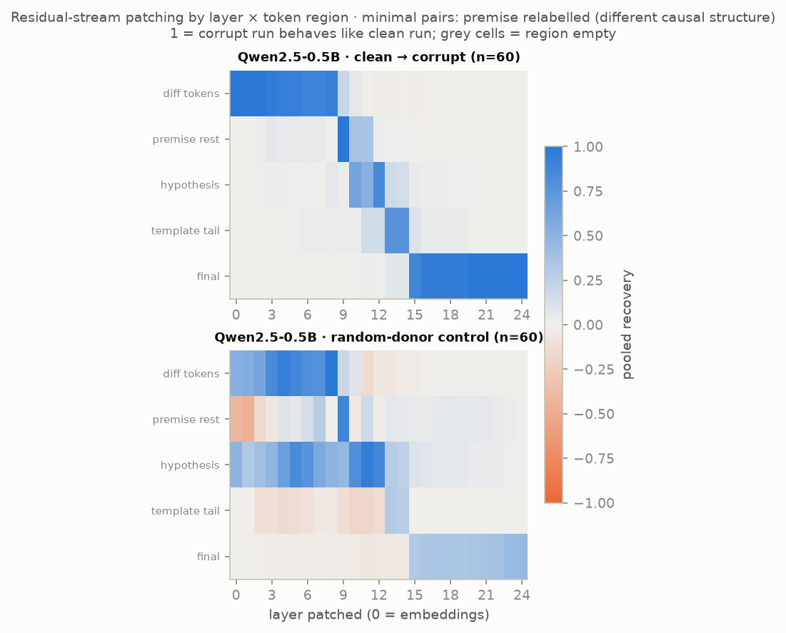
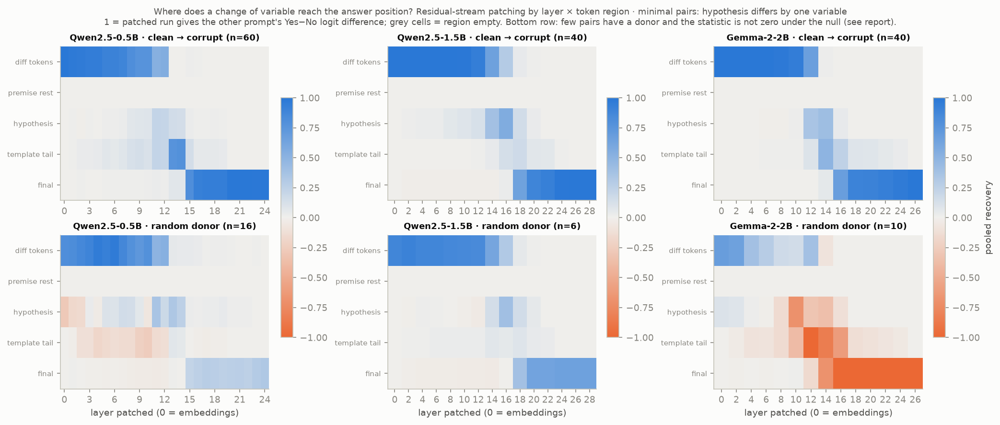

**What the data show.** The models do not prefer the valid member of a pair: mean D is +0.009 [-0.060, +0.078] (Qwen2.5-0.5B) and -0.088 [-0.420, +0.267] (Qwen2.5-1.5B) for hyp pairs, and D is positive for about half of the pairs. Because recovery is normalised by each pair's own D, the heat-maps show where *any* difference between the two prompts is carried to the final token, not where a causal judgement is made. That transfer is sharp: recovery at the final token first reaches 0.5 at layer 15 of 24 for Qwen2.5-0.5B (relative depth 0.62) and at layer 17 or 18 of 28 for Qwen2.5-1.5B (every second layer was patched; relative depth 0.61 to 0.64). The two pair kinds share their clean prompts and are not independent replications.

Gemma-2-2B, patched on Kaggle with 40 pairs per kind, shows the same thing: mean D -0.054 [-0.433, +0.392] for hyp pairs and -0.062 [-0.346, +0.262] for prem pairs, and recovery at the final token first reaching 0.5 at layer 16 of 26 (relative depth 0.62) for both kinds.

**The random-donor row is not a control.** Only 16 of 60 (Qwen2.5-0.5B) and 6 of 40 (Qwen2.5-1.5B) pairs have a donor prompt of equal length, half of the donors carry the same token as the clean prompt at the changed position, and the statistic is not zero under the null. It is shown and not used.

| Model | Pair kind | Pairs | Pearson r (attr. vs real) | Spearman | Mean |real| top-10 | Mean |real| random-10 | Largest real effects |
|---|---|---|---|---|---|---|---|
| Qwen2.5-0.5B | hyp | 30 | 1.00 | 0.98 | 0.449 | 0.034 | L14H5 (+0.76), MLP23 (-0.67), MLP12 (+0.50), MLP14 (+0.45), L12H2 (+0.44) |
| Qwen2.5-0.5B | prem | 30 | 1.00 | 0.98 | 0.495 | 0.039 | L14H5 (+0.87), MLP9 (+0.72), MLP23 (-0.69), MLP12 (+0.65), L12H2 (+0.43) |
| Qwen2.5-1.5B | hyp | 20 | 1.00 | 0.98 | 0.412 | 0.043 | L17H0 (+0.71), MLP18 (+0.50), MLP12 (+0.47), L15H10 (+0.43), MLP27 (-0.40) |
| Qwen2.5-1.5B | prem | 20 | 0.99 | 0.93 | 0.368 | 0.052 | L17H0 (+0.60), L15H10 (+0.47), MLP18 (+0.42), MLP27 (-0.39), MLP11 (+0.33) |
| Gemma-2-2B | hyp | 20 | 0.98 | 0.99 | 0.410 | 0.032 | L15H2 (+0.62), MLP15 (+0.53), L12H3 (+0.47), MLP17 (+0.43), L13H2 (+0.41) |
| Gemma-2-2B | prem | 20 | 0.99 | 1.00 | 0.391 | 0.040 | L13H2 (+0.59), L15H2 (+0.50), MLP15 (+0.48), MLP17 (+0.46), L12H3 (+0.40) |

Source: `results/patching_qwen0.5b.json`, `results/patching_qwen1.5b.json`, `results/patching_gemma2b.json`

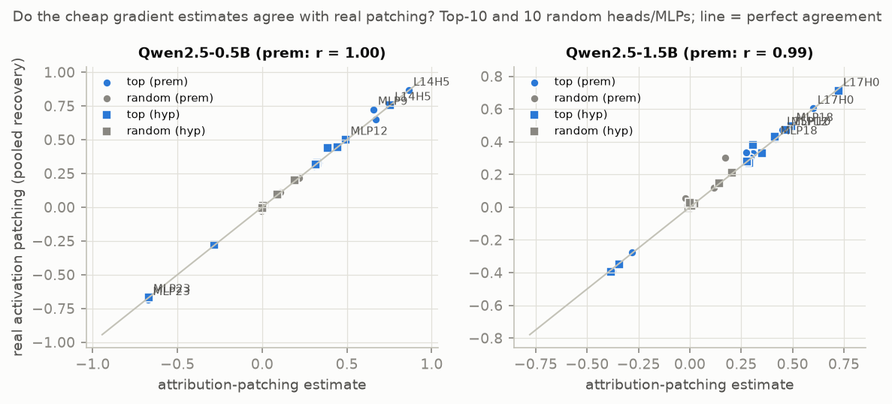

**Components.** Attribution patching (one gradient) agrees with real patching for the ten highest-ranked components of each model and pair kind. Among ten random components the agreement is driven by one or two large ones; without them the two estimates can disagree in sign. So: accurate for the largest components, not a complete ranking. Component names such as L14H5 are block numbers; residual index 15 is the output of block 14.

**Label-preserving pairs (second round; so far Qwen2.5-0.5B).** The control this section lacked: pairs with the same kind of edit (one variable letter in the hypothesis, or the matching relabelling of the premise) whose two prompts have the *same* gold label, half of them valid/valid and half invalid/invalid.

| Model | Pair kind | Pairs | n | of which Yes/Yes, No/No | Mean D = LD(original) − LD(edited) | Mean |D| | Mean |D|: Yes/Yes, No/No | First layer with ≥ 0.5 recovery at final token | …as relative depth |
|---|---|---|---|---|---|---|---|---|---|
| Qwen2.5-0.5B | hyp | label changes (Yes → No) | 60 | – | +0.009 [-0.060, +0.078] | 0.253 | – | 15 | 0.62 |
| Qwen2.5-0.5B | hyp | label preserved | 60 | 31 / 29 | +0.084 [+0.012, +0.156] | 0.233 | 0.219 / 0.249 | 16 | 0.67 |
| Qwen2.5-0.5B | prem | label changes (Yes → No) | 60 | – | +0.023 [-0.042, +0.090] | 0.236 | – | 15 | 0.62 |
| Qwen2.5-0.5B | prem | label preserved | 60 | 31 / 29 | +0.223 [+0.173, +0.270] | 0.239 | 0.264 / 0.212 | 16 | 0.67 |

Source: `results/patching_qwen0.5b_same.json`, `results/patching_qwen0.5b.json`

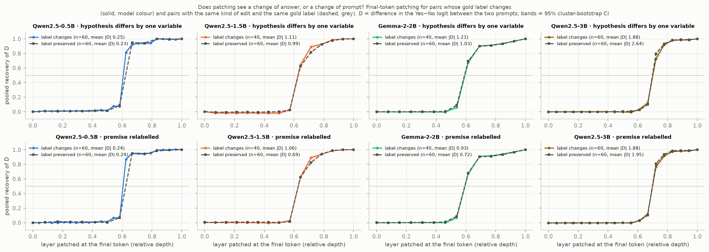

The answer logit moves as much when the correct answer stays the same as when it changes: mean |D| is 0.233 against 0.253 for hypothesis edits and 0.239 against 0.236 for premise relabellings. Within hypothesis type, giving each type present in both kinds the same weight (`scripts/08b_patching_by_template.py`), label-preserving minus label-changing is -0.025 [-0.105, +0.061] logits for hypothesis edits and +0.013 [-0.053, +0.076] for premise relabellings: no detectable difference. Those intervals are wide: they could not exclude a label effect of 0.2 logits, about the size of |D| itself.

The better evidence is the *sign* of D. It follows the direction of the letter change, not the label. In the label-changing premise relabellings, D (original minus edited) is +0.252 [+0.181, +0.332] when the hypothesis letter is replaced by a later letter (100% of 27 pairs positive) and -0.165 [-0.238, -0.086] when it is replaced by an earlier one. The label-preserving pairs contain later-letter edits only (the pair builder counts each unordered pair once), and their D is +0.223 [+0.173, +0.268]. Matched on direction, the two kinds differ by +0.029 [-0.061, +0.126] (premise relabellings) and +0.065 [-0.075, +0.203] (hypothesis edits). So the Yes−No logit is about 0.2 higher when the queried variable has the earlier letter, whether or not that makes the hypothesis valid. The model responds to which variable is asked about, not to validity. (I first read the label-preserving mean of +0.22 as a reaction to letters being "out of alphabetical order"; the fifth audit showed that it is produced by the one-sided construction of that pair set and that the earlier-letter half of the label-changing pairs refutes the explanation.)

Three cautions. The patching curves of the two kinds of pair look alike, and that is not evidence of anything: recovery is normalised by each pair's own D and is 1 by construction at the changed tokens early and at the final token late, for any two prompts. The label-preserving run patched every second layer, so "layer 16" against "layer 15" in the table is the grid. And the label-preserving set has eight pairs of a hypothesis type the label-changing set lacks; they are left out of the within-type comparison.

### 4.3 Cross-model comparison

| Model | Params (B) | Dataset | Model acc. | Gold probe acc. | Probe − strongest text baseline | Probe − random-init | Selected layer (rel. depth) | First layer within 1 pt (rel.) | Selectivity |
|---|---|---|---|---|---|---|---|---|---|
| Qwen2.5-0.5B | 0.494 | Corr2Cause pool | 0.501 | 0.807 [0.784, 0.828] | -0.113 [-0.136, -0.091] | +0.186 [+0.156, +0.219] | 15/24 (0.62) | 0.62 | +0.117 |
| Qwen2.5-0.5B | 0.494 | CLadder | 0.506 | 0.561 [0.534, 0.586] | -0.240 [-0.285, -0.203] | +0.063 [+0.024, +0.099] | 16/24 (0.67) | 0.67 | -0.234 |
| Qwen2.5-1.5B | 1.54 | Corr2Cause pool | 0.505 | 0.870 [0.850, 0.890] | -0.049 [-0.068, -0.032] | +0.276 [+0.244, +0.307] | 21/28 (0.75) | 0.64 | +0.088 |
| Qwen2.5-1.5B | 1.54 | CLadder | 0.506 | 0.605 [0.580, 0.631] | -0.196 [-0.234, -0.162] | +0.096 [+0.061, +0.134] | 24/28 (0.86) | 0.79 | -0.221 |
| Gemma-2-2B | 2.61 | Corr2Cause pool | 0.507 | 0.863 [0.841, 0.886] | -0.056 [-0.078, -0.033] | +0.267 [+0.236, +0.302] | 18/26 (0.69) | 0.62 | +0.071 |
| Gemma-2-2B | 2.61 | CLadder | 0.506 | 0.626 [0.590, 0.664] | -0.174 [-0.220, -0.133] | +0.107 [+0.064, +0.150] | 20/26 (0.77) | 0.65 | -0.194 |
| Qwen2.5-3B | 3.09 | Corr2Cause pool | 0.509 | 0.862 [0.843, 0.880] | -0.057 [-0.077, -0.038] | +0.251 [+0.220, +0.282] | 27/36 (0.75) | 0.69 | +0.071 |
| Qwen2.5-3B | 3.09 | CLadder † | 0.528 | 0.628 [0.600, 0.654] | -0.135 [-0.176, -0.096] | +0.112 [+0.078, +0.145] | 27/36 (0.75) | 0.75 | -0.195 |

Source: `results/cross_model.json` † computed on the GPU machine's draw of the 3,000-item CLadder sample (2,271 items shared with the other models' draw; Section 7).

| Comparison (gold-probe accuracy, paired) | Difference |
|---|---|
| c2c_probe:qwen1.5b_minus_qwen0.5b | +0.063 [+0.040, +0.087] |
| c2c_probe:gemma2b_minus_qwen0.5b | +0.057 [+0.033, +0.081] |
| c2c_probe:qwen3b_minus_qwen0.5b | +0.055 [+0.032, +0.079] |
| c2c_probe:gemma2b_minus_qwen1.5b | -0.007 [-0.029, +0.017] |
| c2c_probe:qwen3b_minus_qwen1.5b | -0.008 [-0.028, +0.012] |
| c2c_probe:qwen3b_minus_gemma2b | -0.002 [-0.023, +0.019] |
| cladder:qwen1.5b_minus_qwen0.5b | +0.044 [+0.014, +0.076] |
| cladder:gemma2b_minus_qwen0.5b | +0.065 [+0.029, +0.103] |
| cladder:qwen3b_minus_qwen0.5b | +0.089 [+0.056, +0.126] |
| cladder:gemma2b_minus_qwen1.5b | +0.021 [-0.013, +0.056] |
| cladder:qwen3b_minus_qwen1.5b | +0.036 [-0.002, +0.074] |
| cladder:qwen3b_minus_gemma2b | +0.015 [-0.024, +0.052] |

Source: `results/cross_model.json`

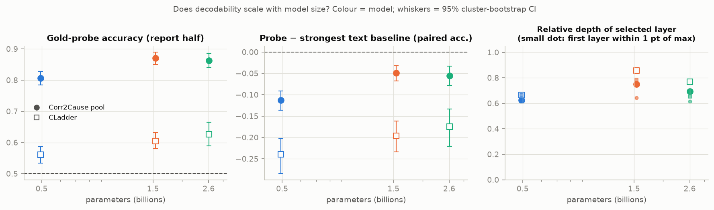

A descriptive comparison of four models from two families, not a scaling law. On the original item sets gold-probe accuracy is higher for the three larger models than for Qwen2.5-0.5B and does not differ among them (Corr2Cause pool 0.86 to 0.87), and the probe trails the strongest text baseline for every model. The selected layer lies at relative depth 0.6 to 0.9. Qwen2.5-3B's CLadder point is on the other draw of the CLadder sample; its paired differences to the other models use the 2,271 shared items (`results/cross_model.json`, `n_items_paired`). On the debiased pool (Section 3.6) the step from Qwen2.5-0.5B to Qwen2.5-1.5B is larger and is the more informative comparison, since it is not inflated by the hypothesis-string cue; from 1.5B to 3B nothing changes there either.

### 4.4 Is the adjacency information used? (second round)

**Why this experiment.** Section 3.6 left one structured signal in the answers. Whether the two variables named in the hypothesis are *adjacent* (correlated in the premise, and separated by no conditioning set) is linearly readable from every model, and the answers depend on it, with a sign that differs by hypothesis type and by model. AUROC of the answer logit for adjacency, among items that share a hypothesis string (0.5 = no dependence; all 2,400 items):

| Hypothesis type | Qwen2.5-0.5B | Qwen2.5-1.5B | Gemma-2-2B | Qwen2.5-3B |
|---|---|---|---|---|
| X directly causes Y | 0.531 [0.489, 0.573] | 0.649 [0.603, 0.693] | 0.420 [0.374, 0.465] | 0.605 [0.560, 0.652] |
| X causes something else which causes Y | 0.452 [0.394, 0.515] | 0.434 [0.374, 0.496] | 0.439 [0.381, 0.492] | 0.637 [0.579, 0.693] |
| X is a cause for Y, but not a direct one | 0.570 [0.513, 0.632] | 0.469 [0.409, 0.532] | 0.557 [0.499, 0.619] | 0.582 [0.524, 0.643] |
| X and Y have a common effect | 0.261 [0.220, 0.302] | 0.381 [0.318, 0.446] | 0.370 [0.315, 0.426] | 0.515 [0.457, 0.573] |
| X and Y have a common cause | 0.375 [0.305, 0.441] | 0.427 [0.356, 0.496] | 0.309 [0.238, 0.383] | 0.196 [0.136, 0.257] |

Source: `results/probe_content_<model>_c2c_debiased.json`, key `answers/by_template/<template>/within_string_auroc_for_adjacency`.

The question: does that dependence run through the linear encoding of adjacency that a probe reads, at the place where it is read?

**Design** (`scripts/17_adjacency_test.py`; evaluation on 100 report-half items per hypothesis type; everything fitted on the selection half). At one site (a layer and a token) three things are done to an item's activation, and the answer is read at the final token:

1. *Translate*: add (for not-adjacent items) or subtract (for adjacent items) the difference between the mean activations of adjacent and not-adjacent items of the same hypothesis type. On average this puts an item where the other class sits.
2. *Erase*: remove linear information about adjacency with LEACE, fitted per hypothesis type on the selection half. How well that works on items the eraser was not fitted on is measured (a probe cross-validated on erased report-half activations): about half of the excess decodability goes. The erasure moves each item along the same class-mean difference as the translation, by an amount that depends on the item, so with a linear response it is the same measurement as the translation, not a second line of evidence (the per-item correlation between the two is in the first table).
3. *Step along the probe's weight vector*, by the distance between the two classes along it.

Activations are centred by hypothesis string first, so that no direction can encode which hypothesis is being asked. Every operation is repeated with adjacency labels shuffled within hypothesis string (20 shuffles). For the translation the controls are the shuffled-label class-mean differences rescaled to the real one's norm. For the erasure the fair control keeps each item's real coefficient and replaces the direction by a shuffled-label one of the same norm; a control eraser fitted to shuffled labels cannot change the gap between adjacent and not-adjacent items whatever its direction does, and was dropped after the fifth audit. The summary statistic was fixed before the full-size runs: the **contrast**, the average over hypothesis types whose observed gap excludes zero of (sign of the observed gap) × (effect). If the encoding fully carried the dependence, the contrast would equal the average absolute observed gap, the *full-mediation benchmark*. Sites: the layer where adjacency is best decodable, and the first layer at which it reaches half of that, at the final prompt token and at the last token of the hypothesis.

**History.** This is the second version. The first (`scripts/16_feature_causal.py`) was reviewed by an independent reviewer while it was running on the laptop and before any Kaggle or Colab time was spent on it (Section 6, fourth audit). Its removal arm left adjacency readable at AUROC 0.84, its pooled class-mean direction did not separate the classes for direct-causation hypotheses, and its summary compared a real change with the mean of controls whose signs cancel. Its results are kept in `results/feature_causal_*.json`, are superseded, and are not used. A further arm, *transfer*, was added after the first full-size result of the second version, for the reason given below. The second version's own first summary was then taken apart by a fifth audit of results and claims: its erasure control could not fail, its summary statistic counted a gap moving away from zero as a reduction, and its check of the erasure was made on the half the eraser was fitted on. What follows is the analysis as corrected after that audit; the earlier wording is in the git history and in `notes/log.md`.

| Model | Site (layer) | Items | Within-question answer linearly predictable from this site (held-out R²) | Adjacency AUROC on held-out items: before | …after erasure | Adjacency AUROC on the evaluated items: before | …after erasure | (Probe trained on the half the eraser was fitted on: after erasure) | (…after removing the probe direction only) | Erasure effect vs −coefficient × translation effect (r over items) | Self-check: shortcut vs full forward pass (logits) | SD of the answer logit difference |
|---|---|---|---|---|---|---|---|---|---|---|---|---|
| Qwen2.5-0.5B | final token, best layer (15/24) | 500 | 0.96 | 0.858 | 0.698 | 0.852 | 0.650 | 0.434 | 0.873 | 0.998 | 0.006 | 0.39 |
| Qwen2.5-0.5B | end of hypothesis, best layer (13/24) | 500 | 0.79 | 0.912 | 0.702 | 0.912 | 0.640 | 0.535 | 0.918 | 0.939 | 0.008 | 0.39 |
| Qwen2.5-0.5B | final token, earlier layer (11/24) | 500 | 0.43 | 0.773 | 0.692 | 0.745 | 0.642 | 0.421 | 0.743 | 0.876 | 0.010 | 0.39 |
| Qwen2.5-0.5B | end of hypothesis, earlier layer (5/24) | 500 | 0.31 | 0.793 | 0.691 | 0.757 | 0.618 | 0.564 | 0.807 | 0.549 | 0.007 | 0.39 |

Source: `results/adjacency_qwen0.5b_c2c_debiased_final_best.json`, `results/adjacency_qwen0.5b_c2c_debiased_hyp_best.json`, `results/adjacency_qwen0.5b_c2c_debiased_final_first50.json`, `results/adjacency_qwen0.5b_c2c_debiased_hyp_first50.json`

| Model | Site (layer) | Templates in the pre-specified contrast | Full-mediation benchmark (mean |observed gap|) | Translation: pre-specified contrast | …20 random directions of the same size (range) | Controls smaller in absolute value (%) | Same with one sign for all types (adjacent → No) | Controls smaller (%) | Translation effects towards No | Mean absolute gap on evaluated items, before → after erasure | Reduction (interval over items) | Fair controls smaller in absolute value (%) | Positive control: model-answer direction, slope per unit norm (share of controls it exceeds) |
|---|---|---|---|---|---|---|---|---|---|---|---|---|---|
| Qwen2.5-0.5B | final token, best layer (15/24) | parent, descendant, collider, confounder | 0.112 | +0.110 | -0.069 to +0.091 | 100 | +0.096 | 100 | 4/5 | 0.102 → 0.070 | +0.032 [-0.010, +0.077] | 75 | +1.258 (100%) |
| Qwen2.5-0.5B | end of hypothesis, best layer (13/24) | parent, descendant, collider, confounder | 0.112 | +0.013 | -0.021 to +0.011 | 95 | +0.016 | 95 | 5/5 | 0.102 → 0.097 | +0.005 [-0.000, +0.015] | 55 | +0.209 (100%) |
| Qwen2.5-0.5B | final token, earlier layer (11/24) | parent, descendant, collider, confounder | 0.112 | +0.000 | -0.025 to +0.019 | 5 | -0.007 | 55 | 1/5 | 0.102 → 0.102 | -0.000 [-0.006, +0.002] | 10 | +0.255 (95%) |
| Qwen2.5-0.5B | end of hypothesis, earlier layer (5/24) | parent, descendant, collider, confounder | 0.112 | +0.004 | -0.003 to +0.010 | 80 | +0.002 | 40 | 4/5 | 0.102 → 0.099 | +0.004 [-0.001, +0.005] | 85 | +0.011 (35%) |

Source: `results/adjacency_qwen0.5b_c2c_debiased_final_best.json`, `results/adjacency_qwen0.5b_c2c_debiased_hyp_best.json`, `results/adjacency_qwen0.5b_c2c_debiased_final_first50.json`, `results/adjacency_qwen0.5b_c2c_debiased_hyp_first50.json`

| Model | Site (layer) | Template | Observed gap in the answer logit, adjacent − not adjacent (all items) | Translation by the class-mean difference: effect towards Yes per move towards adjacent | …20 random directions of the same size (range) | Controls smaller in absolute value (%) | Gap on evaluated items: before | …after erasure | Change in absolute gap | …20 fair controls: same per-item coefficients, random direction (range) | Controls smaller in absolute value (%) | Moving across the class gap along the probe's weight vector |
|---|---|---|---|---|---|---|---|---|---|---|---|---|
| Qwen2.5-0.5B | final token, best layer (15/24) | parent | +0.050 [+0.005, +0.096] | +0.040 [+0.038, +0.042] | -0.084 to +0.110 | 45 | +0.078 | +0.055 | -0.023 | -0.063 to +0.050 | 45 | +0.0009 [+0.0008, +0.0010] |
| Qwen2.5-0.5B | final token, best layer (15/24) | ancestor | -0.042 [-0.098, +0.015] | -0.044 [-0.046, -0.043] | -0.101 to +0.094 | 70 | -0.105 | -0.090 | -0.014 | -0.035 to +0.036 | 50 | +0.0009 [+0.0008, +0.0009] |
| Qwen2.5-0.5B | final token, best layer (15/24) | descendant | +0.055 [+0.024, +0.084] | -0.037 [-0.039, -0.035] | -0.069 to +0.178 | 40 | +0.054 | +0.076 | +0.022 | -0.052 to +0.046 | 45 | +0.0005 [+0.0005, +0.0006] |
| Qwen2.5-0.5B | final token, best layer (15/24) | collider | -0.230 [-0.281, -0.177] | -0.255 [-0.258, -0.252] | -0.124 to +0.224 | 100 | -0.263 | -0.006 | -0.258 | -0.127 to +0.233 | 100 | +0.0011 [+0.0010, +0.0012] |
| Qwen2.5-0.5B | final token, best layer (15/24) | confounder | -0.113 [-0.190, -0.033] | -0.183 [-0.185, -0.181] | -0.187 to +0.165 | 95 | -0.011 | +0.122 | +0.110 | -0.000 to +0.122 | 85 | +0.0012 [+0.0012, +0.0013] |
| Qwen2.5-0.5B | end of hypothesis, best layer (13/24) | parent | +0.050 [+0.005, +0.096] | -0.009 [-0.010, -0.008] | -0.027 to +0.041 | 45 | +0.077 | +0.084 | +0.007 | -0.033 to +0.021 | 50 | +0.0024 [+0.0023, +0.0026] |
| Qwen2.5-0.5B | end of hypothesis, best layer (13/24) | ancestor | -0.042 [-0.098, +0.015] | -0.002 [-0.003, -0.001] | -0.025 to +0.030 | 5 | -0.105 | -0.106 | +0.001 | -0.014 to +0.018 | 15 | +0.0020 [+0.0019, +0.0021] |
| Qwen2.5-0.5B | end of hypothesis, best layer (13/24) | descendant | +0.055 [+0.024, +0.084] | -0.003 [-0.004, -0.002] | -0.016 to +0.038 | 20 | +0.056 | +0.057 | +0.001 | -0.016 to +0.009 | 15 | +0.0002 [+0.0002, +0.0002] |
| Qwen2.5-0.5B | end of hypothesis, best layer (13/24) | collider | -0.230 [-0.281, -0.177] | -0.037 [-0.040, -0.035] | -0.046 to +0.053 | 85 | -0.264 | -0.221 | -0.043 | -0.052 to +0.061 | 85 | +0.0033 [+0.0031, +0.0035] |
| Qwen2.5-0.5B | end of hypothesis, best layer (13/24) | confounder | -0.113 [-0.190, -0.033] | -0.026 [-0.028, -0.025] | -0.043 to +0.038 | 80 | -0.010 | +0.018 | +0.008 | -0.010 to +0.039 | 35 | +0.0022 [+0.0020, +0.0023] |
| Qwen2.5-0.5B | final token, earlier layer (11/24) | parent | +0.050 [+0.005, +0.096] | +0.005 [+0.003, +0.006] | -0.021 to +0.016 | 15 | +0.078 | +0.075 | -0.002 | -0.009 to +0.009 | 10 | -0.0006 [-0.0006, -0.0006] |
| Qwen2.5-0.5B | final token, earlier layer (11/24) | ancestor | -0.042 [-0.098, +0.015] | +0.000 [-0.001, +0.001] | -0.019 to +0.020 | 10 | -0.105 | -0.107 | +0.002 | -0.006 to +0.007 | 70 | -0.0005 [-0.0006, -0.0005] |
| Qwen2.5-0.5B | final token, earlier layer (11/24) | descendant | +0.055 [+0.024, +0.084] | +0.013 [+0.011, +0.015] | -0.039 to +0.064 | 35 | +0.054 | +0.041 | -0.013 | -0.043 to +0.033 | 40 | -0.0007 [-0.0007, -0.0007] |
| Qwen2.5-0.5B | final token, earlier layer (11/24) | collider | -0.230 [-0.281, -0.177] | +0.020 [+0.016, +0.023] | -0.060 to +0.049 | 65 | -0.263 | -0.280 | +0.016 | -0.045 to +0.041 | 65 | -0.0006 [-0.0006, -0.0006] |
| Qwen2.5-0.5B | final token, earlier layer (11/24) | confounder | -0.113 [-0.190, -0.033] | -0.004 [-0.006, -0.001] | -0.042 to +0.022 | 5 | -0.011 | -0.010 | -0.002 | -0.010 to +0.011 | 10 | -0.0007 [-0.0007, -0.0007] |
| Qwen2.5-0.5B | end of hypothesis, earlier layer (5/24) | parent | +0.050 [+0.005, +0.096] | +0.009 [+0.008, +0.011] | -0.014 to +0.016 | 45 | +0.077 | +0.070 | -0.007 | -0.013 to +0.009 | 45 | +0.0001 [+0.0001, +0.0001] |
| Qwen2.5-0.5B | end of hypothesis, earlier layer (5/24) | ancestor | -0.042 [-0.098, +0.015] | -0.010 [-0.011, -0.008] | -0.010 to +0.013 | 90 | -0.105 | -0.103 | -0.002 | -0.005 to +0.006 | 55 | +0.0001 [+0.0001, +0.0001] |
| Qwen2.5-0.5B | end of hypothesis, earlier layer (5/24) | descendant | +0.055 [+0.024, +0.084] | -0.002 [-0.003, -0.001] | -0.010 to +0.010 | 30 | +0.056 | +0.056 | +0.000 | -0.009 to +0.007 | 0 | -0.0000 [-0.0000, -0.0000] |
| Qwen2.5-0.5B | end of hypothesis, earlier layer (5/24) | collider | -0.230 [-0.281, -0.177] | -0.005 [-0.007, -0.004] | -0.016 to +0.016 | 40 | -0.264 | -0.260 | -0.004 | -0.015 to +0.013 | 25 | +0.0000 [+0.0000, +0.0000] |
| Qwen2.5-0.5B | end of hypothesis, earlier layer (5/24) | confounder | -0.113 [-0.190, -0.033] | -0.005 [-0.006, -0.004] | -0.008 to +0.008 | 65 | -0.010 | -0.005 | -0.005 | -0.005 to +0.005 | 90 | -0.0000 [-0.0000, +0.0000] |

Source: `results/adjacency_qwen0.5b_c2c_debiased_final_best.json`, `results/adjacency_qwen0.5b_c2c_debiased_hyp_best.json`, `results/adjacency_qwen0.5b_c2c_debiased_final_first50.json`, `results/adjacency_qwen0.5b_c2c_debiased_hyp_first50.json`

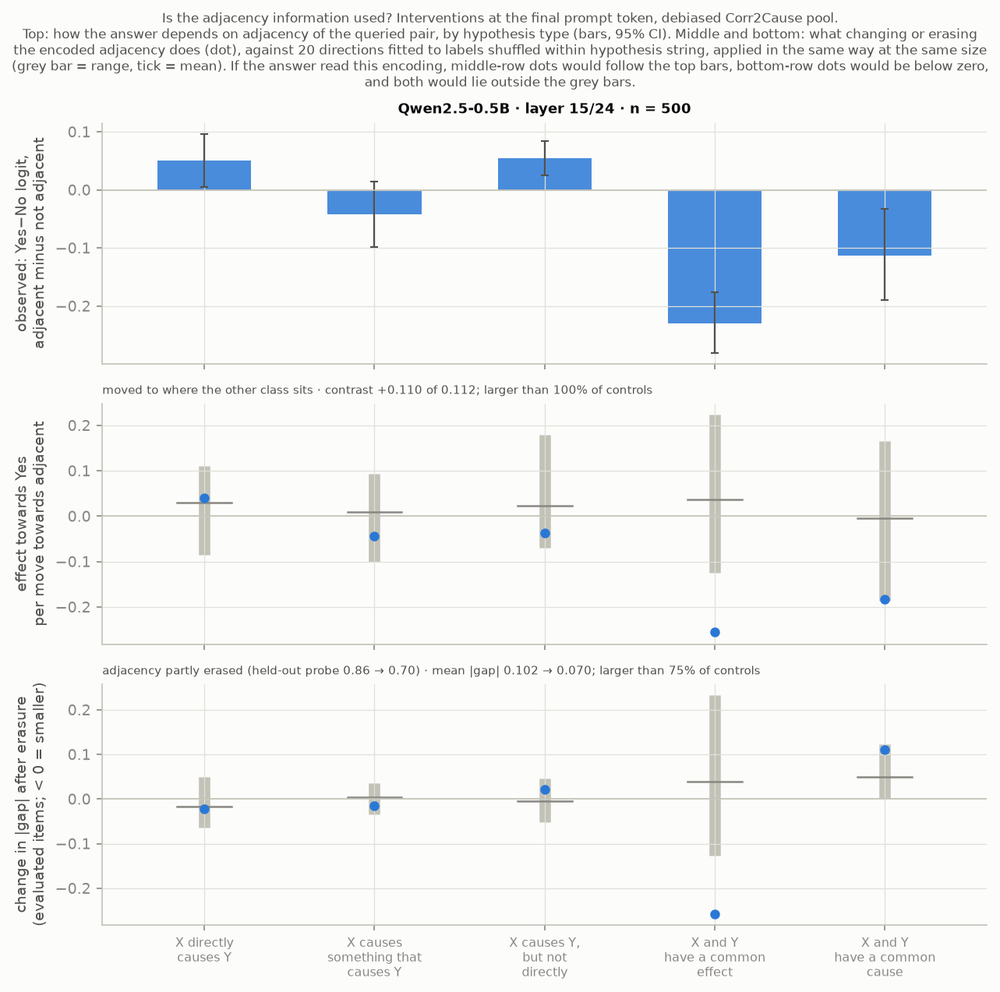
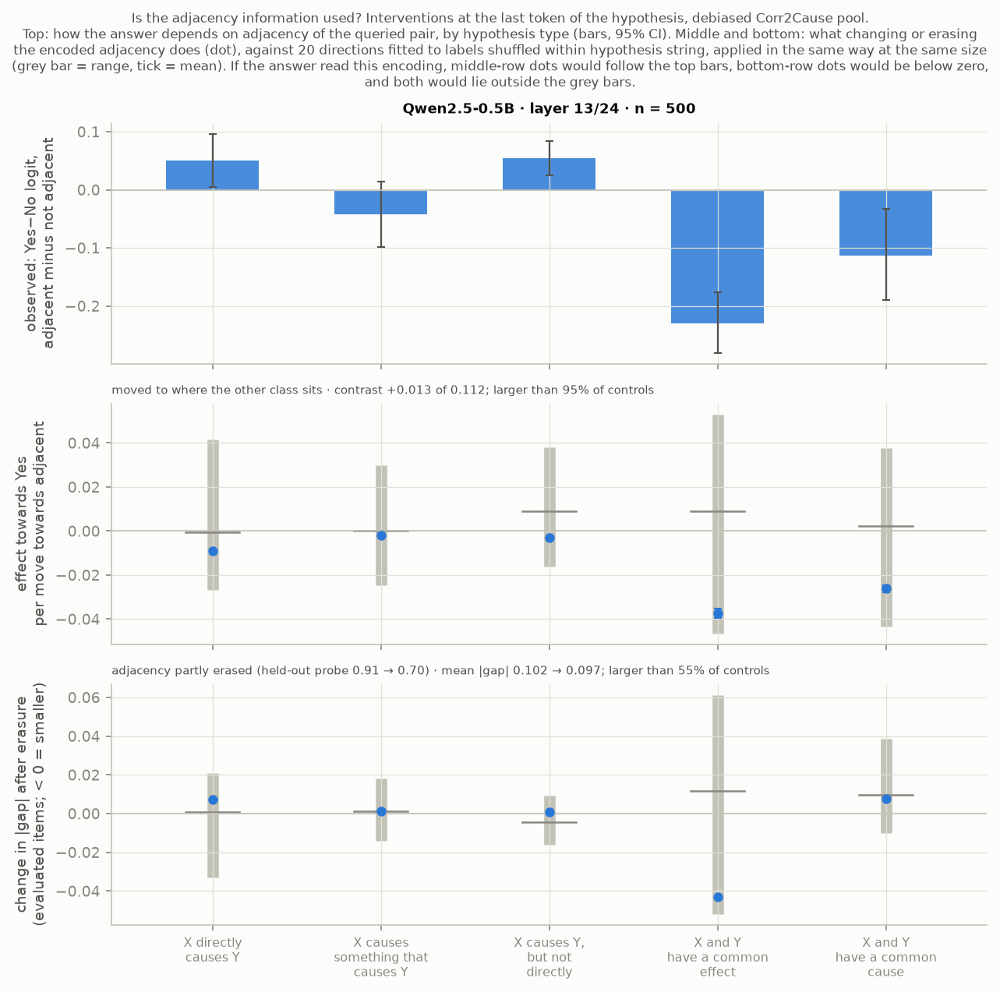

**What the data show (Qwen2.5-0.5B; the other models are added as their GPU runs return).**

1. *How far the answer is already formed at each site.* A ridge regression from the activation at the site to the answer logit (both centred by hypothesis string, fitted on the selection half) predicts the report half with R² = 0.96 at the final token, layer 15 of 24, and 0.79 at the last token of the hypothesis, layer 13. At the two earlier layers it is 0.43 and 0.31. So at both main sites most of the within-question variation of the answer is already linearly present; the difference between them is one of degree.
2. *The erasure is partial.* On held-out items a probe reads adjacency at AUROC 0.858 before and 0.698 after the erasure at the final token, and 0.912 and 0.702 at the end of the hypothesis. (A probe trained on the half the eraser was fitted on gives 0.434 and 0.535; I reported those first, and they overstate the erasure.) Removing only the probe's weight direction leaves adjacency at 0.873 and 0.918.
3. *Final token, layer 15: one clear effect.* Translating common-effect items by their adjacent-minus-not difference moves the answer by -0.255 [-0.258, -0.252] logits, the sign and size of the observed gap (-0.230 [-0.281, -0.177]), and beyond all 20 random directions of the same size (-0.124 to +0.224). The erasure takes that gap on the evaluated items from -0.263 to -0.006, again beyond all 20 fair controls. For common-cause hypotheses the translation effect is -0.183 [-0.185, -0.181] (95% of the controls are smaller in absolute value), but on the evaluated items there was no gap to remove (-0.011) and the erasure *creates* one (+0.122). For the other three hypothesis types the effects are inside the control range, and for descendant hypotheses the translation has the wrong sign. Averaged over the five types the absolute gap goes from 0.102 to 0.070, a reduction of +0.032 [-0.010, +0.077] whose interval includes zero and which 75% of the fair controls stay below. The pre-specified contrast (+0.110 against a benchmark of 0.112) looks like full mediation only because errors of opposite sign cancel in it; I first reported it as "almost all of the dependence", which was wrong.
4. *This is a statement about where the answer is.* With the answer a linear function of this activation (point 1), translating by any class difference reproduces that class's difference in answers. The class-mean differences of the five hypothesis types are not one direction (direct causation has cosines of -0.18 to -0.60 with the others), and the transfer matrix has constant columns, as linearity requires: each type's class difference acts as that type's answer shift on any item. That adjacency stays readable at AUROC 0.65 on the very items whose common-effect gap has gone says the same thing more directly: what was removed is the answer shift, not the adjacency information.
5. *Final token, layer 11: nothing.* Translation contrast +0.000; mean absolute gap unchanged. The adjacency-dependent part of the answer reaches the final token between layers 11 and 15, where the patching of Section 4.2 puts the arrival of prompt differences.
6. *End of the hypothesis, layer 13: a small push towards No, not distinguishable from random directions of the same size.* All five translation effects are negative (-0.009, -0.002, -0.003, -0.037, -0.026): the observed direction for common-effect and common-cause hypotheses, the opposite of it for direct-causation and descendant ones. The pre-specified contrast is +0.013; one of the 20 random directions of the same size gives a larger absolute value (-0.021), and a contrast with one sign for all types fits as well (+0.016). The erasure shrinks the common-effect gap on the evaluated items from -0.264 to -0.221 (85% of the fair controls change it by less) and shrinks no other; the mean absolute gap falls from 0.102 to 0.097 (+0.005 [-0.000, +0.015]; 55% of the fair controls stay below). The transfer matrix has the same shape as at the final token, less cleanly: the common-effect and common-cause vectors lower the Yes logit of items of every type, descendant items responding a quarter to a third as much.
7. *End of the hypothesis, layer 5: uninformative.* The positive control fails there (the model-answer direction's slope is larger than only 35% of its controls).
8. *Splitting the class difference (added after the fifth audit, which proposed it).* Each hypothesis type's adjacent-minus-not difference is split into its component along the direction from which the within-question answer is linearly predicted at the site (a ridge regression on the selection half) and the remainder, and an item is translated by each part separately. In the order direct causation, ancestor, descendant, common effect, common cause, the observed gaps are +0.050, -0.042, +0.055, -0.230, -0.113. At the final token, layer 15, the answer-predictive component, which is a small part of the vector (norm 0.061 s against 0.285 s for the remainder, common effect), moves the answer by +0.022, -0.012, +0.047, -0.157, -0.131: the signs of the observed gaps for all five types, including the descendant type where the whole translation had the wrong sign. The remainder moves it by +0.017, -0.032, -0.083, -0.097, -0.051: towards No for four types whatever their observed sign. At the end of the hypothesis, layer 13: +0.005, -0.005, +0.003, -0.012, -0.010 for the answer-predictive component and -0.013, +0.003, -0.005, -0.025, -0.015 for the remainder. So the part of the class difference that reproduces the observed, type-specific pattern is the part that already predicts the answer; the rest acts as a uniform push towards No. That is what "the class difference is an answer shift" predicts, and it is not what a separately encoded adjacency variable that is used later would predict (its effect would sit in the remainder and follow the item's type). The fair erasure control measured directly in these runs agrees with the one extrapolated from the translation columns (correlation over items and controls 0.98 at the final token).
9. *The probe's weight vector.* Moving an item across the whole class gap along it changes the answer by 0.0002 to 0.003 logits, inside the range of shuffled-label probe directions at every site. The class gap along that vector is many times shorter than the class-mean difference, so this is a statement about step size and says nothing about use.

| Model | Site (layer) | Off-diagonal contrast with the target template's sign | …with the source template's sign | Full-mediation benchmark | Cosines between the five class-mean differences (range) | Cosine of the direct-causation difference with each of the others |
|---|---|---|---|---|---|---|
| Qwen2.5-0.5B | final token, best layer (15/24) | -0.042 [-0.043, -0.042] | +0.111 [+0.111, +0.112] | 0.112 | -0.60 to +0.87 | ancestor -0.18 · descendant -0.60 · collider -0.49 · confounder -0.59 |
| Qwen2.5-0.5B | end of hypothesis, best layer (13/24) | -0.001 [-0.002, -0.001] | +0.010 [+0.009, +0.010] | 0.112 | -0.44 to +0.74 | ancestor +0.02 · descendant -0.44 · collider -0.10 · confounder -0.07 |
| Qwen2.5-0.5B | final token, earlier layer (11/24) | -0.002 [-0.002, -0.001] | +0.001 [+0.001, +0.001] | 0.112 | -0.75 to +0.94 | ancestor -0.34 · descendant -0.64 · collider -0.62 · confounder -0.75 |
| Qwen2.5-0.5B | end of hypothesis, earlier layer (5/24) | -0.002 [-0.003, -0.002] | +0.002 [+0.002, +0.002] | 0.112 | -0.67 to +0.92 | ancestor -0.28 · descendant -0.58 · collider -0.67 · confounder -0.62 |

Source: `results/adjacency_qwen0.5b_c2c_debiased_final_best.json`, `results/adjacency_qwen0.5b_c2c_debiased_hyp_best.json`, `results/adjacency_qwen0.5b_c2c_debiased_final_first50.json`, `results/adjacency_qwen0.5b_c2c_debiased_hyp_first50.json`

| Model | Site (layer) | Item's template (target) | Target's observed gap | Vector from: parent | Vector from: ancestor | Vector from: descendant | Vector from: collider | Vector from: confounder |
|---|---|---|---|---|---|---|---|---|
| Qwen2.5-0.5B | final token, best layer (15/24) | parent | +0.050 | +0.040 | -0.047 | -0.053 | -0.278 | -0.197 |
| Qwen2.5-0.5B | final token, best layer (15/24) | ancestor | -0.042 | +0.034 | -0.044 | -0.043 | -0.270 | -0.189 |
| Qwen2.5-0.5B | final token, best layer (15/24) | descendant | +0.055 | +0.032 | -0.041 | -0.037 | -0.263 | -0.179 |
| Qwen2.5-0.5B | final token, best layer (15/24) | collider | -0.230 | +0.023 | -0.040 | -0.017 | -0.255 | -0.176 |
| Qwen2.5-0.5B | final token, best layer (15/24) | confounder | -0.113 | +0.036 | -0.043 | -0.038 | -0.259 | -0.183 |
| Qwen2.5-0.5B | end of hypothesis, best layer (13/24) | parent | +0.050 | -0.009 | -0.004 | -0.005 | -0.043 | -0.029 |
| Qwen2.5-0.5B | end of hypothesis, best layer (13/24) | ancestor | -0.042 | -0.012 | -0.002 | -0.004 | -0.057 | -0.039 |
| Qwen2.5-0.5B | end of hypothesis, best layer (13/24) | descendant | +0.055 | -0.007 | +0.007 | -0.003 | -0.010 | -0.013 |
| Qwen2.5-0.5B | end of hypothesis, best layer (13/24) | collider | -0.230 | -0.007 | -0.000 | -0.005 | -0.037 | -0.023 |
| Qwen2.5-0.5B | end of hypothesis, best layer (13/24) | confounder | -0.113 | -0.007 | -0.002 | -0.010 | -0.037 | -0.026 |
| Qwen2.5-0.5B | final token, earlier layer (11/24) | parent | +0.050 | +0.005 | +0.004 | +0.009 | +0.013 | -0.010 |
| Qwen2.5-0.5B | final token, earlier layer (11/24) | ancestor | -0.042 | +0.006 | +0.000 | +0.002 | +0.007 | -0.012 |
| Qwen2.5-0.5B | final token, earlier layer (11/24) | descendant | +0.055 | -0.003 | +0.007 | +0.013 | +0.016 | +0.001 |
| Qwen2.5-0.5B | final token, earlier layer (11/24) | collider | -0.230 | +0.004 | +0.002 | +0.018 | +0.020 | -0.005 |
| Qwen2.5-0.5B | final token, earlier layer (11/24) | confounder | -0.113 | +0.001 | +0.002 | +0.012 | +0.014 | -0.004 |
| Qwen2.5-0.5B | end of hypothesis, earlier layer (5/24) | parent | +0.050 | +0.009 | -0.009 | -0.009 | -0.015 | -0.011 |
| Qwen2.5-0.5B | end of hypothesis, earlier layer (5/24) | ancestor | -0.042 | +0.008 | -0.010 | -0.007 | -0.012 | -0.008 |
| Qwen2.5-0.5B | end of hypothesis, earlier layer (5/24) | descendant | +0.055 | -0.003 | +0.003 | -0.002 | +0.001 | -0.007 |
| Qwen2.5-0.5B | end of hypothesis, earlier layer (5/24) | collider | -0.230 | +0.002 | -0.004 | -0.007 | -0.005 | -0.009 |
| Qwen2.5-0.5B | end of hypothesis, earlier layer (5/24) | confounder | -0.113 | +0.001 | -0.003 | -0.004 | -0.003 | -0.005 |

Source: `results/adjacency_qwen0.5b_c2c_debiased_final_best.json`, `results/adjacency_qwen0.5b_c2c_debiased_hyp_best.json`, `results/adjacency_qwen0.5b_c2c_debiased_final_first50.json`, `results/adjacency_qwen0.5b_c2c_debiased_hyp_first50.json`

**What may and may not be concluded (Qwen2.5-0.5B).**

- May: at the final token from layer 15 the within-question answer is a linear function of the activation (held-out R² 0.96), and the part of it that goes with adjacency for common-effect hypotheses can be moved and removed there, beyond every control. Four layers earlier it cannot. That locates the arrival of this part of the answer; it agrees with the patching result.
- May: at the last token of the hypothesis, layer 13, the difference between adjacent and not-adjacent items has a small effect on the answer, towards No for every hypothesis type. It is no larger than the effect of a random direction of the same size (1 of 20 larger for the contrast, 3 to 4 of 20 for the two types that carry it), does not depend on the item's hypothesis type, and lowers the answers' absolute dependence on adjacency by an amount whose interval reaches zero.
- May not: that the model uses an adjacency feature, in the sense of a variable that later computation reads according to the question; nor, any longer, that "a sixth of the dependence is removed by erasing adjacency at the end of the hypothesis, where control erasures do nothing". That sentence stood in this report for about an hour and rested on a control that could not fail.
- May not: anything about validity. Adjacency is not the correct answer.
- Status: the design, the contrast and the expectations were written down before the full-size runs (`notes/log.md`, 13 November, 16:35 to 18:25). The second version of the test, the transfer arm, and the corrected readouts (fair erasure control, held-out erasure quality, absolute gaps, the alternative sign choices) were all introduced after seeing results. The move to LEACE with its first control made a positive reading easier, not harder, and that is how the wrong sentence above came about.
- Limits: one model; 20 shuffles (the smallest possible two-sided share is 5%); four sites and three arms without adjustment; intervals over evaluated items are conditional on the fitted directions; the eraser removes about half of the linearly readable adjacency on held-out items.

## 5. Tier 3 results

### 5.1 Sparse-autoencoder features for causal graph type (Gemma-2-2B, CLadder)

**Question.** Does Gemma-2-2B have sparse features that mark the causal graph a CLadder question is about (confounding, collision, chain, fork, mediation), and does removing them change the answer more than removing other features?

**Setup.** Gemma Scope residual-stream SAEs (`gemma-scope-2b-pt-res-canonical`, 16k features) at blocks 6, 12 and 18, applied to activations at the last token of the context and at the final prompt token. Only CLadder's ten "nonsense" stories are used (1,155 items in the sample), because every real-world story has a single graph type, so a "smoking" feature would pass for a "confounding" feature. For each graph type the ten features with the highest AUROC for that type against the rest are selected on stories 0–4 (566 items) and evaluated on stories 5–9 (589 items). Ablation (block 12): the selected features' contributions are subtracted from the residual stream at every token and the answer logit difference is compared with the unablated run, against three sets of random features matched on mean activation. All of this ran on Kaggle, on Kaggle's draw of the CLadder sample (Section 7).

**Two caveats that limit everything below.**

1. *The SAEs reconstruct most of each activation but little of what differs between items.* They were trained on the base model `gemma-2-2b`; the activations are from the instruction-tuned `gemma-2-2b-it`, at two specific tokens. The reconstruction recovers 74 to 84% of the squared norm (relative squared error 0.16 to 0.26). But most of an activation at a fixed token is shared by all items, and a search for features of graph type depends on the part that differs. Of that part, at the end of the context, the reconstruction leaves 0.65, 0.67 and 0.87 unexplained (blocks 6, 12, 18; the fraction of variance across these items), although the reconstruction points in nearly the right direction (cosine 0.91 at block 12). At the final prompt token the unexplained fraction is above one at every block: all items share that token and differ little there, and the SAE does not capture the differences. Features at the final token are listed in the table for completeness and I draw nothing from them. No reference value on the SAEs' own training distribution was computed, so this does not show that they fit worse here than they were built to; it shows that they are a blunt tool for this question.
2. *Three random feature sets are too few.* Their effects range from 0.04 to 0.51 logits. This is the same weakness the Tier 2 audit found in the first steering table, and I did not fix it before the Kaggle run.

| Block | Token | Fraction of variance unexplained | Relative squared error | Cosine(reconstruction, activation) | Mean active features | Features ever active |
|---|---|---|---|---|---|---|
| 6 | premise end | 0.65 | 0.16 | 0.92 | 51 | 759 |
| 6 | final | 47.23 | 0.15 | 0.92 | 43 | 57 |
| 12 | premise end | 0.67 | 0.18 | 0.91 | 129 | 2389 |
| 12 | final | 28.61 | 0.27 | 0.86 | 121 | 227 |
| 18 | premise end | 0.87 | 0.26 | 0.86 | 74 | 1124 |
| 18 | final | 2.16 | 0.26 | 0.86 | 67 | 286 |

Source: `results/sae_features.json`

**Features.** Selected features generalise to held-out stories about as well as they fit the discovery stories, so the selection is not noise, but they are weak markers of graph type.

| Block | Token | Graph type | Held-out items of that type | Mean AUROC of the 10 selected features, discovery stories | …held-out stories | Best feature (held-out AUROC) | Features with held-out AUROC ≥ 0.70 |
|---|---|---|---|---|---|---|---|
| 6 | premise end | confounding | 40 | 0.60 | 0.60 | 7015 (0.65) | 0 |
| 6 | premise end | collision | 27 | 0.70 | 0.64 | 3742 (0.75) | 1 |
| 6 | premise end | chain | 71 | 0.67 | 0.67 | 13460 (0.84) | 3 |
| 6 | premise end | fork | 47 | 0.66 | 0.60 | 13460 (0.78) | 2 |
| 6 | premise end | mediation | 55 | 0.64 | 0.57 | 14499 (0.60) | 0 |
| 6 | final | confounding | 40 | 0.56 | 0.54 | 6699 (0.57) | 0 |
| 6 | final | collision | 27 | 0.69 | 0.60 | 12942 (0.69) | 0 |
| 6 | final | chain | 71 | 0.72 | 0.75 | 13460 (0.86) | 8 |
| 6 | final | fork | 47 | 0.73 | 0.69 | 13460 (0.82) | 5 |
| 6 | final | mediation | 55 | 0.62 | 0.60 | 12823 (0.64) | 0 |
| 12 | premise end | confounding | 40 | 0.65 | 0.64 | 16346 (0.68) | 0 |
| 12 | premise end | collision | 27 | 0.73 | 0.61 | 13295 (0.71) | 1 |
| 12 | premise end | chain | 71 | 0.73 | 0.70 | 2620 (0.86) | 3 |
| 12 | premise end | fork | 47 | 0.71 | 0.66 | 2620 (0.81) | 2 |
| 12 | premise end | mediation | 55 | 0.69 | 0.57 | 7815 (0.67) | 0 |
| 12 | final | confounding | 40 | 0.61 | 0.58 | 6869 (0.64) | 0 |
| 12 | final | collision | 27 | 0.78 | 0.66 | 6869 (0.84) | 3 |
| 12 | final | chain | 71 | 0.76 | 0.80 | 2620 (0.89) | 10 |
| 12 | final | fork | 47 | 0.77 | 0.72 | 15848 (0.84) | 6 |
| 12 | final | mediation | 55 | 0.69 | 0.62 | 2620 (0.72) | 1 |
| 18 | premise end | confounding | 40 | 0.62 | 0.62 | 3407 (0.67) | 0 |
| 18 | premise end | collision | 27 | 0.75 | 0.67 | 4602 (0.78) | 2 |
| 18 | premise end | chain | 71 | 0.74 | 0.70 | 9392 (0.82) | 4 |
| 18 | premise end | fork | 47 | 0.71 | 0.65 | 9392 (0.84) | 2 |
| 18 | premise end | mediation | 55 | 0.67 | 0.60 | 9392 (0.69) | 0 |
| 18 | final | confounding | 40 | 0.58 | 0.54 | 5943 (0.62) | 0 |
| 18 | final | collision | 27 | 0.70 | 0.73 | 6026 (0.80) | 8 |
| 18 | final | chain | 71 | 0.61 | 0.61 | 448 (0.77) | 1 |
| 18 | final | fork | 47 | 0.63 | 0.54 | 448 (0.68) | 0 |
| 18 | final | mediation | 55 | 0.65 | 0.55 | 10303 (0.63) | 0 |

Source: `results/sae_features.json`

At the end of the context no selected feature reaches a held-out AUROC of 0.70 for confounding or mediation at any block. The best features are for chain (up to 0.86), and the same feature is the best one for fork: at block 12 feature 2620 fires on 100% of chain items and on 89% of all other items, and its top-activating examples include collision and mediation items (`results/sae_top_examples.md`). It responds more strongly to contexts that describe the graph as a short list of "has a direct effect on" sentences without probabilities; chain and fork items are over-represented among those. I found no feature that is specific to one graph type by its content. The nearest is feature 4602 at block 18, end of context: it fires on 85% of collision items and 38% of the others (held-out AUROC 0.78), and its eight top examples are all collision items; they are `collider_bias` and `backadj` questions, so it tracks the wording of the question. The ablation below is at block 12 and did not test it.

**Ablation.**

| Graph type whose top-10 features are removed | Evaluated on | Items | Mean |Δ logit difference|, top features | …random features (mean of 3 sets) | …each random set | Top − random (difference of the two means) | Mean signed Δ | Flip rate, top | Flip rate, random | Accuracy before | Accuracy after |
|---|---|---|---|---|---|---|---|---|---|---|---|
| confounding | items of that graph type | 40 | 0.318 [0.248, 0.384] | 0.171 | 0.17 / 0.18 / 0.16 | +0.147 | +0.307 | 0.07 | 0.07 | 0.53 | 0.45 |
| confounding | items of other graph types | 40 | 0.336 [0.276, 0.384] | 0.189 | 0.18 / 0.20 / 0.19 | +0.146 | +0.318 | 0.07 | 0.03 | 0.50 | 0.47 |
| collision | items of that graph type | 27 | 0.223 [0.199, 0.241] | 0.125 | 0.04 / 0.19 / 0.14 | +0.097 | +0.211 | 0.04 | 0.05 | 0.48 | 0.52 |
| collision | items of other graph types | 40 | 0.137 [0.111, 0.188] | 0.112 | 0.06 / 0.21 / 0.07 | +0.025 | +0.134 | 0.00 | 0.03 | 0.40 | 0.40 |
| chain | items of that graph type | 40 | 0.442 [0.381, 0.517] | 0.242 | 0.24 / 0.13 / 0.36 | +0.200 | -0.226 | 0.07 | 0.09 | 0.42 | 0.45 |
| chain | items of other graph types | 40 | 0.360 [0.272, 0.430] | 0.214 | 0.23 / 0.10 / 0.31 | +0.146 | -0.223 | 0.17 | 0.06 | 0.57 | 0.55 |
| fork | items of that graph type | 40 | 0.439 [0.386, 0.480] | 0.121 | 0.06 / 0.17 / 0.13 | +0.318 | -0.171 | 0.12 | 0.02 | 0.45 | 0.38 |
| fork | items of other graph types | 40 | 0.415 [0.324, 0.512] | 0.111 | 0.09 / 0.14 / 0.11 | +0.304 | -0.234 | 0.23 | 0.02 | 0.53 | 0.50 |
| mediation | items of that graph type | 40 | 0.190 [0.144, 0.239] | 0.269 | 0.17 / 0.51 / 0.13 | -0.079 | -0.137 | 0.07 | 0.06 | 0.53 | 0.45 |
| mediation | items of other graph types | 40 | 0.186 [0.146, 0.232] | 0.270 | 0.16 / 0.48 / 0.17 | -0.084 | -0.180 | 0.05 | 0.06 | 0.53 | 0.53 |

Source: `results/sae_ablation.json`

Removing the ten selected features changes the answer logit difference by 0.190 (mediation) to 0.442 (chain) logits on items of the features' own graph type. For four of the five graph types that is more than each of their three matched random sets (by 0.10 to 0.32 logits on average); for mediation it is less, and one of mediation's random sets moves the answer more (0.51) than any selected set. For four graph types the effect is not specific: it is as large on items of other graph types (for example chain: 0.442 on chain items, 0.360 on others). Collision is the exception: 0.223 [0.199, 0.241] on collision items against 0.137 [0.111, 0.188] on others (intervals over five stories; fragile). For confounding and collision the change is almost entirely a uniform shift of the logit difference in one direction, a change of answer bias; for chain and fork about half of it is. Accuracy before and after differs by at most eight points on 27 to 40 items, which is inside the noise for samples of that size.

**What may be concluded.** With SAEs that fit poorly, on one sample of nonsense-story items: there are features whose activation is moderately associated with chain- or fork-shaped contexts, they are not specific to a graph type (collision in part excepted), and removing them shifts the answer logit somewhat more than removing three sets of matched random features in four of five cases. This is not evidence of a "causal structure" feature that the answer depends on, and it is not evidence against one either: a dictionary that leaves two thirds or more of the between-item variance unexplained could miss it.

**Compared with what I expected** (logged before opening the results): I expected the features to track story or question type more than graph type (roughly right: they track how the context is worded) and the ablation effect to be below matched random features in at least half the cases (wrong: above in four of five). I expected no accuracy change beyond three points; the data cannot resolve three points.

**A reporting error of mine.** The result file's `top_minus_random_mean_abs_delta` interval subtracts the absolute value of the mean over random sets, not the mean of their absolute effects, and so overstates the gap (for confounding it reads +0.25 where the two means in the table differ by +0.15). The table shows the difference of the two means without an interval; the raw per-item values were not exported, so a correct interval needs a rerun.

LoRA fine-tuning (the optional second half of Tier 3) was dropped when the heavy runs moved to Kaggle (decision D20).

## 6. Audits

Each tier was reviewed by a fresh reviewer agent that received the code, the result files and the raw outputs, but not the author's conclusions. Raw reports: `notes/audit_tier1_raw.md`, `notes/audit_tier2_raw.md`, `notes/audit_debiased_raw.md`. Responses, finding by finding: `notes/log.md`.

**Tier 1 audit (Friday 00:05; Qwen models).** Confirmed: no fold leakage, no premise shared between pool and test, baselines fitted on training folds only, positions, layer indexing and sign conventions, all tables regenerate from the result files. Found:

| Finding | Consequence |
|---|---|
| The hypothesis string alone predicts the label at 0.86 in the balanced pool; my baselines (whole-prompt TF-IDF, six-template prior) were too weak | Hypothesis-string, question-only and parsed-feature baselines added; "audited criterion" = probe versus strongest text baseline; the positive verdict I had logged (Qwen2.5-1.5B on Corr2Cause) was retracted. Which cells pass the pre-registered criterion "as coded" changed when this audit also widened the TF-IDF regularisation grid; the current list is in Section 3.4 |
| "Accuracy above 0.5 on items the model gets wrong" is not a chance test when those items are mostly one class | Balanced accuracy and class balance reported; criterion flagged not applicable outside 20–80% balance |
| With model answers nearly independent of the gold label, the wrong-items design reduces to probe versus text baseline | Said plainly; audited criterion is exactly that comparison |
| On CLadder the probe's signal is present before the question is read | Probe accuracy by token position added |
| The gold-signed logit-lens figure showed answer bias, not knowledge | Figure replaced; AUROC version is the headline |
| Stale figures and result files | Everything regenerated |

**Tier 2 audit (Friday 11:37; Qwen models).** Confirmed: every number reproduces from the raw outputs; selection and report halves are disjoint; layer indexing is consistent; the key-value-cache shortcut is equivalent to a full forward pass by code reading. The claim I had asked it to attack ("the gold-probe direction is inert while the model-output direction flips answers") **did not survive as stated**:

| Finding | Consequence |
|---|---|
| For Qwen2.5-1.5B on Corr2Cause the gold-probe direction has a consistent, wrong-signed effect that my table hid by showing one sign only | Re-analysis with signed slopes and both signs (`scripts/07b_steering_analysis.py`) |
| Three random directions cannot support "no more than random" | 100 isotropic and 2 × 20 label-shuffled control directions (`scripts/07c_steering_controls.py`) |
| Steps were tens to hundreds of the probe direction's natural SDs; `s` was mislabelled as a typical deviation | Natural-scale quantities reported; labels corrected |
| The probe weights and the difference of class means are two views of one discriminant; "weights inert" is not "information unused" | Wording |
| The difference-of-means effect is not specific to the gold label | Shuffled-label control; wording |
| CLadder steering rows are vacuous (the direction barely decodes gold) | Conclusions restricted to Corr2Cause |
| Qwen2.5-0.5B steering had been run at an outdated layer and regularisation | Rerun |
| Flip rate and "accuracy towards gold" are poor metrics for near-constant answerers | Signed slope is the headline; column renamed "controllability" |
| Ablation effects are at the float16 noise floor | No ablation claim; noise floor reported |
| Patching localises where a prompt difference reaches the final token, not where the answer is determined; the random-donor control is invalid as run | Section retitled and reworded; control removed from the argument |
| Attribution patching is validated for the largest components only | Wording |

**Third audit (Friday 14:45; the debiased-pool analysis and the steering wording).** Raw report: `notes/audit_debiased_raw.md`. Confirmed with its own code: the pool is exactly balanced for every hypothesis string and premise in all 30 training and test folds; the headline probe accuracy reproduces (0.752 [0.730, 0.775]); no selection contamination; the parser is correct; steering numbers reproduce. Four of the seven sentences I had proposed did not survive:

| Finding | Consequence |
|---|---|
| My test of what the probe adds to the parser (one extra column in gradient boosting) could not detect a two-point gain; I had concluded "nothing measurable" | Nested logistic stacking: about two points over the hand parse, nothing over a stronger text-only model (Section 3.6.2) |
| The "shallow confound controls" I listed are at 0.50 by construction in this pool and prove nothing | A ladder of interaction baselines; the probe is placed on it (Section 3.6.1) |
| "The answers do not express this information" is false below the pooled level | Per-template analysis of the answers (Section 3.6.5) |
| Twenty control directions support "within the range of", not "no more than"; the effect is not zero; per natural SD one case exceeds all controls | Section 4.1 reworded; per-natural-SD percentiles added to the table |
| For Qwen2.5-0.5B the final-token signal is absent, not "weaker" | Wording |
| Adjacency is largely decodable from per-variable statement counts; single shuffles are not a null distribution; near-duplicate properties; uninformative strata | Text baselines per property, end-of-premise check, repeated shuffles, merged properties, score strata (Sections 3.6.3, 3.6.4) |

**What the audits did not cover.** Gemma-2-2B's Tier 1 results were produced after the Tier 1 audit by the same, already-audited code and were reviewed by the author only. The new experiment code for the second round of GPU runs was reviewed by a fourth independent reviewer before those runs were launched (`notes/audit_round2_code_raw.md`); the results of the first Kaggle run (Gemma steering, patching and SAEs; Qwen2.5-3B) and of the second round are covered by that audit's follow-up. *(Findings and responses are added below as they arrive.)*

## 7. Limitations

- **Models and scale.** Three models of 0.5 to 2.6 billion parameters (plus one larger model run remotely), all at chance on both tasks. Nothing here says what a model that can do the task would show.
- **One probe family.** Linear probes (L2 logistic regression) at three token positions. A non-linear or multi-position read-out could find more; a negative probing result is weak evidence.
- **Post-hoc analysis.** The stronger text baselines, the audited criterion and the debiased pool were introduced after seeing results (decisions D18, D19, D21). They make the claim harder to pass, but they are not pre-registered.
- **Multiplicity.** Many model × dataset × criterion cells are reported with unadjusted 95% intervals.
- **Few clusters.** The Corr2Cause test set has 21 premises, CLadder 47 stories (24 in a report half); cluster-bootstrap intervals with so few clusters under-cover.
- **Numerics.** Activations are cached in float16 from float16 models; for the two larger local models no float32 reference fits in memory. Probe fits at C = 1 are stopped at 300 iterations (bias against the probe of under one point on the one fold checked).
- **Two machines.** Gemma's probes on the original item sets use activations cached on the laptop; its steering, patching, SAE results and its debiased-pool activations were computed on a Kaggle GPU. Agreement of the answer logits between the two is reported in `results/cache_agreement_gemma2b.json`.
- **Two draws of the CLadder sample.** The stratified sampler broke a four-way tie differently on the laptop and on Kaggle (decision D28), so Qwen2.5-3B's CLadder results and Gemma's CLadder steering and SAE results are computed on a different draw of 3,000 items (2,271 shared; same strata definition, with graph-type and story composition differing by up to 13 items per graph type). They are valid on their own but not item-for-item comparable with the laptop models' CLadder results; every Qwen2.5-3B CLadder row in the tables of Sections 3 and 4 is on that draw, as are its random-init control and its 500-item few-shot subset. On the 2,271 shared items Qwen2.5-3B's CLadder accuracy is 0.532, against 0.49 to 0.51 for the other three models (computed by the fifth audit; `notes/audit_round2_results_raw.md`). Nothing on Corr2Cause is affected. The sample is now pinned.
- **Remote caches hold the final token only.** For the larger model, and for Gemma on the debiased pool, the position comparison is unavailable.
- **Steering.** One layer (plus two fixed depths for some models); final token, and for Qwen2.5-0.5B also the last token of the hypothesis; directions fitted on about 1,200 items; float16. Debiased-pool controls were shuffled over the whole pool, not within hypothesis string (Section 4.1).
- **Adjacency test.** One model so far; 20 shuffles; the eraser removes about half of the linearly readable adjacency on held-out items; four sites and three arms without adjustment for multiplicity.
- **Patching.** 40 to 60 minimal pairs from at most five-variable premises; the models do not distinguish the pairs by gold label; every second layer for the 1.5B model.
- **Gemma generation check** is first-token-only on 100 items per set.
- **Labels as released.** Public reports of label errors in both benchmarks exist and were not checked.
- **CLadder few-shot demonstrations** come from stories that also occur among the evaluated items.
- **No fine-tuning tier.** The planned LoRA comparison was dropped for compute reasons (decision D20).

## 8. Interpretation and what I'd do next

*(Deliberately left empty: to be written by the project owner.)*

## References

- Jin, Z., Liu, J., Lyu, Z., Poff, S., Sachan, M., Mihalcea, R., Diab, M., Schölkopf, B. (2023a). Can Large Language Models Infer Causation from Correlation? arXiv:2306.05836 (ICLR 2024).
- Jin, Z., Chen, Y., Leeb, F., Gresele, L., Kamal, O., Lyu, Z., Blin, K., Gonzalez, F., Kleiman-Weiner, M., Sachan, M., Schölkopf, B. (2023b). CLadder: Assessing Causal Reasoning in Language Models. arXiv:2312.04350 (NeurIPS 2023).
- Hewitt, J., Liang, P. (2019). Designing and Interpreting Probes with Control Tasks. EMNLP.
- nostalgebraist (2020). Interpreting GPT: the logit lens.
- Lieberum, T. et al. (2024). Gemma Scope: Open Sparse Autoencoders Everywhere All At Once on Gemma 2. arXiv:2408.05147.
- Hu, E. et al. (2021). LoRA: Low-Rank Adaptation of Large Language Models. arXiv:2106.09685.
- Nanda, N. (2023). Attribution Patching: Activation Patching At Industrial Scale.
